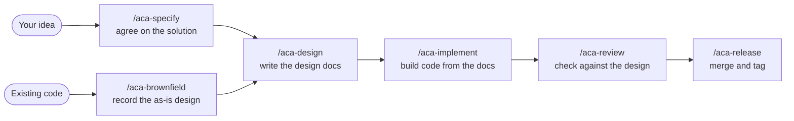

<p align="center">
  <picture>
    <source media="(prefers-color-scheme: dark)" srcset="assets/logo-dark.png">
    
  </picture>
</p>

<p align="center">
  The design language for AI-built software<br>
  <em>Vibe coding, without the leaks</em>
</p>

<p align="center"><strong>English</strong> · <a href="README.zh-CN.md">简体中文</a></p>

<p align="center"> </p>

---

## What Problem It Solves

With vibe coding, AI writes code fast, but the design leaks away
Decisions live in chat history and disappear when the session ends
The code grows without a plan that anyone can read, and every new session starts by guessing

Anyone Can Architect makes the design the source of truth
Your AI assistant first agrees on the solution with you, then writes it into readable design docs, then builds the code from those docs
Every later change starts from the docs, so the design and the code stay in step
The docs follow the [design rules](doc-design/README.md) for each project type, so every project records its design the same way



---

## Design Is Source Code

> *Instead of imagining that our main task is to instruct a computer what to do, let us concentrate rather on explaining to human beings what we want a computer to do.*
>
> — Donald Knuth, *Literate Programming*, 1984

In the AI era, source code does not have to be natural language: it can be a language built for design
It is freer and easier to interpret, so anyone can quickly understand what a project is and how it works

---

## Quick Start

```bash
npx anyone-can-architect install
```

The installer sets up every AI tool it finds and needs Node.js 18+, plus Git for Windows on Windows
The skills install in English by default; for Chinese, add `--lang zh`
To update later, run `/aca-update`

Then, in your project:

1. `/aca-init` sets the project type
2. `/aca-specify <your idea>` agrees on the solution
3. `/aca-design` writes the design docs

Not sure which skill to use? Type `/aca` and describe what you want
In Codex, type `$` instead of `/`, for example `$aca`

---

## Skills

| Skill | What it does |
| --- | --- |
| `/aca` | Picks the right skill for what you describe |
| `/aca-init` | Sets the project type and the basic project records |
| `/aca-specify` | Works through a new requirement or an improvement and confirms the solution |
| `/aca-brownfield` | Records the as-is design of existing code |
| `/aca-design` | Writes the design docs from the confirmed solution |
| `/aca-walkthrough` | Walks you through the design docs in plain language and fixes issues on the spot |
| `/aca-implement` | Builds the code and tests from the design docs |
| `/aca-review` | Reviews the design docs or the code in the current scope |
| `/aca-repo-audit` | Checks the whole repo for broken links, contradictions and drift between docs and code |
| `/aca-release` | Merges the verified version into main and tags it |
| `/aca-feedback` | Files a GitHub issue when a rule does not fit your project |
| `/aca-update` | Updates the installed skills to the newest version |

---

## Contributing

Clone the repo, then install your working copy with `node cli/index.js install`
Run `bash tests/run-tests.sh` before opening a pull request

---

## License

[MIT](LICENSE)

---

> 📦 **Anyone Can Architect v0.1.0**
> 🤝 Powered by [Anyone Can Architect](https://github.com/ruozi/anyone-can-architect) v0.1.0 · Repo-Type: `guideline`
