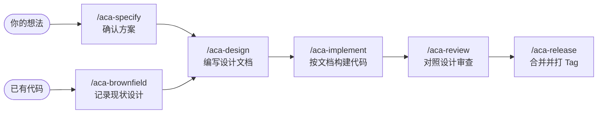

<p align="center">
  <picture>
    <source media="(prefers-color-scheme: dark)" srcset="assets/logo-dark.png">
    
  </picture>
</p>

<p align="center">
  <strong>人人都可以当架构师</strong><br>
  AI 构建软件的设计语言
</p>

<p align="center"><a href="README.md">English</a> · <strong>简体中文</strong></p>

<p align="center"> </p>

---

## 解决什么问题

Vibe coding 让 AI 写代码很快，设计却在流失
决定散落在聊天记录里，会话一结束就消失
代码在没有可读设计的情况下不断生长，每次新会话都从猜测开始

Anyone Can Architect 让设计成为唯一的事实来源
AI 助手先和你确认方案，再写成可读的设计文档，最后按文档构建代码
之后的每次改动都从文档出发，设计与代码始终保持一致
文档遵循各工程类型的[设计规则](zh-CN/doc-design/README.md)，每个项目都以同样的方式记录设计



---

## 设计即源码

> 与其把主要任务想成指挥计算机做什么，不如专注于向人类解释我们希望计算机做什么
>
> *Instead of imagining that our main task is to instruct a computer what to do, let us concentrate rather on explaining to human beings what we want a computer to do.*
>
> —— Donald Knuth, *Literate Programming*, 1984

AI 时代的源码不一定是自然语言，而是一门专为设计而生的语言
它的自由度更高、可解释性更强，让人快速看懂一个项目是怎么回事

---

## 快速开始

```bash
npx anyone-can-architect install --lang zh
```

安装程序为找到的每个 AI 工具安装技能，需要 Node.js 18+，Windows 上还需要 Git for Windows
之后更新运行 `/aca-update`

然后在你的项目中：

1. `/aca-init` 确定工程类型
2. `/aca-specify <你的想法>` 确认方案
3. `/aca-design` 编写设计文档

不确定用哪个技能时，输入 `/aca` 并描述你想做的事
在 Codex 中用 `$` 代替 `/`，例如 `$aca`

---

## 技能

| 技能 | 作用 |
| --- | --- |
| `/aca` | 根据你的描述选择合适的技能 |
| `/aca-init` | 确定工程类型与基础项目记录 |
| `/aca-specify` | 论证新需求或优化方案，确认方案 |
| `/aca-brownfield` | 记录已有代码的现状设计 |
| `/aca-design` | 根据已确认的方案编写设计文档 |
| `/aca-walkthrough` | 用业务语言带你走读设计文档，当场修正问题 |
| `/aca-implement` | 按设计文档构建代码与测试 |
| `/aca-review` | 审查当前范围的设计文档或代码 |
| `/aca-repo-audit` | 检查全仓的断链、矛盾及文档与代码的偏移 |
| `/aca-release` | 将已验证的版本合入 main 并打 Tag |
| `/aca-feedback` | 规则不适合你的项目时，提交 GitHub Issue |
| `/aca-update` | 将已安装的技能更新到最新版本 |

---

## 参与贡献

克隆仓库后，用 `node cli/index.js install` 安装你的工作副本
提交 Pull Request 前运行 `bash tests/run-tests.sh`

---

## License

[MIT](LICENSE)
