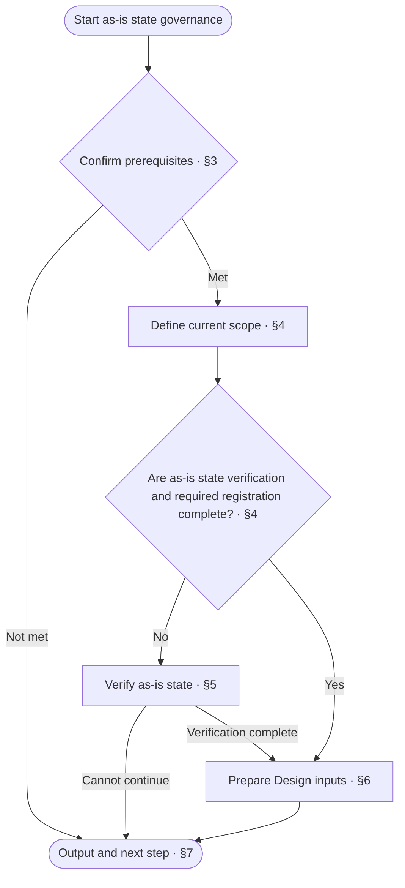
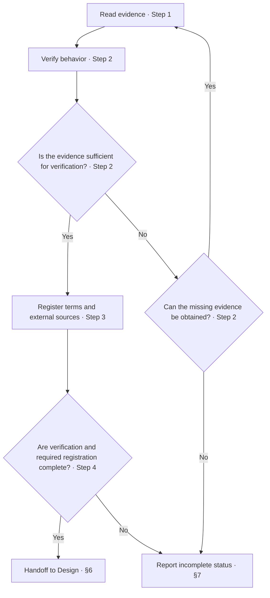

<!-- AUTO-GENERATED from SKILL.md.tmpl — do not edit directly -->
<!-- Regenerate: bash scripts/build-skills.sh --host antigravity-cli -->

# aca-brownfield

Verify the as-is state of the current scope, then hand off to `/aca-design` to write or revise docs
New requirements and improvement solutions belong to `/aca-specify`

## 1 Principles

1. **Factual evidence**
   Describe current behavior using verifiable implementation and runtime evidence
2. **Complete evidence**
   Match verification conclusions to evidence and leave unverifiable content unconfirmed
3. **Scope constraints**
   Use the confirmed governance scope to determine what to verify and the boundaries of the work
4. **Responsibility boundaries**
   As-is state verification describes current behavior, while Specify reasons through new requirements and improvement solutions
   Design writes design docs, while Implement modifies code and tests

## 2 Workflow



## 3 Confirm Prerequisites

1. Run `bash ~/.gemini/antigravity-cli/skills/aca/bin/aca-repo-type-check` to obtain the repo type
   - Continue if the output is a valid type name
   - For `NEEDS_INIT` / `INVALID_TYPE`, run `/aca-init` and check again
   - For `PENDING`, state that the type is not yet supported and report incomplete status under §7
   - If the output is unexpected or the check cannot run, record the reason and report incomplete status under §7
2. Read `~/.gemini/antigravity-cli/skills/aca/doc-design/repo-types/{repo-type}.md`
   If the file is missing or cannot be read, record the rule location and reason, recommend repairing the installation, and report incomplete status under §7
   If the rules have been read but specify no governance order, explain that Brownfield does not apply to this type, report under §7, and stop

## 4 Define Scope

1. Compare the existing implementation and docs against the repo-type spec and document sets
   If the developer has specified a target, start with that scope and the necessary related content
   - List the docs to create or revise
   - List the old docs whose placement needs adjustment and how to retain, merge, split, or delete them
   Use the methods for retaining, merging, splitting, or deleting docs as the handling plan handed off to Design
   Brownfield verifies and records the evidence and does not reorganize docs in this step
   Reuse existing confirmation if the scope is confirmed and unchanged
   Confirm additions or changes to the scope with the developer
2. Reuse the repo version and the branch for this governance round specified in the root README
   If a new branch is needed, create it according to the repo's branch conventions
   - Use `feature/docs-align-v{X.Y.Z}` if no naming convention is specified
   - Create it from the specified integration branch, or from the default branch if none is specified
3. Record the governance scope and progress in the current status in `ROADMAP.md`
   Preserve existing version goals
4. Determine the order of work
   Prioritize the overall project-level design
   Then proceed according to module dependencies, handling dependencies first
   If there are no module divisions, treat the entire project as one scope
5. Define the current scope and check as-is state verification progress
   Reuse existing verification results if the current scope, related implementation, configuration, operating conditions, and verification requirements are unchanged
   If changes exist, reverify only the affected parts
   Proceed directly to §6 if the current scope's behavior is verified, the evidence can be located, and required registration is complete
   Proceed to §5 if verification is not yet complete

## 5 As-Is State Verification



1. Read evidence
   Read the code, configuration, resources, runtime materials, and related project-level records for the current scope
   Use existing docs as leads for verification
   Reuse materials already read that have not changed
2. Verify behavior
   Verify current behavior by responsibility and record applicable conditions and corresponding evidence locations
   If evidence is insufficient, check additional related materials and reverify the affected content
   If verification is still not possible, ask the developer to provide additional evidence
   If evidence cannot be obtained, record the gaps and report incomplete status under §7
   If implementation issues are found, record the issues and established expected behavior in the future goals in `ROADMAP.md`
   For improvement approaches that are not yet decided, record only the issues and hand them off to Specify for reasoning
3. Register terms and external sources
   Select terms according to the [context doc design](~/.gemini/antigravity-cli/skills/aca/doc-design/documents/context.md) and reuse existing entries
   Register ambiguous terms after the developer confirms them
   Verify and register adopted external sources according to the [ssot doc design](~/.gemini/antigravity-cli/skills/aca/doc-design/documents/ssot.md)
   If evidence exists and `SSOT.md` is missing, create it from the corresponding template
4. Determine whether the work is complete
   Proceed to §6 if the current scope's behavior is verified, the evidence can be located, and required registration is complete
   If any content remains unverifiable or required registration is incomplete, report incomplete status under §7

## 6 Handoff to Design

1. Update governance progress
   Update governance progress in the current status in `ROADMAP.md`
   If new facts affect completed scopes, mark those scopes as pending verification
   Record the affected scopes, impacts, and content to verify, and do not reuse old verification results for the affected parts
2. Prepare writing inputs
   Prepare inputs according to [aca-design §3](~/.gemini/antigravity-cli/skills/aca-design/SKILL.md#3-writing-inputs)
   Provide this round's version and branch, this round's scope, the order of work, the current scope, and completion progress
   Provide verified behavior, evidence locations, and related docs
   Provide the doc list confirmed in Chapter 4, the handling plan for old docs, and its supporting evidence
3. Check handoff conditions
   Once verification of the current scope is complete and all required inputs are available, report the results under §7, with `/aca-design` as the next step
   If gaps remain, return to the corresponding steps to fill them
   If the gaps cannot be filled, report incomplete status under §7

## 7 Output

1. Determine the status of the current scope
   Report the current scope as complete if its behavior is verified, the evidence can be located, required registration is complete, and all Design inputs are available
   Report incomplete status if verification or inputs still have gaps
   Completion of the current scope does not mean all scopes in this round are complete
   Record verified implementation defects as part of the as-is state and reason through improvements separately, without requiring code fixes in Brownfield
2. Report actual results
   Fill in the heading and results using the following format
   Clearly state the current scope, unverified items, and the actual point from which to resume
   If the version or branch is not yet determined, state this accurately

   ```markdown
   # 🧭 Brownfield: <scope complete / incomplete>

   | Item | Result |
   | --- | --- |
   | Version and branch | <version and branch for this round / undetermined items and reasons> |
   | Scope | <governance scope for this round, current scope, and completion progress> |
   | As-is state | <verified behavior and evidence locations / unverified items> |
   | Implementation issues | <issues and follow-up record locations / none> |
   | Commits | <commit records / not committed> |
   | To-do | <incomplete items, reasons, and points from which to resume / none> |
   | Next step | <target skill and scope / fill the corresponding gaps / none> |
   ```

3. Determine the next step
   If the conditions are met, the next step is `/aca-design`
   If the conditions are not met, fill the corresponding gaps and do not use unverified content as the basis for Design writing
