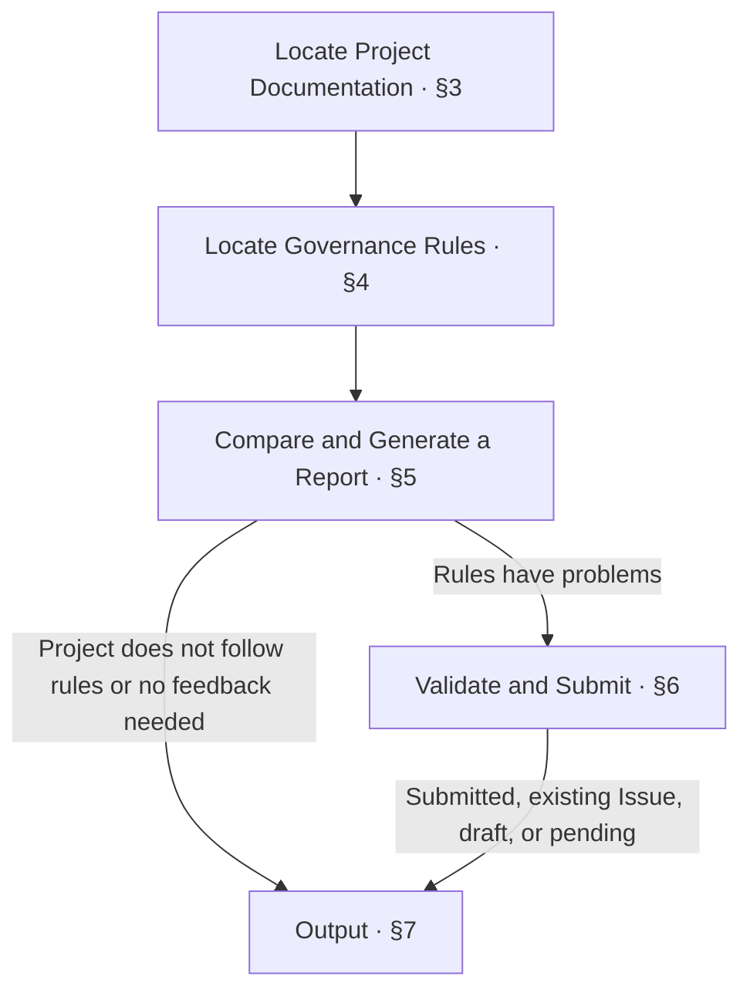

<!-- AUTO-GENERATED from SKILL.md.tmpl — do not edit directly -->
<!-- Regenerate: bash scripts/build-skills.sh --host antigravity-cli -->

# aca-feedback

Compare project practice with Anyone Can Architect governance rules and document specific deviations
Validate the report and submit an Issue when the developer explicitly requests feedback
Do not modify project docs or code

## 1 Principles

1. **Practice-Based Evidence**
   Use specific project practice to determine whether governance rules apply
2. **Clear Attribution**
   Distinguish problems in the rules from failures to follow the rules in the project
3. **Consistent Evidence**
   Ensure the current rules, project practice, impact, and recommendations address the same deviation
4. **Responsibility Boundaries**
   Feedback addresses governance rule problems, while the corresponding workflows handle project corrections

## 2 Workflow



If you cannot continue in chapters 3 through 5, report the verified facts, missing information, and next step as specified in [Output](#7-output)

## 3 Locate Project Documentation

1. Locate the feedback subject
   Read the files directly if the developer has provided their locations
   Otherwise, follow relevant references from the root README to locate the feedback subject
2. Verify the repo type and terminology
   Run `bash ~/.gemini/antigravity-cli/skills/aca/bin/aca-repo-type-check` to check the repo type
   Read the terminology definitions relevant to the feedback in `CONTEXT.md`
   If you cannot obtain a valid repo type or Context is missing, record the reason and continue verifying project facts that you can confirm
3. Record project practice
   Identify the files, chapters, or fields addressed by the feedback and how they are handled in practice
   If content is missing, record its absence
4. Complete the necessary background
   Read information that you can confirm in the project yourself
   Ask only about background or decisions that you cannot confirm and that affect the assessment

## 4 Locate Governance Rules

1. Locate the rule entry point
   If the type is valid, locate the corresponding doc design from `~/.gemini/antigravity-cli/skills/aca/doc-design/repo-types/<repo-type>.md`
   If the type is unavailable, locate the type definition or relevant governance rules based on the feedback subject
2. Read related rules
   Follow references to read the patterns, references, and skills relevant to this feedback
3. Verify rule coverage and placement
   If no corresponding rule is found, check whether existing rules cover the content
   If they still do not cover it, record the gap and its recommended location
   If project docs are missing, determine where they belong based on the relevant rules
4. Record the rule evidence
   Record the rule file, specific chapter or field, and original wording or precise meaning
   If multiple provisions apply, record each separately for comparison and assessment in chapter 5

## 5 Compare and Generate a Report

1. Compare and assess
   Use the project facts from chapter 3 and rule evidence from chapter 4 to determine the action according to the table below

   | Situation | Action |
   | --- | --- |
   | Rules are clear, but the project does not follow them | Identify where the project needs changes, do not generate rule feedback, and report as specified in chapter 7 |
   | Rules are missing, ambiguous, conflicting, or impossible to execute | Continue organizing the feedback and generate a report |
   | No rule problems found | Report that no feedback is needed as specified in chapter 7 |
   | Insufficient evidence to assess | Record missing information and report the pending status as specified in chapter 7 |

2. Organize the feedback
   Address the same deviation in all four items below

   | Content | Requirement |
   | --- | --- |
   | Current rules | File locations and specific provisions, or the recommended location if missing |
   | Project practice | Project file locations and actual handling, or a statement of absence if content is missing |
   | Impact | Specific impact caused by the rule problem |
   | Recommendation | Specify the rule content before and after the proposed change, or explain the basis for retaining a project exception or waiting for more cases |

3. Fill in the report
   `target_outline`, `target_chapter`, current rules, and project practice must contain specific information
   If required content cannot be confirmed, report the pending status as specified in chapter 7
   Use `unknown` for supporting information such as `repo_type` and `aca_version` only when it truly cannot be obtained
   Fill in the report using the following template

```markdown
---
source: aca-feedback
created_at: <UTC ISO 8601>
repo: <git remote org/name; directory name if no remote>
repo_type: <Repo-Type from README footer; unknown if absent>
project_branch: <current branch>
commit: <current commit>
target_outline: <corresponding doc design / pattern / skill>
target_chapter: <specific chapter, paragraph, or field>
aca_version: <current version; unknown if unavailable>
---
# <Summarize This Deviation in One Sentence>

## Situation Background

<What the project does and why the current scenario requires this approach; include only the background needed to judge whether it can be generalized>

## Actual Deviation

- Current rules: <What the corresponding doc design / pattern / skill currently requires>
- Project practice: <How the project docs actually handle it>
- Resulting problems: <What specific problems the inconsistency causes>

## Recommended Actions

<Recommend changing the rules with a clear before → after, keeping this as a project-specific exception, or waiting for more cases; explain the basis for the judgment>
```

## 6 Validate and Submit

### 6.1 Validate the Report

1. Check that all template placeholders have been replaced
2. Check that the current rules and project practice have specific evidence
3. Check that existing content includes file locations and specific details
   For missing content, state its absence and recommended location
4. Check that the title, field context, actual deviation, and recommended action address the same deviation
5. Check that the report has been organized and does not directly copy raw conversations
6. Check whether the report contains sensitive information such as credentials, internal network addresses, or customer data
   Sanitize it if necessary, then validate it again

If key disagreements about the recommended action affect the submission content, confirm the decision with the developer before completing report validation
If validation fails, correct the report first
If the report cannot be completed or sanitized, retain it and report the pending status as specified in chapter 7
Proceed to the next section after validation passes

### 6.2 Confirm Authorization and Prepare Submission

1. Verify submission authorization
   The developer invoking `/aca-feedback` or explicitly requesting an Issue authorizes submission of this feedback
   Use existing authorization directly without asking for confirmation again
   If the developer explicitly requests to review a draft first, display the report, report the draft status as specified in chapter 7, and wait for submission instructions
   Without submission authorization, report findings only and do not upload
2. Determine the target repository
   Submit to Anyone Can Architect by default
   If the developer specifies another repository, enter `target_repo: owner/repo` in the report frontmatter
3. Save this report
   Save the report to `~/.aca/outbox/field-reports/<created_at-with-underscores>_<repo>.md`
   Record the absolute path of this report
4. Check submission credentials
   Submission uses existing GitHub credentials and requires Issues write permission
   Look for credentials in this order: `GITHUB_TOKEN`, `GH_TOKEN`, `.env`, `gh auth token`, and the git credential helper
   If credentials are missing, retain the report, ask the developer to configure them locally, and report the pending status as specified in chapter 7
   Do not request a Token in the conversation or echo credentials

Proceed to the next section after completing preparation in this section

### 6.3 Submit and Verify Results

1. Submit this report
   After validation in 6.1 passes and preparation in 6.2 is complete, call the submission script directly
   Replace the following placeholder with the absolute path of this report and submit only this report

   ```bash
   bash ~/.gemini/antigravity-cli/skills/aca/bin/aca-feedback-submit "<absolute path of this report>"
   ```

2. Verify the submission result
   Determine whether the status is submitted, existing Issue, or pending based on the upload, duplicate check, or pending result for this report
   Do not determine success solely from the script exit code
   Obtain the number and link from actual results or queries, and state honestly if they are unavailable without guessing
3. Handle subsequent status
   The script removes the local report after a successful upload or a duplicate match
   If submission is confirmed successful but the link is unavailable, do not submit again
   If submission fails, retain the report and explain the reason without automatically retrying
   Report the actual status and next step as specified in chapter 7

## 7 Output

1. Determine the current status
   Submitted and existing Issue statuses require actual evidence
   Use draft when waiting for draft confirmation
   Use pending when evidence, credentials, or submission is blocked
   Use no feedback needed when there are no rule problems
2. Report the result and next step
   If the project does not follow the rules, identify where changes are needed and the corresponding workflow
   If feedback is blocked, state the conditions needed to proceed or the action needed to resume
   If nothing remains, enter none for the next step
   Fill in the title and results using the following format

```markdown
# 💬 Feedback: <submitted / existing Issue / draft / pending / no feedback needed>

| Item | Result |
| --- | --- |
| Deviation | <title and one-sentence deviation / no rule problems found> |
| Rule location | <corresponding rule file and chapter> |
| Target repository | <target repository for this feedback / not applicable> |
| Issue | <verified number and link / submitted but link unavailable / existing Issue but link unavailable / not submitted> |
| Local report | <pending report location / cleaned up / not generated> |
| To-do | <incomplete items and reasons / none> |
| Next step | <one immediately executable action / none> |
```
