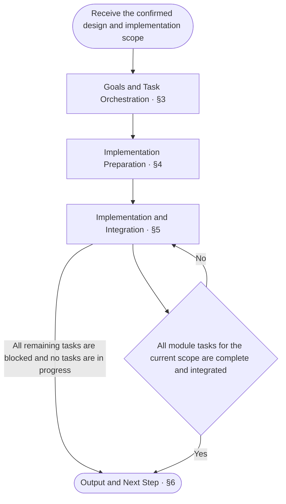

<!-- AUTO-GENERATED from SKILL.md.tmpl — do not edit directly -->
<!-- Regenerate: bash scripts/build-skills.sh --host antigravity-cli -->

# aca-implement

Write production code and test code according to the design docs for the current scope
Change only code and tests, without modifying design docs or running tests

## 1 Principles

1. **Goal-driven**
   Use confirmed delivery goals to determine the implementation scope and task priorities
   Judge implementation completion by coverage of the design requirements
2. **Dependency-driven parallelism**
   Use dependencies to determine the implementation order
   Advance tasks in parallel wherever possible when their dependencies are satisfied and they have no file conflicts
3. **Code and tests in sync**
   Write production code along with black-box and white-box test code in sync based on external contracts, internal design, and test design
4. **Write only, no test execution**
   Write or modify code and tests only during implementation, and hand off test execution to `/aca-test`

## 2 Workflow



## 3 Goals and Task Orchestration

Read the design docs, project configuration, existing code, and tests for the current scope
Check the workspace state and recent commits to verify current implementation progress and existing changes
Preserve existing changes outside the scope of this implementation

1. **Specify deliverables and completion criteria**
   - List deliverables and their completion criteria based on the confirmed design and implementation scope
2. **Compile the code and test change list**
   - Compare delivery requirements with existing code and tests, and list what to reuse, modify, add, or remove
3. **Orchestrate the corresponding test scope**
   - List the test cases and fixtures to write or update in this run based on the black-box and white-box test designs
   - Record the units under test and test case scope corresponding to the current implementation scope for direct execution by `/aca-test`
4. **Identify modules and dependencies**
   - List the modules involved in this implementation and their dependencies based on the design
   - Modules include submodules at all levels: top-level modules come from architecture, and submodules come from the internal composition of their direct parent's class-design
5. **Plan the source code and test file structure**
   - Plan the source code and test file structure based on module boundaries, internal design, and repository conventions
   - List all source code and test directories and files within the current implementation scope
6. **Check file responsibilities and boundaries**
   - Specify each file's responsibilities, owning module, and dependencies
   - Check whether each file has a single responsibility and whether responsibilities overlap
   - Responsibilities are not singular or overlap: adjust file boundaries
7. **Split module implementation and integration tasks**
   - Split implementation preparation, module implementation, and integration into tasks
   - Use modules in the design as the smallest units of implementation and commits
   - When submodules exist, create separate tasks for each submodule and the parent's composition implementation, with the parent task depending on all its submodule tasks
   - Specify each task's dependencies, owner, and completion criteria
8. **Maintain task status and progress**
   - Use the goal or task management capabilities provided by the current AI Agent environment to maintain the overall goal and task progress
   - Record each task's status: pending implementation, in progress, complete, or blocked
   - When resuming a task, check task records, the workspace, and recent commits, update task status, and continue implementation

## 4 Implementation Preparation

1. **Create directories and file placeholders**
   - Add all missing source code and test directories and file placeholders for the current scope according to the plan
   - Reuse existing files directly and create new files as empty files
   - Delete files explicitly marked for removal in the plan only after verifying that they no longer serve a valid responsibility
   - File purpose, dependencies, or deletion scope cannot be confirmed: retain the file and verify with the developer
   - Start module implementation only after all file placeholders are in place
2. **Assign separate workspaces**
   - The main agent assigns separate workspaces to sub-agents
   - Synchronize the prepared file structure to each workspace
3. **Dispatch task context to sub-agents**
   - The overall implementation goal, the functionality to complete for the current module, and the scope of changes
   - Links to relevant chapters covering the structural basis, interfaces, internal design, and test cases for the current module and its dependencies
     The structural basis for top-level modules is architecture, and the structural basis for submodules is the internal composition of the parent's class-design
   - The readiness of each dependency and the arrangements for real dependencies or test doubles in tests
   - The workspace path, starting commit, files permitted for modification, and applicable repository conventions
   - Modify only production code and test code, without modifying design docs or running tests
   - Follow the [Exception Handling](#52-exception-handling) requirements
   - Return changed files, commit records, corresponding test scope, and reasons for blockers

   When files owned by other tasks or shared files are involved, first ask the main agent to coordinate

## 5 Implementation and Integration

### 5.1 Implementation Loop

1. **Dispatch parallelizable module tasks**
   - The main agent selects module tasks whose dependencies are satisfied and assigns tasks that can run in parallel to sub-agents
2. **Write module production code and test code**
   - Reuse, write, or update black-box and white-box test code and fixtures for the module's current scope according to the design
   - Complete production code changes within the module's current scope according to the design
   - Follow repository conventions for implementation details not specified by the design, or use the simplest implementation that meets the design when the repository has no corresponding convention
   - When the design includes a Lark (Feishu) card mockup, implement it according to [Lark Card Mapping](~/.gemini/antigravity-cli/skills/aca/skills/references/lark-card-mapping.md)
   - Organize code structure as needed to keep responsibilities singular and boundaries clear
3. **Check module completion criteria and commit**
   - Check that interface contracts, internal mechanisms, and black-box and white-box test code for the module's current scope are all written according to the design
   - Stage and commit only the current task's changes
4. **Integrate module commits**
   - The main agent checks the file scope and completion status of module commits
   - Integrate the module's commits after confirming that it meets the completion criteria
5. **Update progress and advance**
   - The main agent updates task status, implemented module scope, and dependency readiness
   - Record the reasons for blocked tasks and the conditions for resuming them
   - Synchronize integrated dependency commits to downstream module workspaces
   - Tasks remain that can be implemented: return to step 1
   - No tasks can be assigned and tasks are still in progress: wait for execution results
   - All module tasks for the current scope are complete and integrated: proceed to [Output](#6-output)
   - All remaining tasks are blocked and no tasks are in progress: report the incomplete status according to [Output](#6-output)

### 5.2 Exception Handling

1. **Handle missing or conflicting designs**
   - When the design is missing, contains conflicts, or cannot be implemented, the agent executing the task pauses affected tasks
   - Sub-agents report the issue and its scope of impact to the main agent
   - The main agent verifies the issue and its scope of impact, then reports them to the developer
   - When the solution needs additions or revisions, recommend using `/aca-specify`
   - Continue unaffected independent tasks
2. **Handle cross-repository issues**
   - When issues are found in other repositories, the main agent verifies them and reports the issues and their impact to the developer
   - Do not modify other repositories without authorization

## 6 Output

When all completion criteria for the current scope are satisfied, mark the goal and task status as complete
If incomplete, report remaining work, reasons for blockers, and actions to resume
After this implementation is complete, use `/aca-review` to run an implementation review on this scope
Provide Review and subsequent `/aca-test` with the overall goal, corresponding design, implementation scope, orchestrated test scope, and comparison baseline
Identify the commits and uncommitted changes under review
Use the following format for the final report, filling in the title and results according to the actual status

```markdown
# 🛠️ Implement: <complete / incomplete>

| Item | Result |
| --- | --- |
| Goal | <overall goal and completion criteria satisfaction> |
| Scope | <implementation scope and module progress> |
| Changes | <main production code and test code changes> |
| Test scope | <units under test and test case scope orchestrated for /aca-test> |
| Commits | <commit records / uncommitted> |
| Blockers | <blockers and reasons / none> |
| Recommendations | <extension recommendations / none> |
| Next step | <one immediately actionable step> |
```
