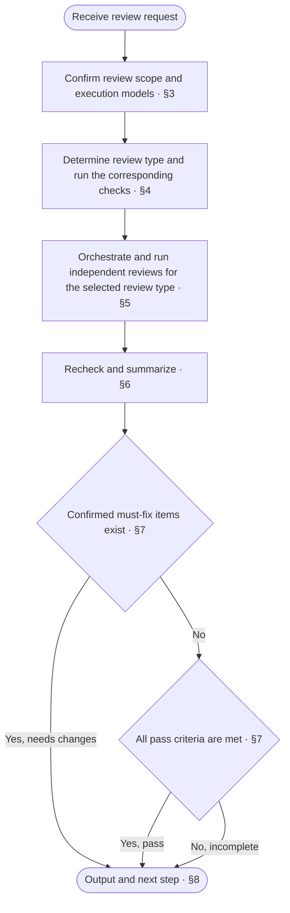
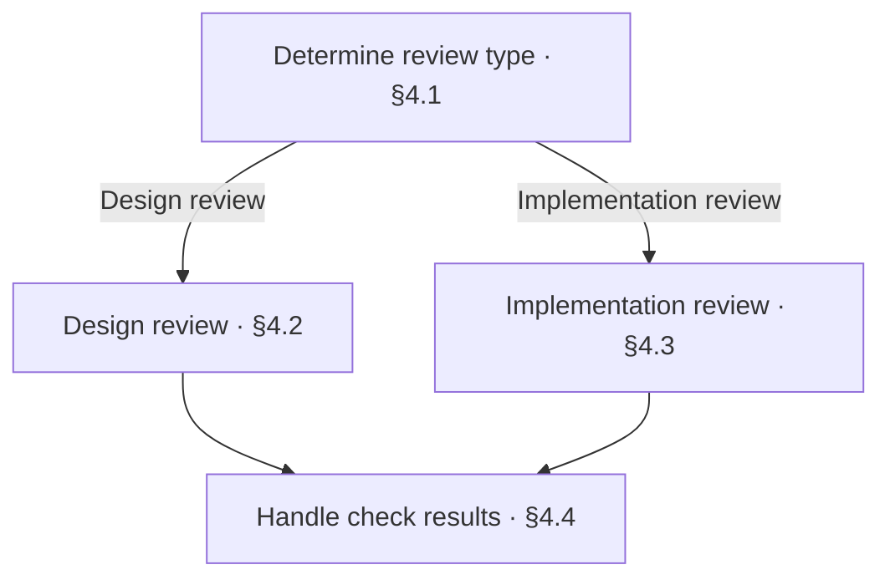

<!-- AUTO-GENERATED from SKILL.md.tmpl — do not edit directly -->
<!-- Regenerate: bash scripts/build-skills.sh --host antigravity-cli -->

# aca-review

Review the design docs or code implementation in the current scope and determine pass, needs changes, or incomplete
Do not modify design docs, project source code, or test code
Use `/aca-repo-audit` for the repository-wide audit before release

## 1 Principles

### 1.1 Review Principles

1. **Source-driven review**
   Review the design against confirmed requirements and applicable rules
   Review the implementation against the confirmed design
2. **Independent judgment**
   Form conclusions independently for each review task
3. **Evidence-based verdict**
   Determine issues and review conclusions from item-by-item verification results and evidence
4. **Scope constraints**
   Limit review conclusions to the current scope

### 1.2 Writing Axiom

The writing axiom applies to reviews of design doc prose and the wording of review reports

> Write clearly with the lowest possible effort to understand: no redundancy, no omissions, no ambiguity

**Writing Structure**

- Present the whole first, then expand on the details, see the [Pyramid Principle](~/.gemini/antigravity-cli/skills/aca/SSOT.md#2-structure)
- When stating a judgment, give the conclusion first, then the supporting evidence
- Merge heading levels that add no information
- Use numbered lists for items with a sequence or priority, and indent multiple attributes under each item
- Use tables only for content with multiple rows of the same structure, more than two attributes per row, and no sequence between rows
- Write list items as complete sentences
- When an item has branches, indent the branches under that item
- Write each branch on its own line as “condition: action”
- Put conditions that must be known before execution before the action
- When a condition controls multiple steps, list the steps under that condition

**Presentation and Typography**

- Describe only the currently valid design in the design body
- When revising the design body, remove incorrect or obsolete descriptions
- Do not explain differences from earlier versions, the change process, or reasons for changes in the design body
- Describe problems, processes, and decisions in business language, and use technical language only for supporting explanations
- Define each rule in only one place, and reference it elsewhere
- Make rules and references directly locatable so readers can clearly find where to make changes
- Remove content that adds no information and does not help understanding
- Write one sentence per line, with only one fact per sentence
- State actions directly in operational steps
- Write sequential actions as separate items
- Make the actor, the object of the action, and the referents clear
- Do not repeat actors, objects of actions, or referents already clear from context
- Do not put periods at the ends of lines
- Do not leave blank lines between lines on the same topic, and leave one blank line when changing topics
- Write fragments in table cells, not sentences, and omit periods
- Write multiple facts in a cell on separate lines, without joining them with semicolons
- Reply in the language the user uses
- Follow [English typography rules](~/.gemini/antigravity-cli/skills/aca/SSOT.md#1-writing-rules), with sentence case in body text and Title Case only in headings
- Follow [ISO 2145](~/.gemini/antigravity-cli/skills/aca/SSOT.md#1-writing-rules) for chapter and section numbering
- Use `§` only for cross-references in body text, never in headings
- When referencing a specific chapter or section in body text, use a Markdown link directly to its anchor
  For references within the same doc, use a local chapter or section anchor, such as `[§1.2](#12-section-title)`
  For references across docs, use the target file’s relative path and chapter or section anchor, such as `[Target doc §1.2](other.md#12-section-title)`
  Link text can use the chapter or section name, or `§` followed by its number
  When chapter or section titles or order change, update affected references and verify their targets
  When an algorithm or command in a code block needs to reference a chapter or section, put the link in the body text before or after the code block
- When referencing an entire doc, link to the target file

Reference: [ASD-STE100](~/.gemini/antigravity-cli/skills/aca/SSOT.md#1-writing-rules)
## 2 Workflow



## 3 Review Preparation

### 3.1 Subject, Scope, and Prerequisites

1. If the developer has specified the review subject and scope, follow that specification first
   Otherwise, use the review subject and scope already specified by the caller
2. If the subject or scope is unclear, determine it from current workspace changes and recent relevant commits
   Read the descriptions and diffs of recent relevant commits to understand the intent and content of the changes
3. If the review subject or scope is still unclear, ask the developer to specify it
4. Record the review subject, scope, and comparison baseline
   Specify the commits under review and any uncommitted changes included in the review
5. Run `bash ~/.gemini/antigravity-cli/skills/aca/bin/aca-repo-type-check` to check the repo type
   If the repo type is missing or invalid, mark the repo-type spec check as incomplete and recommend running `/aca-init`
   If the repo type is not yet supported, mark the repo-type spec check as incomplete and note that the corresponding rules are missing
6. If the input does not include the design doc location, locate it through the documentation entry in the root README
   If the review source material or files under review cannot be located, ask the developer to provide their locations
   Until the locations are clear, mark checks that depend on this content as incomplete

7. Read the general review source material
   Read the confirmed problems, goals, and change scope for this review
   If the repo type is valid and supported, read the corresponding Repo Type rules
   Read `CONTEXT.md` and check the business concepts and definitions involved in this review
   Read the design docs for the current scope and follow references to read any additional docs needed for understanding and verification

### 3.2 Agent and Model Selection

1. Scan the current AI Agent environment and other AI Agent environments already available on this machine
   Record the Agent tool types and actual model identifiers in each environment and compare them with the main agent
   Use existing tool entry points, configuration, and model lists to verify invocation methods and availability
   Installation or configuration alone does not prove that an environment can be invoked
   Mark information that cannot be verified as unknown
2. Propose execution combinations based on the scan results
   Prefer callable flagship models and assess flagship status using information that can currently be verified
   Prefer combinations whose Agent environment and model both differ from those of the main agent
   Do not prescribe a brand, model, or order of attempts
   If no other suitable and callable candidate is available, propose using the current model
3. Show each candidate's Agent, model, availability, invocation method, and differences from the main agent
   Explain the recommendation and available alternative combinations, and ask the developer to confirm
   Run the review only after the developer confirms
   Reuse the existing confirmation if the confirmed selection and availability conditions have not changed
4. Use the confirmed execution combinations for [task orchestration](#53-model-and-task-orchestration)
   If the selected combination cannot be invoked, use a confirmed alternative
   If no alternative has been confirmed, report the change and ask the developer to confirm a new combination
   Record the actual selection, fallback, and reasons in the report

## 4 Read Source Material and Run Checks



### 4.1 Determine Review Type

1. If the developer has specified the review type, follow that specification first
   Otherwise, use the review type already specified by the caller
2. If the review type is unclear, determine it from the subject under review and the actual changes
   - Design docs: run a design review
   - Code, tests, or runtime configuration: run an implementation review
   - Both design and implementation: run both review types separately
3. If the review type is still unclear, ask the developer to specify it

Run both check branches when both review types are selected

### 4.2 Design Review

1. Read the document set, Doc Design, and Patterns actually used for the current scope
   Extract their applicable checklist items as the basis for item-by-item verification
2. Determine target paths for mechanical checks based on the current review scope
   Prose checks cover all docs under review, including project-level records within the review scope
   For the doc graph check, select a doc tree that includes the docs under review and has a README entry
   Mechanical checks for Context verify structure and formatting, while content is verified against the corresponding Doc Design checklist
3. Run or reuse mechanical checks
   Existing mechanical check results from this session can be reused if they cover the same scope and the relevant files, check rules, and tools have not changed
   When reusing results, state the original check results and the reuse conditions met in this review in the report
   If the reuse conditions are not met, replace the placeholder paths in the following commands with the actual paths determined in step 2 and run them

   ```bash
   bash ~/.gemini/antigravity-cli/skills/aca/bin/aca-doc-graph-check <doc directory>
   bash ~/.gemini/antigravity-cli/skills/aca/bin/aca-context-check CONTEXT.md
   bash ~/.gemini/antigravity-cli/skills/aca/bin/aca-prose-check <paths to all docs under review>
   ```

### 4.3 Implementation Review

1. Read the confirmed design, test design, and repository implementation conventions for the current scope
2. Read the current diff and changed files against the established comparison baseline
   Read affected callers and dependency code
   Read the functions, classes, and related call chains containing the changes to understand their execution context
3. Map the implementation and tests to the design conventions and test scenarios respectively
4. Based on the impact scope of the current changes, run or reuse the tests, builds, and static checks required by the design and repository conventions
   Verify behavior that the design requires checking through actual execution by running the corresponding test cases
   Existing verification results can be reused if they cover the same content under review and the test cases, fixtures, configuration, and dependency environment have not changed
   When reusing results, state the original verification results and the reuse conditions met in this review in the report
   Run the corresponding checks if verification evidence is insufficient or reuse conditions are not met
   Use an isolated verification environment as specified by the test design
   Do not modify commit history during verification

### 4.4 Handle Check Results

Handle tool checks for both review types as specified in this section

| Check status | Action |
| --- | --- |
| Pass | Record the results and verification evidence |
| Failure returned | Check the diagnostics and list confirmed issues as must fix |
| Cannot run or diagnostics cannot be verified | Mark the corresponding check or issue verification as incomplete and state the reason |

## 5 Review Orchestration and Execution

### 5.1 Design Review Dimensions

1. **Product perspective**
   Check whether the design fully addresses the confirmed problems, goals, and scope
2. **Design perspective**
   Check whether the division of responsibilities and boundaries matches the division of business work
   Check whether the collaboration and processing mechanisms can achieve the confirmed business goals
   If user interaction is involved, check whether users can achieve their goals by following the designed workflow
   Check whether each interaction state and each success and failure path provides clear feedback and action guidance
3. **Implementation perspective**
   Check whether module dependencies and interface conventions are sufficient to guide module collaboration
   Check whether data, state changes, error handling, and boundary behavior are sufficient to guide detailed implementation
   Check whether the test design specifies fixtures, scenarios, execution methods, and expected results
   Check whether test results can determine if the corresponding acceptance criteria are met
   Check whether the design contains ambiguities that would lead to different business behavior
   Check whether additional design decisions are still needed before implementation
4. **Overall perspective**
   Check whether the documentation entry and references accurately locate the current design and its dependencies
   Check related docs for design omissions, conflicting conventions, duplicate definitions, or inconsistent terminology

### 5.2 Implementation Review Dimensions

Check the following items individually against the confirmed design docs

1. **Structural setup**
   Check whether the division of modules and files, responsibility assignments, interface definitions, and dependencies conform to the design
2. **Detailed logic implementation**
   Check whether inputs, outputs, and processing flows conform to the design
   Check whether data and state changes, error handling, and boundary behavior conform to the design
   Check whether fixtures, scenarios, and expected results in black-box and white-box tests conform to the corresponding test design
   Check whether test assertions can detect deviations between actual behavior and expected results
3. **Overall structural implementation**
   Check whether module assembly, call chains, and collaboration methods conform to the overall architecture design
   Check whether integrated behavior conforms to the cross-module flows and acceptance criteria in the design

### 5.3 Model and Task Orchestration

1. Create independent review tasks for the selected review type
   For design reviews, assign an independent sub-agent to each perspective
   For implementation reviews, assign independent sub-agents to structural setup, detailed logic implementation, and overall structural implementation
   Each sub-agent forms conclusions independently without reading other sub-agents' review results beforehand
2. Arrange execution using the combinations confirmed in [Agent and Model Selection](#32-agent-and-model-selection)
   Keep review tasks independent even when using the current model
3. Provide task context to each sub-agent
   - Assigned review items and applicable checklist items
   - Review subject, scope, and comparison baseline, including commits under review and uncommitted changes included in the review
   - Locations of the content under review and the corresponding design source material
   - Existing check results and evidence from chapter 4, with the basis for execution or reuse
   - The diff, changed files, affected callers and dependency code, and repository implementation conventions needed for the implementation review

### 5.4 Run the Review

1. Each sub-agent verifies its assigned checklist items individually
   If a checklist item does not apply to the current scope, record it as not applicable and state the basis
2. For each check, record the verification result, corresponding file location, and basis for judgment
3. For each issue, record the location, problem, impact, and recommended changes using the issue format in [Review Report](#81-review-report)
4. Return the complete check records, issue list, and incomplete items to the main agent

## 6 Recheck and Summarize

1. The main agent reads each sub-agent's check records
   Check whether tool checks and verification evidence correspond to the current content under review
2. Check the files and evidence for each issue and include it in the report only after confirming it
   Exclude disproven issues
   Mark issues with insufficient evidence as incomplete verification
   The main agent can add issues it finds independently after applying the same evidence verification
   Merge duplicate issues while retaining their locations, evidence, and impact
3. Summarize the check records for all review items and check each checklist item's applicability and verification result
   If a sub-agent did not cover its assigned scope, omitted checks, or lacked verification evidence, assign the corresponding supplementary checks
   The main agent rechecks the supplementary results
   Mark review items or checks that still cannot be completed as incomplete and state the reasons
4. Summarize confirmed issues and check completion status as the basis for the verdict

## 7 Verdict

| Verdict | Criteria |
| --- | --- |
| Pass | All selected review tasks are complete, all applicable checklist items have passed verification, all applicable tool checks have passed, and there are no must-fix items |
| Needs changes | Confirmed must-fix items exist |
| Incomplete | Pass criteria are not met and there are no confirmed must-fix items |

If must-fix items and incomplete checks both exist, the verdict is needs changes, and the incomplete items must be listed
Optional improvements do not affect a pass
After the content under review changes, review the affected scope again and update the corresponding conclusions

## 8 Output and Next Step

### 8.1 Review Report

Output the review results in the current conversation using the following template without writing to project files

```markdown
# 🔎 Review: <pass / needs changes / incomplete>

| Item | Result |
| --- | --- |
| Subject | <design docs / code implementation / both> |
| Scope | <modules, files, or changes under review> |
| Baseline | <comparison baseline, commits under review, and uncommitted changes> |
| Verdict basis | <how pass criteria are met, or issues and incomplete checks preventing a pass> |
| Must fix | <issue count and main impact / none> |
| Tool checks | <pass, failure, and incomplete status of tests, builds, or mechanical checks> |
| Incomplete | <incomplete review tasks and checks within the current scope, and reasons / none> |
| Next step | <one immediately actionable step> |

## Must Fix

- <doc section link / code file link and line number>
  - Problem: <actual content, design conventions or checklist items violated, and specific deviations>
  - Impact: <impact on design understanding, implementation, or runtime behavior, and conditions under which it occurs>
  - Change: <content to correct or confirm, and conventions or checklist items to satisfy after correction>

## Optional Improvements

- <suggested improvements that do not affect a pass, corresponding locations, and expected benefits>

## Check Scope

- Read: <files actually read in this review>
- Checklist: <criteria and sources, item-by-item verification results, basis for non-applicability, and reasons for incomplete checks>
- Tools: <commands actually run and their results, or original results reused and basis for reuse>

| Review item | Agent environment | Model | Completion status | Notes |
| --- | --- | --- | --- | --- |
| <design review perspective / implementation review item> | <actual Agent environment> | <actual model and verifiable version> | <complete / incomplete> | <reason for fallback or incomplete status / none> |
```

For design reviews, list the four perspectives: product, design, implementation, and overall
For implementation reviews, list the three items: structural setup, detailed logic implementation, and overall structural implementation

### 8.2 Follow-Up Actions

Select the next step based on the review verdict and progress in the current round

| Verdict | Situation | Next step |
| --- | --- | --- |
| Incomplete | Inputs, verification environment, or verification conditions are missing | Report the conditions for resuming and continue this review through `/aca-review` once they are met |
| Needs changes | Implementation issues | Fix and verify through `/aca-implement` |
| Needs changes | The design solution still needs reasoning or decisions | Extend or revise the solution through `/aca-specify` |
| Needs changes | The solution is clear and only design docs need revision | Revise the docs through `/aca-design` |
| Pass | Only the design review has passed and implementation is needed in this round | `/aca-implement` |
| Pass | The implementation review has passed and implementation tasks remain in this round | Continue implementation through `/aca-implement` |
| Pass | All work in this round is complete and all required reviews have passed | Proceed to `/aca-release` according to the confirmed version progression plan |

After design or implementation corrections, review the affected scope again through `/aca-review`
