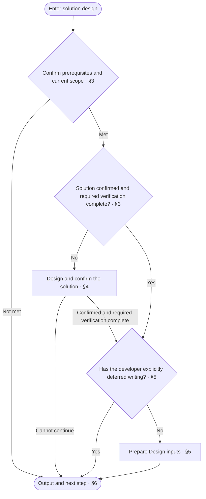
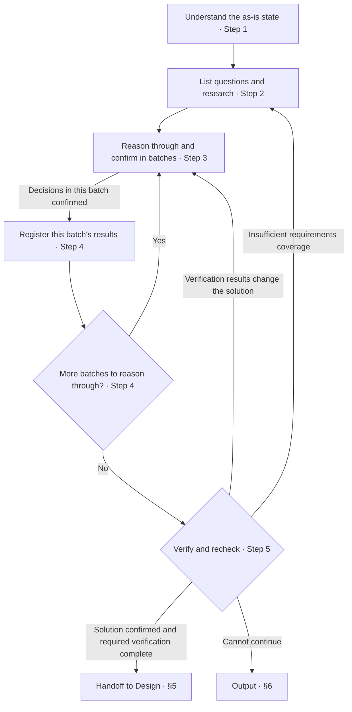

<!-- AUTO-GENERATED from SKILL.md.tmpl — do not edit directly -->
<!-- Regenerate: bash scripts/build-skills.sh --host antigravity-cli -->

# aca-specify

Reason through new requirements or optimize existing designs, then hand off to `/aca-design` to write design docs after confirming the solution
Update solution records only, without changing code

## 1 Principles

### 1.1 Completeness Axiom

Solution design follows these axioms

> **AI lowers the cost of doing the job fully — if you can do 100%, do not settle for 80%**

- Reason through and determine the best solution under the defined requirements, scenarios, and constraints
- Do not omit content or verification within the defined scope to save effort
- Do not claim incomplete work is complete

AI lowers the cost of work, making complete goals that were once too costly worth pursuing

> **Leave no loose ends in work you have decided to do**
> Explicitly mark excluded content as out of scope

**Counterexample**

- ❌ Choose a solution that omits defined requirements to reduce code volume → Content within the defined scope must be fully covered
- ❌ Omit boundary and error handling to save effort → Boundary cases and error paths within the defined scope must be completed
- ❌ Claim completion before verification is complete → Verification within the defined scope must be completed before claiming completion

Reference: [Garry Tan, *Boil the Ocean*](~/.gemini/antigravity-cli/skills/aca/SSOT.md#5-philosophy)

### 1.2 Design Method

Form an approach from the overall requirements, and use [drill-down](~/.gemini/antigravity-cli/skills/aca/skills/references/drill-down.md) to break down responsibilities, boundaries, and collaboration

When dividing modules, organize them by business capability and responsibility boundary, rather than mechanically splitting them by processing step
Identify design decisions that are difficult to settle or likely to change, place them in the module responsible for that responsibility, and expose only what collaboration requires through interfaces

Use representative business scenarios to check whether all parts can work together to complete the business activity
When responsibilities are missing or overlap, or collaboration fails, adjust the division and corresponding solutions before refining further

## 2 Workflow



## 3 Confirm Prerequisites

1. Run `bash ~/.gemini/antigravity-cli/skills/aca/bin/aca-repo-type-check` to get the repo type
   - Continue if the output is a valid type name
   - For `NEEDS_INIT` / `INVALID_TYPE`, run `/aca-init` and check again
   - For `PENDING`, report that the type is not yet supported and stop
   - If the output is abnormal or the check cannot run, record the reason, report incomplete under §6, and do not continue solution design
2. Read `~/.gemini/antigravity-cli/skills/aca/doc-design/repo-types/{repo-type}.md`
   If no governance order is specified, explain that Specify does not apply to this type, report under §6, and stop
3. Check the existing implementation and as-is docs involved in this design
   If this solution depends on existing behavior and the relevant as-is evidence is insufficient, report incomplete under §6
   The next step is `/aca-brownfield` to verify the relevant scope, then return to Specify once the as-is evidence is complete
   For a new project with no existing implementation, do not treat this absence as insufficient prerequisites
4. Determine the target version and working branch for this round
   - If the target version is already set, check whether the changes match the version
   - If the target version is not yet set or needs adjustment, propose a version under SemVer and confirm it with the developer
   - Continue using the branch that holds this round of design
   - If a new branch is needed, create it according to the repository's branch conventions
     If no naming convention is specified, use `feature/{business-short-name}-v{X.Y.Z}`
     Use an English business abbreviation that identifies this round's scope
     Create it from the specified integration branch, or from the default branch if none is specified
5. Determine the current scope and order of work
   When optimizing an existing design, confirm the scope to reassess and write in this round
   Prioritize the overall project solution
   Then proceed according to module dependencies, handling dependency modules first
   If there is no module division, handle the entire project as one scope
6. Check the solution and verification results for the current scope
   When optimizing an existing design, reassess the existing solution
   If this round's solution is confirmed and required verification is complete, proceed to §5
   Otherwise, proceed to §4

## 4 Solution Design

### 4.1 Responsibility Scope

1. Limit this round's scope
   Base the design scope on the version requirements confirmed for this round
   Record ideas and optimizations outside the scope as future goals in `ROADMAP.md`
2. Handle scope expansion
   Explain why expanding the design scope is necessary and what it affects
   Include it in this round's design after the developer confirms
3. Handle cross-repository issues
   If an issue is in a related upstream or downstream repository, do not modify that repository
   Draft an Issue describing the problem, its impact on this repository, and the expected resolution
   Submit it after the developer confirms the content and target repository
   If submission succeeds, record the Issue link in `ROADMAP.md`
   If submission fails, retain the draft, record the reason for failure, and notify the developer
   If a cross-repository issue affects the validity of the current solution, include the relevant dependencies and impacts among the open decisions or items to verify in 4.2

### 4.2 Execution Steps



1. Understand the as-is state when first entering solution design for the current scope
   - Summarize this round's requirements and issues from the developer's description and Review and Implement feedback
   - Read the corresponding requirement entries in `ROADMAP.md`
   - Follow the links in `SSOT.md` to consult the original requirements
   - Read the entries in `CONTEXT.md` relevant to this round
     Reuse registered names and definitions, and use standard meanings for common terms
     Add new terms and ambiguous definitions to the list of open decisions
   - If an as-is design exists, consult this round's relevant design docs through `docs/README.md`
     Use the verified as-is design as the basis
     If the as-is evidence is insufficient, complete it under §3 Step 3
   - Reuse material already read and unchanged in this round, and read any new or changed parts
2. List open decisions from the current scope's requirements and the design requirements of relevant docs
   When optimizing an existing design, reassess requirements coverage, responsibilities, boundaries, collaboration, and verification design against the latest rules
   List omissions and unreasonable aspects as open decisions
   Hand content with only writing issues to Design for revision
   Determine how to research and reason through each question based on its nature
   - When decomposition and scenario checks reveal new questions, add them to the list and research and reason through them under the same rules
   - For questions about general methods and platform constraints, consult official documentation, industry standards, or mature open-source implementations
     Record research conclusions and their sources
   - For business tradeoffs, reason through requirements, the as-is state, and constraints
     Conduct additional research if the factual basis is insufficient
   - If no applicable practice is found, record the sources checked
     Derive a solution from business constraints
   - List anything still unresolved as an item to verify
     Record the question to verify, verification method, and decision criteria
3. Present the full picture first, then reason through batches to confirm the solution for the current scope
   - Form and check the solution under [§1.2](#12-design-method)
   - Restate requirements in business language and present the full solution
   - List open decisions, summarizing each question in one sentence
   - Propose names and definitions for new terms and ambiguous definitions
     After confirming with the developer, register them under §4.2 Step 4
   - Reason through questions in batches according to their dependencies
     First reason through decisions that later questions depend on
     After confirming this batch's decisions, proceed to Step 4 to register them
   - If only one reasonable solution exists, explain the solution and its basis directly
   - If multiple reasonable solutions exist, compare their costs and impacts and give a recommendation
   - Cite the sources recorded in §4.2 Step 2 as the research basis
   - Present items to verify
     Confirm the verification method, decision criteria, and owner with the developer
   - Reason through disputed questions separately
     Check the factual basis and business constraints, and explain the conditions under which the solution holds
     Revise the solution when new evidence changes the assessment
     Keep decisions pending until agreement is reached
4. Register this batch's confirmed results by content type
   - Write this batch's confirmed decisions under the corresponding version goals in `ROADMAP.md`
     Organize and number them by module
     Record the conclusion in each entry and cite its supporting evidence
     For items to verify, record the question, verification method, decision criteria, and owner
     When revising an existing decision, update the original entry
     When a new decision affects a completed scope, record the affected scope and content that needs revision
   - Verify external sources adopted in this batch under the [ssot doc design](~/.gemini/antigravity-cli/skills/aca/doc-design/documents/ssot.md) and register them in `SSOT.md`
     If external sources exist but the file is missing, create it from `~/.gemini/antigravity-cli/skills/aca/templates/SSOT.md.example`
   - Handle this batch's confirmed new terms and definition revisions according to the inclusion scope and writing steps in the [context doc design](~/.gemini/antigravity-cli/skills/aca/doc-design/documents/context.md)
     Write terms that meet the inclusion criteria into `CONTEXT.md`
     When revising an existing definition, update the original entry
   - After registering this batch, return to Step 3 if more batches need to be reasoned through
     After completing all batches, proceed to Step 5
5. Determine whether the current scope is complete
   - First complete verification of items that affect the current design conclusions
     Confirm the results against the decision criteria
     If the results change the solution, return to §4.2 Step 3 to reason through it again
   - Register the remaining items to verify under §4.2 Step 4, then continue
   - Recheck solution coverage and scenario results under [§1.2](#12-design-method)
     If current requirements are not met, return to §4.2 Steps 2 and 3 to add questions and reason through them again
   - When the current solution is confirmed and required verification is complete, proceed to §5

## 5 Handoff to Design

1. Follow the established writing arrangement
   If the developer has explicitly deferred writing, commit the solution records actually changed this time and report current progress under §6
   If there are no actual changes, do not create a commit
   When writing is deferred, do not prepare Design inputs
   When proceeding to writing, continue to the next step
2. Prepare writing inputs
   Prepare inputs under [aca-design §3](~/.gemini/antigravity-cli/skills/aca-design/SKILL.md#3-writing-inputs)
   Provide this round's version and branch, this round's scope, the order of work, the current scope, and completion progress
   Provide confirmed decisions and their record locations, as-is evidence, and verification results
   When optimizing an existing design, provide this round's reassessment conclusions and the scope of doc rewrites
3. Check handoff conditions
   Once all required inputs are complete, report results under §6, with `/aca-design` as the next step
   If gaps remain, return to the corresponding steps to fill them
   If the gaps cannot be filled, report incomplete under §6

## 6 Output

1. Determine whether the current scope is complete
   The solution completion conditions are met when the current scope's solution is confirmed, results are registered, and required verification is complete
   When proceeding to writing, all required Design inputs must also be complete
   Report incomplete if decisions are unconfirmed, required verification is incomplete, or inputs needed to proceed to writing are missing
   Completion of the current scope does not mean that all scopes in this round are complete
2. Report facts and remaining items
   Fill in the title and results using the following format
   Clearly state confirmed decisions, verification results, to-dos, and the next step
   State any undetermined version or branch accurately, without guessing

   ```markdown
   # 🧭 Specify: <scope complete / incomplete>

   | Item | Result |
   | --- | --- |
   | Version and branch | <target version and branch / undetermined items and reasons> |
   | Scope | <this round's scope, current scope, and completion progress> |
   | Decisions | <confirmed decisions and record locations / none> |
   | Verification | <verification results and impact of items to verify / not performed and reasons> |
   | Commit | <commit records / not committed> |
   | To-dos | <unfinished items and reasons / none> |
   | Next step | <target skill and scope to handle / continue current solution design / none> |
   ```

3. Follow the confirmed writing arrangement
   When proceeding to writing and all required inputs are complete, the next step is `/aca-design`
   If the developer has explicitly deferred writing, follow that arrangement and do not fix Design as the next step
   If the current scope is incomplete, identify the unfinished items and the corresponding points to resume
