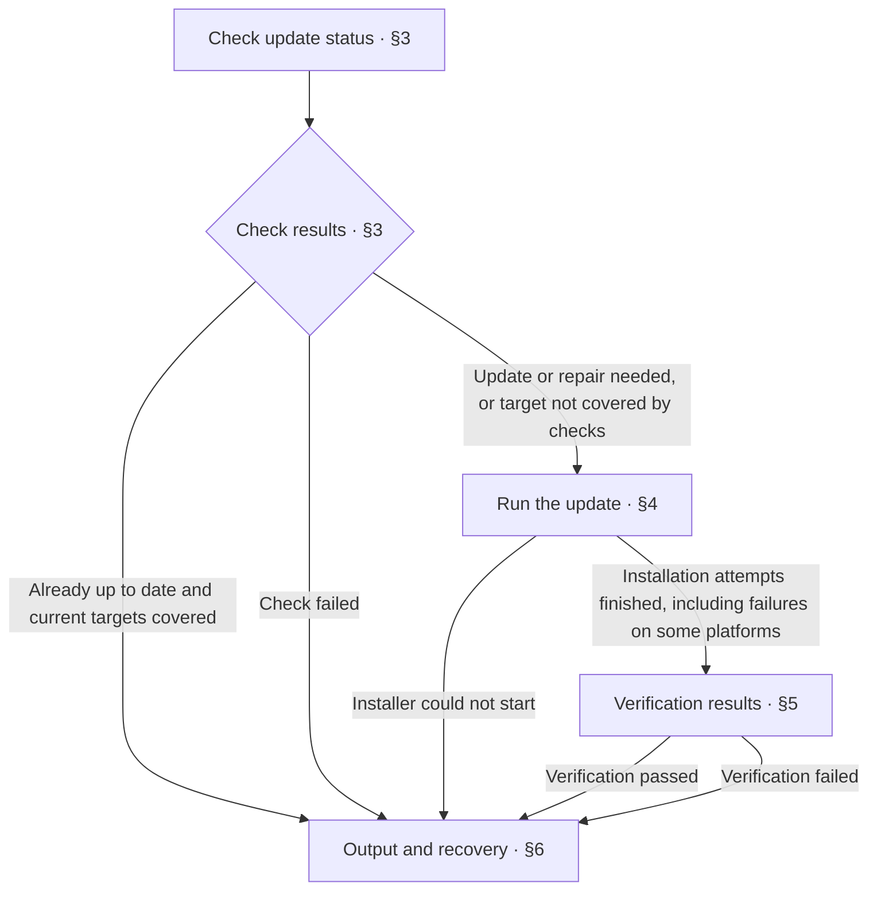

<!-- AUTO-GENERATED from SKILL.md.tmpl — do not edit directly -->
<!-- Regenerate: bash scripts/build-skills.sh --host antigravity-cli -->

# aca-update

Update the installed Anyone Can Architect skills to the latest npm release
Check the latest version, reinstall on the target platforms, and verify the results

## 1 Principles

1. **Base status on evidence**
   Determine status from actual checks and verification results, and leave it unconfirmed if checks fail
2. **Define the scope**
   Limit the update scope to the target platforms for this run
3. **Base recovery on facts**
   Determine recovery actions from completed stages and actual failure causes

## 2 Workflow



## 3 Check Update Status

1. Run the check
   Run the following command and record its output and exit status

   ```bash
   bash ~/.gemini/antigravity-cli/skills/aca/bin/aca-update-check
   ```

2. Evaluate the results
   Determine the next step from the following results

   | Result | Action |
   | --- | --- |
   | Successfully returns `UPDATE_AVAILABLE <old> <new>` | Go to Chapter 4 to update or repair the installation |
   | Successfully returns `UP_TO_DATE <version>` and the check covers the current targets | Report that the version is already up to date as described in Chapter 6 |
   | Successfully returns `UP_TO_DATE <version>` but does not cover an explicitly specified target platform | Go to Chapter 4 to install and verify on the specified platform |
   | `CHECK_FAILED <reason>`, empty output, unknown output, or execution failure | Report the check as incomplete as described in Chapter 6, and do not conclude that the version is already up to date |

   When the developer explicitly specifies a platform, verify that the platform exists and is covered by the check script
   If the target platform is not yet installed, do not end this update because other platforms are already up to date

3. Record the check evidence
   Record the latest npm version and the installed platforms involved
   The `<old>` value in `UPDATE_AVAILABLE` may come from any platform with a mismatched version and does not represent the previous version of all platforms
   Verify each platform's versions before and after the update separately, and do not use this field alone to summarize version changes across the environment

## 4 Run the Update

1. Determine the target platforms
   Update all installed platforms by default
   When the developer explicitly specifies a platform, use the installer's `--host` parameter
   The installer covers Claude Code, Codex, Cursor, Grok, and the Antigravity IDE and CLI
   Record the target platforms and their versions before this update
2. Run the installer
   Run the following command for the default scope

   ```bash
   npx -y anyone-can-architect@latest update
   ```

   When a platform is explicitly specified, replace the following placeholder with the target platform identifier

   ```bash
   npx -y anyone-can-architect@latest update --host "<claude / codex / cursor / grok / antigravity / antigravity-cli>"
   ```

   The installer keeps the language of the previous installation
   Let the installer run installation and verification for each platform
   Record its output and exit status
3. Handle stage results
   If the installer cannot start, for example because Node.js, npm, or the network is unavailable, report the update as incomplete as described in Chapter 6
   If installation or verification fails on one platform, the installer continues to attempt the other target platforms
   After installation attempts finish, retain the facts about completed work on each platform and go to Chapter 5 to check the results

## 5 Verification Results

1. Check the target platforms
   Run the check from Chapter 3 again
   For each platform, verify that the installed version and version markers of all managed skills match the latest npm version
   The check scope is the target platforms determined in Chapter 4
   Record the actual installation and verification results for each platform
2. Determine the verification outcome
   Report the update as complete only when all current targets pass
   If any target fails or remains unverified, report the overall update as incomplete while retaining the facts about successful targets
   If the version number has not changed but the installation has been repaired, explicitly report the same-version reinstallation result
   When a single platform is explicitly specified, do not count other platforms as failures in this update

This chapter checks versions and installation status and does not claim that all file contents have been compared character by character

## 6 Output and Recovery

1. Determine the status
   Report the update as completed when execution finishes and verification passes for the current targets
   For a same-version repair, note the same-version reinstallation in the results
   Report that the version is already up to date only when the check succeeds and covers the current targets
   Report the update as incomplete if a required stage fails or remains unverified
2. Report the actual results
   Record each target platform's version separately
   Describe installation and verification results and failure locations for each platform, retaining the facts about partial success
   Fill in the title and results using the following format

   ```markdown
   # 🔄 Update: <updated / already up to date / incomplete>

   | Item | Result |
   | --- | --- |
   | Latest version | <latest npm version / not obtained> |
   | Target platforms | <target platforms for this update> |
   | Completed stages | <stages verified as completed / none> |
   | Installation | <actual results / no execution needed / not executed> |
   | Verification | <target platform verification results / incomplete> |
   | To-do | <incomplete items, reasons, and failure locations / none> |
   | Next step | <conditions to meet and executable recovery actions / none> |

   | Platform | Version before update | Version after update | Installation result | Verification result and failure location |
   | --- | --- | --- | --- | --- |
   | <target platform> | <actual version / not obtained> | <actual version / not obtained> | <actual result / not executed> | <actual result and failure location / not verified> |
   ```

3. Determine recovery actions
   Clearly state the conditions that must be met, the failed stage, and executable recovery commands
   Use the default installer invocation or `--host` parameter from Chapter 4
