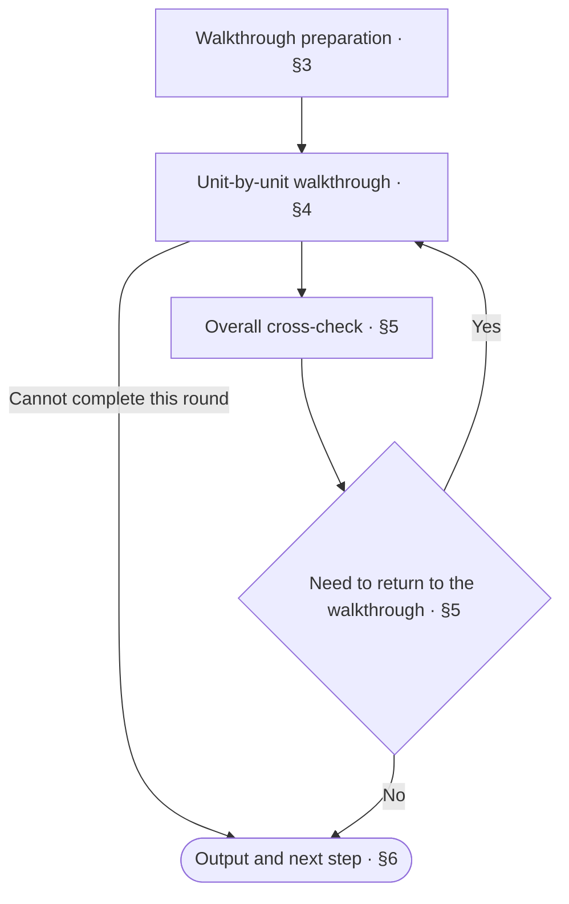
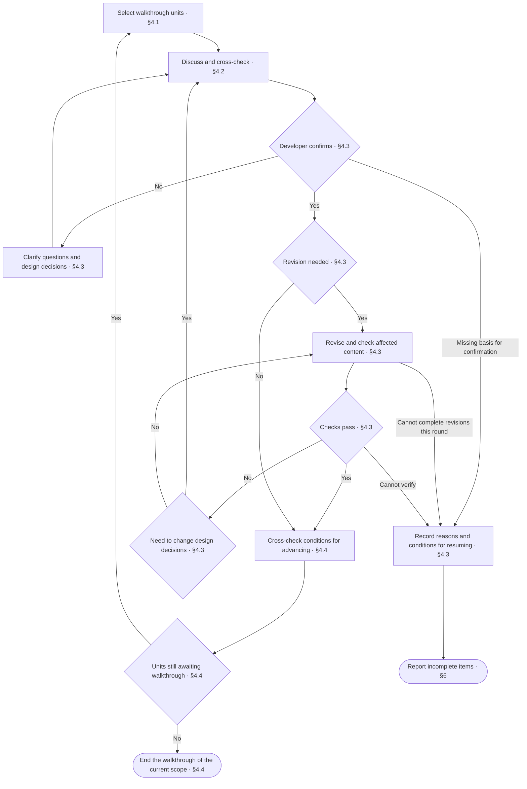

<!-- AUTO-GENERATED from SKILL.md.tmpl — do not edit directly -->
<!-- Regenerate: bash scripts/build-skills.sh --host antigravity-cli -->

# aca-walkthrough

Walk through the design docs in the current scope in business language
Confirm design decisions unit by unit and correct identified issues on the spot after confirmation

## 1 Principles

### 1.1 Walkthrough Principles

1. **Business focus**
   Explain design decisions through business problems and requirements
   Use technical language only for supporting explanations
2. **Confirm level by level**
   Build a shared understanding from the overall picture to the details
   Use developer confirmation as the basis for advancing and revising
3. **Responsibility boundaries**
   A walkthrough does not determine whether a review passes
   Review conclusions belong to `/aca-review`

### 1.2 Writing Axiom

> Write clearly with the lowest possible effort to understand: no redundancy, no omissions, no ambiguity

**Writing Structure**

- Present the whole first, then expand on the details, see the [Pyramid Principle](~/.gemini/antigravity-cli/skills/aca/SSOT.md#2-structure)
- When stating a judgment, give the conclusion first, then the supporting evidence
- Merge heading levels that add no information
- Use numbered lists for items with a sequence or priority; when a step contains sub-items, start the step with a bold phrase stating its purpose and indent specific operations and conditional branches under it
- Use tables only for content with multiple rows of the same structure, more than two attributes per row, and no sequence between rows
- Write list items as complete sentences
- When an item has branches, indent the branches under that item
- Write each branch on its own line as “condition: action”
- Put conditions that must be known before execution before the action
- When a condition controls multiple steps, list the steps under that condition

**Presentation and Typography**

- Describe only the currently valid design in the design body
- When revising the design body, remove incorrect or obsolete descriptions
- Do not explain differences from earlier versions, the change process, or reasons for changes in the design body
- Describe problems, processes, and decisions in business language, and use technical language only for supporting explanations
- Define each rule in only one place, and reference it elsewhere
- Make rules and references directly locatable so readers can clearly find where to make changes
- Remove content that adds no information and does not help understanding
- Write one sentence per line, with only one fact per sentence
- State actions directly in operational steps
- Write sequential actions as separate items
- Make the actor, the object of the action, and the referents clear
- Do not repeat actors, objects of actions, or referents already clear from context
- Do not put periods at the ends of lines
- Do not leave blank lines between lines on the same topic, and leave one blank line when changing topics
- Write fragments in table cells, not sentences, and omit periods
- Write multiple facts in a cell on separate lines, without joining them with semicolons
- Reply in the language the user uses
- Follow [English typography rules](~/.gemini/antigravity-cli/skills/aca/SSOT.md#1-writing-rules), with sentence case in body text and Title Case only in headings
- Follow [ISO 2145](~/.gemini/antigravity-cli/skills/aca/SSOT.md#1-writing-rules) for chapter and section numbering
- Use `§` only for cross-references in body text, never in headings
- When referencing a specific chapter or section in body text, use a Markdown link directly to its anchor
  For references within the same doc, use a local chapter or section anchor, such as `[§1.2](#12-section-title)`
  For references across docs, use the target file’s relative path and chapter or section anchor, such as `[Target doc §1.2](other.md#12-section-title)`
  Link text can use the chapter or section name, or `§` followed by its number
  When chapter or section titles or order change, update affected references and verify their targets
  When an algorithm or command in a code block needs to reference a chapter or section, put the link in the body text before or after the code block
- When referencing an entire doc, link to the target file

Reference: [ASD-STE100](~/.gemini/antigravity-cli/skills/aca/SSOT.md#1-writing-rules)
## 2 Workflow



## 3 Walkthrough Preparation

1. Cross-check the repo type
   Run `bash ~/.gemini/antigravity-cli/skills/aca/bin/aca-repo-type-check`
   - `NEEDS_INIT`: Run `/aca-init` first
   - `PENDING`: Stop the walkthrough
   Read Repo-Type only from the root README footer
2. Determine the starting scope
   Start at the project level by default
   If the developer has specified a scope, walk through only that object and its lower levels
3. Follow the documentation entry from the root README to locate the current scope
   If it still cannot be located, ask the developer to specify the doc location
   Read `~/.gemini/antigravity-cli/skills/aca/doc-design/repo-types/{repo-type}.md`
   Read `CONTEXT.md` and the design docs in the current scope
   Read the corresponding document set, doc design, and patterns actually used
4. Arrange the walkthrough order
   Follow the governance order in the repo-type spec
   Within a document set, follow the order specified by that document set
   If no order is specified, arrange the order by doc reference dependencies
5. Confirm the scope and order
   List the scope and order
   Confirm with the developer if they are not yet confirmed or have changed
   Continue directly if they are confirmed and unchanged

## 4 Unit-by-Unit Walkthrough



### 4.1 Select Walkthrough Units

1. Select the current object according to the confirmed scope and order
   Proceed from the overall picture to the details
   Discuss one unit at a time
2. When entering a doc, first use its overall writing structure as the discussion unit
   List the Chapters and Sections in the current doc and the content each contains
3. After the overall doc structure is confirmed, necessary revisions are complete, and affected checks pass, select content units by Chapter or Section
   The smallest discussion unit is a Section

| Level | Walkthrough focus |
| --- | --- |
| Project | Overall requirements, design goals, and division of responsibilities |
| Module | Requirements it addresses, external capabilities, collaboration relationships, and division of responsibilities among docs |
| Doc | Doc responsibilities, overall chapter and section divisions, content placement, and presentation order |
| Chapter or Section | Specific requirements, solutions, and design decisions to clarify |

### 4.2 Discuss and Cross-Check

1. First explain the problems and requirements the current unit must address in business language
   Then explain how the design meets these requirements
   When business concepts are involved, link to the corresponding entries in the project's `CONTEXT.md`
   Explain each concept's meaning and role in the current design
2. Cross-check the design of the current unit
   Cross-check each applicable checklist item in the document set, doc design, and patterns actually used
   When walking through the overall doc structure, discuss chapter and section divisions, content placement, and presentation order against the corresponding Doc Design
   Identify content that needs to be merged, split, or reordered

   | Check item | Focus |
   | --- | --- |
   | Requirements match | How well the design meets the current problems and requirements |
   | Completeness | Omissions in responsibilities, behavior, boundaries, and exception handling |
   | Ambiguity and implementation uniqueness | Multiple reasonable interpretations, implementations that match the description but behave differently, and unresolved design decisions |
   | Redundancy | Duplicate maintenance and content that adds no information |
   | Expression | Writing axiom, corresponding doc design, and terminology consistency |

### 4.3 Confirm, Revise, and Check

1. Ask the developer to confirm the current unit's design decisions
   If the developer does not understand or disagrees, clarify the meaning and rationale
   If not yet confirmed, continue discussing the current unit according to [Discuss and Cross-Check](#42-discuss-and-cross-check)
2. When changes are confirmed, revise on the spot according to the corresponding doc design
   When chapters or sections change, also update affected references and related designs
3. After revision, rerun affected checklist items and mechanical checks
   Report the corrections and check results
   If checks fail and corrections can follow the confirmed design, correct and recheck
   If design decisions must change, discuss again according to [Discuss and Cross-Check](#42-discuss-and-cross-check) and ask the developer to confirm
4. If confirmation, revision, or verification cannot be completed this round, record the current unit, reasons, and conditions for resuming
   Report incomplete items according to [Output and Next Step](#6-output-and-next-step)
   While normally waiting for developer confirmation, retain the current unit and do not treat the wait as grounds for declaring this round impossible to complete

### 4.4 Advance the Walkthrough

1. Cross-check the conditions for advancing from the current unit
   Move to the next unit after current design decisions are confirmed, necessary revisions are complete, and affected checks pass
   If the conditions are not met, continue working on the current unit according to [Confirm, Revise, and Check](#43-confirm-revise-and-check)
2. After the content at the current level is confirmed, cross-check the entry and navigation according to [readme doc design §3 Step 5](~/.gemini/antigravity-cli/skills/aca/doc-design/documents/readme.md#3-writing-steps)
3. If units in the current scope still await a walkthrough, continue according to [Select Walkthrough Units](#41-select-walkthrough-units)
   After all units in the current scope are complete, proceed to [Overall Cross-Check](#5-overall-cross-check)

## 5 Overall Cross-Check

1. Cross-check applicable checklist items that require assessing the entire scope
   Reuse existing results for items already checked and unaffected by later revisions
2. When content needs changes, handle affected units according to [Unit-by-Unit Walkthrough](#4-unit-by-unit-walkthrough)
   Then cross-check the affected overall checklist items again
3. For items that cannot be verified or completed, record the reasons and to-dos
   Report the results of this walkthrough according to [Output and Next Step](#6-output-and-next-step)

## 6 Output and Next Step

### 6.1 Determine Completion Status

| Status | Conditions |
| --- | --- |
| Complete | All units in the current scope are confirmed, necessary revisions are complete, and all applicable checks are verified and pass |
| Incomplete | Completion conditions are not met |

If incomplete, list the remaining content and reasons

### 6.2 Walkthrough Report

Record missing, conflicting, or unexecutable doc designs or patterns as rule issues
You may suggest reporting them through `/aca-feedback`

Use the following format for the closing report, filling in the title and results according to the actual status

```markdown
# 📖 Walkthrough: <complete / incomplete>

| Item | Result |
| --- | --- |
| Scope | <scope covered and walkthrough progress> |
| Decisions | <confirmed decisions> |
| Corrections | <corrections saved to disk / none> |
| Checks | <check results and unverified items / not run> |
| To-dos | <content awaiting walkthrough or requiring redesign / none> |
| Rule issues | <identified rule issues / none> |
| Commits | <commit records / not committed> |
| Next step | <one immediately executable action> |
```

### 6.3 Follow-Up Actions

Choose one immediately executable action based on completion status and progress this round

| Status | Situation | Next step |
| --- | --- | --- |
| Incomplete | Units still await a walkthrough or verification conditions are missing | Meet the conditions, then continue this walkthrough through `/aca-walkthrough` |
| Incomplete | The design solution cannot be determined this round | Use `/aca-specify` to reason through the solution |
| Complete | The walkthrough of the current scope is complete | Review the design through `/aca-review` according to the confirmed arrangements |
