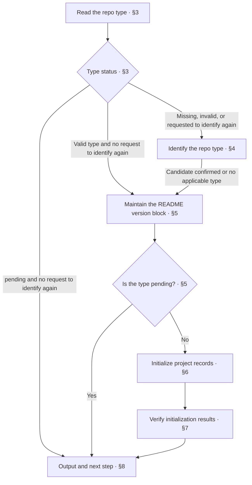

<!-- AUTO-GENERATED from SKILL.md.tmpl — do not edit directly -->
<!-- Regenerate: bash scripts/build-skills.sh --host cursor -->

# aca-init: Project Initialization

Establish the project's repo-type identifier and the project records required for initialization

Requirements and solution confirmation belong to `/aca-specify`
Writing project design docs belongs to `/aca-design`
Governance of the as-is state of existing projects belongs to `/aca-brownfield`

For repo types and their scope, see [Repo Types and Doc Design](~/.cursor/skills/aca/doc-design/README.md#repo-type-and-doc-design), and for specific requirements, see the corresponding repo-type spec

## 1 Principles

1. **Factual basis**
   Establish project identifiers from the confirmed repo type and actual version records
2. **Initialize as needed**
   Use the required conditions in the repo-type spec to determine which project records to create
3. **Preserve existing content**
   Add missing records during initialization and preserve valid content already in the project
4. **Limit responsibilities**
   Initialization establishes project identifiers and basic records, while the corresponding workflows handle requirements reasoning, design writing, and governance of the as-is state

## 2 Workflow



If you cannot continue in chapters 3 through 7, report completed work, the reason for stopping, and the conditions for resuming as specified in [Output and Next Step](#8-output-and-next-step)

## 3 Read the Repo Type

1. Read initialization information
   The root README footer is the sole source of truth for Repo-Type
   Determine the project directory, read the Anyone Can Architect version, run the repo-type check, and retain the exit status

   ```bash
   PROJECT_DIR="$(pwd)"
   ACA_VERSION_STATUS=0
   ACA_VERSION=$(cat ~/.cursor/skills/aca/VERSION) || ACA_VERSION_STATUS=$?
   TYPE_CHECK_STATUS=0
   TYPE_VALUE=$(bash ~/.cursor/skills/aca/bin/aca-repo-type-check "$PROJECT_DIR") || TYPE_CHECK_STATUS=$?
   ```

   If the Anyone Can Architect version cannot be read or is empty, report incomplete as specified in chapter 8 and do not write the version block
   If the repo-type check returns output or an exit status not listed below, record the reason and report incomplete as specified in chapter 8
2. Determine whether to identify the type again
   If the developer explicitly requests identification again, proceed to chapter 4
   Otherwise, continue according to the check results in the next step
3. Continue according to the check results

   | Check output | Exit status | Action |
   | --- | --- | --- |
   | `NEEDS_INIT` or `INVALID_TYPE <value>` | `1` | Proceed to chapter 4 |
   | `PENDING` | `1` | Explain that the type is not yet supported and report incomplete as specified in chapter 8 |
   | A supported, valid type name | `0` | Assign it to `REPO_TYPE` and proceed to chapter 5 to refresh the version block |

## 4 Identify the Repo Type

1. Collect evidence for identification
   Read the root README, project structure, and main artifacts
   Compare them with the [Repo-Type Index](~/.cursor/skills/aca/doc-design/README.md#repo-type-and-doc-design) and the scope of candidate types
2. Propose a candidate and confirm it
   Present the candidate type and the reasoning for the developer to confirm
   If changes are needed, reassess using the additional information from the developer and do not write the type before confirmation
3. Determine the next path
   After a supported type is confirmed, assign it to `REPO_TYPE` and proceed to chapter 5
   After confirming that no type applies, set `REPO_TYPE` to `pending`, proceed to chapter 5 to write the version block, and then stop initialization
   You may suggest reporting the type gap through `/aca-feedback`, but do not submit an Issue automatically
   If the type is not yet confirmed, do not write it and report that confirmation is pending as specified in chapter 8

## 5 Maintain the README Version Block

1. Determine the repository name
   Prefer the repository name from `origin` for `REPO_NAME`, and use the sole remote if there is no `origin`
   If multiple other remotes exist, ask the developer to confirm
   If there is no remote, use the H1 of the root README, and if neither exists, ask the developer to confirm
2. Determine the project version
   Determine `REPO_VERSION` from the version records on the current branch, reading only files allowed by the repo type when the type is valid
   If the current branch has no records, look for version records in local `main`, `master`, and the default branch of `origin`, in that order
   If the default branch of `origin` is not identified, check `origin/main` and then `origin/master`
   Distinguish the version under development from released Tags, and ask the developer to confirm if uncertain
   If there are no version records, have the developer confirm the initial version, with `0.1.0` as the default suggestion
   If `pending` has no corresponding repo-type spec, use the project's existing version records and do not apply another repo-type spec
3. Maintain and validate the version block
   Maintain a single two-line version block at the end of the root README, updating any existing block in place and moving it to the end
   If the README does not exist, create an H1 using the repository name
   Create or correct the block before calling the synchronization script
   The version block has a fixed format:

   ```markdown
   ---

   > 📦 **<REPO_NAME> v<REPO_VERSION>**
   > 🤝 Powered by [Anyone Can Architect](https://github.com/ruozi/anyone-can-architect) v<ACA_VERSION> · Repo-Type: `<REPO_TYPE>`
   ```

   Run `bash ~/.cursor/skills/aca/bin/aca-readme-version-sync README.md "$REPO_VERSION" "$ACA_VERSION"` to synchronize versions and check the block format
   On failure, correct the problem according to the error message and rerun
   If the problem cannot be corrected, report incomplete as specified in chapter 8
   After the check passes, proceed to chapter 6 for a valid type
   If `REPO_TYPE` is `pending`, report incomplete as specified in chapter 8 and do not proceed to chapter 6

## 6 Initialize Project Records

1. Determine the initialization checklist
   Read "Project Structure" in `~/.cursor/skills/aca/doc-design/repo-types/{repo-type}.md`
   Select the root-directory files to initialize based on the required conditions, and record their applicability conditions and whether they exist or are missing
   Include `SSOT.md` in the checklist when the project actually uses external sources and the repo-type spec requires it
   If there are no external sources, do not create an empty SSOT file
2. Preserve existing files and add missing files
   Preserve existing files, and create and fill in missing files from `~/.cursor/skills/aca/templates/<filename>.example`
   Fill in confirmed information according to the following doc designs

   | File | Writing basis and content |
   | --- | --- |
   | `CONTEXT.md` | Select and register terms and definitions according to the [context doc design](~/.cursor/skills/aca/doc-design/documents/context.md) |
   | `ROADMAP.md` | Record the actual status and confirmed plans for future versions according to the [roadmap doc design](~/.cursor/skills/aca/doc-design/documents/roadmap.md) |
   | `CHANGELOG.md` | Retain the unreleased block and register existing release facts according to the [changelog doc design](~/.cursor/skills/aca/doc-design/documents/changelog.md) |
   | `SSOT.md` | Register verified external sources and their origins according to the [ssot doc design](~/.cursor/skills/aca/doc-design/documents/ssot.md) |

   Remove examples, placeholder content, and inapplicable optional parts brought into new files by templates
3. Handle missing prerequisites
   If required information is missing, verify it in the project, and if it still cannot be confirmed, ask the developer to supply it
   If templates are missing, repair the installation with `npx -y anyone-can-architect@latest install`
   Check the templates again after repairing the installation, and continue once they are available
   If required information or templates remain unavailable, report the missing content and paths, and report incomplete as specified in chapter 8

## 7 Verify Initialization Results

1. Verify the initialization checklist
   Run `bash ~/.cursor/skills/aca/bin/aca-repo-type-check "$PROJECT_DIR"` and confirm that the result matches the confirmed `REPO_TYPE`
   Verify that the README version block is valid and that the required files in the initialization checklist exist
   Reuse the results of checks that passed in chapter 5 and were not affected by later changes
2. Check initialized content
   For added or updated files, verify the applicable checklist items in the corresponding doc design and run `aca-prose-check`
   Replace the following placeholder with the actual path of a file added or updated during this initialization

   ```bash
   bash ~/.cursor/skills/aca/bin/aca-prose-check "<path of a file added or updated during this initialization>"
   ```

   If `CONTEXT.md` is in this initialization checklist, run the following check

   ```bash
   bash ~/.cursor/skills/aca/bin/aca-context-check "$PROJECT_DIR/CONTEXT.md"
   ```

   Confirm that examples and placeholder content brought into new files by templates have been removed and that reference locations in added or updated content are valid
3. Handle check results
   After correcting problems caused by initialization, rerun the affected checks
   If existing content needs to be redesigned, record the problems and connect to the corresponding workflow as specified in chapter 8
   If required checks fail or have not been verified, report incomplete as specified in chapter 8

This chapter verifies project identifiers and basic records and does not extend to code tests or a repository-wide audit

## 8 Output and Next Step

1. Determine initialization status
   Report complete when a supported repo type is confirmed, the README version block is valid, all required records are present, and required checks pass
   Report incomplete when the type is `pending` or unconfirmed, or when required steps are blocked or unverified
2. Report actual results
   Fill in the heading and results using the following format
   Include only verified versions, file changes, and check facts

   ```markdown
   # 🌱 Init: <complete / incomplete>

   | Item | Result |
   | --- | --- |
   | Repo type | <confirmed type / pending / awaiting confirmation> |
   | Version | <verified project and Anyone Can Architect versions / unconfirmed items and reasons> |
   | Files | <added or updated files / none> |
   | Checks | <actual results and incomplete items / not run> |
   | To-do | <incomplete items and reasons / none> |
   | Next step | <one immediately actionable step / none> |
   ```

3. Connect to the next step
   If initialization is incomplete, explain the missing prerequisites and where to resume
   If initialization is complete, follow the confirmed subsequent arrangements
   If no arrangements exist, propose the next step based on the actual task
   Requirements reasoning belongs to `/aca-specify`, writing docs for confirmed solutions belongs to `/aca-design`, and verifying the as-is state of existing projects belongs to `/aca-brownfield`
   Do not determine the subsequent workflow solely by whether the repo-type spec includes a governance order
