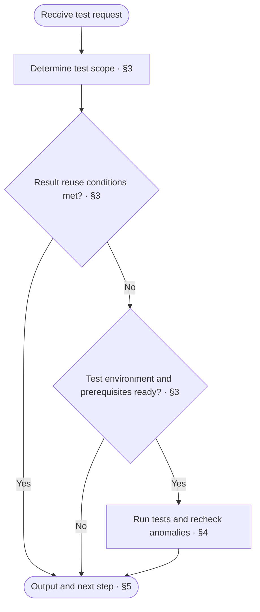

<!-- AUTO-GENERATED from SKILL.md.tmpl — do not edit directly -->
<!-- Regenerate: bash scripts/build-skills.sh --host cursor -->

# aca-test

Select and run the corresponding minimal tests based on the current implementation scope or the design boundary crossed by changes
Run tests and verification only, without modifying design docs, production code, or test code

## 1 Principles

1. **Blast-Radius Scoping**
   Determine the minimal test scope from the contract boundaries and dependencies of the current implementation or changes
2. **Test Only, No Edits**
   Run tests and verify results only, without modifying design docs, production code, or test code
3. **Evidence Binding**
   Bind test results to the commit under test, test scope, and commands actually executed for direct reuse by downstream stages

## 2 Workflow



## 3 Determine Test Scope

1. **Identify the subject under test and scope of changes**
   - Developer or upstream caller has specified the scope to test: use that scope directly
   - Scope not specified: read current workspace changes and recent commits, and locate the modules, commands, or events to which the changes belong against the design docs
   - Record the commit under test and any uncommitted changes included in verification
2. **Select the minimal test set by the design boundary crossed by changes**
   - Only internal implementation of a module, command, or event is added or modified, and the module `interface`, command routing, and event dispatch contracts are unchanged: select only the unit's own white-box and black-box tests
   - Module `interface`, command routing, event dispatch, or cross-unit collaboration is modified: select this unit's tests, tests of modules or commands and events that call this contract, and black-box tests in project-level `testcase` whose design basis links to this unit
   - Shared foundation across modules such as common infrastructure, global configuration, data migration, build, or deployment is modified: select all affected tests and the corresponding environment verification
   - When the repository `release` doc specifies additional verification for the current scope, include it as well
3. **Check reuse conditions and execution environment**
   - Existing test results cover the selected scope and the content under test, test code, fixtures, configuration, and dependency environment have not changed: reuse the results directly, record the basis, and proceed to [Output and Next Step](#5-output-and-next-step)
   - Test execution required: check the readiness of the required environment, fixtures, and real dependencies or test doubles according to the test design
   - Environment or dependencies not ready: record the missing conditions and report incomplete according to [Output and Next Step](#5-output-and-next-step)

## 4 Run and Recheck

1. **Control concurrency and resource isolation**
   - Set up fixtures and an isolated environment according to the test design
   - When shared or heavy resources such as containers, databases, real platforms, or model evaluations are involved, limit concurrency and isolate resources to prevent timeouts caused by parallel contention
2. **Run the selected tests**
   - Run the test cases selected in [Determine Test Scope](#3-determine-test-scope) along with required builds or static checks
   - After execution completes, clean up test data and temporary resources created in this run according to the fixture rules
   - Do not modify design docs, production code, test code, or commit history during verification
3. **Recheck failures and distinguish causes**
   - All pass: record the executed commands, number of passing test cases, and elapsed time
   - Failures occur: check the failure logs and diagnostics
   - Suspected timeout caused by high host load or resource contention: rerun the failed items individually under low-concurrency isolated conditions to verify
   - Individual rerun passes consistently and is confirmed to be caused by environment load: record the initial anomaly, rerun command, and passing result
   - Failure confirmed to be caused by code or test implementation issues: record the failing test cases, error diagnostics, and corresponding locations
   - Environment failure or diagnostics cannot be verified: mark the corresponding verification as incomplete and record the reason

## 5 Output and Next Step

### 5.1 Verdict

| Verdict | Criteria |
| --- | --- |
| Pass | All tests and required checks in the selected scope pass (including reused results or timeout rechecks), with no failing or incomplete items |
| Fail | Confirmed code or test failures exist |
| Incomplete | Environment is missing, execution is impossible, or diagnostics cannot be verified, and no confirmed failures exist |

When both confirmed failures and incomplete items exist, the verdict is fail, and the incomplete items must be listed

### 5.2 Test Report

Output the test results in the current conversation using the following template

```markdown
# 🧪 Test: <pass / fail / incomplete>

| Item | Result |
| --- | --- |
| Scope | <unit or change scope under test> |
| Baseline | <commit under test and uncommitted changes included in verification> |
| Selection basis | <upstream scope / intra-unit tests with unchanged contract / dependency-chain tests for contract change / full tests for global foundation> |
| Commands | <actual test and check commands run, or basis for reuse> |
| Result | <pass count, fail count, and elapsed time> |
| Anomaly recheck | <individual rerun verification result for timeouts / none> |
| Failures | <failing test cases, causes, and corresponding locations / none> |
| Incomplete | <unexecuted verification, reasons, and conditions for resuming / none> |
| Next step | <one immediately actionable step> |
```

### 5.3 Follow-Up Actions

Select the next step based on the test verdict and progress in the current round

| Verdict | Situation | Next step |
| --- | --- | --- |
| Incomplete | Test environment, fixtures, or external dependencies are missing | Supply the environment conditions and verify again through `/aca-test` |
| Fail | Code or test implementation issues | Fix through `/aca-implement`, review through `/aca-review`, then run `/aca-test` |
| Fail | Missing design or contract conflict | Revise the design through `/aca-specify` or `/aca-design` |
| Pass | Subsequent implementation tasks remain in this round | Continue implementing the next scope through `/aca-implement` |
| Pass | All implementation scopes in this round have passed verification | Proceed to `/aca-release` according to the version progression plan or conclude the current task |
