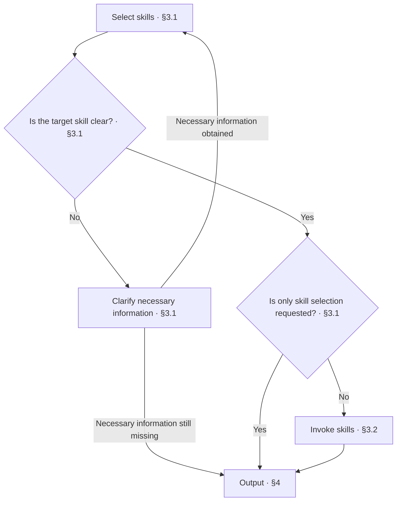

<!-- AUTO-GENERATED from SKILL.md.tmpl — do not edit directly -->
<!-- Regenerate: bash scripts/build-skills.sh --host cursor -->

# aca

Select and invoke the appropriate skill based on developer intent

## 1 Principles

1. **Intent as the basis**
   Use the developer's current request to determine the work goal and skill selection
2. **Context continuity**
   Retain confirmed goals, scope, and progress that remain valid
3. **Necessary clarification**
   Clarify only information that affects skill selection and cannot be determined from context

## 2 Workflow



## 3 Select and Invoke Skills

### 3.1 Select Skills

| Skill | What it does |
|---|---|
| `/aca-init` | Establish the repo-type identifier and project records required for initialization |
| `/aca-brownfield` | Verify the as-is state within the current scope, then proceed to Design |
| `/aca-specify` | Reason through new requirements or improve existing designs, then proceed to Design after confirming the solution |
| `/aca-design` | Write and check design docs within the current scope, then determine the next scope or complete the overall closeout |
| `/aca-walkthrough` | Walk through design docs in business language, confirm design decisions unit by unit, and correct identified issues on the spot after confirmation |
| `/aca-review` | Determine the review subject and scope, statically review the design or code and test implementation, without modifying the docs or code under review or running code |
| `/aca-implement` | Plan the file structure based on the design, then write production code and test code according to module dependencies |
| `/aca-test` | Select and run minimal tests based on the current implementation scope or the design boundary crossed by changes, testing only without modifying files |
| `/aca-repo-audit` | Check repository documentation and verify the implementation as needed, with read-only access and no changes |
| `/aca-release` | Close out according to the repository release workflow, merge into main, and lock in an annotated Tag |
| `/aca-feedback` | Collect deviations from governance rules and submit an Issue after explicit authorization |
| `/aca-update` | Update source code and installed skills, then verify the update results |

1. When the developer explicitly specifies a skill, select that skill
2. Otherwise, use the current request, confirmed goals, and current progress to select a skill from the routing table
3. If the skill cannot be determined, clarify only the necessary information that affects selection
   Reassess after obtaining the information
   If necessary information is still missing, report what needs confirmation as described in Chapter 4

After selection, report requests that require only skill selection as described in Chapter 4
For execution requests, continue with 3.2

### 3.2 Invoke Skills

1. Read the target skill
   Read its complete instructions and the references needed for the current step
2. Retain the execution context
   Retain confirmed goals, scope, current progress, and constraints
   Reuse confirmed information that remains valid without reconfirmation
   Obtain missing necessary information as required by the target skill
3. Execute the target skill
   Follow the target skill's steps, checklist, and completion requirements
   When finished, proceed to Chapter 4 to report

## 4 Output

1. Determine the reporting method
   If the target skill was executed, use that skill's closing report
   If the developer requested only skill selection, report the selected skill
   If the skill cannot yet be determined or executed, report the missing information, reason for stopping, and next step
2. Report the routing result
   If only selecting a skill or unable to start the target skill, report in the following format

   ```markdown
   # 🧭 ACA: <skill selected / pending confirmation / unable to execute>

   | Item | Result |
   | --- | --- |
   | Intent | <current work goal> |
   | Skill | <target skill / pending confirmation> |
   | Reason | <only skill selection requested / missing information or reason for stopping> |
   | Next step | <one immediately actionable step / none> |
   ```
