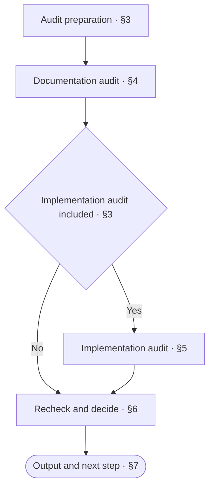

<!-- AUTO-GENERATED from SKILL.md.tmpl — do not edit directly -->
<!-- Regenerate: bash scripts/build-skills.sh --host grok -->

# aca-repo-audit

Check project documentation for connections, narrative flow, contradictions, and redundancy
Cross-check implementation against the design when the developer requests it or `/aca-release` invokes this skill
Make no changes and output results in the current conversation

Use `/aca-review` when you need to judge whether business goals and design solutions are reasonable

## 1 Principles

### 1.1 Audit Principles

1. **Source-Driven**
   Cross-check the documentation against the applicable repo-type spec and documentation conventions
   Cross-check implementation against the confirmed design
2. **Evidence-Based Decisions**
   Determine issues and audit conclusions from verifiable content and runtime results
3. **Scope Constraints**
   Limit audit conclusions to the current scope

### 1.2 Writing Axiom

> Write clearly with the lowest possible effort to understand: no redundancy, no omissions, no ambiguity

**Writing Structure**

- Present the whole first, then expand on the details, see the [Pyramid Principle](~/.grok/skills/aca/SSOT.md#2-structure)
- When stating a judgment, give the conclusion first, then the supporting evidence
- Merge heading levels that add no information
- Use numbered lists for items with a sequence or priority; when a step contains sub-items, start the step with a bold phrase stating its purpose and indent specific operations and conditional branches under it
- Use tables only for content with multiple rows of the same structure, more than two attributes per row, and no sequence between rows
- Write list items as complete sentences
- When an item has branches, indent the branches under that item
- Write each branch on its own line as “condition: action”
- Put conditions that must be known before execution before the action
- When a condition controls multiple steps, list the steps under that condition

**Presentation and Typography**

- Describe only the currently valid design in the design body
- When revising the design body, remove incorrect or obsolete descriptions
- Do not explain differences from earlier versions, the change process, or reasons for changes in the design body
- Describe problems, processes, and decisions in business language, and use technical language only for supporting explanations
- Define each rule in only one place, and reference it elsewhere
- Make rules and references directly locatable so readers can clearly find where to make changes
- Remove content that adds no information and does not help understanding
- Write one sentence per line, with only one fact per sentence
- State actions directly in operational steps
- Write sequential actions as separate items
- Make the actor, the object of the action, and the referents clear
- Do not repeat actors, objects of actions, or referents already clear from context
- Do not put periods at the ends of lines
- Do not leave blank lines between lines on the same topic, and leave one blank line when changing topics
- Write fragments in table cells, not sentences, and omit periods
- Write multiple facts in a cell on separate lines, without joining them with semicolons
- Reply in the language the user uses
- Follow [English typography rules](~/.grok/skills/aca/SSOT.md#1-writing-rules), with sentence case in body text and Title Case only in headings
- Follow [ISO 2145](~/.grok/skills/aca/SSOT.md#1-writing-rules) for chapter and section numbering
- Use `§` only for cross-references in body text, never in headings
- When referencing a specific chapter or section in body text, use a Markdown link directly to its anchor
  For references within the same doc, use a local chapter or section anchor, such as `[§1.2](#12-section-title)`
  For references across docs, use the target file’s relative path and chapter or section anchor, such as `[Target doc §1.2](other.md#12-section-title)`
  Link text can use the chapter or section name, or `§` followed by its number
  When chapter or section titles or order change, update affected references and verify their targets
  When an algorithm or command in a code block needs to reference a chapter or section, put the link in the body text before or after the code block
- When referencing an entire doc, link to the target file

Reference: [ASD-STE100](~/.grok/skills/aca/SSOT.md#1-writing-rules)
## 2 Workflow



## 3 Audit Preparation

1. Determine the scope of this audit
   Prefer the scope specified by the developer, then use the scope explicitly set by the caller
   Audit the entire repository by default if no scope is specified
   Record the commit under review and any uncommitted changes included in scope
2. Run `bash ~/.grok/skills/aca/bin/aca-repo-type-check` to check the repo type
   Mark the repo-type spec cross-check as incomplete if the type is missing, invalid, or not yet supported
   Recommend correction through `/aca-init` if the type is missing or invalid
   Continue the remaining checks that do not depend on the repo-type spec
3. Determine whether to include an implementation audit
   Include an implementation audit when the developer requests it or `/aca-release` invokes this skill
   Otherwise, perform a documentation audit
4. Read the spec for the valid repo type and `CONTEXT.md`, and cross-check the project glossary
   Locate the documentation entry for this audit scope from the root README
   Ask the developer for its location if the entry cannot be located
   Mark checks that depend on this content as incomplete until its location is clear

## 4 Documentation Audit

### 4.1 Read Documentation

1. Create a document inventory for the current scope
   List the expected docs based on the requirements of the repo-type spec and the selected document sets
   Compare the README entry with the actual directories, and record missing and unregistered docs
2. Read the docs in the inventory and follow references to obtain the content needed for understanding and verification
   Use references outside the scope as supporting sources without automatically expanding the audit scope
3. Read the corresponding document sets, Doc Design, and the Pattern actually used
   Extract the applicable checklist criteria as the basis for subsequent item-by-item cross-checks

### 4.2 Mechanical Checks

1. Determine the actual paths to check from the [document inventory](#41-read-documentation)
   Cover the documentation directories in this audit with the document graph check
   Cover all docs in this audit, including relevant project-level files, with the prose check
   Check the structure and format of Context when it is included in the audit scope
2. Run mechanical checks or reuse their results
   Reuse results from the same scope in this session if the relevant files, check rules, and tools have not changed
   State the original check results and the basis for reuse in the report
   If the reuse conditions are not met, replace the following placeholders with actual paths and run the corresponding checks

   ```bash
   bash ~/.grok/skills/aca/bin/aca-doc-graph-check <documentation directories>
   bash ~/.grok/skills/aca/bin/aca-prose-check <all docs in this audit>
   bash ~/.grok/skills/aca/bin/aca-context-check <Context docs in this audit>
   ```

3. Handle check results based on the actual diagnostics
   Record the results and supporting evidence when checks pass
   Verify diagnostics when issues are detected, and classify confirmed issues as must fix
   Mark the corresponding check as incomplete and explain why if a tool is missing or fails to run
   Mark verification of the corresponding issue as incomplete and explain why if a diagnostic cannot be verified
   Continue the remaining checks that can be performed

### 4.3 Content Checks

1. Cross-check each applicable checklist criterion extracted in [Read Documentation](#41-read-documentation)
   Check the wording against the [writing axiom](#12-writing-axiom)
   Record the verification result, corresponding location, and supporting evidence for each item
   Explain why any criterion does not apply
2. Follow the documentation's narrative flow to cross-check relationships between docs
   - Are the entry and reading order clear
   - Do descriptions of the same feature, term, version, or workflow contradict each other
   - Is the same information maintained in multiple docs
   - Is there outdated content, unfinished drafts, empty docs, or vague text that cannot guide action
   - Does the design body describe only the current target design, without mixing in differences from earlier versions, the change process, or reasons for changes
3. Record issues and incomplete items
   Record each issue's location, supporting evidence, impact, and recommended action
   Specify where information should remain when it is duplicated across docs
   Recommend removing duplicate content elsewhere or replacing it with references
   Classify it as must fix if it creates multiple authoritative locations or a risk of drift
   Classify it as optional trim if it affects only length
   Record why any item cannot be verified, and continue the remaining checks that can be performed

## 5 Implementation Audit

### 5.1 Consistency Cross-Check

When an implementation audit is included, cross-check all design items in scope in both directions without sampling

1. List the design items that must be implemented
   List modules, behaviors, interfaces, states, error handling, and acceptance criteria based on the confirmed delivery scope
2. Cross-check the design against implementation
   Locate the corresponding code, tests, and configuration for each design item
   Check whether implementation is complete and conforms to design conventions
3. Cross-check implementation against the design
   Check whether actual business behavior maps to the design description
   Check how helper functions, utility code, and project boilerplate affect the designed behavior
4. Record mappings and deviations
   Record the cross-check result and supporting evidence for each design item
   Provide the design doc and implementation locations for each deviation
   State what is missing when either side is absent
   Record why any item cannot be verified, and continue the remaining checks that can be performed

### 5.2 Runtime Verification

1. **Determine verification requirements**
   Determine the test and build commands required for the current scope according to the boundary rules in `/aca-test` and the repository `release` doc
   Run full tests and builds by default when the repository does not specify tiered verification
   Check the required environment, configuration, and fixtures
2. **Run verification or reuse its results**
   Reuse existing `/aca-test` or build results if they cover the required scope and the commit under review, tests, fixtures, configuration, dependency environment, and commands have not changed
   State the original verification results and the basis for reuse in the report
   Run the required tests and builds in an isolated environment following the execution rules of `/aca-test` if the reuse conditions are not met
   Static reading cannot replace verification by execution
   Do not modify project source code, design docs, or commit history during verification
3. **Record results and handle exceptions**
   Record the results and supporting evidence when verification passes
   Verify diagnostics and record confirmed issues when verification fails
   Mark the corresponding verification as incomplete and explain why if the environment is unavailable or execution is not possible
   Mark verification of the corresponding issue as incomplete and explain why if a diagnostic cannot be verified
   Continue the remaining checks that can be performed

## 6 Recheck and Decide

### 6.1 Recheck Results

1. Cross-check evidence mappings
   Confirm that check results correspond to the content under review
   Check whether reused results meet the corresponding conditions
2. Recheck the issue list
   Cross-check the files and evidence involved in each issue, and include the issue in the report once confirmed
   Exclude disproven issues
   Mark issues with insufficient evidence as incomplete verification
   Merge duplicate issues while retaining relevant locations, supporting evidence, and impact
3. Cross-check coverage
   Check for omissions against the document inventory, applicable checklist criteria, and requirements for this implementation audit
   Complete any additional checks that can be performed
   Record the scope, reasons, and conditions for resuming any items that still cannot be completed

### 6.2 Verdict

| Verdict | Condition |
| --- | --- |
| Pass | All required checks in the current scope are complete and pass, with no must fix items |
| Action required | Confirmed must fix items exist |
| Incomplete | Pass conditions are not met, and no confirmed must fix items exist |

Required checks include reading documentation, mechanical checks, and content checks in the current scope
When an implementation audit is included, they also include all consistency cross-checks and the tests and builds required for the current scope
When both must fix items and incomplete checks exist, set the verdict to action required and list the incomplete items
Optional trim does not affect a pass

## 7 Output and Next Step

### 7.1 Audit Report

Report the audit verdict, issues, and next step in the current conversation using the following template

```markdown
# 🩺 Repo Audit: <pass / action required / incomplete>

| Item | Result |
| --- | --- |
| Scope | <scope of this audit> |
| Baseline | <commit under review and uncommitted changes included in scope> |
| Verdict basis | <how pass conditions are met, or issues and incomplete checks preventing a pass> |
| Documentation checks | <file connection and documentation check results> |
| Implementation cross-check | <actual results / incomplete / not included in this audit> |
| Tests and builds | <actual results / incomplete / not included in this audit> |
| Must fix | <issue count and main impact / none> |
| Incomplete | <incomplete checks, scope, reasons, and conditions for resuming / none> |
| Next step | <one immediately executable action> |

## Must Fix

- <doc chapter link / code file link and line number>: <issue, violated convention or checklist criterion, supporting evidence, impact, and recommended action>

## Optional Trim

- <doc chapter link / code file link and line number>: <content that can be merged, deleted, or rewritten and expected benefits>

## Check Scope

- Reading: <docs and code actually read>
- Checklist criteria: <sources of criteria, item-by-item verification results, reasons criteria do not apply, and reasons checks are incomplete>
- Implementation consistency: <mappings between design items and implementation, verification results / not included in this audit>
- Tools: <commands actually executed and results, or original results reused and basis for reuse>
```

### 7.2 Follow-Up Actions

Choose one immediately executable action based on the nature of the issues and the verification conditions

| Situation | Next step |
| --- | --- |
| Verification prerequisites are missing | Meet the prerequisites, then continue this audit through `/aca-repo-audit` |
| The solution still needs reasoning | Use `/aca-specify` to reason through the solution |
| The revised solution is clear and only docs need changes | Use `/aca-design` to revise the docs |
| Implementation deviates | `/aca-implement` Fix code or tests |
| Tests or builds incomplete | `/aca-test` Run verification |
| Audit passes | Return to the caller and continue with the confirmed arrangements |

Audit the affected scope again after the issues are corrected
