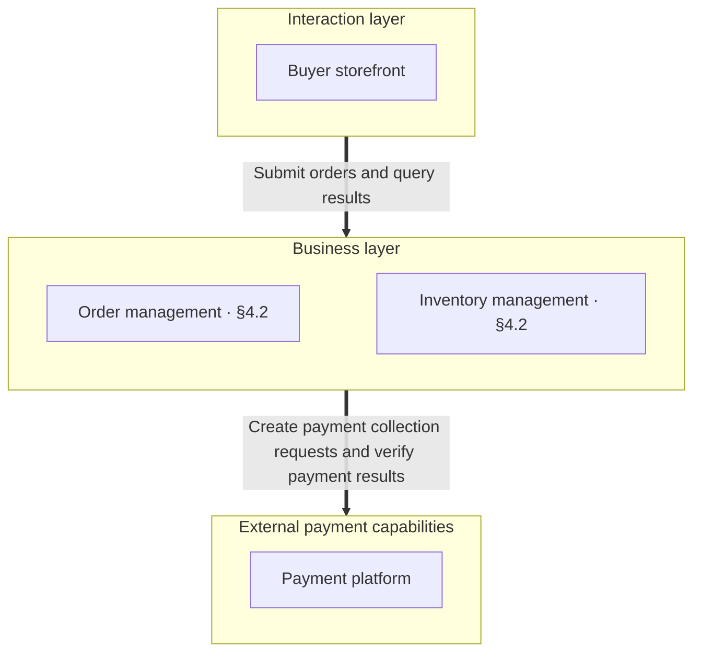
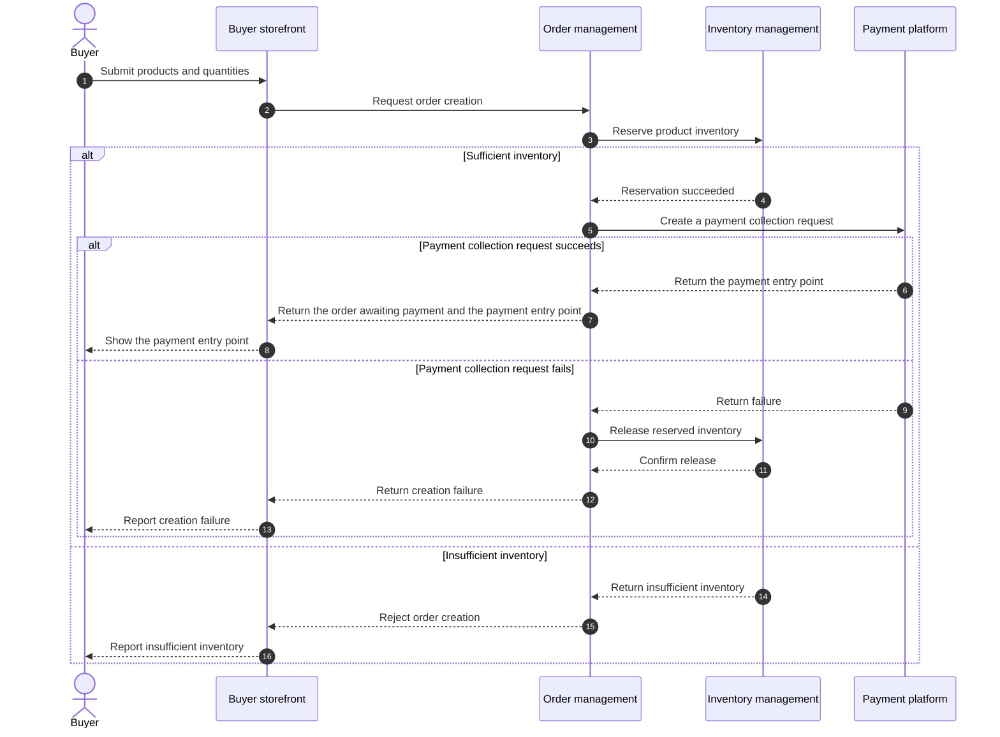

# Doc Design: architecture

## 1 Purpose

Design the overall system's module division and collaboration, defining module responsibilities, boundaries, dependencies, and layered organization

Internal module implementation and interface contracts belong in the corresponding module docs
This doc defines only top-level modules, while submodule division and collaboration belong in the parent module's class-design

## 2 Structure

| Chapter | Pattern | Content |
| --- | --- | --- |
| Overall Structure | Hierarchical relationship view from [Layered View](../patterns/layered-view.md) | Module composition, layers, and dependencies, with references to relevant design locations |
| Module Responsibilities | Module table: module, capabilities, responsibility boundary | Capabilities delivered by each module and its responsibility boundary, with module names linked to their corresponding README |
| Module Collaboration | Relationship table: initiator, recipient, collaboration responsibility, trigger condition, result handling | One module collaboration per row |
| Business Scenarios | A separate section for each scenario, using a [Sequence Diagram](../patterns/sequence-diagram.md) | Triggers, participating modules, call order, and business outcomes |

Result handling in the collaboration relationship table includes success and failure branches, with references to existing contracts
Where transactions are involved, define transaction ownership and boundaries for cross-module interactions

Business scenarios verify whether the module division supports the business, showing only key collaboration between modules and business outcomes without expanding implementation details
Failure branches show only key cases that affect module collaboration, and participants are modules, entry points, and external dependencies
Directly reference collaboration flows already defined by Command or Event without drawing them again

Structure outline:

```text
## 1 Overall Structure
## 2 Module Responsibilities
## 3 Module Collaboration
## 4 Business Scenarios
### 4.1 <scenario one>
### 4.2 <scenario two>
```

## 3 Writing Steps

1. Summarize module division, responsibility boundaries, and dependencies, and list the collaboration rules and business scenarios to express
2. Organize the overall structure and link module responsibilities and relevant design locations
3. Document the capabilities delivered by each module and its responsibility boundary
4. Document module collaboration, defining call conditions, direction, results, and failure handling
5. Select representative business scenarios to verify whether module responsibilities and collaboration relationships can jointly complete the business activity
6. Organize chapters according to [§2](#2-structure), checking consistency among the structure, module responsibilities, and collaboration rules, and checking business scenario coverage of system responsibilities

## 4 Example

### 4.1 Overall Structure



### 4.2 Module Responsibilities

```markdown
| Module | Capabilities | Responsibility boundary |
| --- | --- | --- |
| [Order management](module-order/README.md) | Create orders, maintain order status, and coordinate payment | Inventory management owns inventory quantities and reservation records, and the payment platform owns payment collection and payment results |
| [Inventory management](module-stock/README.md) | Reserve, query, and release product inventory | Order management owns order validity and payment status |
```

### 4.3 Module Collaboration

| Initiator | Recipient | Collaboration responsibility | Trigger condition | Result handling |
| --- | --- | --- | --- | --- |
| Buyer storefront | Order management | Create an order | The buyer submits products and quantities | Show the payment entry point on success, show the reason on rejection, and query the order result when the outcome is undetermined |
| Order management | Inventory management | Reserve inventory | An order is being created and parameter validation passes | Request payment collection on success, reject if inventory is insufficient, and query the reservation record when the outcome is undetermined |
| Order management | Inventory management | Query the reservation result | The reservation call outcome is undetermined | Continue if reserved, reject if confirmed not reserved, and keep processing status if still undetermined |
| Order management | Payment platform | Create a payment collection request | Inventory reservation succeeds | Return the payment entry point on success, release inventory on confirmed failure, and verify the payment collection request when the outcome is undetermined |
| Order management | Inventory management | Release reserved inventory | The payment collection request has definitively failed or an unpaid order is canceled | Finish processing on success, and retry release using the reservation record on failure or an undetermined outcome |

### 4.4 Business Scenarios

#### 4.4.1 Order Creation Scenario



## 5 Checklist

- [ ] The overall structure uses the hierarchical relationship view from Layered View, and module composition, layers, and dependencies match the actual design
- [ ] The module table includes modules, capabilities, and responsibility boundaries, module names link to their corresponding README, and the module list matches the directory structure
- [ ] Each row in the collaboration relationship table describes one collaboration and includes the initiator, recipient, collaboration responsibility, trigger condition, and result handling
- [ ] Collaboration results include success and failure branches, existing contracts are referenced, and transaction ownership and interaction boundaries are defined where transactions are involved
- [ ] Business scenarios are all in Chapter 4, each scenario has its own section expressed as a sequence diagram, and existing Command or Event flows are directly referenced
- [ ] Scenarios include triggers, participating modules, key collaboration, and business outcomes, with failure branches limited to key cases that affect collaboration and no expansion of implementation details
- [ ] The overall structure, module responsibilities, and collaboration rules are consistent, and business scenarios show how the module division supports system responsibilities
- [ ] Internal module implementation and interface contracts are referenced without repeating their details