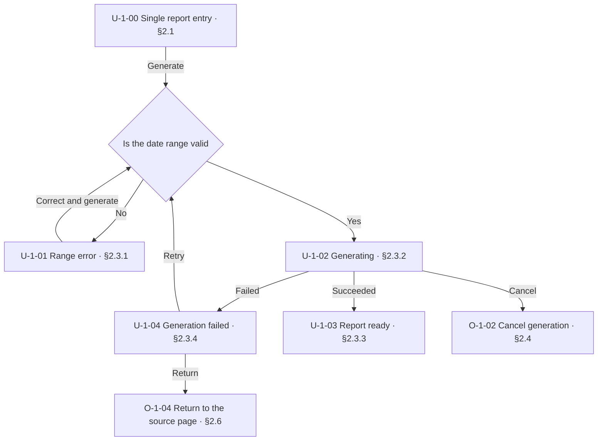
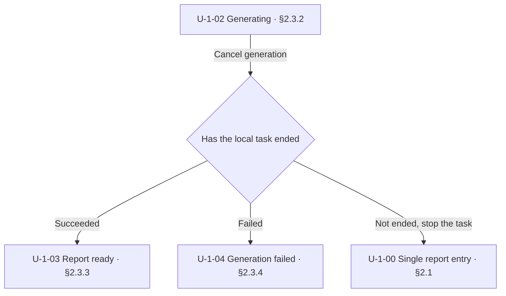
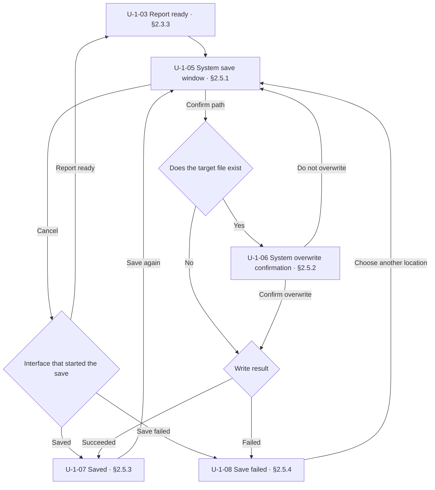
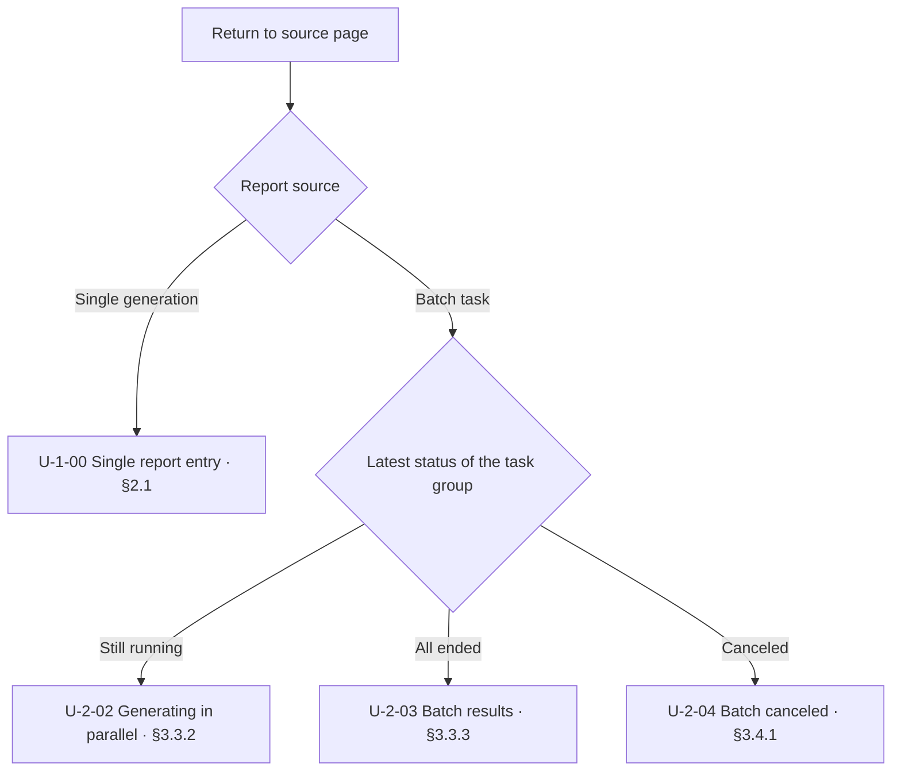
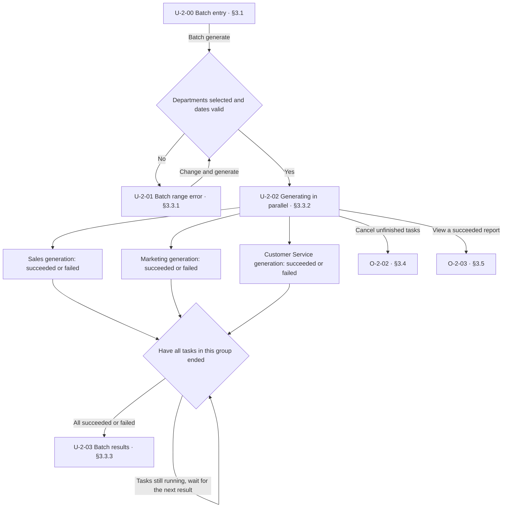
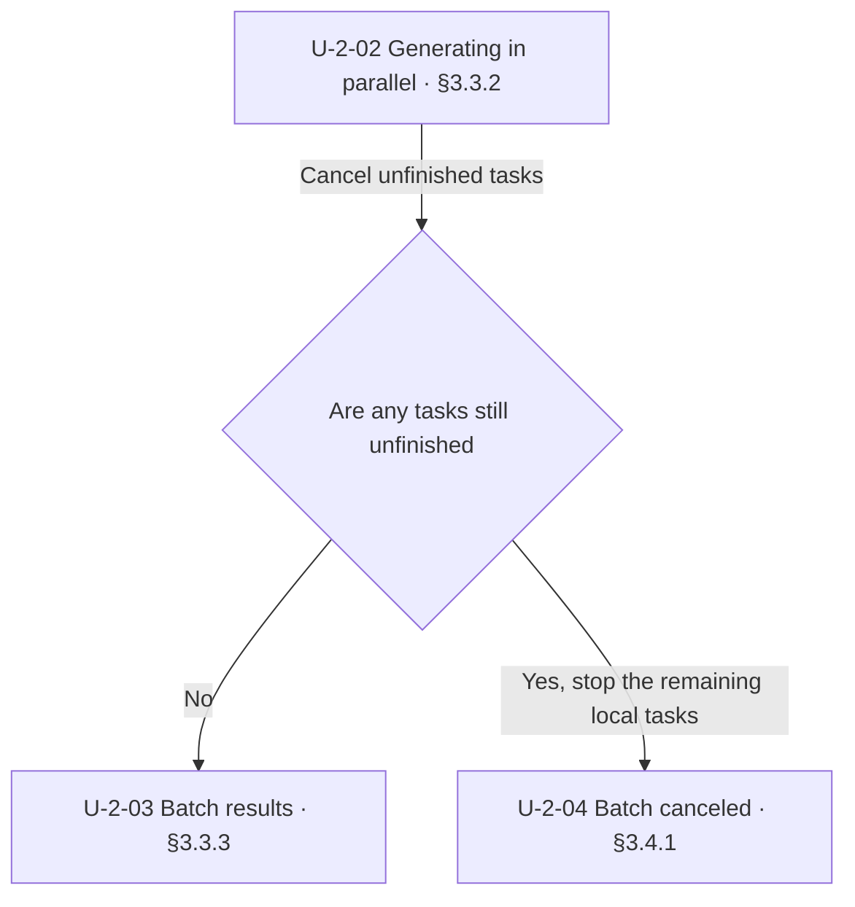
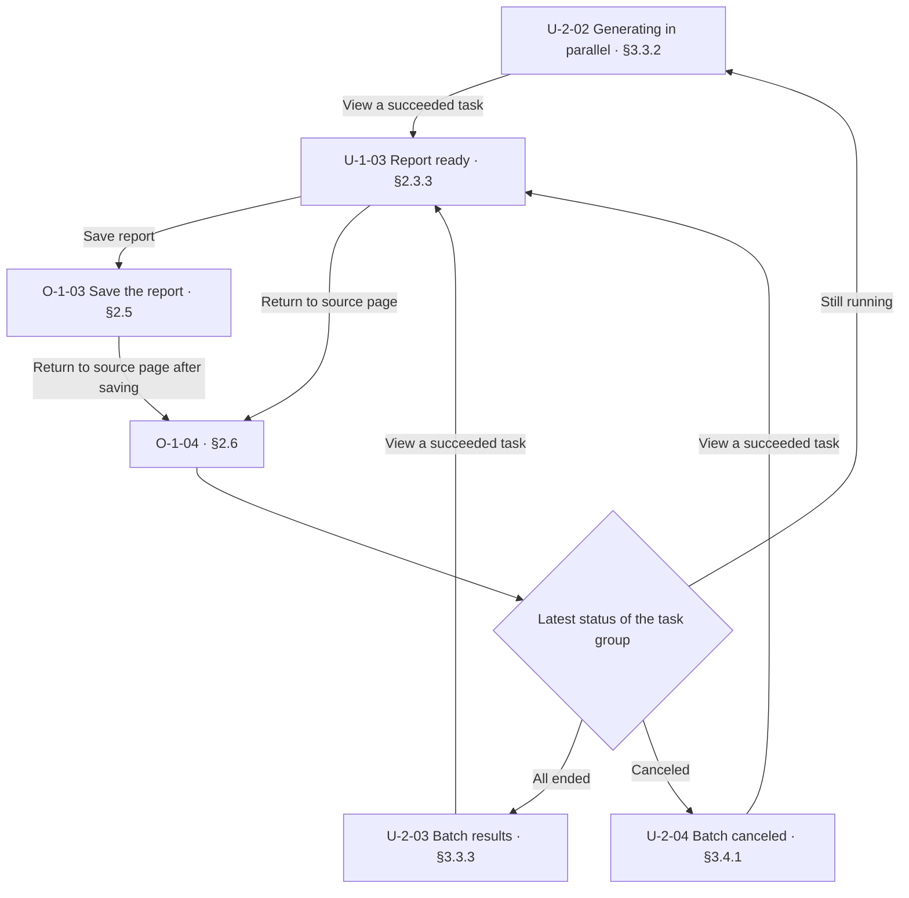
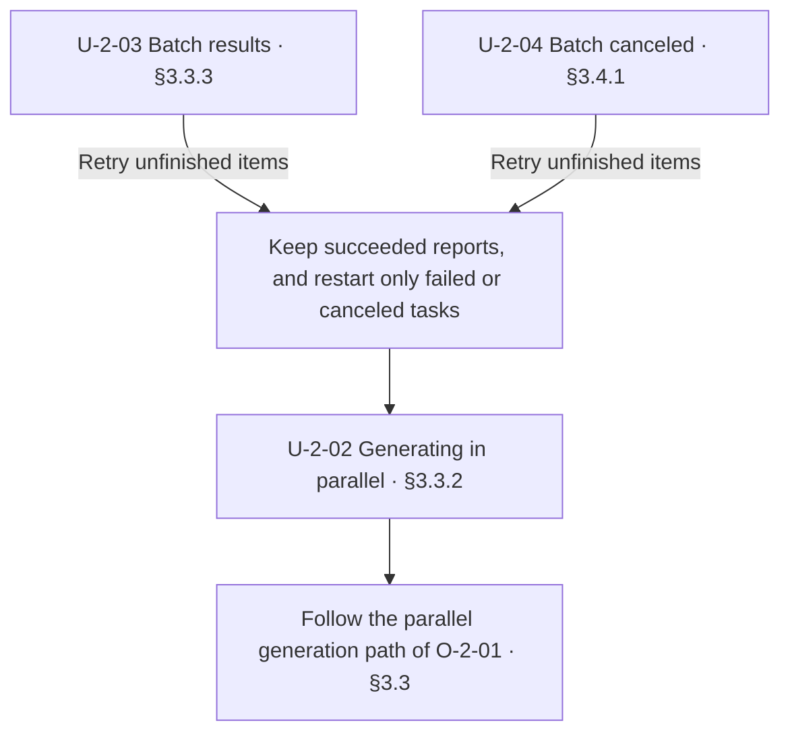

# Doc Design: interaction

## 1 Purpose

Define product interaction behavior from the user's perspective so that user operations, interfaces, and feedback can be understood, implemented, and verified consistently

Internal implementation belongs in the corresponding module design
Usage guidance belongs in [user-manual](user-manual.md)
Black-box tests for interaction behavior belong in [testcase](testcase.md)

## 2 Structure

The first [chapter](../../CONTEXT.md#chapter), “Usage Scenarios”, summarizes feature groups, user goals, entry points, and their locations
Later content expands each feature group F, using [drill-down](../../skills/references/drill-down.md) along user operations

### 2.1 Features, Operations, and Interfaces

| Object | Meaning | Doc level and location |
| --- | --- | --- |
| F feature group | A group of related user features | One [chapter](../../CONTEXT.md#chapter) for each F |
| O user operation | An action the user actually performs | Expanded within F from the third [section](../../CONTEXT.md#section) onward |
| U interface | A page the user can encounter and operate, covering at least every page type | Put the entry U in the first [section](../../CONTEXT.md#section) of F, and every other U in a [subsection](../../CONTEXT.md#subsection) of the corresponding O |

Within the [chapter](../../CONTEXT.md#chapter) for each F, arrange each [section](../../CONTEXT.md#section) and its [subsections](../../CONTEXT.md#subsection) according to the following [hierarchy tree](../patterns/hierarchy-tree.md#21-tree)

```text
<interaction design doc>
├─ 1 Usage Scenarios                  chapter
├─ 2 F1 <feature group>               chapter
│  ├─ 2.1 U-1-00 <entry interface>    section
│  ├─ 2.2 Operation Overview          section
│  ├─ 2.3 O-1-01 <user operation>     section
│  │  ├─ 2.3.1 U-1-01 <interface>    subsection
│  │  └─ 2.3.2 U-1-02 <interface>    subsection
│  └─ 2.4 O-1-02 <user operation>     section
│     └─ 2.4.1 U-1-03 <interface>    subsection
└─ 3 F2 <feature group>               chapter
   ├─ 3.1 U-2-00 <entry interface>    section
   ├─ 3.2 Operation Overview          section
   ├─ 3.3 O-2-01 <user operation>     section
   │  └─ 3.3.1 U-2-01 <interface>    subsection
   └─ …
```

Each F has exactly one entry U, which is the starting point for traversing the feature
The second [section](../../CONTEXT.md#section) in each F is the operation overview, which summarizes the operations on all U in that F, the interfaces that start them, and links to detailed descriptions, including operations on later result and failure pages
When an existing O is reused, the overview references the original O

### 2.2 Numbering

| Object | Number | Example |
| --- | --- | --- |
| Feature group | F plus the feature group number | `F1`, `F2` |
| User operation | O-feature group number-operation sequence number | `O-1-01`, `O-1-02` |
| Single entry | U-feature group number-00 | `U-1-00`, `U-2-00` |
| Other interfaces | U-feature group number-interface sequence number | `U-1-01`, `U-1-02` |

Number F in body order
Within each F, number O and non-entry U separately and consecutively from `01`, in the body order where each is first defined
U numbers do not include O numbers
Reuse keeps the existing number

### 2.3 Operation Paths

Each O starts by referencing its starting U and describing the user action and execution conditions
Wherever possible, lead the operation path with a [flowchart](../patterns/flowchart.md#21-flowchart); only very simple operations that need no expansion can use short text
Page nodes in the diagram show the U number, name, and chapter location, and link to the corresponding mockup
Express later U along the normal, failure, interruption, and recovery branches, and give retry, return, and cancel paths clear destinations
When multiple areas run at the same time, show the parallel paths and the join conditions in the diagram

### 2.4 Interface Mockups

Use HTML interface mockups in the body as the main form of expression, showing the layout, content, controls, and feedback the user actually sees
Put the U number in the heading, and write design notes, entry conditions, and internal processing outside the mockup
When static mockups cannot express operation order, immediate feedback, or dynamic changes, add an interactive prototype
Use [card mockups](../patterns/lark-card-mockup.md) for Lark (Feishu) cards

A partial mockup states the U number it belongs to and its location on the page, and links to that U
Parallel pages show the progress, button states, and error messages of each area in one mockup
Error mockups show the specific error copy and the corresponding handling buttons
When the user needs to change content, mark the problem location and give a suggested change

System native windows are also covered by U, such as directory selection, file save, and authorization windows

## 3 Writing Steps

1. **Determine F and the entry U**
   - Divide F by user goal, and build the content for each F according to [Structure](#2-structure)
   - Draw the single entry U for each F, and describe the available operations and permissions where roles differ
2. **Expand O from the current U**
   - Starting from the entry U, list the O the user can perform, and reference existing O directly
   - Express each O according to [Operation Paths](#23-operation-paths), and use the normal, failure, interruption, and recovery branches of internal processing to find all later U
   - Add permissions, validation, and control enablement conditions that the diagrams and mockups do not express, and the content retained after saving, canceling, leaving, or retrying
3. **Show later U and continue the traversal**
   - Draw later U according to [Interface Mockups](#24-interface-mockups); for an existing U, reference the original definition and state the differences and the return location
   - Add mockups when the layout, operation method, or feedback differs, and use a representative example for pages of the same type that differ only in data
   - Return from each later U to step 2 and continue expanding until all user operations and page types of the F are covered
4. **Summarize and check**
   - Fill in the scenario index and the operation overview of each F, and check F, O, and U against [Numbering](#22-numbering)
   - Walk every path from each entry U, and check diagrams, body text, and mockups against the [Checklist](#5-checklist)
   - List the coverage of this round, and record undesigned content and implementation differences in the corresponding project records

## 4 Example

### 4.1 Short Structure Example

The following excerpt shows how a login feature is organized; a complete doc also covers the other operations and branches of the feature

```text
## 1 Usage Scenarios
  F1 Login: obtain access, entry U-1-00, links to chapter 2
## 2 F1 Login
### 2.1 U-1-00 Login Entry
  Interface mockup with account, password, and login button
### 2.2 Operation Overview
  Summarizes the operations on each U, the interfaces that start them, and links to detailed descriptions
### 2.3 O-1-01 Log In with Account and Password
  Starting U, user action, conditions, and flowchart
#### 2.3.1 U-1-01 Submitting
  Interface mockup of submission progress and control states
#### 2.3.2 U-1-02 Login Failed
  Interface mockup of the error and the resubmit operation
### 2.4 O-1-02 Start the Software Again
  A flowchart shows that a valid login enters the workspace and an expired login returns to U-1-00
#### 2.4.1 U-1-03 Confirm Login Status
  Interface mockup of confirmation progress
```

### 4.2 Complete Doc Example for Two Related Features

The following Markdown can be read as a standalone interaction doc, with HTML placed directly in the body of the corresponding U
The example covers single reports and batch generation, and page buttons switch between the two entry points
The native save window follows the Windows page type

````markdown
# Department Report Tool Interaction Design

## 1 Usage Scenarios

| Feature group | Purpose | Single entry | Interaction design |
| --- | --- | --- | --- |
| F1 Single Report | Generate and save the report for one department | U-1-00, shown when the tool starts | [§2](#2-f1-single-report) |
| F2 Batch Generation | Generate reports for multiple departments in parallel | U-2-00, entered from the single report entry | [§3](#3-f2-batch-generation) |

## 2 F1 Single Report

### 2.1 U-1-00 Single Report Entry

<div style="max-width:640px;padding:20px;border:1px solid #cbd5e1;border-radius:8px;font:14px/1.6 sans-serif;background:#fff;color:#1e293b">
  <h3>Generate a Department Report</h3>
  <p><label>Department <select><option>Sales</option><option>Marketing</option></select></label></p>
  <p><label>Start date <input type="date" value="2026-09-01"></label> <label>End date <input type="date" value="2026-09-30"></label></p>
  <button type="button">Generate report</button> <button type="button">Batch generate</button>
</div>

The department list shows only departments the current account can access, selects the account's department by default, and the dates default to the current month
In this example, reports are generated locally, and every report being generated can be canceled

### 2.2 Operation Overview

| Operation | Started from | Purpose | Details |
| --- | --- | --- | --- |
| O-1-01 Generate a report | U-1-00, U-1-01, U-1-04 | Fill in the range and generate, or retry a failed report | [§2.3](#23-o-1-01-generate-a-report) |
| O-1-02 Cancel generation | U-1-02 | Stop the current generation and return to the entry | [§2.4](#24-o-1-02-cancel-generation) |
| O-1-03 Save the report | U-1-03, U-1-07, U-1-08 | Choose a save location and write the PDF | [§2.5](#25-o-1-03-save-the-report) |
| O-1-04 Return to the source page | U-1-03, U-1-04, U-1-07, U-1-08 | Return to the generation entry or the original batch list | [§2.6](#26-o-1-04-return-to-the-source-page) |
| O-1-05 Switch to batch generation | U-1-00 | Enter the batch entry | [§2.7](#27-o-1-05-switch-to-batch-generation) |

### 2.3 O-1-01 Generate a Report

On [U-1-00](#21-u-1-00-single-report-entry) or [U-1-01](#231-u-1-01-range-error), select a department, fill in the dates, and click “Generate report”
On [U-1-04](#234-u-1-04-generation-failed), click “Retry” to generate again with the original range



The start and end dates are both required, and the start date must not be later than the end date
After entering the generating state, only one generation is accepted; closing the tool stops unfinished local tasks, and starting again shows the entry and restores the last selected range

#### 2.3.1 U-1-01 Range Error

<div style="max-width:640px;padding:20px;border:1px solid #cbd5e1;border-radius:8px;font:14px/1.6 sans-serif;background:#fff;color:#1e293b">
  <h3>Generate a Department Report</h3>
  <p><label>Department <select><option>Sales</option></select></label></p>
  <p><label>Start date <input type="date" value="2026-09-30"></label> <label>End date <input type="date" value="2026-09-01"></label></p>
  <p role="alert" style="color:#b91c1c">The start date cannot be later than the end date. Change the dates and generate again</p>
  <button type="button">Generate report</button>
</div>

When a date is missing, the error appears under the missing date field with “Select a start date” or “Select an end date”
Filling in and generating again follow [O-1-01](#23-o-1-01-generate-a-report)

#### 2.3.2 U-1-02 Generating

<div style="max-width:640px;padding:20px;border:1px solid #cbd5e1;border-radius:8px;font:14px/1.6 sans-serif;background:#fff;color:#1e293b">
  <h3>Generate a Department Report</h3><p>Sales · 2026-09-01 to 2026-09-30</p>
  <p role="status">Generating the report</p><progress value="45" max="100">45%</progress>
  <p><button type="button">Cancel generation</button></p>
</div>

#### 2.3.3 U-1-03 Report Ready

<div style="max-width:640px;padding:20px;border:1px solid #cbd5e1;border-radius:8px;font:14px/1.6 sans-serif;background:#fff;color:#1e293b">
  <h3>Report Generated</h3><p>Sales · 2026-09-01 to 2026-09-30 · 128 records in total</p>
  <button type="button">Save report</button> <button type="button">Return to source page</button>
</div>

A report opened from the batch list uses this interface, takes the department, dates, and record count from the corresponding task result, and keeps the source list
“Save report” performs [O-1-03](#25-o-1-03-save-the-report), and “Return to source page” performs [O-1-04](#26-o-1-04-return-to-the-source-page)

#### 2.3.4 U-1-04 Generation Failed

<div style="max-width:640px;padding:20px;border:1px solid #cbd5e1;border-radius:8px;font:14px/1.6 sans-serif;background:#fff;color:#1e293b">
  <h3>Report Generation Failed</h3><p>Sales · 2026-09-01 to 2026-09-30</p>
  <p role="alert" style="color:#b91c1c">Reading department data timed out. Try again later</p>
  <button type="button">Retry</button> <button type="button">Return to source page</button>
</div>

### 2.4 O-1-02 Cancel Generation

On [U-1-02](#232-u-1-02-generating), click “Cancel generation”



Cancellation and the generation result are handled by whichever result the local task confirms first
After a successful cancellation, the selected range is kept, and the following immediate message is added under the form on [U-1-00](#21-u-1-00-single-report-entry)

<p role="status">Generation canceled. You can change the range and generate again</p>

### 2.5 O-1-03 Save the Report

On [U-1-03](#233-u-1-03-report-ready), [U-1-07](#253-u-1-07-saved), or [U-1-08](#254-u-1-08-save-failed), click “Save report”



While saving, the starting page stays in place, shows “Saving” next to the save button, and temporarily disables the save and return buttons
The following partial mockup is in the bottom action area of that page, and the report summary stays as on the starting page

<div><span role="status">Saving</span> <button type="button" disabled>Save report</button> <button type="button" disabled>Return to source page</button></div>

Canceling the window or a failed write both keep the generated report; after the tool is closed, the report must be generated again before it can be saved

#### 2.5.1 U-1-05 System Save Window

Open the Windows native “Save As” window, with the last successful save directory as the initial directory, or the current user's Documents directory on first use
The default file name is “Sales-2026-09.pdf”, and the file type is limited to PDF
The user can change the directory and file name
When the target name already exists, go to [U-1-06](#252-u-1-06-system-overwrite-confirmation); canceling Save As returns to the U that started the save
Until the window is confirmed, the original report and the target file stay unchanged
Other departments and dates use the same native window page type with a different default file name

```text
Windows native "Save As" window
Location: Documents
File name: Sales-2026-09.pdf
Save as type: PDF (*.pdf)
Actions: Save / Cancel
```

#### 2.5.2 U-1-06 System Overwrite Confirmation

The Windows native duplicate-name confirmation window shows the target file name; the file is written only if the user confirms the overwrite, and declining returns to [U-1-05](#251-u-1-05-system-save-window)

```text
Windows native overwrite confirmation window
Sales-2026-09.pdf already exists
Do you want to replace it?
Actions: Yes / No
```

#### 2.5.3 U-1-07 Saved

<div style="max-width:640px;padding:20px;border:1px solid #cbd5e1;border-radius:8px;font:14px/1.6 sans-serif;background:#fff;color:#1e293b">
  <h3>Report Saved</h3><p>Sales · 2026-09-01 to 2026-09-30</p>
  <p role="status">Saved to C:/Reports/Sales-2026-09.pdf</p>
  <button type="button">Save report</button> <button type="button">Return to source page</button>
</div>

#### 2.5.4 U-1-08 Save Failed

<div style="max-width:640px;padding:20px;border:1px solid #cbd5e1;border-radius:8px;font:14px/1.6 sans-serif;background:#fff;color:#1e293b">
  <h3>Report Save Failed</h3><p>Sales · 2026-09-01 to 2026-09-30</p>
  <p role="alert" style="color:#b91c1c">The selected directory cannot be written to. Choose another save location</p>
  <button type="button">Save report</button> <button type="button">Return to source page</button>
</div>

### 2.6 O-1-04 Return to the Source Page

On [U-1-03](#233-u-1-03-report-ready), [U-1-04](#234-u-1-04-generation-failed), [U-1-07](#253-u-1-07-saved), or [U-1-08](#254-u-1-08-save-failed), click “Return to source page”



The single report entry keeps the last selected range, and the batch list shows the latest task status and restores the previously selected task

### 2.7 O-1-05 Switch to Batch Generation

On [U-1-00](#21-u-1-00-single-report-entry), click “Batch generate” to enter [U-2-00](#31-u-2-00-batch-generation-entry) with the current date range

## 3 F2 Batch Generation

### 3.1 U-2-00 Batch Generation Entry

<div style="max-width:640px;padding:20px;border:1px solid #cbd5e1;border-radius:8px;font:14px/1.6 sans-serif;background:#fff;color:#1e293b">
  <h3>Batch Generate Department Reports</h3>
  <p><label><input type="checkbox" checked>Sales</label> <label><input type="checkbox" checked>Marketing</label> <label><input type="checkbox" checked>Customer Service</label></p>
  <p><label>Start date <input type="date" value="2026-09-01"></label> <label>End date <input type="date" value="2026-09-30"></label></p>
  <button type="button">Batch generate</button> <button type="button">Single report</button>
</div>

The department range follows the permission constraints of [U-1-00](#21-u-1-00-single-report-entry)
On first entry from the single report entry, the department selected there is checked; the mockup shows the same page type with three departments selected by the user

### 3.2 Operation Overview

| Operation | Started from | Purpose | Details |
| --- | --- | --- | --- |
| O-2-01 Batch generate | U-2-00, U-2-01 | Select departments and dates, and start a task group | [§3.3](#33-o-2-01-batch-generate) |
| O-2-02 Cancel unfinished tasks | U-2-02 | Keep existing results and stop the remaining tasks | [§3.4](#34-o-2-02-cancel-unfinished-tasks) |
| O-2-03 View a report | U-2-02, U-2-03, U-2-04 | View the report of a succeeded task | [§3.5](#35-o-2-03-view-a-report) |
| O-2-04 Retry unfinished items | U-2-03, U-2-04 | Retry failed or canceled tasks | [§3.6](#36-o-2-04-retry-unfinished-items) |
| O-2-05 Return to selection | U-2-03, U-2-04 | Return to the batch entry to adjust the selection | [§3.7](#37-o-2-05-return-to-selection) |
| O-2-06 Switch to single report | U-2-00 | Return to the single report entry | [§3.8](#38-o-2-06-switch-to-single-report) |
| Reuse O-1-03 Save the report | U-1-03, U-1-07, U-1-08 | Save a report opened from the list | [§2.5](#25-o-1-03-save-the-report) |
| Reuse O-1-04 Return to the source page | U-1-03, U-1-07, U-1-08 | Return to the original batch list | [§2.6](#26-o-1-04-return-to-the-source-page) |

### 3.3 O-2-01 Batch Generate

On [U-2-00](#31-u-2-00-batch-generation-entry) or [U-2-01](#331-u-2-01-batch-range-error), check departments, fill in the dates, and click “Batch generate”



Date validation follows [O-1-01](#23-o-1-01-generate-a-report), and at least one department must be selected
Each selected department has one task with independently updated progress, and when one task fails, the other tasks continue
In this example, the three tasks can generate at the same time, and changes in percentages and completion order follow the same parallel page type
Closing the tool stops unfinished local tasks; saved files are kept, and unsaved reports and the task list are cleared on exit

#### 3.3.1 U-2-01 Batch Range Error

<div style="max-width:640px;padding:20px;border:1px solid #cbd5e1;border-radius:8px;font:14px/1.6 sans-serif;background:#fff;color:#1e293b">
  <h3>Batch Generate Department Reports</h3>
  <p><label><input type="checkbox">Sales</label> <label><input type="checkbox">Marketing</label> <label><input type="checkbox">Customer Service</label></p>
  <p role="alert" style="color:#b91c1c">Select at least one department</p>
  <p><label>Start date <input type="date" value="2026-09-01"></label> <label>End date <input type="date" value="2026-09-30"></label></p>
  <button type="button">Batch generate</button>
</div>

Date errors appear under the corresponding date field in the same way as [U-1-01](#231-u-1-01-range-error), and selecting departments and correcting dates both belong to [O-2-01](#33-o-2-01-batch-generate)

#### 3.3.2 U-2-02 Generating in Parallel

<div style="max-width:640px;padding:20px;border:1px solid #cbd5e1;border-radius:8px;font:14px/1.6 sans-serif;background:#fff;color:#1e293b">
  <h3>Batch Generate Department Reports</h3><p role="status">1 / 3 ended · 2026-09-01 to 2026-09-30</p>
  <ul>
    <li>Sales: generated <button type="button">View report</button></li>
    <li>Marketing: generating <progress value="60" max="100">60%</progress></li>
    <li>Customer Service: generating <progress value="20" max="100">20%</progress></li>
  </ul>
  <button type="button">Cancel unfinished tasks</button>
</div>

When a task fails, its row shows the failure summary from [U-2-03](#333-u-2-03-batch-results), and the other progress areas stay visible
Only succeeded tasks offer “View report”; retry and return to selection are offered only after all tasks end

#### 3.3.3 U-2-03 Batch Results

<div style="max-width:640px;padding:20px;border:1px solid #cbd5e1;border-radius:8px;font:14px/1.6 sans-serif;background:#fff;color:#1e293b">
  <h3>Batch Generation Ended</h3><p>2 succeeded, 1 failed · 2026-09-01 to 2026-09-30</p>
  <ul>
    <li>Sales: generated <button type="button">View report</button></li>
    <li style="color:#b91c1c">Marketing: reading data timed out, can be retried</li>
    <li>Customer Service: generated <button type="button">View report</button></li>
  </ul>
  <button type="button">Retry unfinished items</button> <button type="button">Return to selection</button>
</div>

When all tasks succeed, every row shows the view operation and “Retry unfinished items” is hidden; when all tasks fail, every row shows a failure summary, and the retry and return operations stay available
Failed tasks use the same error facts as [U-1-04](#234-u-1-04-generation-failed), summarized by department in their task rows

### 3.4 O-2-02 Cancel Unfinished Tasks

On [U-2-02](#332-u-2-02-generating-in-parallel), click “Cancel unfinished tasks”



Tasks already confirmed as succeeded or failed keep their results, and the remaining tasks are marked as canceled

#### 3.4.1 U-2-04 Batch Canceled

<div style="max-width:640px;padding:20px;border:1px solid #cbd5e1;border-radius:8px;font:14px/1.6 sans-serif;background:#fff;color:#1e293b">
  <h3>Unfinished Tasks Canceled</h3><p>Generated reports kept · 2026-09-01 to 2026-09-30</p>
  <ul>
    <li>Sales: generated <button type="button">View report</button></li>
    <li>Marketing: canceled</li><li>Customer Service: canceled</li>
  </ul>
  <button type="button">Retry unfinished items</button> <button type="button">Return to selection</button>
</div>

Failed tasks continue to show the failure summary from [U-2-03](#333-u-2-03-batch-results)

### 3.5 O-2-03 View a Report

On [U-2-02](#332-u-2-02-generating-in-parallel), [U-2-03](#333-u-2-03-batch-results), or [U-2-04](#341-u-2-04-batch-canceled), click “View report” in the row of a succeeded task



The report and save interfaces reuse the definitions in F1, show the report data of the current department, and record the source task group and task row
While a report is viewed or saved, the other batch tasks continue, and on return the list U that matches the latest results is shown

### 3.6 O-2-04 Retry Unfinished Items

On [U-2-03](#333-u-2-03-batch-results) or [U-2-04](#341-u-2-04-batch-canceled), click “Retry unfinished items”



### 3.7 O-2-05 Return to Selection

On [U-2-03](#333-u-2-03-batch-results) or [U-2-04](#341-u-2-04-batch-canceled), click “Return to selection” to go back to [U-2-00](#31-u-2-00-batch-generation-entry), keeping the departments and dates
Generating again creates a new task group that replaces the old list, and saved files are kept

### 3.8 O-2-06 Switch to Single Report

On [U-2-00](#31-u-2-00-batch-generation-entry), click “Single report” to go back to [U-1-00](#21-u-1-00-single-report-entry), restoring the last single report selection, or the entry defaults on first use
````

## 5 Checklist

- [ ] The scenario index covers all F in this round, and user goals, entry points, and corresponding chapters can be located
- [ ] Each F has exactly one entry U, numbered U-feature group number-00, in the first [section](../../CONTEXT.md#section)
- [ ] The second [section](../../CONTEXT.md#section) is the operation overview, which summarizes the O on all U and links to the operation descriptions
- [ ] F, O, and U are organized as [chapters](../../CONTEXT.md#chapter), [sections](../../CONTEXT.md#section), and [subsections](../../CONTEXT.md#subsection), and the entry U is in the first [section](../../CONTEXT.md#section) as required
- [ ] O are divided by actual user actions, and automatic processing belongs to the O that triggers it
- [ ] From the entry U, following U → O → U traverses all operations and page types in the current scope
- [ ] Internal states and branches are used to find all U, and the destinations of normal, failure, interruption, and recovery paths are clear
- [ ] O use a flowchart wherever possible, and operations without a diagram are very simple with clear paths
- [ ] The U number, name, chapter location, and link of each page node in the diagrams match the body
- [ ] The starting point, user action, execution conditions, and later U of each O are clear, and every operation on each U has a corresponding O or reference
- [ ] F, O, and non-entry U are numbered separately and consecutively in body order, and U numbers do not include O numbers
- [ ] Shared O, U, and rules are defined in one place, and references keep the current context, differences, and return location
- [ ] User pages cover at least every page type, and partial mockups can locate their page and area
- [ ] Mockups show real content, controls, and feedback, and design notes are outside the mockups
- [ ] Error summaries, located details, suggested changes, and recovery operations fit the current user task
- [ ] Parallel paths, join conditions, the progress of each area, partial failures, and available operations are consistent
- [ ] System native windows involved in user operations are included in U and operation paths
- [ ] Permissions, validation, and control enablement conditions are complete, and the results and retained content of saving, canceling, leaving, and retrying are clear
- [ ] The index, overviews, flowcharts, mockups, and cross-doc references of the whole doc are synchronized, with no duplicate or dangling numbers
- [ ] The coverage of this round of interaction design is clear, and undesigned content and implementation differences have corresponding records
