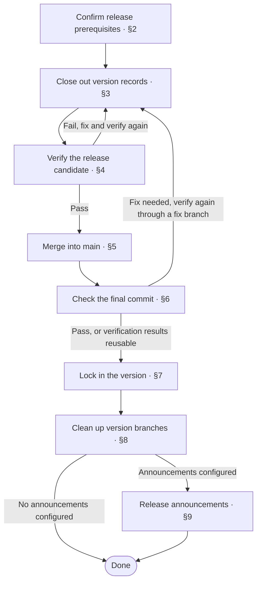

# Doc Design: release

## 1 Purpose

Define the complete process for this repository from pre-release verification to merging into main and locking the Tag, including the execution method, pass criteria, failure handling, and recovery point for each step
All parts delivered from the same repository use one repository version, and one release process is defined for them

## 2 Structure

The first [chapter](../../CONTEXT.md#chapter) shows the release process with a [flowchart](../patterns/flowchart.md#21-flowchart), and its nodes reference the corresponding stages
Later content expands the stages, and each stage can use its own [chapter](../../CONTEXT.md#chapter)
When there are few stages, they can share one [chapter](../../CONTEXT.md#chapter), separated by [sections](../../CONTEXT.md#section)
Each stage describes the execution method, pass criteria, failure handling, and recovery point
Use [drill-down](../../skills/references/drill-down.md) for complex stages based on their actual content

Treat release prerequisites as a stage to check, and describe the version source, version records, merge chain, and execution requirements
Arrange verification steps as needed by the repository, including tests, builds, verification on real platforms, and other necessary operations, either running full verification uniformly or defining tiered verification by the design boundary crossed and dependency blast radius
Include the release summary in the stage that locks the Tag
Arrange branch cleanup according to the repository policy, limited to branches merged in this release that no longer carry later work
Arrange release announcements as needed

The following [hierarchy tree](../patterns/hierarchy-tree.md#21-tree) shows an example where each stage has its own chapter, and the repository process determines the actual stages

```text
<release doc>
├─ 1 Release Process                    chapter
├─ 2 Confirm Release Prerequisites      chapter
├─ 3 Close Out Version Records          chapter
├─ 4 Verify the Release Candidate       chapter
├─ 5 Merge into main                    chapter
├─ 6 Check the Final Commit             chapter
├─ 7 Lock In the Version                chapter
├─ 8 Clean Up Version Branches          chapter
└─ 9 Release Announcements              chapter, as needed
```

## 3 Writing Steps

1. **Determine release inputs**
   - Determine the version source, version records, merge chain, and target Tag
   - Locate the environment, permissions, tools, and external dependencies required for execution
2. **Arrange stages and verification**
   - Arrange prerequisite checks, closing out version records, verification, and merging according to dependencies, and draw the overall process flowchart
   - Define the operations, pass criteria, and recovery point after failure for each stage
   - When verification is tiered by blast radius, define the corresponding test sets, conditions for escalating to full verification, and periodic full verification
   - When verification involves real platforms or model evaluation, define the required environment, data, and result evaluation criteria
   - In the final check, use the reuse conditions for existing results to decide whether to verify again, and link verification results to the final commit
3. **Define version lock-in and follow-up handling**
   - Define the final check of version records, and the source, format, and validation method for the release summary
   - Create an annotated Tag on the verified main commit, and after the push, check the remote target and annotation
   - Do not move or recreate the Tag after creation, only retry the push if it fails, and stop if a Tag with the same name conflicts
   - Arrange cleanup of branches merged in this release according to the repository policy
   - When announcements are needed, define how to extract content from the Tag annotation, the channels, the check of the send result, and retries after failure
     When using Lark (Feishu) cards, draw them according to the [card mockup](../patterns/lark-card-mockup.md)
4. **Organize the body and check it**
   - Expand each stage according to [Structure](#2-structure), and check the steps before and after each stage and the failure recovery paths
   - Check the version, Tag, final commit, and verification results against the [Checklist](#5-checklist)

## 4 Example

````markdown
# Report Service Release

## 1 Release Process



## 2 Confirm Release Prerequisites

Check the following conditions, and continue after any unmet condition is satisfied

| Item | Requirement for this release |
| --- | --- |
| Version source | VERSION, 2.0.0 for this release |
| Version records | The finalized section for this version in CHANGELOG |
| Consistency requirements | VERSION, pyproject.toml, and the target Tag version match |
| Merge chain | feature/report-export-v2.0.0 → main, merged through a Pull Request |
| Tag | v2.0.0, annotated Tag |
| Execution environment | Bash, Git, the project Python environment, and container build tools |
| Repository permissions | Commit version records, merge Pull Requests, and push Tags |
| Verification environment | A separate test database and object storage, using the isolated resources defined in [test fixtures](testcase.md#1-fixtures) |

`scripts/release-verify.sh` runs unit tests, database migration tests, an image build, and object storage upload and download verification
Verification results are linked to the source commit, verification inputs, individual results, and image digest, and the script returns a nonzero exit code if any check fails
Clean up test data from this run after verification

## 3 Close Out Version Records

1. Update the project version in VERSION and pyproject.toml to 2.0.0, close out the finalized section for this version in CHANGELOG, and commit
2. Run `bash scripts/check-version.sh 2.0.0`
   - Returns 0 and the working tree is clean: go to [candidate verification](#4-verify-the-release-candidate)
   - Validation fails: correct and commit the version records, then validate again

## 4 Verify the Release Candidate

1. Run `bash scripts/release-verify.sh`
2. Check the results
   - All checks pass, and the results are linked to the current candidate commit: go to [Merge into main](#5-merge-into-main)
   - Verification fails: fix the issue and rerun this stage
   - Test data cleanup fails: clean up data from this run first, then verify again

## 5 Merge into main

1. Create or update the Pull Request, complete the reviews and checks required by branch protection, then merge into main
   - Conflicts must be resolved or content must change: update the Pull Request after [candidate verification](#4-verify-the-release-candidate)
   - The Pull Request is not merged yet: stop at this stage
   - The Pull Request is merged: continue to the [final check](#6-check-the-final-commit)
2. When resuming, check the merge status first, and keep the merge result of a Pull Request that is already merged

## 6 Check the Final Commit

1. Run `git fetch origin`, switch to main, and synchronize with `git pull --ff-only origin main`
2. Check that local main matches remote main, the working tree is clean, and `bash scripts/check-version.sh 2.0.0` passes
3. Check whether the results of [candidate verification](#4-verify-the-release-candidate) apply to the current main
   - The tested content, tests, fixtures, configuration, toolchain, and dependency environment are the same, and verification does not depend on changed commit metadata: reuse the existing results and link them to the current main commit
   - The reuse conditions are not met: run `bash scripts/release-verify.sh` on the current main
4. After all required checks and verification pass, go to [Lock in the version](#7-lock-in-the-version)
   If a check or verification fails, stop at this stage, handle the cause, and verify again
   If content needs a fix, verify it on a fix branch and merge into main, then rerun this stage

Even when only the commit hash changes, check the verification conditions above; compare source content with `git diff --exit-code <candidate-commit> HEAD`

## 7 Lock In the Version

1. Generate a summary file outside the repository from the finalized section for this version in CHANGELOG, and validate its format with the [summary validation tool](../../bin/aca-tag-notify-check)
   The last summary entry uses the verification results from the [final check](#6-check-the-final-commit)
   If validation fails, correct the summary and validate again before continuing

   ```text
   v2.0.0: Report export

   ---NOTIFY-BEGIN---
   📄 Reports · Support exporting and downloading business reports
   ✅ Verification · Unit tests, migration tests, image build, and object storage verification passed
   ---NOTIFY-END---
   ```

2. Synchronize with the remote again, confirm that main still points to the verified commit, and check the target Tag locally and on the remote
   - The target Tag exists neither locally nor on the remote: create the Tag with `git tag -a v2.0.0 <verified-main-commit> -F /tmp/report-service-v2.0.0.md`, then run `git push origin v2.0.0`
   - main has changed: return to the [final check](#6-check-the-final-commit)
   - The Tag exists and its target and annotation match: keep the existing Tag, and push it if the remote does not have it yet
   - The target or annotation of a Tag with the same name does not match: stop and report the conflict
3. Check that the remote Tag is an annotated Tag, points to the verified main commit, and contains the summary for this version in its annotation

## 8 Clean Up Version Branches

1. Check that the remote Tag passed verification, and confirm that the version branch for this release is merged into main and no longer carries later work
2. Clean up the version branch according to the repository policy
   - Cleanup conditions are met: delete the merged local and remote version branches for this release
   - The branch still carries later work, or its merge status cannot be confirmed: keep the branch
   - Cleanup fails: keep the locked-in Tag, fix the cleanup issue, and continue this stage

## 9 Release Announcements

Pushing a remote v* Tag triggers the announcement pipeline, which uses the [announcement extraction tool](../../bin/aca-tag-notify-extract) to extract content from the Tag annotation and send it to the development release group
See [Release Bot](security.md#3-release-bot) for bot credential sources and handling credential leaks

Check the actual send result of the announcement job
If credentials are missing or sending fails, add the credentials or fix the issue, then rerun the announcement job with the same Tag
````

## 5 Checklist

- [ ] The overall flowchart matches the corresponding stages, and release prerequisites include the version source, version records, merge chain, target Tag, and execution requirements
- [ ] The process covers all necessary operations for this repository from pre-release verification to merging into main and locking the Tag
- [ ] Each stage has an execution method, pass criteria, failure handling, and a recovery point
- [ ] The verification environment, commands, and result evaluation criteria are defined, and existing results are checked against the reuse conditions and linked to the final commit
- [ ] When tiered verification is used, the test sets for each blast radius, conditions for escalating to full verification, and the fallback full verification are defined
- [ ] Prerequisites and results connect across stages, and resuming execution has a clear recovery point
- [ ] Version records are consistent, and the summary source, format, and validation method are defined
- [ ] The remote annotated Tag points to the verified final main commit, and the version, commit, and verification results are traceable
- [ ] Tags are not moved or recreated, failed pushes are only retried, and execution stops if the target or annotation of a Tag with the same name conflicts
- [ ] If branch cleanup is configured, it is limited to branches merged in this release that no longer carry later work
- [ ] If announcements are configured, the trigger, content extraction, channels, credential sources, check of the send result, and retry method are clear
- [ ] If cleanup or announcements fail, continue the corresponding stage and keep the locked-in version
