# Flowchart

## 1 When to Use

Describe flows with branches and loops within a submodule or a single module
Use a [flowchart](#21-flowchart) for flows that follow explicit rules
Add [executor markers](#22-executor-markers) to flows that include model judgment or autonomous execution

Use numbered lists for fixed steps without branches or loops
Use a [sequence diagram](sequence-diagram.md) when the focus is on collaboration between multiple participants

## 2 Presentation Principles

| Content | Required When | Presentation Rules |
| --- | --- | --- |
| Flowchart | Always required | [§2.1](#21-flowchart) |
| Executor markers | Required for flows that include LLM／Agent | [§2.2](#22-executor-markers) |

### 2.1 Flowchart

The flowchart governs its chapter or section, and nodes that need detail reference the corresponding subsections without separate step numbering

- Use Mermaid `flowchart TD` and follow the syntax in the [official flowchart documentation](https://mermaid.ai/open-source/syntax/flowchart.html)
- Divide and name nodes by the business purpose of each stage, not by specific operation
- List specific steps in execution order in subsections, state decision conditions explicitly, and do not repeat paths shown in the diagram

### 2.2 Executor Markers

Flows that include LLM／Agent follow [§2.1](#21-flowchart), with an executor marker before the name of each step node

| Marker | Executor | Meaning |
| --- | --- | --- |
| ⚙️ | Program | Executes predefined rules |
| 🧠 | LLM | A single model call |
| 🤖 | Agent | Autonomously organizes execution around a goal |
| 👤 | Human | A person makes decisions or performs actions |

## 3 Example

### 3.1 Checkout

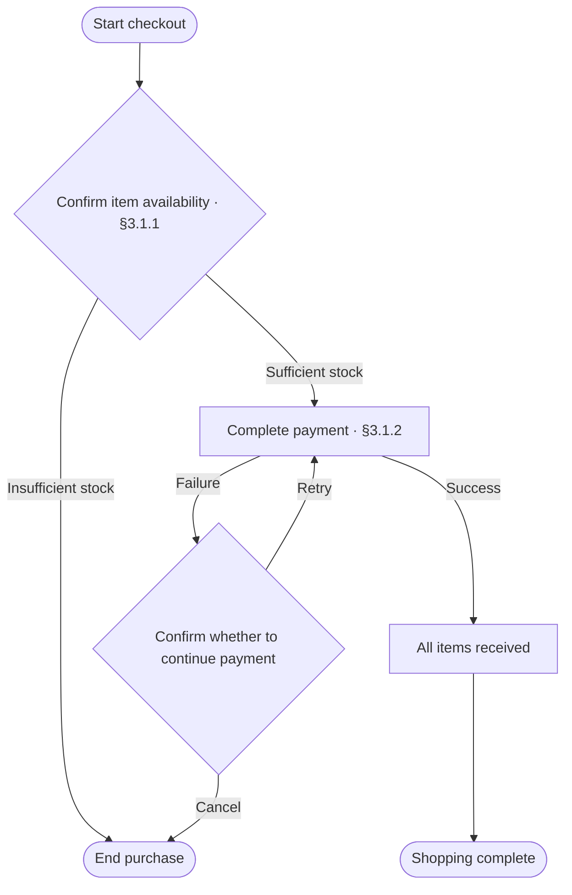

#### 3.1.1 Confirm Item Availability

1. Query available stock by item and variant
2. If any item has no record or stock is below the purchase quantity, take the "Insufficient stock" branch
3. If stock meets the purchase quantity for all items, take the "Sufficient stock" branch

#### 3.1.2 Complete Payment

1. Confirm the total amount due, including shipping and deducting discounts
2. Verify the previous payment result before retrying: if successful, take the "Success" branch; if undetermined, wait for confirmation
3. For the first payment or after confirming that the previous payment failed, initiate payment for the total amount due
4. Take the "Success" or "Failure" branch based on the confirmed payment result

### 3.2 Order Inquiry

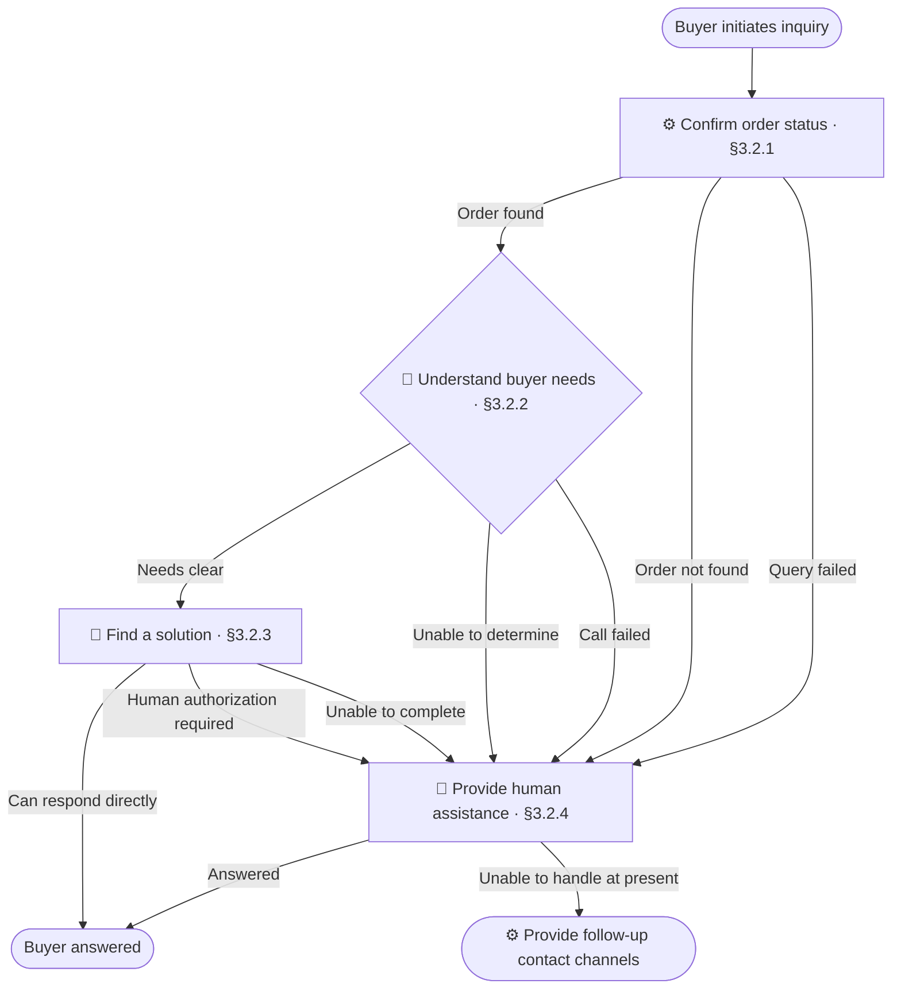

#### 3.2.1 Confirm Order Status

1. Retrieve the order selected by the buyer
2. If no order is selected, the order does not exist, or access is denied, take the "Order not found" branch
3. Query item, payment, and shipping status, and take the "Query failed" branch if the query fails
4. Hide the full address and phone number, and take the "Order found" branch

#### 3.2.2 Understand Buyer Needs

1. Send the buyer's description and order status to the LLM to extract the subject of the inquiry and the expected outcome
2. If the subject and expected outcome are clear without relying on guesses, take the "Needs clear" branch
3. If information is missing or contradictory, or the output does not meet requirements, take the "Unable to determine" branch
4. If the model call fails, take the "Call failed" branch

#### 3.2.3 Find a Solution

1. Consult product descriptions, shipping records, or after-sales rules based on the buyer's needs
2. If only an explanation or advice is needed and the available information supports a response, answer the buyer with supporting evidence and take the "Can respond directly" branch
3. If refund or compensation authorization is involved, take the "Human authorization required" branch
4. If information is insufficient or contradictory, or execution fails, take the "Unable to complete" branch

#### 3.2.4 Provide Human Assistance

1. Read the existing needs and query records, and ask the buyer only for missing information
2. For refunds or compensation, check the authorized amount limit and record the handler, amount, and reason
3. Complete handling within the authorized scope, answer the buyer, and take the "Answered" branch
4. If no human joins, the request exceeds authorization, or handling is not currently possible, take the "Unable to handle at present" branch

## 4 Checklist

### 4.1 Fixed Steps Shown as a Flowchart

- [ ] Fixed steps without branches or loops use a numbered list, not a flowchart

**Counterexample**

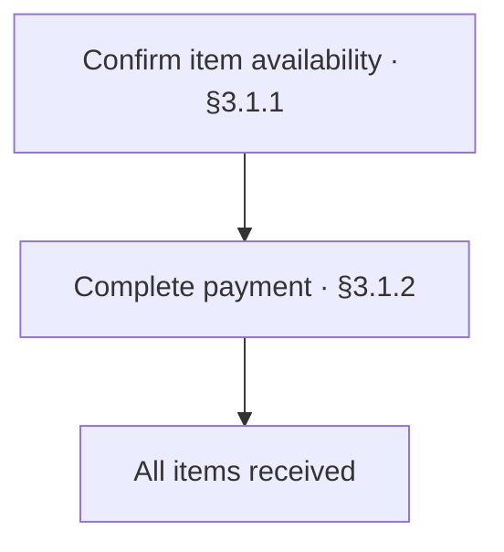

### 4.2 Nodes Split by Specific Operation

- [ ] Nodes are divided and named by the business purpose of each stage, without turning each operation within a stage into a separate node

**Counterexample**

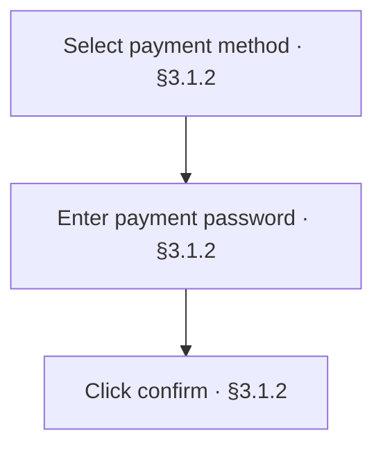

These operations all serve "Complete payment" and should be detailed in that stage's subsection

### 4.3 Extra Step Numbering

- [ ] Nodes do not have separate step numbering

**Counterexample**

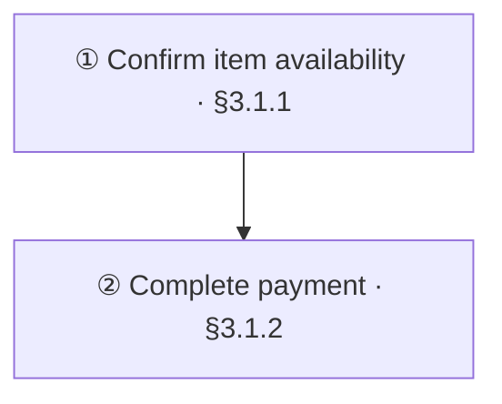

### 4.4 Chapter and Section Reference Mismatch

- [ ] Nodes that need detail have chapter or section references, and the referenced subsections exist with content that matches the nodes' meaning

**Counterexample**

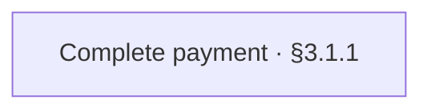

§3.1.1 explains stock checks, while payment is actually detailed in §3.1.2

### 4.5 Unclear Branch Conditions

- [ ] Each branch of a branching node has an explicit condition

**Counterexample**

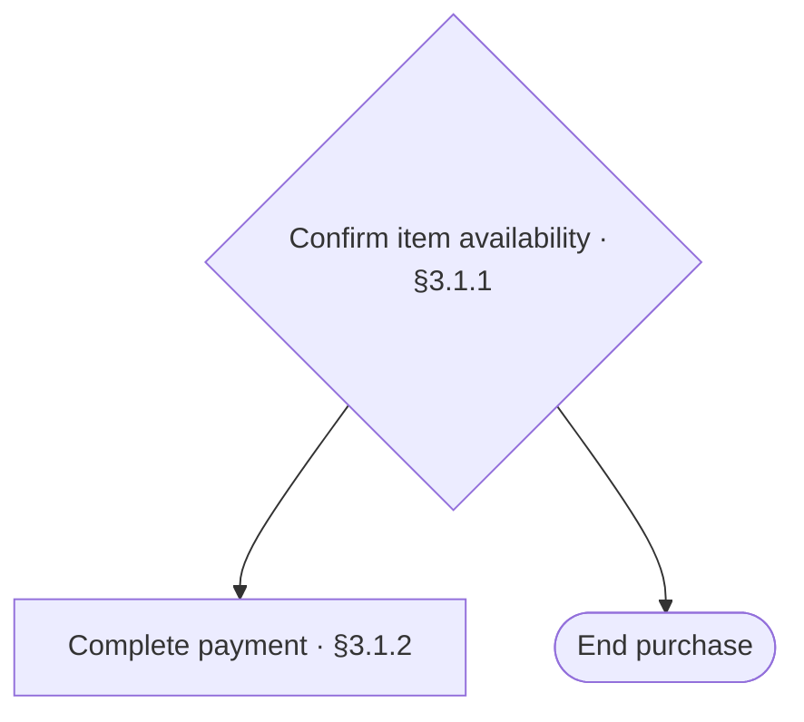

### 4.6 Unexpected Path Breaks

- [ ] All nonterminal nodes have outgoing paths

**Counterexample**

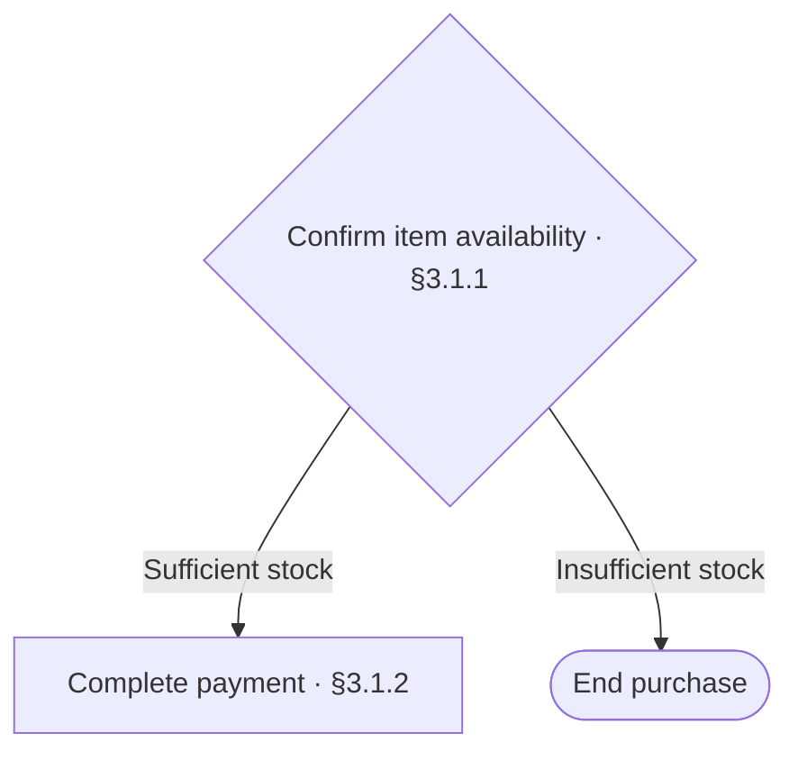

There is no outcome or destination after "Complete payment"

### 4.7 Loops Lack Return Points or Exit Conditions

- [ ] Return points and exit conditions for loops and retries are explicit

**Counterexample**

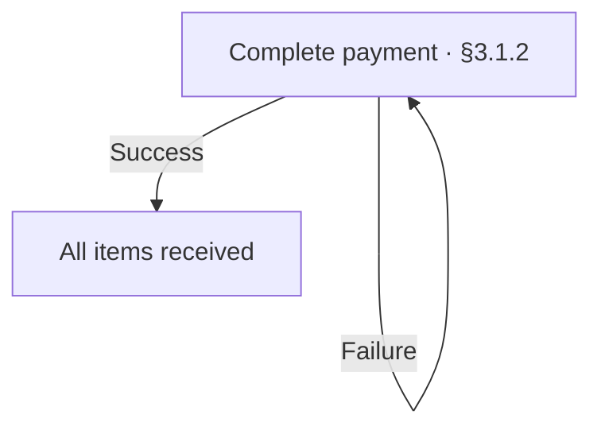

Failure causes unlimited retries with no exit condition

### 4.8 Executor Marker Mismatch

- [ ] In flows that include LLM／Agent, step node markers match the actual executors

**Counterexample**

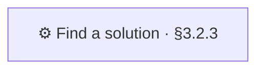

In §3.2.3, an Agent searches autonomously, so the marker should be 🤖

### 4.9 Flowchart Does Not Run Top to Bottom

- [ ] Uses Mermaid `flowchart TD`

**Counterexample**

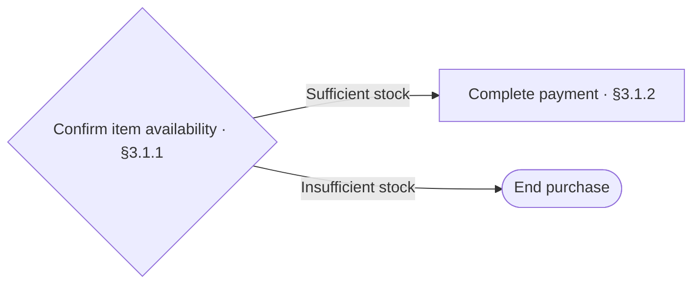

`LR` runs from left to right; use `TD` instead

### 4.10 Text Repeats Diagram Content

- [ ] Subsections add specific steps and decision conditions without repeating paths shown in the diagram

**Counterexample**

> Pay if in stock; end if out of stock

This does not explain how to determine whether stock is sufficient
