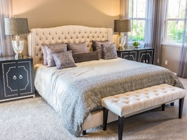
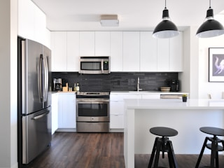

# Lark Card Mockup

## 1 When to Use

Present the appearance and interactions of Lark (Feishu) cards in design docs
Use HTML to simulate real scenarios and display card mockups to guide card JSON implementation

## 2 Overall Presentation Principles

Cover all user-visible scenarios and states, and show a complete [card mockup](../../CONTEXT.md#card-mockup) for each state
Make card mockups as close as possible to the visual appearance and interactions in actual scenarios
Use card mockups to convey information as fully as possible, and omit explanatory text for information that a card mockup can convey
Use specific example values that match the current scenario and state for dynamic content, with reasonable compromises or additional card mockups for extreme cases

Address private chat text to the recipient, and make clear who needs to act in group chat text
Use a friendly tone, consider the recipient's feelings, and use business-relevant language to explain the facts and what the user needs to do

## 3 Overall Card Mockup Presentation

### 3.1 Canvas

Use `class="card-mockup"` on the root node
Adapt the card width to the available width of its host and use the available space fully
Determine the minimum supported width based on the usage environment, and keep the layout fully usable at that width
Use a white background, a 1px `#dee0e3` border, an 8px corner radius, 14px body text, and a line height of 1.6

### 3.2 Long Content and Pagination

**Scenarios Without Pagination**

The full content meets both of the following [capacity limits](../../SSOT.md#7-platforms-and-tools)
- The card message body does not exceed 30 KB
- The total number of elements and components does not exceed 200

Confirmation cards
- If the confirmation details exceed capacity, keep only the fields that identify each object
- If the content still exceeds capacity after reducing fields, show the first few items that fit and the last item, with an ellipsis in between
- If not all items are listed, state the total at the end

Product data import · ⏳ Awaiting confirmation

File

Chestnut Store Product Data.xlsx

No.

Product code

Product name

1

<code>A3K9F2</code>

Chestnut gift box

2

<code>B7M2Q8</code>

Hazelnut gift box

3

<code>C4P6R1</code>

Pistachio gift box

……

200

<code>Z8N5T3</code>

Cashew gift box

200 product records in total

✅ Confirm import
🚫 Cancel

Form cards
- If the content exceeds capacity, keep the required fields and reduce optional explanations
- If the required fields still exceed capacity, adjust the form completion workflow

Follow-up task · ⏳ Awaiting input

<form name="form_followup_task" style="padding:10px 12px">

Task name *

Follow up with customers who left negative reviews of the chestnut gift box

Assignee *

Select an assignee ▾

✅ Create task
🚫 Cancel

</form>

Extremely long content
- Summarize noncritical content and display it on a single card within capacity
- Keep the information needed to identify the object, determine its state, and take action in the summary

After-sales communication · ✅ Summarized

Order

<code>A3K9F2</code>

📝 Communication summary

The customer received a damaged gift box and requested a replacement

A free replacement was agreed upon, and the customer does not need to return the original gift box

⚡ Next step

Ship the replacement gift box by 18:00 today

<a class="card-button button-default button-open-url" href="https://example.com/orders/A3K9F2/communications" style="display:inline-block;padding:4px 12px;border:1px solid #dee0e3;border-radius:6px;color:#1f2329;text-decoration:none">📜 View full communication history</a>

**Pagination Methods**

Changing pages in a private chat updates the original card
Changing pages in a group chat updates the original card by default, and members who can see the card share the current page and can change pages
When users need to browse independently, send the user who clicked a browsing card in a private chat that references the same results, and keep the original group chat card unchanged
The private chat browsing card provides only browsing and pagination actions, while business confirmation, cancellation, and submission remain on the original card
Changing pages does not change the ownership of the original card or permissions for business actions
Specify the pagination method used by the group chat card in the detailed design

Keep the title and total on every page
Changing pages switches only the details
When a nested list or an extremely long record spans pages, keep its parent object's identifier and title on continuation pages
When task progress changes require a refresh of paginated content, preserve the reading position of the first displayed unit on the current page
Follow [card mapping](../../skills/references/lark-card-mapping.md#32-long-content-and-pagination) for repagination and positioning

Use a divider at the bottom of the page to separate a dedicated pagination area
Include the currently displayed range, total, and pagination buttons in the pagination area
Show "⬅️ Previous page" on every page except the first
Show "➡️ Next page" when more content follows

Product data lookup

📦 Nut gift box collection (continued)

No.

Product code

Product name

27

<code>P00027</code>

Chestnut gift box 1kg

28

<code>P00028</code>

Hazelnut gift box 1kg

29

<code>P00029</code>

Pistachio gift box 1kg

📦 Dried fruit gift box collection

No.

Product code

Product name

30

<code>P00030</code>

Raisin gift box 250g

31

<code>P00031</code>

Cranberry gift box 250g

Records 27–31 of 200

⬅️ Previous page
➡️ Next page

## 4 Title Bar

Use `card-header` for the title bar and specify exactly one theme class from the table
Set vertical padding to 8px and horizontal padding to 12px
Use `card-title` for the main title, which is required and unique, with a font size of 14px, a font weight of 600, a line height of 22px, and text color inherited from the title bar
Use `card-subtitle` for the optional subtitle, with at most one subtitle, a font size of 14px, regular weight, a line height of 22px, and text color inherited from the title bar

| Theme class | Background color | Text color | Standard meaning |
| --- | --- | --- | --- |
| `theme-default` | `ffffff` | `1f2329` | Use when a title without color is explicitly required |
| `theme-blue` | `e8f1ff` | `1f5bd6` | Standard cards: details, queries and no matching results, data entry, selection, normal confirmation, processing and progress notifications |
| `theme-green` | `eaf9e6` | `237804` | Success, completion |
| `theme-orange` | `fff1e6` | `d46b08` | Warnings, time alerts, additional information or clarification required to continue |
| `theme-red` | `fdecec` | `d83931` | Failure, error, overdue, object searched for by a specific identifier does not exist |
| `theme-grey` | `646a73` | `ffffff` | Invalid, expired, revoked, canceled, or confirmation of termination |

Example:

Product information query

Order details · ⏳ Awaiting shipment

Chestnut gift box · 3 items total

Data import · ✅ Completed

Data import · ⚠️ Partially failed

Data import · ❌ Failed

Product query · No matching results

Data import · Canceled

## 5 Layout

### 5.1 Field Row

Use a description list with separate columns for labels and values
Use `field-row` for field rows, `field-label` for labels, and `field-value` for values
Set the label column to a fixed width of 64px and the column gap to 12px, left-align the value column, wrap long content within the column, and do not use spaces for alignment
Use 14px for both labels and values, with `#646a73` for label text and `#1f2329` for value text

Status

⏳ In progress

Expected time

Tomorrow 18:30

Delivery address

Room 1203, Unit 2, Building 3, 88 Zhangjiang Road, Pudong New Area, Shanghai

### 5.2 Divider

Separate different information blocks with a divider on its own line
Do not add dividers between objects already separated by outline boxes
Separate a standalone action area from the content above it with a divider, but do not add a divider before inline buttons
Use a 1px solid `#dee0e3` divider with 12px spacing above and below

Product data import · ⏳ Awaiting confirmation

Chestnut Store Product Data.xlsx

200 product records total

✅ Confirm import
🚫 Cancel

### 5.3 Outline Box

When a card contains multiple objects of the same type and each object needs to display multiple attributes or separate actions, use one outline box per object
Use `outlined-block` for outline boxes
Use a 1px solid `#dfe1e3` border, an 8px corner radius, 8px vertical padding, and 12px horizontal padding
Set the gap between adjacent outline boxes to 8px
Place the details button at the far right inside the box, vertically centered relative to the entire content block on the left

🧩 Subtask 1 · Design the login page

Expected time

Tomorrow 18:30

🔎 Details

🧩 Subtask 2 · Test API integration

Expected time

Friday 18:30

🔎 Details

### 5.4 Gray Background Block

Place content that explains what the current object belongs to in a gray background block, such as the parent task of a subtask
Use `grey-block` for gray background blocks
Use a `#f5f6f7` background, a 4px corner radius, 8px vertical padding, and 12px horizontal padding

🗂 Parent task

Task

Product launch event preparation <code>a3Kf9X</code>

### 5.5 Action Block

Use an action block after the relevant content when you need to highlight an action the user should take
Use `action-block` for action blocks and select colors based on the title theme class of the containing card
Use a 4px vertical line on the left of the block and select the background and line colors from the table below
Use a 4px corner radius, 8px vertical padding, and 12px horizontal padding
Use `#1f2329` for the block title color and `font-weight:700` for its font weight

| Theme class | Vertical line | Background color |
| --- | --- | --- |
| `theme-orange` | `#ff811a` | `#fff3e5` |
| `theme-red` | `#ff7570` | `#fef0f0` |
| `theme-blue` | `#7aa2ff` | `#f0f4ff` |
| `theme-green` | `#35bd4b` | `#e4fae1` |
| `theme-default` | `#7aa2ff` | `#f0f4ff` |
| `theme-grey` | `#7aa2ff` | `#f0f4ff` |

⏰ 1 hour until the committed time

Design the login page <code>b7Xy2Z</code>

⚡ What to do now

If you cannot finish on time, reply to this message with a new estimated completion time

### 5.6 Collapse

Collapse noncritical information as needed, keeping summaries, key statuses, and information required for actions outside the collapsed area
Specify the collapsed content and its count in the title line
Use `
` in the mockup, collapsed by default

📜 History · 3 entries

9/28 18:30 John Smith adjusted the committed time

9/28 16:20 Jane Brown added delivery requirements

9/28 14:00 John Smith started working on the task

### 5.7 Table Layout

Use `table-layout` for the table container, `table-header` for the header, and `table-row` for record rows
Use the container's `--table-columns` column width definition for both the header and record rows, with an 8px column gap
Place one record per row, align the same field by column, and left-align content columns
Use bold text for the header, place the action column at the far right, center the action header and buttons within the column, and vertically center buttons relative to the row content
Use a 1px solid `#dee0e3` divider at the bottom of the header and each record, with 8px padding above and below

Tag query

TagApp countActions

Puzzle2🔎 View

Indie games1🔎 View

### 5.8 Text Hierarchy Spacing

Set the gap between a body heading and its body text or first subheading to 4px
Set the gap between adjacent body paragraphs to 8px
Determine the gap between a new section heading and the previous section based on the current heading level

| Heading level | Font size | Preceding spacing |
| --- | --- | --- |
| First level | 16px | 12px |
| Second level | 18px | 16px |
| Third level | 20px | 20px |
| Fourth level | 24px | 24px |
| Fifth level | 30px | 28px |

Set the preceding spacing of the first heading in a container to 0px, retaining the container's own padding
Use 4px when a heading immediately follows a parent heading, without adding the preceding spacing from the table
Always specify spacing in the following element's `margin-top` and set the preceding element's `margin-bottom` to 0px
Follow the respective rules for internal spacing in title bars, field rows, forms, button areas, and other components
## 6 Text

Text style combines font size, color, and weight, with each dimension selected for the usage scenario

### 6.1 Font Size

Use 14px as the base size for body text, make headings within the body bold, and increase the font size level by level starting from the level closest to body text
Use `text-heading` for headings within the body, place each on its own line, prefix it with an emoji that represents the topic, and include only the topic name
Set the spacing between body headings and paragraphs according to [§5.8](#58-text-hierarchy-spacing)

| Font size | Usage scenario |
| --- | --- |
| 30px | Fifth-level heading, Heading 0 |
| 24px | Fourth-level heading, Heading 1 |
| 20px | Third-level heading, Heading 2 |
| 18px | Second-level heading, Heading 3 |
| 16px | First-level heading, Heading 4 |
| 14px | Body text, field labels, field values, form field names, error causes, action text |
| 12px | Supporting information such as time, source, and additional notes |
| 10px | Not currently used |

🎉 Chestnut Store v2.0.0 release

🎯 Order placement workflow redesign

📍 Scope

Shopping cart, checkout, and order details

📢 Impact

View existing orders as usual, with no action required

⏰ 2026-09-29 18:30

### 6.2 Text Color

| Text color | HTML color code (light mode) | Usage scenario |
| --- | --- | --- |
| Dark | `#1f2329` | Headings within the body, body text, field values, error causes, and required actions |
| Gray `text-grey` | `#646a73` | Field labels, time, source, additional notes |
| Light gray | `#8f959e` | Input placeholders, text in disabled controls |
| Red `text-red` | `#c02a26` | Critical warnings or errors that need emphasis, required field indicators |

Use `is-placeholder` for placeholder text and `is-disabled` for disabled controls

Create follow-up task

<form name="form_followup_task" style="padding:10px 12px">

Task name *

Follow up with customers who left negative reviews for the chestnut gift box

Owner *

Select an owner ▾

Select an owner

Source: Chestnut Store after-sales support group

✅ Create task
🚫 Cancel

</form>

### 6.3 Font Weight

| Font weight | HTML setting | Usage scenario |
| --- | --- | --- |
| Regular | `font-weight:400` | Body text, subtitles, and supporting information |
| Semibold | `font-weight:600` | Main card title |
| Bold | `font-weight:700` | Body headings, form field names, and key content |

Except for the critical alerts in [§6.2](#62-text-color), change only the font weight to emphasize specific text

### 6.4 Code Style

Use inline code style for business identifiers, such as task numbers, order numbers, and product IDs, to distinguish them from normal body text
In mockups, use `<code>` to display identifiers with a 14px monospace font, text color `#1f2329`, background color `#f5f6f7`, a 4px corner radius, and padding of 2px vertically and 4px horizontally

Order details

Order number

<code style="font-family:ui-monospace,Consolas,monospace;font-size:14px;color:#1f2329;background:#f5f6f7;border-radius:4px;padding:2px 4px">A3K9F2</code>

Product name

Chestnut gift box

### 6.5 Common Text Styles

| Usage scenario | Font size | Color (light mode) | Font weight |
| --- | --- | --- | --- |
| Headings within the body | 16, 18, 20, 24, or 30px according to heading level | `#1f2329` | 700 |
| Form field names | 14px | `#1f2329` | 700 |
| Body text, field values, required actions | 14px | `#1f2329` | 400 |
| Field row labels | 14px | `#646a73` | 400 |
| Time, source, additional notes, pagination range and total count | 12px | `#646a73` | 400 |
| Input placeholders | 14px | `#8f959e` | 400 |
| Error messages | 14px | `#c02a26` | 400 |
| Critical warnings that need emphasis | 14px | `#c02a26` | 700 |

## 7 Icons and Markers

Choose emoji by topic or action, and use consistent markers for similar information
Show emoji together with text

### 7.1 Status Markers

| Marker | Meaning | Example |
| --- | --- | --- |
| ✅ | Success | ✅ Import successful |
| ⏳ | Waiting, processing | ⏳ Not yet generated |
| ⚪ | Not yet started | ⚪ Not started |
| ⚠️ | Warning, needs attention | ⚠️ Some imports failed |
| ❌ | Failure, error | ❌ Read failed |
| ❔ | Unknown result, awaiting confirmation | ❔ Result awaiting confirmation |
| — | Not applicable, not performed | — Not applicable |

Pair status markers with text, and do not distinguish statuses by color alone

### 7.2 Leading Icons

To identify a platform, brand, or app, show its actual icon before its name
Set both icon dimensions to 1 times the adjacent text size, preserve the original aspect ratio, and center the icon vertically with the name
Use `` to show the actual icon in the mockup, and do not approximate it with emoji

 <a href="https://apps.apple.com/app/id728293409">Monument Valley</a>

 <a href="https://play.google.com/store/apps/details?id=com.ustwo.monumentvalley">Monument Valley</a>

 <a href="https://apps.apple.com/">App Store</a>

 <a href="https://play.google.com/store/apps">Google Play</a>

## 8 People

Represent people in body text with avatar capsules, with a circular avatar on the left and a name on the right
Use `person-capsule` for avatar capsules and `data-person-key` to identify the corresponding person in the business context
Use a 20 × 20px avatar, a name in 14px `#1f2329` regular text, and a 4px gap between the avatar and name
Use a `#f5f6f7` capsule background, a 999px corner radius, and padding of 2px vertically and 8px horizontally
Place multiple people side by side in a field row with an 8px gap between capsules, and wrap when they do not fit the current width
Keep the avatar and name together within each capsule, and do not shrink either
Use only names for people in titles and buttons
When person information is unavailable, show the corresponding missing-information text instead of an empty capsule

Owner

Alex Smith

Related people

Jamie BrownTaylor Wilson

## 9 Actions and Inputs

### 9.1 Buttons

Use `card-button` for buttons, with exactly one style class
Use `button-callback` for callback buttons, `data-action` to identify the action, and `data-object-key` to identify the business object
Use `<a>` and `button-open-url` for link buttons, with `href` specifying the target URL
Give each button exactly one interaction class

| Style class | Border | Text | When to use |
| --- | --- | --- | --- |
| `button-default` | `#dee0e3` | `#1f2329` | Standard actions |
| `button-primary` | `#94b4ff` | `#1456f0` | The primary action in the current action area |
| `button-danger` | `#f89e9b` | `#f54a45` | Irreversible actions such as voiding, deleting, or removing |
| Disabled state | `#eff0f1` | `#8f959e` | Actions that cannot currently be performed |

Use a `#ffffff` button background, a 1px solid border, a 6px corner radius, and padding of 4px vertically and 12px horizontally
Use 14px regular text for buttons and an 8px gap between buttons
Use `button-area` for a separate action area, and place it at the end of the object or card
Arrange multiple buttons horizontally, and wrap when they do not fit the current width
Place the primary action on the left, followed by secondary actions, with cancel and discard actions on the far right
Button text states only the current action, preceded by an emoji that represents the action
Put details such as object counts in the body text

Follow-up task · ⏳ Awaiting confirmation

Follow up with customers who left negative reviews of the chestnut gift box

✅ Confirm creation
🚫 Cancel

Void product record · ⏳ Awaiting confirmation

Chestnut gift box

Cannot be restored after voiding

🗑 Confirm voiding
🚫 Cancel

Follow-up task · ⏳ Creating

Follow up with customers who left negative reviews of the chestnut gift box

⏳ Creating

### 9.2 Forms

Use `<form name="form_identifier">` for forms, with a unique name within the card
Use a form when users need to enter or select values, with a submit and cancel action area at the bottom
Use `form-label` for field labels, with `data-field-name` corresponding to the control name
Use `is-required` for required controls
Use `form-submit` for submit buttons, with `data-field-name` providing the button name
Use `form-cancel` for cancel buttons, with `data-field-name` providing the button name
Place field labels above controls in 14px `#1f2329` bold text, and append a "*" in `#c02a26` to required field labels
Use a 4px gap between a field label and its control, and a 12px gap between adjacent field groups
Use `card-input` for input boxes, with `input-single` for single-line inputs and `input-multiline` for multiline inputs
Use `data-value` for prefilled input values, and display the prefilled content directly inside the corresponding control
Use `card-select` for dropdowns, with `select-single`, `select-multi`, `select-person-single`, or `select-person-multi` specifying the type
Use `data-options-key` to identify the option list for dropdown controls
Use `data-value` for the initial value of a standard single-select control, and a JSON string array in `data-values` for a multi-select control
Use `data-person-key` for the initially selected person in a single-select person control, and a JSON identifier array in `data-person-keys` for a multi-select person control
Show "▾" on the right of dropdowns, render person selectors as dropdowns, and show the names of selected people
Display field validation errors below the corresponding controls in 14px `#c02a26` regular text
Place submission failure messages above the buttons in the bottom action area, and retain entered content in the controls

Create follow-up task

<form name="form_followup_task" style="padding:10px 12px">

Task name *

Follow up with customers who left negative reviews of the chestnut gift box

Owner *

Select an owner ▾

Additional notes

Optional, line breaks allowed

✅ Create task
🚫 Cancel

</form>

Create follow-up task · ⚠️ Complete the required information

<form name="form_followup_task" style="padding:10px 12px">

Task name *

Follow up with customers who gave negative reviews of the chestnut gift box

Assignee *

Select an assignee ▾

Select an assignee

Additional notes

Optional, line breaks allowed

✅ Create task
🚫 Cancel

</form>

Create follow-up task · ❌ Creation failed

<form name="form_followup_task" style="padding:10px 12px">

Task name *

Follow up with customers who gave negative reviews of the chestnut gift box

Assignee *

James Smith ▾

Additional notes

Check whether the gift box arrived damaged

Save failed, try again

✅ Create task
🚫 Cancel

</form>

### 9.3 Date and Time

Use `card-datetime` for date and time controls and `data-value` for prefilled values
`data-timezone` specifies the business time zone, and the field label displays the corresponding time zone name
When no date and time is selected, the control displays “📅 Select time” in 14px `#8f959e` regular text
When a date and time is selected, the control displays the specific date and time, such as “2026-10-08 18:30”, in 14px `#1f2329` regular text

Adjust delivery time

<form name="form_delivery_time" style="padding:10px 12px">

Design the login page

Delivery time (Beijing time) *

📅 Select time

✅ Save
🚫 Cancel

</form>

Adjust delivery time

<form name="form_delivery_time" style="padding:10px 12px">

Design the login page

Delivery time (Beijing time) *

2026-10-08 18:30

✅ Save
🚫 Cancel

</form>

## 10 Progress Display

### 10.1 Progress Bar

Use `progress-bar` for progress bars, with `data-completed` for the number of finished items and `data-total` for the total number of items
`data-length` specifies the number of character cells in the bar, based on the available layout width, font size, and length of the text on the right
When the overall progress of the card can be calculated, use a character bar to show the proportion of finished items
The finished item count includes successful and failed items, but excludes items that are processing, not started, or have unknown results
Use "█" for the finished portion and "░" for the remaining portion, and calculate the number of filled cells by dividing the finished item count by the total item count, multiplying by the number of character cells, and rounding down
Use inline code styling for the progress bar and vertically center it with the count on the right
`data-format` is either `ratio` or `percent`, with `ratio` as the default
Show the count ratio or percentage to the right of the progress bar in 14px bold text, such as "1/2", "3/16", or "50%"

Data import · ⏳ Processing

<code style="flex:0 0 auto;font-family:Consolas,'Cascadia Mono','DejaVu Sans Mono',monospace;font-size:16px;line-height:16px;color:#1f2329;background:#f5f6f7;border-radius:4px;padding:2px 4px;white-space:nowrap">████████░░░░░░░░</code>1/2

### 10.2 Step Progress

Use `<ol class="step-progress">` for step progress
Show each step and its status in workflow order, with related details below the corresponding step

Data import · ⏳ Processing

Product Data.xlsx

<ol class="step-progress" style="margin:4px 0 0;padding-left:20px">
<li>Read: ✅ Completed</li>
<li>Validate: ✅ Completed</li>
<li>Write: ⏳ Processing
120/300 rows written
</li>
<li>Generate results: ⚪ Not started</li>
</ol>

## 11 Attachments

Use `` for image thumbnails
Use `attachment-gallery` for thumbnail groups
Use actual image thumbnails for image attachments, sized at 56 × 56px with 6px rounded corners, proportionally scaled and center-cropped
During design, determine the number of thumbnails per row based on the available width in the usage environment, with 8px spacing between thumbnails
If not all images are shown, provide a "🖼️ View all" button in the bottom action area
Write the total image count below the thumbnails in 12px `#646a73` regular text
Present files as links labeled "📄 File name"

Venue information

📎 Attachments

8 images in total

📄 <a href="https://example.com/files/venue-info.pdf">Venue Information.pdf</a>

🖼️ View all

## 12 Checklist

### 12.1 Scenarios and States

- [ ] All user-visible scenarios and states have complete card mockups
- [ ] Dynamic content uses specific example values that match the current scenario and state
- [ ] Key statuses and information required for actions are directly visible

### 12.2 Layout

- [ ] Cards adapt to the available host width, and information and actions remain fully usable at the minimum supported width
- [ ] Field rows use a true two-column structure, and long values wrap within their own columns
- [ ] A divider separates standalone action areas from the body, and inline buttons are vertically centered with the content
- [ ] Table layouts align by column, with content columns left-aligned and the header and buttons in the rightmost action column centered
- [ ] Outlined boxes, gray background blocks, and action blocks conform to their respective scopes
- [ ] Spacing between body headings and paragraphs conforms to [§5.8](#58-text-hierarchy-spacing), with no duplicate spacing applied to the same gap

### 12.3 Platform Capabilities

- [ ] Components and interactions in the mockups map to capabilities supported by Lark (Feishu)
- [ ] HTML effects are not treated as evidence of Lark support
- [ ] Behaviors that require business implementation have an explicit basis in the design or mapping

### 12.4 Progress and Results

- [ ] Progress counting rules are clear, and the number of filled cells matches the count ratio or percentage on the right
- [ ] The dark and light portions of the character bar have the same height and are vertically centered with the value on the right
- [ ] Finished processing is distinguishable from complete success, and unknown results are not shown as failures
- [ ] Steps appear in workflow order, and details belong to their corresponding steps

### 12.5 Actions and Forms

- [ ] Button styles match their purposes, and labels contain only an action and an emoji
- [ ] The order of primary, secondary, and cancel actions is clear, and disabled states are recognizable
- [ ] Required fields, placeholder hints, and prefilled content are distinguishable
- [ ] Field validation errors appear below the corresponding controls, and submission failure messages appear above the bottom buttons
- [ ] Entered content remains visible after submission fails

### 12.6 Capacity and Pagination

- [ ] Capacity and pagination conform to [§3.2](#32-long-content-and-pagination)
- [ ] The pagination method in group chats matches the card's purpose and is specified in the design
- [ ] Changing pages does not change the original card's ownership or business action permissions
- [ ] Confirmation cards and form cards are not paginated, and handling of excess content conforms to their respective rules
- [ ] Pagination mockups retain the associated object, title, and total count, and show the pagination area separately
- [ ] Confirmation details that are not fully listed state the total count clearly, and omitting details from display does not change the confirmation scope

### 12.7 Text and Markers

- [ ] The classes, counts, and styles of the title bar, theme, main title, and subtitle conform to [§4](#4-title-bar)
- [ ] Body headings increase in size at each higher level from the 14px body text baseline, and combinations of font size, color, and weight conform to [§6](#6-text)
- [ ] Business identifiers use code styling, and field labels use 14px gray text
- [ ] Information of the same type uses consistent emoji, and status markers match the meaning of the text

### 12.8 People and Attachments

- [ ] People in the body use avatar pills, while people in titles and buttons appear by name only
- [ ] Icons at the start of a line use actual assets and scale with the adjacent font size
- [ ] Avatars and attachment thumbnails use actual images, and asset sources are registered
- [ ] The number of displayed images is specified in the design, and the total count and view-all entry conform to the attachment rules

### 12.9 Presentation and References

- [ ] Text outside the mockups does not repeat information already conveyed by the mockups
- [ ] Section references resolve, local images load, and HTML structures are complete
- [ ] Assets are saved with the doc, and image paths do not point to local temporary directories