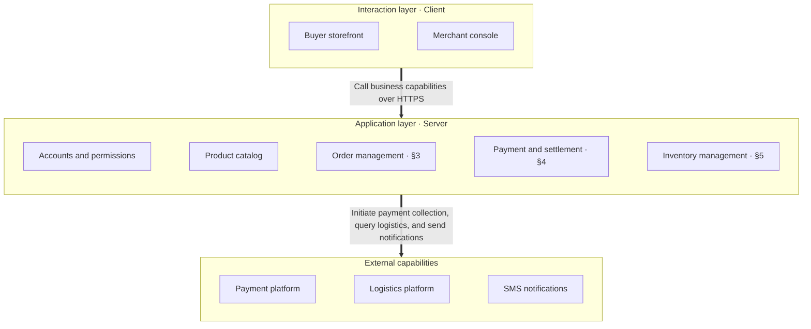
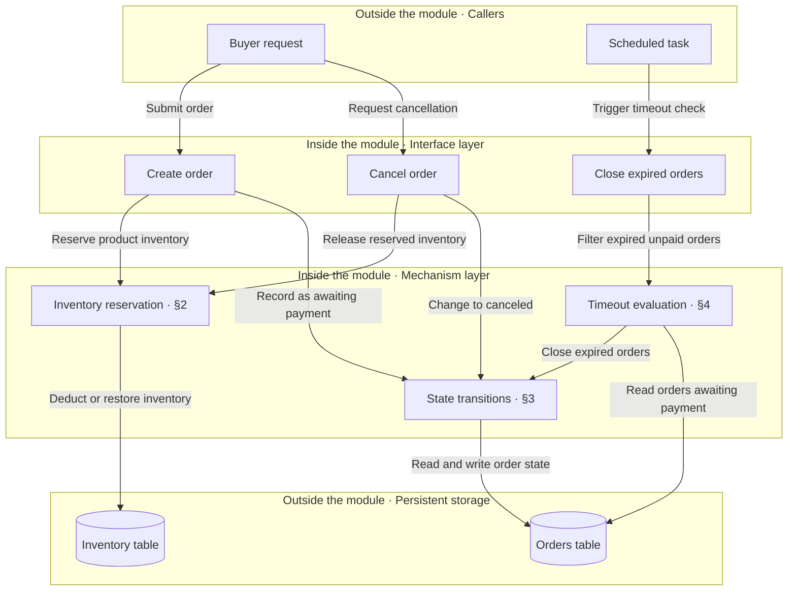
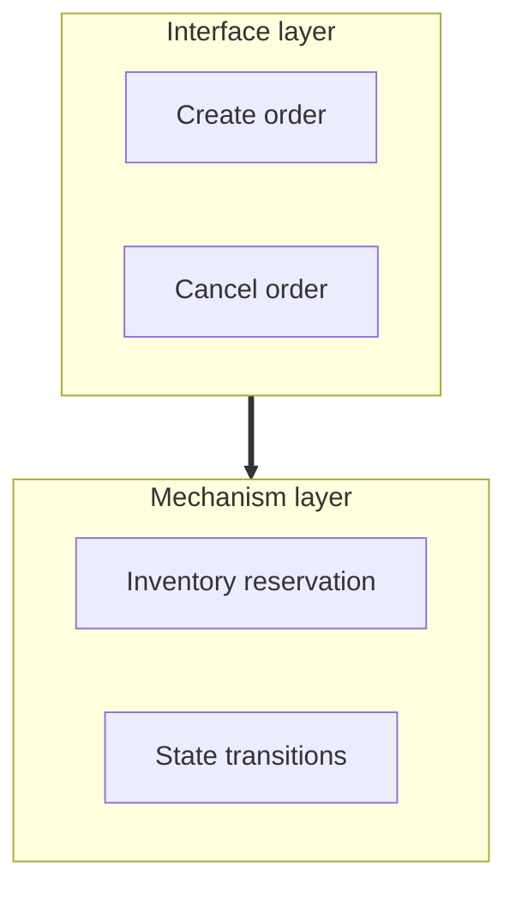
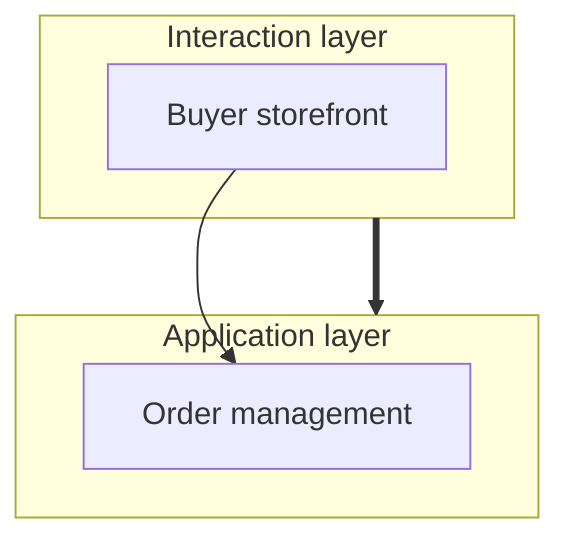
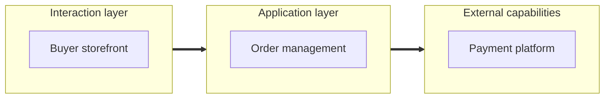
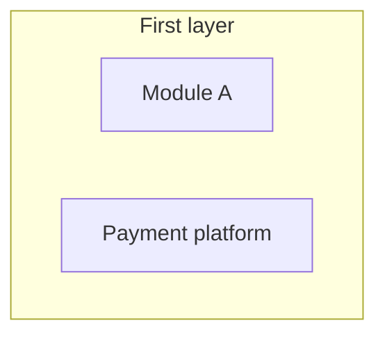
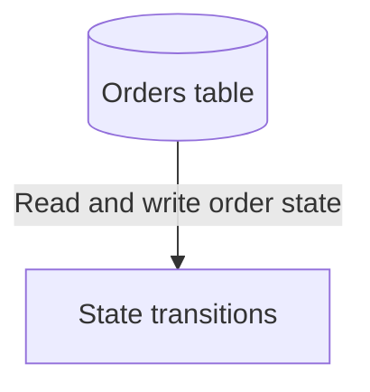
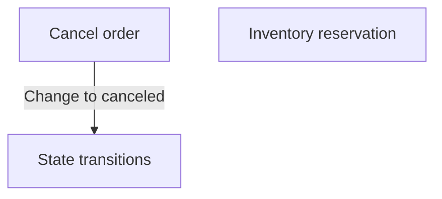
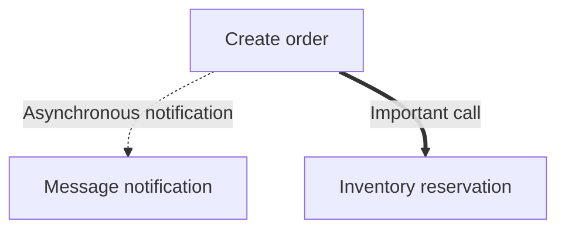

# Layered View

## 1 When to Use

Present the hierarchical composition and dependencies of a system or module

Each use of a layered view **must select exactly one presentation option**

| Presentation option | Purpose | Example |
| --- | --- | --- |
| Hierarchical relationship view | Show the overall system architecture, the composition of each layer, and relationships between layers | [§3](#3-example-e-commerce-order-system-architecture-hierarchical-relationship-view) |
| Layered module dependency view | Show the implementation structure of a business module and clarify dependencies and wiring between specific components | [§4](#4-example-order-module-internal-structure-layered-module-dependency-view) |

## 2 Presentation Principles

- Use Mermaid `flowchart TB` and follow the [official syntax documentation](https://mermaid.ai/open-source/syntax/flowchart.html)
- Different layers **must be arranged vertically from top to bottom, never side by side**, while nodes within the same layer may be arranged horizontally
  Use hidden edges `~~~` to assist layout when necessary, and add comments stating that they do not represent dependencies
- Use `subgraph` to represent layers, group names to describe layer responsibilities, and node names to describe node responsibilities
- Each layer must remove a strong dependency on something specific from the layers above it; otherwise, do not make it a separate layer
- Do not enclose the entire diagram in a system or module frame, and use nested groups only for actual responsibility or runtime boundaries
- Point arrows from the consumer to the dependency, and use edge labels to explain the purpose of the relationship
- Reference the corresponding chapters or sections for layers or nodes that need further detail

| Difference | Hierarchical relationship view | Layered module dependency view |
| --- | --- | --- |
| Nodes | Modules contained in the layer | Specific interfaces, internal mechanisms, or underlying dependencies |
| Visible connections | Between layers, with thick arrows `==>` | Between specific components, with solid arrows `-->` |
| Edge labels | Purpose of the dependency | Meaning of the call, usage, or subscription |
| External capabilities | Place in a separate layer, outside the system's internal business layers | Group callers and external dependencies separately, outside internal implementation layers |
| Dependency scope | Dependencies between layers | Draw both same-layer and cross-layer dependencies according to actual relationships |

## 3 Example: E-Commerce Order System Architecture (Hierarchical Relationship View)

## 4 Example: Order Module Internal Structure (Layered Module Dependency View)

## 5 Checklist

### 5.1 No Choice Between Two Options Based on Presentation Purpose

- [ ] Select a hierarchical relationship view to show the overall system architecture, and a layered module dependency view to detail business module implementation and wiring
- [ ] Use only one view in each place

**Counterexample**

The module's internal design needs to explain which mechanisms each interface uses, but connections between layers cannot show this wiring

### 5.2 Mixed Connection Granularity

- [ ] Both ends of each visible connection are layers in a hierarchical relationship view, and specific components in a layered module dependency view

**Counterexample**

The same diagram uses both connections between layers and connections between components

### 5.3 Hierarchy Arranged Horizontally

- [ ] Different layers appear from top to bottom in the rendered output, and only components within the same layer may appear horizontally

**Counterexample**

The layers form a row from left to right, preventing readers from reading the architecture from top to bottom

### 5.4 Unclear Layer and Node Representation or Membership

- [ ] Use `subgraph` for layers, with group names that describe layer responsibilities
- [ ] Removing any layer would directly connect two roles that should not interact directly
- [ ] Node names describe module or component responsibilities
- [ ] Components reside in the layers they actually belong to, and callers and external dependencies remain outside internal implementation layers
- [ ] Do not add a system or module frame around the entire diagram

**Counterexample**

Neither the layer name nor the node names describe responsibilities, and the payment platform is an external capability placed in the same layer as an internal module

### 5.5 Unclear Relationship Direction or Meaning

- [ ] Arrows point from the consumer to the dependency, and edge labels explain the purpose of the relationship
- [ ] Do not reverse arrows or add nonexistent dependencies to adjust the layout

**Counterexample**

State transitions use the orders table, so the arrow points in the wrong direction

### 5.6 Missing Specific Dependencies

- [ ] The layered module dependency view includes all dependencies within the described scope that affect interface wiring and responsibility allocation

**Counterexample**

Canceling an order requires releasing reserved inventory, but the diagram omits this dependency

### 5.7 Chapter and Section Reference Mismatch

- [ ] Layers or components that need further detail have chapter or section references, and each reference target exists and contains the corresponding content

**Counterexample**

Label timeout evaluation as “§3” in the example in [§4](#4-example-order-module-internal-structure-layered-module-dependency-view)

In the target doc, §3 covers state transitions, so timeout evaluation should reference §4

### 5.8 Diagram Format or Line Style Mismatch

- [ ] Use Mermaid `flowchart TB` with valid syntax that renders correctly
- [ ] For visible connections, use thick arrows `==>` for hierarchical relationships and solid arrows `-->` for component dependencies
- [ ] Annotate hidden edges `~~~` to state that they serve only layout purposes and do not represent dependencies

**Counterexample**

Using dashed lines for asynchronous relationships and thick lines for importance assigns meaning to line styles, but edge labels should explain relationship meaning

### 5.9 Text Repeats Diagram Content

- [ ] Text after the diagram does not repeat its layers, nodes, or connections one by one

**Counterexample**

> A buyer request submits an order to create order, which reserves product inventory and records the order as awaiting payment, a scheduled task triggers a timeout check, and timeout evaluation closes expired orders and reads orders awaiting payment

This text recites the diagram's edges one by one without adding information beyond the diagram