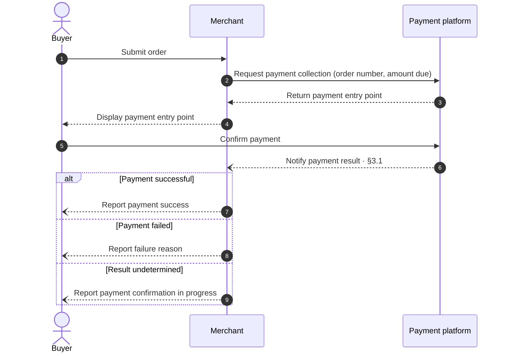
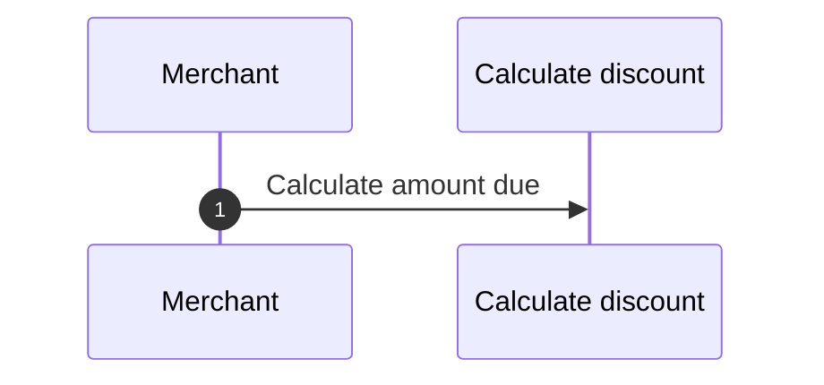
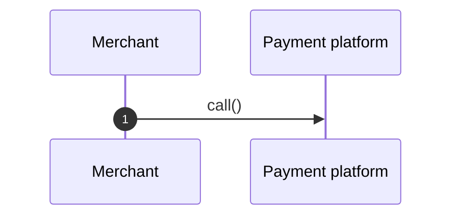
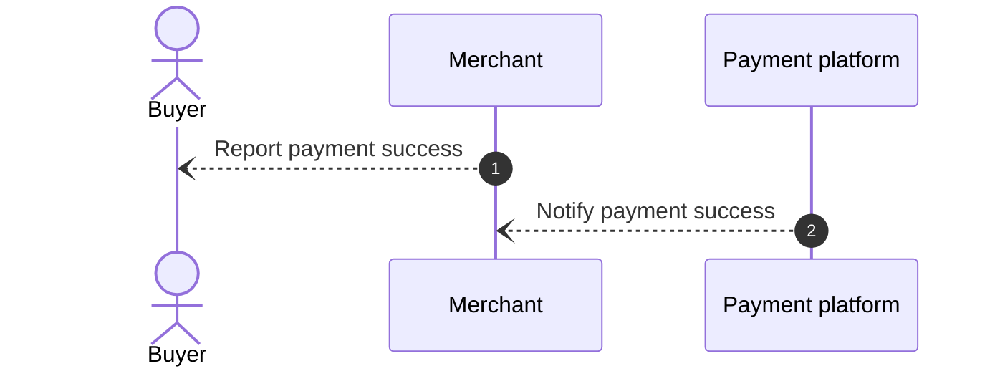
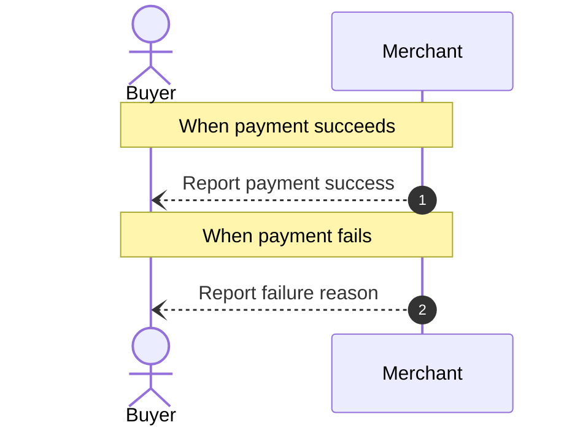
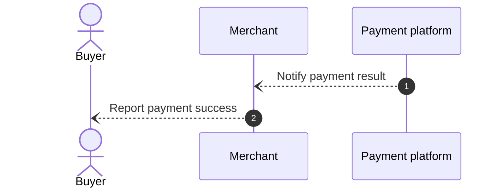
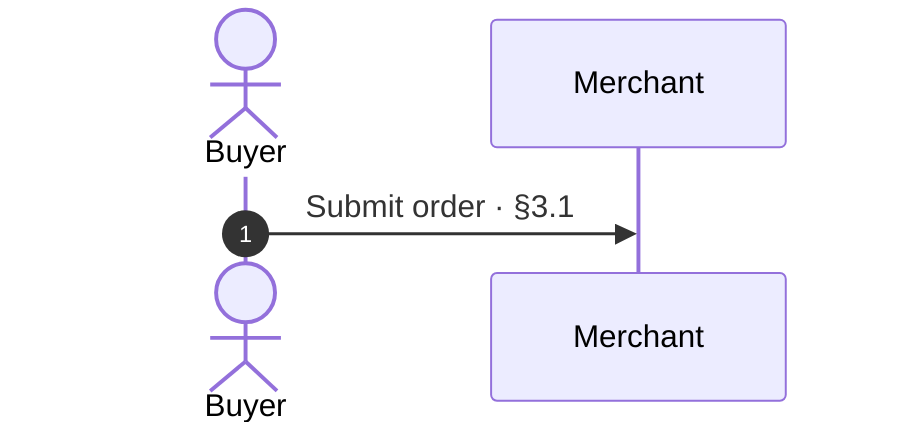
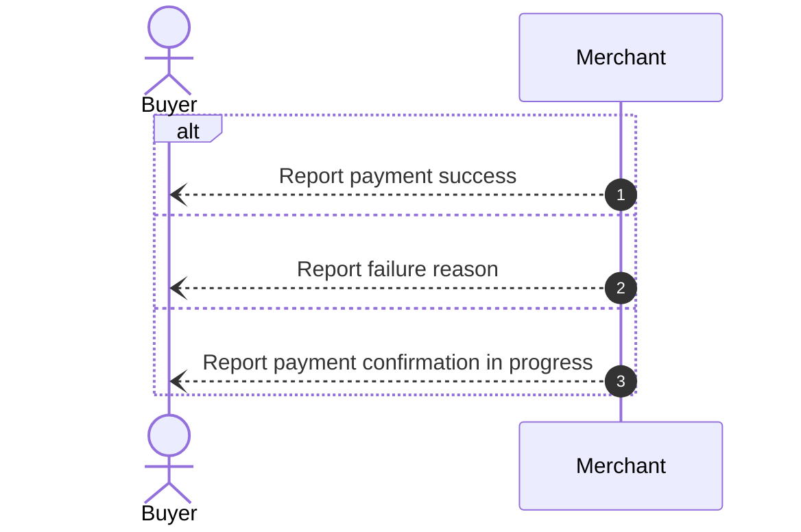

# Sequence Diagram

## 1 When to Use

Express a process in which multiple participants interact in chronological order

Use a [flowchart](flowchart.md) when the focus is on processing and branches within a single module

## 2 Presentation Principles

The sequence diagram provides the overview for its chapter or section, and interactions that need more detail reference the corresponding subsections

- Use Mermaid `sequenceDiagram` and follow the syntax in the [official sequence diagram documentation](https://mermaid.ai/open-source/syntax/sequenceDiagram.html)
- Use `autonumber` to number each interaction message automatically
- Participants represent roles or systems that actually collaborate; do not turn internal processing steps into participants
- Each message should primarily describe the business purpose of the interaction between participants and appear in the actual interaction order
- Use the corresponding control structures for branches and loops; use comments only to add context
- Label branches with business conditions and loops with repeat and exit conditions
- Subsections add only processing details that the diagram does not express, without repeating the interaction process

## 3 Example: Purchase Payment

### 3.1 Receive Payment Results

1. Verify that the notification comes from the payment platform and that the order number and amount match the payment collection request
2. If verification fails, do not update the order based on the notification; verify the result with the payment platform
3. Do not process duplicate notifications again; verify conflicting notifications before updating
4. If no valid result is received, query the payment platform; do not treat a timeout as payment failure

## 4 Checklist

### 4.1 Internal Steps Shown as Participants

- [ ] Participants are roles or systems that actually collaborate, not their internal operations

**Counterexample**

In this example, “Calculate discount” is an internal operation of the merchant, not an independent collaborator

### 4.2 Messages Lack Business Meaning

- [ ] Each message describes the business purpose of the interaction between participants, rather than using an internal method name

**Counterexample**

It is unclear what the merchant requests from the payment platform

### 4.3 Incorrect Interaction Order or Direction

- [ ] Message senders, recipients, and order match the actual collaboration

**Counterexample**

The merchant tells the buyer that payment succeeded before receiving the payment result

### 4.4 Comments Used Instead of Branches

- [ ] Mutually exclusive paths use branch structures, not comments that simulate branches

**Counterexample**

The two notifications are still shown as sequential, without expressing that they are mutually exclusive

### 4.5 Missing Exception Interactions

- [ ] Failures or undetermined results that affect subsequent collaboration have explicit handling paths

**Counterexample**

Payment failure and undetermined results are not distinguished, and all results are treated as success

### 4.6 Chapter and Section Reference Mismatch

- [ ] Interactions that need more detail have chapter or section references, and each reference target exists and its content matches the meaning of the interaction

**Counterexample**

§3.1 describes receiving payment results, not submitting orders

### 4.7 Missing Branch Conditions

- [ ] Each branch is labeled with its business condition

**Counterexample**

The conditions “Payment successful,” “Payment failed,” and “Result undetermined” are missing; actions within a branch cannot replace its entry condition

### 4.8 Text Repeats Diagram Content

- [ ] Subsections add processing details without repeating senders, recipients, or interaction order

**Counterexample**

> The payment platform notifies the merchant of the payment result, and the merchant then informs the buyer

This adds no rules for verification or duplicate handling when receiving payment results