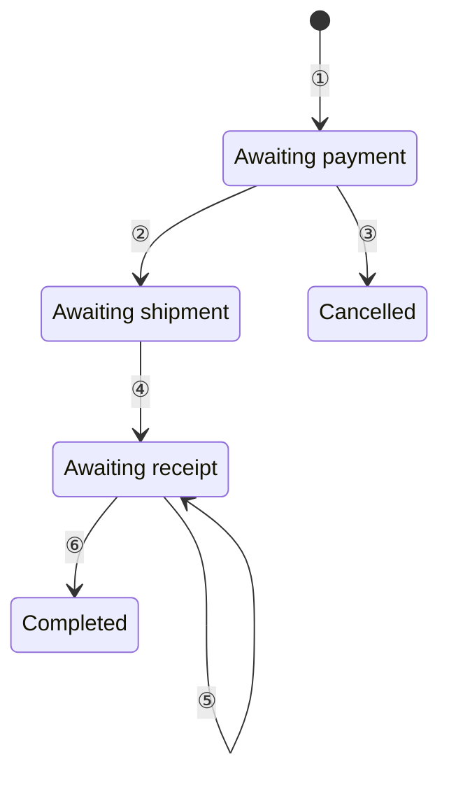
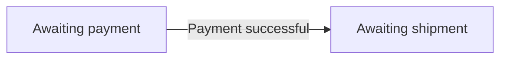
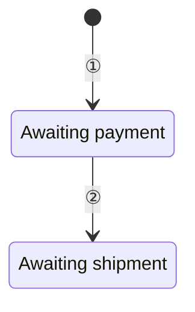
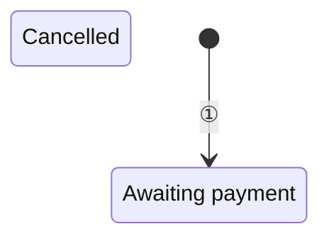
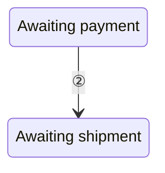

# State Machine

## 1 When to Use

Represent state changes in business objects triggered by events

When the focus is on processing steps and branches, use a [flowchart](flowchart.md)
When the focus is on interactions between multiple participants, use a [sequence diagram](sequence-diagram.md)

## 2 Presentation Principles

All three elements below are required, in the order shown in the table

| Content | Presentation rules |
| --- | --- |
| State overview | [§2.1](#21-state-overview) |
| State transition diagram | [§2.2](#22-state-transition-diagram) |
| Transition conditions | [§2.3](#23-transition-conditions) |

### 2.1 State Overview

List the ID, state, and business meaning in a table, using plain numbers for state IDs

### 2.2 State Transition Diagram

Use Mermaid `stateDiagram-v2`, following the syntax in the [official state diagram documentation](https://mermaid.ai/open-source/syntax/stateDiagram.html)
The diagram must have a start node
Except for the start node, diagram nodes must correspond one-to-one with the states in [§2.1](#21-state-overview)
Every business state must be reachable from the start node through transitions
Assign a unique circled number to each transition, including the initialization transition, without implying execution order

### 2.3 Transition Conditions

List the ID, transition direction, and trigger condition in a table, with one row for each transition in the diagram
Specify the event and the conditions that must hold, ensuring that different destinations for the same event in the same state are unambiguous

## 3 Example: Order States

### 3.1 State Overview

| ID | State | Business meaning |
| --- | --- | --- |
| 1 | Awaiting payment | The order has been created, but successful payment has not been confirmed |
| 2 | Awaiting shipment | Successful payment has been confirmed, but the seller has not completed shipment |
| 3 | Awaiting receipt | The seller has completed shipment, but the buyer has not confirmed receipt of all items |
| 4 | Completed | The buyer has confirmed receipt of all items, and the order record is retained |
| 5 | Cancelled | The unpaid order has been cancelled, no further payment or shipment will occur, and the order record is retained |

### 3.2 State Transition Diagram

### 3.3 Transition Conditions

| ID | Transition direction | Trigger condition |
| --- | --- | --- |
| ① | Start → Awaiting payment | The order is created successfully |
| ② | Awaiting payment → Awaiting shipment | A valid successful payment result is received, and both the order number and the actual amount paid match |
| ③ | Awaiting payment → Cancelled | The buyer requests cancellation, the order is confirmed to be unpaid, and the payment entry point has been closed |
| ④ | Awaiting shipment → Awaiting receipt | The seller confirms that all items in the order have been shipped |
| ⑤ | Awaiting receipt → Awaiting receipt | The buyer confirms receipt of some items, and the accumulated receipts, deduplicated by item and quantity, still do not cover all items |
| ⑥ | Awaiting receipt → Completed | The buyer confirms receipt, and the accumulated receipts, deduplicated by item and quantity, cover all items |

## 4 Checklist

### 4.1 Composition or Order Mismatch

- [ ] Include exactly a state overview table, a state transition diagram, and a transition conditions table, in that order

**Counterexample**

Only a state transition diagram and a transition conditions table are provided

The state overview table is missing, so the business meaning of each state cannot be looked up

### 4.2 Table Field or State ID Mismatch

- [ ] The state overview table includes the ID, state, and business meaning, with plain numbers for state IDs
- [ ] The transition conditions table includes the ID, transition direction, and trigger condition

**Counterexample**

| ID | State |
| --- | --- |
| ① | Awaiting payment |

The state overview table lacks the business meaning column, and state IDs incorrectly use the circled numbers intended for transition IDs

### 4.3 States Lack Business Definitions

- [ ] The state overview lists all states, and each business meaning describes the object's actual situation without repeating the state name

**Counterexample**

| ID | State | Business meaning |
| --- | --- | --- |
| 1 | Completed | Already completed |

The business criteria for completion are not explained

### 4.4 Diagram Format Mismatch

- [ ] The state transition diagram uses Mermaid `stateDiagram-v2`, has valid syntax, and renders correctly

**Counterexample**

Using `flowchart` to draw state transitions does not meet the required state diagram format, even if it renders

### 4.5 Inconsistent Diagram and Table States

- [ ] Except for the start node, diagram nodes correspond one-to-one with the state overview, with one node per state and no additions or omissions

**Counterexample**

The state overview lists "Awaiting payment", "Awaiting shipment", "Awaiting receipt", "Completed", and "Cancelled", but the diagram contains only:

Three business states are omitted

### 4.6 Missing Start Node or Unreachable States

- [ ] The diagram has a start node, and every business state is reachable from it through transitions

**Counterexample**

"Cancelled" has no incoming path

### 4.7 Transition ID and Condition Table Mismatch

- [ ] Each transition has a unique circled number, including the initialization transition, and the IDs and directions in the diagram and condition table correspond one-to-one
- [ ] IDs only link the diagram to the table and do not indicate execution order

**Counterexample**

| ID | Transition direction | Trigger condition |
| --- | --- | --- |
| ② | Awaiting payment → Cancelled | The buyer requests cancellation, the order is confirmed to be unpaid, and the payment entry point has been closed |

The same ID points to different states in the diagram and the table

### 4.8 Trigger Conditions Cannot Determine Destinations

- [ ] Conditions are clear enough to determine whether a transition occurs, and different destinations for the same event do not conflict

**Counterexample**

| ID | Transition direction | Trigger condition |
| --- | --- | --- |
| ⑤ | Awaiting receipt → Awaiting receipt | The buyer confirms receipt |
| ⑥ | Awaiting receipt → Completed | The buyer confirms receipt |

The conditions do not distinguish whether all items have been received, so the same event satisfies both transitions

### 4.9 Text Repeats Diagram or Table Content

- [ ] Text outside the diagram and tables does not repeat states, transitions, or trigger conditions item by item

**Counterexample**

> After creation, the order enters Awaiting payment, then Awaiting shipment after successful payment, then Awaiting receipt after the seller ships the items, and finally Completed after the buyer confirms receipt of all items, while cancellation is possible before payment

This text repeats the transition diagram and condition table item by item without adding information beyond them
