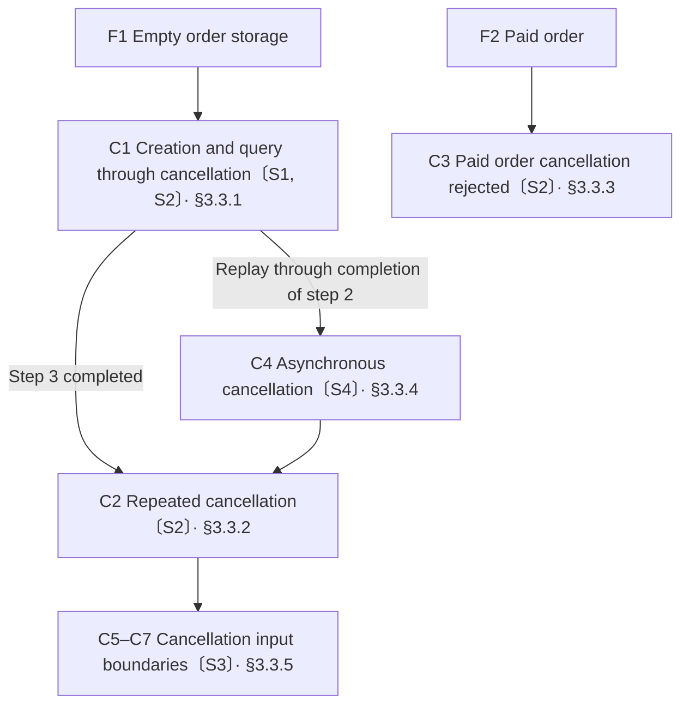

# Test Cases

## 1 When to Use

Start from defined initial conditions and specify the operation steps and expected results so that tests can be implemented directly
The referencing doc design specifies the test basis, scope, entry points, and permitted observations

## 2 Presentation Principles

| Content | Required When | Presentation Rules |
| --- | --- | --- |
| Fixtures | Always required | [§2.1](#21-fixtures) |
| Test scenarios | Always required | [§2.2](#22-test-scenarios) |
| Test cases | Always required | [§2.3](#23-test-cases) |

### 2.1 Fixtures

Fixtures define the initial conditions required before testing and how to set them up and clean them up
Initial conditions include data, state, environment configuration, and real dependencies or test doubles with preset responses
Use F followed by a sequence number as the unique identifier for each fixture so that test cases can reference it

When a test double must return different responses, specify the matching conditions and corresponding response for each call
Retain real dependencies to verify transaction, locking, protocol, or recovery behavior that requires them
For other tests, prefer lightweight test doubles that preserve the validity of verification
Prefer reusing test environments that are costly to set up, and specify how to reuse them
Set up and clean up the data, test doubles, and instance state for each test chain independently

### 2.2 Test Scenarios

Test scenarios list the situations to verify, test points, and their design basis
Use S followed by a sequence number as the unique identifier for each scenario
Use one row per scenario, listing the scenario identifier, scenario name, test points, and design basis
For each item in the design basis, link to the rule or design location being verified

### 2.3 Test Cases

Each independent test case must have a distinct test point or expected verdict
Do not repeatedly enumerate branch combinations that have no independent verification value

Starting from the fixtures, prefer organizing related test points along the longest executable chain
Expand mutually exclusive branches separately from their shared preceding state
Organize separate test chains for test points that cannot be chained together or require different initial conditions
Reference the starting fixtures at the beginning of each test chain, and present test cases in their execution order within the chain
When a test chain branches or merges, use a [flowchart](flowchart.md) to supplement the execution relationships between test cases
Label test case nodes in the diagram with their test case identifiers and covered scenario identifiers, and use arrows to indicate execution order
When preceding steps must be replayed, specify the target test case and step, execute from the starting fixtures to that point, and ensure that prerequisite references do not form cycles

Use C followed by a sequence number as the unique identifier for each test case, and use a name that describes the behavior it verifies
At the beginning of each test case, reference the covered test scenarios and specify the corresponding test points
Use an unordered list for a single operation and a numbered list for multiple consecutive operations
Use one action per item, with expected results indented under the corresponding action
Expected results include return values, state changes, side effects, and events that must not occur
Use the names, states, and error identifiers defined in the test basis
Use deterministic data for inputs and expected results
Specify explicit decision values for boundaries, thresholds, and counts

Use a parameterized table for test cases with the same operation steps but different inputs or expected results
List the test case identifier, input, and expected results in each row, and define the shared operation steps before the table
Execute each row separately from the same preceding state
For asynchronous results, specify the wait condition, maximum wait time, and failure criteria after a timeout
When faults or time boundaries are involved, specify how to inject faults, control time, and observe results
Prefer injecting faults through existing dependency boundaries or the test runner
If no stable injection method exists, revise the test solution instead of adding a production interface or mechanism for a single test case
Prefer triggering long-duration boundaries through deterministic time fixtures or a controllable clock to avoid unnecessary real waiting
When verifying the timing behavior of a real dependency, use the time source that the dependency actually uses
Design performance test cases based on confirmed capacity, latency, or resource constraints
Specify the load, measurement environment, metrics, and pass criteria, and do not set performance thresholds without a design basis
When evaluation is involved, specify the evaluation dataset, execution count per case, result assessment method, and pass criteria
When test cases create resources outside the fixture cleanup scope, specify when and how to clean them up

## 3 Order Test Example

### 3.1 Fixtures

| Identifier | Initial Conditions | Setup Method |
| --- | --- | --- |
| F1 | Isolated order storage is empty, and product S1 has an available stock of 10<br>The inventory service test double returns success for both reservation and release, and its call log is empty | Clear orders and reservation records, set S1 stock to 10, load the success response script, and clear the call log |
| F2 | Order A3K9F2 in isolated storage is paid, contains 2 units of product S1, and has a corresponding reservation record<br>The inventory service test double returns success for release, and its call log is empty | Clear storage, write the order and reservation record described above, load the success response script, and clear the call log |

Match inventory requests against product S1 and quantity 2, and record the operation type, product, and quantity
After switching to the paused release script, release requests remain pending until the test explicitly allows them to proceed, then return success
After each test chain ends, clear isolated storage and the call log, and restore the success response script

### 3.2 Test Scenarios

The test basis for creation and query in this example is defined below, and cancellation results follow the [order cancellation contract](interface.md#3-module-method-example-cancel-an-order-typescript)

```typescript
interface Order {
  id: string;
  productId: string;
  quantity: number;
  status: "pending_payment" | "paid" | "cancelled";
}

/** Create an order pending payment, reserving inventory for the specified product and quantity on success */
declare function createOrder(
  id: string, productId: string, quantity: number
): Promise<Order>;

/** Query the complete order without writes; return null if it does not exist */
declare function queryOrder(id: string): Promise<Order | null>;
```

Successful cancellation releases the inventory reserved for the order, and the cancellation result returns after inventory release completes
Repeated cancellation and rejected cancellation do not add release requests

| Scenario Identifier | Scenario Name | Test Points | Design Basis |
| --- | --- | --- | --- |
| S1 | Create and query an order | Pending payment status, product, and quantity after creation, inventory reservation, and no writes during query | [Creation and query declarations](#32-test-scenarios) |
| S2 | Cancel an order | Cancellation result and state, inventory release, no repeated release on repeated cancellation, and cancellation prohibited for paid orders | [Order cancellation contract](interface.md#3-module-method-example-cancel-an-order-typescript) and the inventory side effect rules in this section |
| S3 | Cancellation input boundaries | TypeError for blank identifiers and not_found for nonexistent orders, both without state changes or inventory release | [Order cancellation contract](interface.md#3-module-method-example-cancel-an-order-typescript) |
| S4 | Asynchronous cancellation | The cancellation result remains pending while the release request is pending, and a deterministic result is obtained after allowing release to proceed | [Cancellation result and inventory release rules](#32-test-scenarios), [Promise contract for cancellation results](interface.md#3-module-method-example-cancel-an-order-typescript) |

### 3.3 Test Cases

Set up the corresponding fixtures before each chain starts, and retain the state produced by preceding operations within the chain



#### 3.3.1 C1 Creation and Query Through Cancellation

Test scenarios: All test points in S1, and successful cancellation and inventory release in S2

1. Call createOrder("A3K9F2", "S1", 2), and wait up to 5 seconds
   - Expected: The Promise resolves and returns id=A3K9F2, productId=S1, quantity=2, status=pending_payment
   - Expected: Exactly 1 reservation request for product S1 and quantity 2, with no release requests
2. Call queryOrder("A3K9F2"), and wait up to 5 seconds
   - Expected: Returns the order data from step 1, with no additional reservations, releases, or order writes
3. Call cancelOrder("A3K9F2"), and wait up to 5 seconds
   - Expected: outcome=cancelled, order.id=A3K9F2, order.status=cancelled
   - Expected: Exactly 1 release request for product S1 and quantity 2, with the reservation request count still at 1

Mark any step as failed if its wait exceeds 5 seconds

#### 3.3.2 C2 Repeated Cancellation

Test scenarios: Repeated cancellation without repeated release in S2
Record the reservation and release request counts before execution

- Call cancelOrder("A3K9F2") again, and wait up to 5 seconds
   - Expected: outcome=already_cancelled, order.id=A3K9F2, order.status=cancelled
   - Expected: Neither the reservation nor the release request count increases

Mark the test as failed if the wait exceeds 5 seconds

#### 3.3.3 C3 Paid Order Cancellation Rejected

Test scenarios: The restriction on cancelling paid orders in S2

- Call cancelOrder("A3K9F2"), and wait up to 5 seconds
   - Expected: outcome=not_allowed, order.id=A3K9F2, order.status=paid
   - Expected: The original reservation record is retained, with no release requests

Mark the test as failed if the wait exceeds 5 seconds

#### 3.3.4 C4 Asynchronous Cancellation

Test scenarios: Waiting for release and asynchronous results in S4
Prerequisite: Starting from F1, replay C1 through completion of step 2 without executing step 3

1. Switch the inventory test double to the paused release script
   - Expected: No additional inventory requests
2. Initiate cancelOrder("A3K9F2"), retain the returned Promise, and wait up to 5 seconds for the test double to receive the release request
   - Expected: Receives 1 release request for product S1 and quantity 2, while the returned Promise remains pending
3. Allow the paused release request to proceed, and wait up to 5 seconds
   - Expected: The original Promise resolves, outcome=cancelled, order.status=cancelled
   - Expected: The total release request count is 1, with no new cancellation operation initiated

Mark the test as failed if waiting for the test double to receive the request or waiting for the result to complete exceeds 5 seconds
After this test case completes, restore the success response script and retain the order and call log for subsequent test cases

#### 3.3.5 Cancellation Input Boundaries

Test scenarios: All test points in S3
Execute each row separately from the same state within the chain, where A3K9F2 is cancelled and missing-order does not exist
Shared operation: Record the current order data and inventory call log, call cancelOrder(input), and wait up to 5 seconds

| Test Case Identifier | Test Case Name | Input | Expected Results |
| --- | --- | --- | --- |
| C5 | Reject an empty identifier | Empty string | The Promise rejects with TypeError |
| C6 | Reject a whitespace-only identifier | Three spaces | The Promise rejects with TypeError |
| C7 | Cancel a nonexistent order | missing-order | outcome=not_found |

For each row, assert that the order data and inventory call log remain unchanged, and mark the test as failed if the wait exceeds 5 seconds

## 4 Intent Recognition Evaluation Example

### 4.1 Fixtures

F1: Isolated conversation history is empty, and the model version and call configuration are fixed
Setup method: Clear the conversation, freeze the model version and configuration for this run, and save their actual values in the result records
Cleanup method: Clear the conversation history for this run

### 4.2 Test Scenarios

In this example, classify(text) returns intent and orderId, where intent is query, cancel, or unknown
Return the corresponding intent and order identifier only when the input explicitly requests a query or cancellation of a specified order
For other inputs, return intent=unknown, orderId=null
The interface only recognizes intent and does not perform order operations

| Scenario Identifier | Scenario Name | Test Points | Design Basis |
| --- | --- | --- | --- |
| S1 | Order intent recognition | Query and cancellation intents, order identifier extraction, and unknown returned when no explicit order operation is requested | [Intent recognition rules](#42-test-scenarios) |

### 4.3 Test Cases

Starting fixtures: F1
Test scenarios: All test points in S1

Shared operations:

1. Execute each test case 3 times, clear the conversation before each call, then call classify and wait up to 10 seconds
   - Expected: Both intent and orderId in the returned object equal the corresponding values in the table, with no order operations performed
2. Write the test case identifier, execution number, model configuration, output, and verdict to results.jsonl in the isolated directory for this run
   - Expected: A total of 9 result records, with a corresponding record for every execution

| Test Case Identifier | Test Case Name | Input | Expected intent | Expected orderId |
| --- | --- | --- | --- | --- |
| C1 | Recognize query intent | Look up order A3K9F2 | query | A3K9F2 |
| C2 | Recognize cancellation intent | Cancel order A3K9F2 | cancel | A3K9F2 |
| C3 | Recognize non-order intent | How is your day going | unknown | null |

Pass criteria: All 9 executions pass, with a pass rate of 100%
Count missing fields, mismatched values, call exceptions, or a wait exceeding 10 seconds as a failure for that execution
Continue executing the remaining tests after an individual failure, and record the failure reason for exceptions or timeouts
Use the result records for this run's assessment, then delete the isolated directory for this run after the assessment is complete

## 5 Checklist

- [ ] Present content in the order of fixtures, test scenarios, and test cases
- [ ] Identify fixtures, scenarios, and cases with F, S, and C followed by sequential numbers, and keep each identifier unique
- [ ] Specify fixture data, state, environment configuration, and dependencies, and clearly define how to establish and clean up initial conditions
- [ ] When a test double must return different responses, clearly define the matching conditions and corresponding response for each call
- [ ] Select dependencies that preserve meaningful verification, and retain verification with real dependencies for behavior that requires them
- [ ] Define how to reuse test environments that are costly to set up, and independently establish and clean up the data, test doubles, and instance state for each test chain
- [ ] Use one row per scenario, listing its name, test points, and design basis, with each basis item linking to the rule or design location being verified
- [ ] Reference the starting fixture for each test chain, prioritize organizing related test points along the longest executable chain, and organize mutually exclusive branches and test points that cannot be chained separately
- [ ] Add a flowchart when branches or merges exist, label nodes with case and scenario identifiers, and use arrows to indicate execution order
- [ ] When replaying prerequisite steps, reference the exact cases and steps, ensure the specified position is reachable from the starting fixture, and avoid circular references
- [ ] Name each case to describe the behavior being verified, reference the scenario and corresponding test points at the start, and cover all test points with cases
- [ ] Give separate cases distinct test points or expected outcome criteria, and avoid repeatedly enumerating branch combinations that provide no independent verification value
- [ ] Use an unordered list for a single operation and a numbered list for consecutive operations, with one action per item and expected results indented under the corresponding action
- [ ] Clearly specify return values, state changes, side effects, and events that must not occur in expected results, and reuse names, states, and error identifiers from the test basis
- [ ] Use deterministic data for inputs and expected results, with explicit evaluation values for boundaries, thresholds, and counts
- [ ] Use a parameterized table for cases with identical steps that differ only in inputs or expected results, listing the case identifier, inputs, and expected results in each row
- [ ] Write shared steps for parameterized cases before the table, and execute each row separately from the same prerequisite state
- [ ] For asynchronous results, clearly define wait conditions, the maximum wait time, and timeout failure criteria
- [ ] For faults or time boundaries, clearly define fault injection, time control, and result observation methods
- [ ] Provide a reliable fault injection method without adding production interfaces or mechanisms for a single case
- [ ] Provide a deterministic way to trigger long-duration boundaries, preserve meaningful verification when controlling time, and avoid unnecessary real-time waits
- [ ] Base performance cases on confirmed design decisions, and clearly define the load, measurement environment, metrics, and pass criteria
- [ ] For evaluations, clearly define the evaluation set, the number of executions per item, the result assessment method, and pass criteria
- [ ] When cases create resources outside the fixture cleanup scope, clearly define when and how to clean them up
