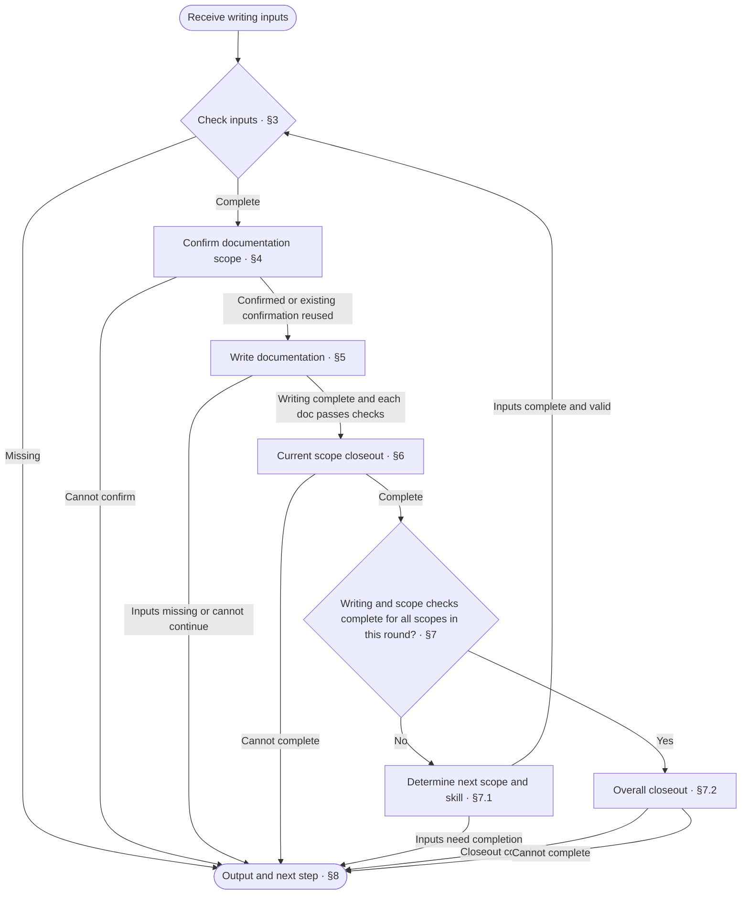

<!-- AUTO-GENERATED from SKILL.md.tmpl — do not edit directly -->
<!-- Regenerate: bash scripts/build-skills.sh --host claude -->

# aca-design

Write complete design docs from a confirmed solution or a verified as-is state
Complete documentation writing and checks for the current scope
Change only documentation, not code

## 1 Principles

### 1.1 Writing Axiom

> Write clearly with the lowest possible effort to understand: no redundancy, no omissions, no ambiguity

**Writing Structure**

- Present the whole first, then expand on the details, see the [Pyramid Principle](~/.claude/skills/aca/SSOT.md#2-structure)
- When stating a judgment, give the conclusion first, then the supporting evidence
- Merge heading levels that add no information
- Use numbered lists for items with a sequence or priority; when a step contains sub-items, start the step with a bold phrase stating its purpose and indent specific operations and conditional branches under it
- Use tables only for content with multiple rows of the same structure, more than two attributes per row, and no sequence between rows
- Write list items as complete sentences
- When an item has branches, indent the branches under that item
- Write each branch on its own line as “condition: action”
- Put conditions that must be known before execution before the action
- When a condition controls multiple steps, list the steps under that condition

**Presentation and Typography**

- Describe only the currently valid design in the design body
- When revising the design body, remove incorrect or obsolete descriptions
- Do not explain differences from earlier versions, the change process, or reasons for changes in the design body
- Describe problems, processes, and decisions in business language, and use technical language only for supporting explanations
- Define each rule in only one place, and reference it elsewhere
- Make rules and references directly locatable so readers can clearly find where to make changes
- Remove content that adds no information and does not help understanding
- Write one sentence per line, with only one fact per sentence
- State actions directly in operational steps
- Write sequential actions as separate items
- Make the actor, the object of the action, and the referents clear
- Do not repeat actors, objects of actions, or referents already clear from context
- Do not put periods at the ends of lines
- Do not leave blank lines between lines on the same topic, and leave one blank line when changing topics
- Write fragments in table cells, not sentences, and omit periods
- Write multiple facts in a cell on separate lines, without joining them with semicolons
- Reply in the language the user uses
- Follow [English typography rules](~/.claude/skills/aca/SSOT.md#1-writing-rules), with sentence case in body text and Title Case only in headings
- Follow [ISO 2145](~/.claude/skills/aca/SSOT.md#1-writing-rules) for chapter and section numbering
- Use `§` only for cross-references in body text, never in headings
- When referencing a specific chapter or section in body text, use a Markdown link directly to its anchor
  For references within the same doc, use a local chapter or section anchor, such as `[§1.2](#12-section-title)`
  For references across docs, use the target file’s relative path and chapter or section anchor, such as `[Target doc §1.2](other.md#12-section-title)`
  Link text can use the chapter or section name, or `§` followed by its number
  When chapter or section titles or order change, update affected references and verify their targets
  When an algorithm or command in a code block needs to reference a chapter or section, put the link in the body text before or after the code block
- When referencing an entire doc, link to the target file

Reference: [ASD-STE100](~/.claude/skills/aca/SSOT.md#1-writing-rules)
### 1.2 Writing Principles

1. **Input basis**
   Base writing on confirmed decisions and the verified as-is state
2. **Structural consistency**
   Organize content according to the doc design and use applicable patterns
3. **Verification alignment**
   Keep designed behavior consistent with the corresponding black-box and white-box test designs
4. **Responsibility boundaries**
   Express established designs in writing, and have the input provider supply unresolved solutions and facts

## 2 Workflow



## 3 Writing Inputs

1. Check the repo type
   Run `bash ~/.claude/skills/aca/bin/aca-repo-type-check` to obtain a valid repo type and read the corresponding repo-type spec
   Reuse an existing valid check result if the repo type identifier and applicable rules have not changed
   If the type is missing or invalid, report incomplete under §8, with `/aca-init` as the next step
   If the type is not yet supported, the check fails unexpectedly, or the rules cannot be read, record the reason and report incomplete under §8
2. Determine the writing basis
   Check confirmed inputs against the following sources

   | Source | Writing basis | Handling missing inputs |
   | --- | --- | --- |
   | `/aca-specify` | Confirmed decisions and necessary verification results for the current scope | Next step: Specify to provide further reasoning and confirmation |
   | `/aca-brownfield` | Verified behavior and evidence locations for the current scope | Next step: Brownfield to verify the as-is state |
   | Provided directly by the developer or caller | An equally complete confirmed solution or verified as-is state | Identify specific gaps for the developer or caller to fill |

   Reuse confirmed information that remains valid without mechanically requiring a specific skill to be called first
3. Check required inputs
   Check this round's target version and branch, scope, progression order, current scope, and completion progress
   Check confirmed decisions or verified behavior, evidence locations, and necessary verification results
   Verification items that affect current design conclusions must be complete
   Accept the confirmed doc list, handling plan, and evidence locations
   The current scope can be the overall project-level design, one module, or the overall design of a project that has not been split
4. Read related content
   Read related design docs and the corresponding entries in `CONTEXT.md`
   If external sources exist, read the corresponding entries in `SSOT.md`
   If required inputs are missing, identify specific gaps and who must fill them, report incomplete under §8, and stop the current writing work

## 4 Documentation Scope

1. Reuse the target version `REPO_VERSION` and branch already established by the developer or caller
2. Start with the confirmed doc list and handling plan, and check the documentation composition for the current scope against the repo-type spec and selected document set
3. Check the relevant as-is and target structures
   Reuse the existing representation if the structure and responsibilities have not changed and it remains valid
   If a new representation is needed, use [hierarchy-tree](~/.claude/skills/aca/doc-design/patterns/hierarchy-tree.md) to show the relevant as-is and target structures
   If the structures are identical, show only one tree
   Annotate each target file with its responsibilities
   For solution inputs, also annotate the corresponding decision IDs
4. Confirm the current scope of changes
   Reuse existing confirmation if the scope is confirmed and has not changed
   If adding docs, changing responsibilities, or adjusting handling methods affects the confirmed scope, explain the changes and their impact, then confirm with the developer

## 5 Documentation Writing

Within the current scope, write in the governance order specified by the repo-type spec
Within a document set, write in that set's design order
If neither the repo-type spec nor the document set specifies an order, arrange work by doc reference dependencies

1. Read the corresponding doc designs referenced by the repo-type spec and document set
   Reuse rules already read that have not changed
   - For docs registered directly in the repo-type spec, read the corresponding doc design
   - For files within a document set, read the set rules first, then read doc designs according to file responsibilities
   - For unregistered docs, find applicable doc designs by responsibility
   If existing doc designs do not cover the need, confirm supplementary expression rules with the developer
   Mention that rule gaps can be reported through `/aca-feedback`
2. Create or revise target docs
   - If a file is missing, create it according to the confirmed documentation composition and corresponding doc design
   - If a file exists, revise it within the confirmed scope
     Adjust its structure according to the corresponding doc design
   Before moving or deleting docs, check locations that reference their paths
   Update path references in docs accordingly
   If code or script changes are involved, have the input provider coordinate those changes before moving or deleting docs
3. Write the body from the inputs in §3
   If the inputs require a rewrite, rewrite according to the latest doc designs, patterns, and writing axiom
   - If missing inputs are found during writing, handle them under §3
   - If the doc design does not specify a pattern, select one based on when to use each pattern in `~/.claude/skills/aca/doc-design/patterns/`
     If no pattern applies, choose an expression method according to the writing axiom
   - Use the corresponding names and definitions for terms already included in `CONTEXT.md`
     Have the input provider confirm new or revised definitions, and handle them within the inclusion scope of the [context doc design](~/.claude/skills/aca/doc-design/documents/context.md)
   - Link included terms in the body and contract tables to their corresponding entries
     Use the link format `[term](<relative path to CONTEXT.md>#<entry-anchor>)`
     Keep plain text in headings, code blocks, Mermaid labels, and product copy
4. Synchronize affected test designs
   - Identify affected black-box and white-box test designs based on contracts, flows, and internal mechanisms added, revised, or deleted in this round
   - Update test designs in sequence according to the corresponding doc designs and [test cases](~/.claude/skills/aca/doc-design/patterns/testcase.md)
     1. Update fixtures
     2. Update test scenarios and their references to design rationale
     3. Update test cases based on the scenarios
        Add missing cases, revise changed cases, and delete or replace invalid cases
   - If only wording is revised and verified behavior has not changed, check that test designs and references remain valid
   - If solution decisions or as-is evidence required for test design are missing, handle them under §3
   - If affected docs are outside the current scope, record their locations and the content that needs synchronization
     Have the input provider confirm whether to adjust this round's scope
5. Check this doc
   1. Check each applicable checklist item from the doc design and the patterns actually used in this doc
   2. Run `bash ~/.claude/skills/aca/bin/aca-prose-check <file>`
   3. Fix failed items
      Rerun affected checks and continue after all applicable checklist items and mechanical checks pass
      If missing inputs, rules, or tools prevent further work, record the reason and report incomplete under §8
6. Enter §6 after writing is complete for all docs in the current scope and each doc passes its checks

## 6 Current Scope Closeout

1. Update affected documentation entries at each level according to the [readme doc design](~/.claude/skills/aca/doc-design/documents/readme.md)
2. Run `bash ~/.claude/skills/aca/bin/aca-readme-version-sync README.md "$REPO_VERSION"` to synchronize version blocks
3. Check checklist items from the document sets, doc designs, and patterns actually used that apply to the current scope
   Reuse passed check results if the files, rules, and related dependencies have not changed
   Focus scope-level checks on relationships across docs
   Verify that files and glossary entries referenced by docs in the current scope exist and that links point to the correct targets
   Check that black-box and white-box test designs affected by changes in the current scope are synchronized
   Do not mark this round as fully complete while test designs within this round's scope remain unsynchronized
4. Run mechanical checks for the current scope
   Reuse passed mechanical check results if the files, check rules, and related dependencies have not changed
   When execution is needed, replace the following file placeholder with the actual paths of files modified or created in this round

   ```bash
   bash ~/.claude/skills/aca/bin/aca-context-check CONTEXT.md
   bash ~/.claude/skills/aca/bin/aca-prose-check "<actual path of a file modified or created in this round>"
   ```

5. Handle check results and update progress
   If checks or version synchronization fail, fix the corresponding files and rerun affected checks or version synchronization
   If fixes or checks cannot be performed, record the reason and report incomplete and the resumption point under §8
   After checks pass, update the completion status of each scope in this round
   Mark completed scopes affected by new facts or decisions as pending
   If progress updates modify related records, check their applicable checklist items and rerun affected mechanical checks
6. Commit the current scope
   After all applicable checks pass, commit docs and related records for the current scope according to the repository's commit conventions
   If the commit cannot be made, record the reason and uncommitted content, and report incomplete and the resumption point under §8

## 7 Progress and Overall Closeout

### 7.1 Next Scope

1. Determine the next scope according to the progression order
2. Check whether inputs for that scope are complete and still valid
   Reuse existing valid inputs
3. Select a path based on actual gaps

   | Situation | Next step |
   | --- | --- |
   | Inputs are complete and valid | Set the next scope as the current scope and return to §3 to continue writing |
   | Solution decisions or necessary verification are insufficient | Continue with `/aca-specify` |
   | As-is behavior or evidence is insufficient | Continue with `/aca-brownfield` |

   If inputs need completion, report specific gaps and pending scopes under §8

### 7.2 Overall Closeout

Perform the following steps after writing and scope checks are complete for all scopes in this round

1. Check overall checklist items
   Check checklist items in the repo-type spec that apply to this round's scope
   Focus on consistency across scopes, the overall entry and navigation, and the synchronization status of affected test designs
   Reuse passed check results if the files, rules, and related dependencies have not changed
2. Check the actual documentation structure
   Determine the directories to check from the repo-type spec and this round's actual documentation entries
   Replace the following placeholder with an applicable actual documentation directory, and run separately for each directory if there are multiple directories

   ```bash
   bash ~/.claude/skills/aca/bin/aca-doc-graph-check "<actual documentation directory>"
   ```

   If the tool does not support the actual structure, record the limitation and supplement it with corresponding checks of file references, entries, and reachability
   Treat missing entries required by the repo-type spec or broken links as failed checks
   If sufficient verification is not possible, report incomplete under §8
3. Handle check results
   If checks fail, fix the corresponding files and rerun affected checks
   If checks or fixes cannot be performed, record the reason and resumption point, and report incomplete under §8
4. Commit and push closeout results
   After all applicable checks pass, commit only actual closeout changes, then push to the remote
   If there are no actual changes, do not create an empty commit, and push existing commits from this round
   If committing or pushing is not possible, record completed work, incomplete actions, and the resumption point, and report incomplete under §8
5. Continue to review
   After all closeout requirements are complete, the next step is `/aca-review`

## 8 Output

1. Determine the status of this run
   The current scope meets completion criteria when the checks, progress updates, and commit in Chapter 6 are complete
   Report this round as fully complete when all scopes are complete and overall checks, closeout commits, and pushes are complete
   Report incomplete if required steps remain unfinished in the current scope or in overall closeout that has already started
   Report the current scope as complete if it is complete but another scope remains
2. Report actual results
   Fill in the heading and results using the following format
   Retain completed facts and clearly state actual input sources, the basis for reusing checks, and incomplete items

   ```markdown
   # 📝 Design: <current scope complete / this round fully complete / incomplete>

   | Item | Result |
   | --- | --- |
   | Scope | <current scope and progress in this round> |
   | Inputs | <solution or as-is state and actual sources> |
   | Docs | <files added, revised, moved, or deleted / none> |
   | Checks | <actual results, basis for reuse, and unverified items> |
   | Commits | <commit and push results / not committed> |
   | Pending | <incomplete items, reasons, and resumption point / none> |
   | Next step | <target skill and pending scope / fill corresponding gaps / none> |
   ```

3. Determine the next step
   After this round is fully closed out, the next step is `/aca-review`
   If the current scope is complete but another scope remains, determine the next path under 7.1
   If work is incomplete, fill the corresponding gaps, and do not judge Design complete solely because files have been written
