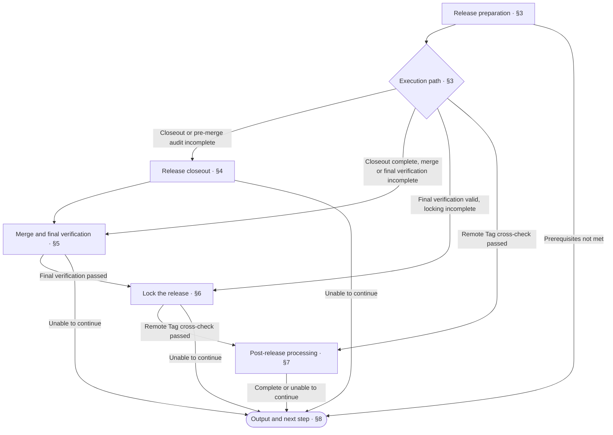

<!-- AUTO-GENERATED from SKILL.md.tmpl — do not edit directly -->
<!-- Regenerate: bash scripts/build-skills.sh --host claude -->

# aca-release

Complete release closeout according to this repository's release workflow
Merge the verified release into main, then create and push an annotated Tag on the final commit
Do not add design or implementation

When a release doc is selected, follow its required sequence, pass criteria, and failure recovery procedures
Otherwise, follow this skill's default workflow

## 1 Principles

1. **Driven by Sources**
   Use the confirmed release goals and repository release workflow to determine the release scope and execution requirements
2. **Matching Evidence**
   Use verification evidence that corresponds to the final commit to determine whether the release is ready to be locked in
3. **Immutable Release Identity**
   Keep the identity of a locked release unchanged
4. **Recovery Based on Facts**
   Use the verified release state to determine the resume point

## 2 Workflow



If execution cannot continue in Chapters 4 through 7, report completed facts, the reason for stopping, and the resume point according to [Output and Next Step](#8-output-and-next-step)

## 3 Release Preparation

### 3.1 Release Basis and Prerequisites

1. Determine the goals for this release
   Use the version, Tag, and release scope already specified by the developer or caller
   Ask the developer to supply missing information
   Reuse information that is already specified
2. Run `bash ~/.claude/skills/aca/bin/aca-repo-type-check` to check the repo type
   If the type is missing or invalid, stop and recommend running `/aca-init`
   If the type is not yet supported, stop and report that the repo-type spec cannot be cross-checked
3. Read `~/.claude/skills/aca/doc-design/repo-types/{repo-type}.md`
   Use the project structure to locate the applicable release workflow, version source, and release records
   If a release doc is selected, follow its requirements
   Otherwise, use this skill's default workflow
4. Specify the execution requirements
   List the required steps, pass criteria, and required environment, tools, permissions, and external dependencies
   If required conditions are not met, report the reason for stopping and the resume point according to [Output and Next Step](#8-output-and-next-step)

### 3.2 Current State and Resume Point

1. Synchronize and read the current release state
   Cross-check remote branches, Tags, local state, and existing execution records
2. Cross-check existing Tags
   Confirm that the targets and annotations of local and remote Tags with the same name match this release
   If conflicts exist, stop and report them
   If they match, preserve the completed locking results
   Do not repeat release record closeout, merges, or Tag creation
3. Cross-check the prerequisites for the remaining steps
   - To continue closeout, merging, or Tag creation: cross-check the corresponding execution conditions
     Confirm the corresponding branches and commits, release records, and workspace state
     Cross-check that version numbers in related files are consistent, all existing changes are committed, and the workspace is clean
     Cross-check that the repository version line in the root README is adjacent to the Anyone Can Architect footer and that the footer is the last line
     If the version block is missing or malformed, stop and recommend running `/aca-init`
   - To resume only the announcement: use the locked Tag as the basis
   If prerequisites or verification evidence are no longer valid, return to the corresponding step and verify again
4. Use the table below to determine the resume point and select an incomplete step
   Reuse completion facts that remain valid

| Remaining work | Entry point |
| --- | --- |
| Release records, merge chain, or pre-merge audit incomplete | [Release Closeout](#4-release-closeout) |
| Closeout complete, merge or final verification incomplete | [Merge and Final Verification](#5-merge-and-final-verification) |
| Final verification valid, release locking incomplete | [Lock the Release](#6-lock-the-release) |
| Remote Tag cross-check passed, only cleanup or announcement remains | [Post-Release Processing](#7-post-release-actions) |

### 3.3 Announcement Configuration

1. Run `bash ~/.claude/skills/aca/bin/aca-release-notify-check .` to check the announcement configuration
   Record the check result and the corresponding configuration location
2. Act on the check result

   | Result | Action |
   | --- | --- |
   | `NOTIFY_NONE` | Record that no transport is configured and continue the release |
   | `NOTIFY_WIRED` | Record the platform and consumer point and continue the release |
   | `NOTIFY_UNWIRED` | Stop and report that the announcement does not use `aca-tag-notify-extract <tag>` to extract content, then check again after the configuration is corrected |
   | Unable to complete the check | Stop and report the reason and resume conditions |

3. Use the configuration check result for the [Announcement Cross-Check](#72-cross-check-the-release-announcement)
   Check again after the configuration is corrected
   The configuration check confirms that the summary is integrated
   Report that the announcement was sent only after obtaining the actual send result

## 4 Release Closeout

### 4.1 Close Out Release Records

1. Determine the scope of release records
   Select the applicable release records at the time and in the manner specified by the repository release workflow
   If no release doc is selected, determine the record scope according to the repo-type spec
   Cross-check whether release records match the actual changes in this release
2. Update the version source and related records
   Update the version source and files that need synchronization according to repository conventions, and close out the records for this release
   If release records do not match actual changes, or it is unclear which content belongs to the current release, stop and explain the differences
3. Synchronize the README version block
   After updating the version source, synchronize the repository version line in the root README to this release's `<TARGET_VERSION>`, preserving the repository name
   - Regular projects: run `bash ~/.claude/skills/aca/bin/aca-readme-version-sync README.md "<TARGET_VERSION>"`
   - Releasing Anyone Can Architect itself: after updating the project's `VERSION`, run `bash ~/.claude/skills/aca/bin/aca-readme-version-sync README.md "$(tr -d '[:space:]' < VERSION)" "$(tr -d '[:space:]' < VERSION)"`
   If synchronization fails, stop and report the reason
   If the version block is missing or malformed, recommend running `/aca-init`
   Handle other failures according to their actual causes
4. Verify and commit closeout changes
   Cross-check version consistency, record completeness, and README version block format
   Commit only the release records, version pointers, and README version block modified in this run
   Do not use `git add -A` to include unrelated changes

### 4.2 Confirm the Merge Chain

1. Confirm the final target
   The final merge and release Tag must be on `main`
   Confirm that the repository has `main`
   If it does not, stop and report that the release target branch is missing
2. Determine the branch sequence
   If a release doc is selected, follow the merge chain it defines
   If no merge chain is defined, determine it from the responsibilities of existing repository branches
   If the purpose of an intermediate branch is unclear, ask the developer to confirm
   Do not create intermediate branches for the Release
3. Specify the requirements for each merge
   Record the source branch, target branch, merge method, and required checks
   Use these requirements as the basis for [Merge and Final Verification](#5-merge-and-final-verification)
4. Cross-check completed merges
   When resuming execution, use merge records and release content to confirm completion
   Reuse completed merges whose prerequisites remain valid

### 4.3 Pre-Merge Audit

1. Specify the state to be merged
   Synchronize the target branch and record the commit to be merged and the target branch state
2. Run or reuse the repository audit
   Invoke `/aca-repo-audit` with implementation cross-checking included
   If existing results meet its reuse conditions, reuse them and state the basis
   If reuse conditions are not met, audit again
3. Complete additional verification required by the repository
   Perform verification and necessary operations not yet covered according to the release workflow, and record the results
4. Determine whether merging is allowed
   After the audit conclusion is pass and required verification passes, proceed to [Merge and Final Verification](#5-merge-and-final-verification)
   If the audit conclusion requires action or is incomplete, stop merging
   If required verification fails or is incomplete, stop merging
   Report issues, resume conditions, and the corresponding handling stage according to [Output and Next Step](#8-output-and-next-step)

## 5 Merge and Final Verification

### 5.1 Merge into main Following the Branch Chain

1. Select the next merge
   Select an incomplete step according to the [Merge Chain](#42-confirm-the-merge-chain)
   Cross-check that the source branch, target branch, and pre-merge audit remain valid
2. Merge according to repository conventions
   Follow the repository's existing merge method and branch protection rules
   - Pull Request required: create or update a Pull Request
   - Local merge allowed: follow repository conventions
   Do not force-push, skip checks, or bypass protection rules
3. Confirm merge completion
   Cross-check the actual merge result and release content in the target branch, and record the resulting commit
   If the Pull Request has not been merged, record the waiting state and resume point
   Proceed to the next merge only after the current merge is complete
   After all changes are merged into main, proceed to [Final Commit Verification](#52-final-commit-verification)
4. Handle conflicts and resume
   If conflicts occur, stop merging and report the conflicting files and causes
   After conflicts are resolved and committed, cross-check the audit and affected verification again according to [Pre-Merge Audit](#43-pre-merge-audit)
   Continue merging after entry conditions are met

### 5.2 Final Commit Verification

1. Locate the final commit
   Synchronize main and confirm that this release has been merged
   Record the main commit to be locked
2. Cross-check the version and content
   Cross-check that the final version number on main matches the target version for this release
   Cross-check that the applicable release records are closed out
   Cross-check that the repository version line in the root README matches this Tag's version
   Cross-check that the Anyone Can Architect footer matches the current Anyone Can Architect version, immediately follows the repository version line, and is the last line
   Cross-check that the final commit contains the complete design, implementation, and tests for this scope
3. Complete final verification
   Complete the verification required by the repository release workflow and the `/aca-test` test scope on the final commit
   Record verification results and the corresponding commit
   When reusing existing `/aca-test` or verification results, state which reuse conditions are met and the basis for their correspondence to the final commit
   If artifacts are involved, cross-check their traceability to this commit
   Verification artifacts cannot replace evidence of completed delivery
4. Determine whether release locking is allowed
   After all required cross-checks and verification pass, proceed to [Lock the Release](#6-lock-the-release)
   If they fail or are incomplete, stop and report the reason and resume point according to [Output and Next Step](#8-output-and-next-step)

## 6 Lock the Release

### 6.1 Release Summary

The release summary is a required Release artifact
Release announcements are generated from the NOTIFY block in the annotated Tag

1. Cross-check existing Tags and content sources
   - Existing Tag target and annotation cross-checks passed: preserve the annotation and go to [Create and Push the Tag](#62-create-and-push-the-tag) to continue incomplete steps
   - Tag creation required: determine summary content from this release's records or confirmed Issues, cross-checking against actual changes in this release
     Take verification facts from the records in [Final Commit Verification](#52-final-commit-verification)
2. Write the summary in the following format to `~/.aca/release-note-<TAG>.md`

   ```text
   vX.Y.Z: <one-sentence theme> (#issue …)

   ---NOTIFY-BEGIN---
   <emoji> <one user-facing change>
   <emoji> <one user-facing change>
   ✅ <verification facts: tests N/N, build, audit conclusion>
   ---NOTIFY-END---
   ```

   - The version on the first line must equal the target Tag, with the theme expressed in one sentence
   - List confirmed Issues in parentheses when available
   - Put one item per NOTIFY line, starting with an emoji and describing a change users can understand
   - Use 3–6 changes where possible, and do not substitute file names or commit hashes for change descriptions
   - Record actual verification results in the last item, starting with ✅

3. Run `bash ~/.claude/skills/aca/bin/aca-tag-notify-check ~/.aca/release-note-<TAG>.md <TAG>` to validate the summary
   If validation fails, correct the summary and validate again
   After validation passes, pass the summary file to [Create and Push the Tag](#62-create-and-push-the-tag)
   Do not use a one-line title or an empty annotation

### 6.2 Create and Push the Tag

1. Cross-check the latest state
   Synchronize with the remote and cross-check whether the target Tag exists locally and remotely
2. Handle existing Tags
   If the target and annotation match, preserve the existing Tag and continue the remaining steps
   If conflicts exist, stop and report them
   Do not move or recreate existing Tags
3. Create an annotated Tag if the target Tag exists neither locally nor remotely
   Before creation, confirm that main still points to the commit recorded in [Final Commit Verification](#52-final-commit-verification)
   Confirm that the [Release Summary](#61-release-summary) has passed validation
   - main has changed: verify the new final commit again according to [Final Commit Verification](#52-final-commit-verification)
     Update and revalidate verification facts according to [Release Summary](#61-release-summary)
   Replace the following placeholders with the target Tag and verified main commit, then run the command

   ```bash
   git tag -a "<TAG>" "<VERIFIED_MAIN_COMMIT>" -F ~/.aca/release-note-<TAG>.md
   ```

4. If the target Tag does not yet exist remotely, push it according to repository conventions
   If the push fails, record the reason and resume point
   After resuming, cross-check the latest state before retrying the push
   After the push completes, or if the target Tag already exists remotely, verify the result according to [Cross-Check the Remote Tag](#63-cross-check-the-remote-tag)

### 6.3 Cross-Check the Remote Tag

1. Read the actual remote result
   Cross-check whether the target Tag exists
   If it does not, handle the push according to [Create and Push the Tag](#62-create-and-push-the-tag), then cross-check again
   If it exists, obtain its type, target commit, and annotation
2. Cross-check the locked content
   Confirm that the target is an annotated Tag
   Cross-check that the commit matches the main commit verified for this release
   Cross-check that the annotation matches the summary confirmed for this release
   When resuming an old release, cross-check against its locking records
3. Record the state and proceed
   After the cross-check passes, record the remote locking facts and proceed to [Post-Release Processing](#7-post-release-actions)
   If cross-checking is impossible or conflicts are found, stop and report the reason and resume conditions
   Preserve existing Tags
## 7 Post-Release Actions

### 7.1 Clean Up Release Branches

1. Determine the cleanup scope
   List the branches for this release and the local and remote cleanup scope according to repository conventions
2. Check the cleanup conditions
   Confirm that the [remote Tag cross-check](#63-cross-check-the-remote-tag) has passed
   Use merge records and release content to confirm that candidate branches have been merged into main
   Retain branches that still support follow-up work
   If branch ownership or merge status cannot be confirmed, retain the branch and record the reason
3. Perform cleanup and check the results
   Clean up only branches for this release that meet the conditions, and record the actual results
   If cleanup cannot be completed, report the remaining branches, reasons, and conditions for resuming
   Cleanup failure does not change the fact that the release is already locked in
   Determine whether cleanup affects Release completion based on whether the repository requires this step

### 7.2 Cross-Check the Release Announcement

1. Locate the delivery results
   Use the [announcement configuration](#33-announcement-configuration) and the repository release workflow to find tasks, logs, or delivery receipts for this Tag
2. Record the delivery status based on evidence

   | Status | Basis for determination |
   | --- | --- |
   | Sent | Evidence of successful delivery for this Tag |
   | Pending delivery | Confirmed to still be waiting or in progress |
   | Delivery failed | An explicit failure result |
   | Unconfirmed | Insufficient evidence to determine the delivery status |
   | Transport not configured | Configuration checks confirm that no delivery mechanism is configured |

3. Handle follow-up actions
   If delivery fails, recover or resend according to repository conventions
   If the status is unconfirmed, report the missing evidence
   To resend, use `aca-tag-notify-extract <tag>` to extract content from the locked Tag
   After resending, cross-check the delivery results again
   Announcement issues do not change the fact that the release is already locked in
   Report follow-up actions separately

## 8 Output and Next Step

### 8.1 Determine Completion Status

1. Determine whether the release is locked in
   Record locked in, not locked in, or unconfirmed based on the [remote Tag cross-check](#63-cross-check-the-remote-tag) results
2. Determine Release completion status
   Mark the Release complete when the required steps in the repository release workflow are complete and the remote annotated Tag target and annotation checks pass
   Mark it incomplete if the completion conditions are not met
   If cleanup or the announcement is incomplete, determine the workflow status based on whether the repository requires these steps
   Retain the verified fact that the release is locked in

### 8.2 Release Report

Fill in the following output with the actual results

```markdown
# 🚀 Release: <complete / incomplete>

| Item | Result |
| --- | --- |
| 🏷️ Version | <release version> |
| 🔀 Merge chain | <actual merge chain> |
| 📝 Release record | <closeout result> |
| 🩺 Repository audit | <results of each audit and basis for reuse> |
| ✅ Verification | <final verification results and corresponding commit> |
| 📌 main commit | <final commit> |
| 🏷️ Tag | <Tag, remote target and annotation cross-check results> |
| 🔒 Release lock-in | <locked in / not locked in / unconfirmed, with supporting evidence> |
| 🧹 Branch cleanup | <local and remote cleanup results, remaining branches / not selected> |
| 📣 Announcement | <sent / pending delivery / delivery failed / unconfirmed / transport not configured, with supporting evidence and follow-up actions> |
| 📍 Workflow status | <complete / incomplete, with supporting evidence> |
| Incomplete steps | <steps and reasons / none> |
| Recovery | <resume point and required conditions / none> |
| Next step | <one immediately executable action / none> |
```

### 8.3 Follow-Up Actions

Select one immediately executable action based on the incomplete items

| Situation | Next step |
| --- | --- |
| Execution conditions are missing | Meet the conditions, then check the status against [release preparation](#3-release-preparation) and resume |
| The design solution still needs reasoning | `/aca-specify` Reason through the solution |
| The revision solution is clear and only doc changes are needed | `/aca-design` Revise the docs |
| Implementation issues | `/aca-implement` Fix code or tests |
| Tests or final verification incomplete | `/aca-test` Run verification, then resume the release |
| Merge conflicts | Resolve and commit the conflicts, then rerun the [pre-merge audit](#43-pre-merge-audit) |
| Push, cleanup, or announcement is still incomplete | Resume from the corresponding incomplete step |
| Everything is complete and no follow-up items remain | Report that there are no pending tasks |
