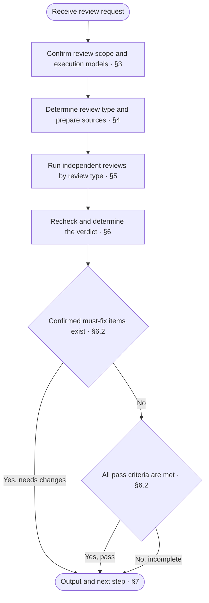
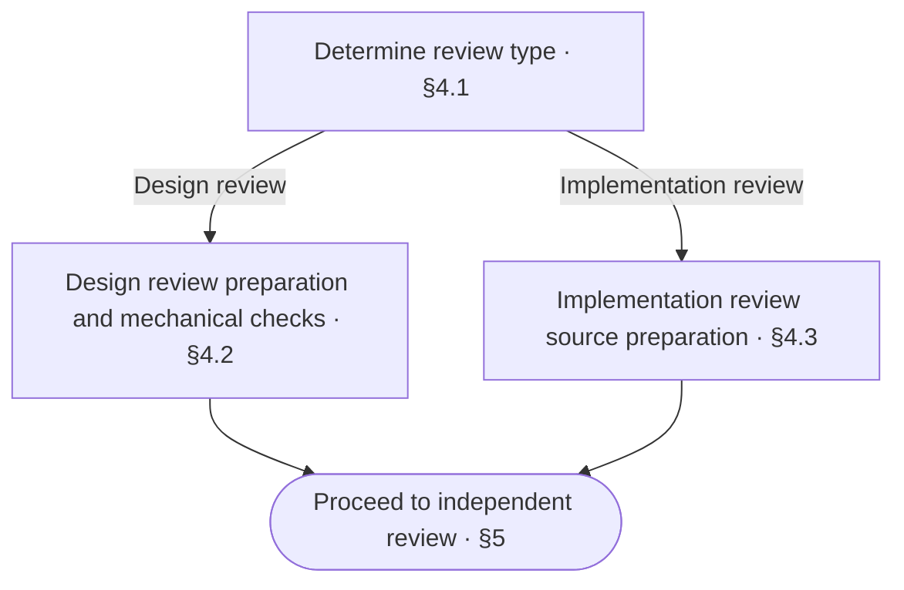

<!-- AUTO-GENERATED from SKILL.md.tmpl — do not edit directly -->
<!-- Regenerate: bash scripts/build-skills.sh --host claude -->

# aca-review

Review the design docs or code structure in the current scope and determine pass, needs changes, or incomplete
Do not modify design docs, project source code, or test code, and do not run the code or tests under review
Use `/aca-repo-audit` for the repository-wide audit before release

## 1 Principles

### 1.1 Review Principles

1. **Source-driven review**
   Review the design against confirmed requirements and applicable rules
   Review the modularity and overall structure of the code against the confirmed design
2. **Independent judgment**
   Form conclusions independently for each review dimension
3. **Evidence-based verdict**
   Determine issues and review conclusions from facts in the code structure and docs
4. **Scope constraints**
   Limit review conclusions to the current scope

### 1.2 Writing Axiom

The writing axiom applies to reviews of design doc prose and the wording of review reports

> Write clearly with the lowest possible effort to understand: no redundancy, no omissions, no ambiguity

**Writing Structure**

- Present the whole first, then expand on the details, see the [Pyramid Principle](~/.claude/skills/aca/SSOT.md#2-structure)
- When stating a judgment, give the conclusion first, then the supporting evidence
- Merge heading levels that add no information
- Use numbered lists for items with a sequence or priority; when a step contains sub-items, start the step with a bold phrase stating its purpose and indent specific operations and conditional branches under it
- Use tables only for content with multiple rows of the same structure, more than two attributes per row, and no sequence between rows
- Write list items as complete sentences
- When an item has branches, indent the branches under that item
- Write each branch on its own line as “condition: action”
- Put conditions that must be known before execution before the action
- When a condition controls multiple steps, list the steps under that condition

**Presentation and Typography**

- Describe only the currently valid design in the design body
- When revising the design body, remove incorrect or obsolete descriptions
- Do not explain differences from earlier versions, the change process, or reasons for changes in the design body
- Describe problems, processes, and decisions in business language, and use technical language only for supporting explanations
- Define each rule in only one place, and reference it elsewhere
- Make rules and references directly locatable so readers can clearly find where to make changes
- Remove content that adds no information and does not help understanding
- Write one sentence per line, with only one fact per sentence
- State actions directly in operational steps
- If a specific practice fully expresses a constraint, write the practice directly
- Keep prohibitions that no specific practice can fully express
- Write sequential actions as separate items
- Make the actor, the object of the action, and the referents clear
- Do not repeat actors, objects of actions, or referents already clear from context
- Do not put periods at the ends of lines
- Do not leave blank lines between lines on the same topic, and leave one blank line when changing topics
- Write fragments in table cells, not sentences, and omit periods
- Write multiple facts in a cell on separate lines, without joining them with semicolons
- Reply in the language the user uses
- Follow [English typography rules](~/.claude/skills/aca/SSOT.md#1-writing-rules), with sentence case in body text and Title Case only in headings
- Follow [ISO 2145](~/.claude/skills/aca/SSOT.md#1-writing-rules) for chapter and section numbering
- Use `§` only for cross-references in body text, never in headings
- When referencing a specific chapter or section in body text, use a Markdown link directly to its anchor
  For references within the same doc, use a local chapter or section anchor, such as `[§1.2](#12-section-title)`
  For references across docs, use the target file’s relative path and chapter or section anchor, such as `[Target doc §1.2](other.md#12-section-title)`
  Link text can use the chapter or section name, or `§` followed by its number
  When chapter or section titles or order change, update affected references and verify their targets
  When an algorithm or command in a code block needs to reference a chapter or section, put the link in the body text before or after the code block
- When referencing an entire doc, link to the target file

Reference: [ASD-STE100](~/.claude/skills/aca/SSOT.md#1-writing-rules)
## 2 Workflow



## 3 Review Preparation

### 3.1 Subject, Scope, and Prerequisites

1. **Confirm the review subject and scope**
   - Developer has specified the review subject and scope: follow that specification first
   - Developer has not specified them: use the review subject and scope already specified by the caller
   - Subject or scope is still unclear: determine it from current workspace changes and recent relevant commits, reading the descriptions and diffs of recent relevant commits
   - Review subject or scope still cannot be determined: ask the developer to specify it
2. **Record the comparison baseline**
   - Record the review subject, scope, and comparison baseline
   - Specify the commits under review and any uncommitted changes included in the review
3. **Check the repo type**
   - Run `bash ~/.claude/skills/aca/bin/aca-repo-type-check` to check the repo type
   - Repo type is missing or invalid: mark the repo-type spec check as incomplete and recommend running `/aca-init`
   - Repo type is not yet supported: mark the repo-type spec check as incomplete and note that the corresponding rules are missing
4. **Locate and read general review sources**
   - When the input does not include the design doc location, locate it from the documentation entry in the root README, or ask the developer for its location if it cannot be located and mark checks that depend on this content as incomplete until the location is clear
   - Read the confirmed problems, goals, and change scope for this review
   - If the repo type is valid and supported, read the corresponding Repo Type rules
   - Read `CONTEXT.md` and check the business concepts and definitions involved in this review
   - Read the design docs for the current scope and follow references to read any additional docs needed for understanding and verification

### 3.2 Agent and Model Selection

1. **Reuse the confirmed model first**
   - Developer has specified an Agent environment or model: run with that specification
   - A review model has already been confirmed and its availability conditions have not changed: reuse the last confirmed Agent environment and model by default, and skip the environment scan and confirmation
2. **Scan and confirm the model on the first review**
   - On the first review with no model specified, scan the current AI Agent environment and other AI Agent environments on this machine, and the models that can be invoked
   - Prefer recommending a callable flagship model that differs from the main agent; if no other suitable and callable candidate is available, propose using the current model
   - Show each candidate's Agent environment, model, availability, and the reason for the recommendation, and ask the developer to confirm before running the review; later reviews reuse this confirmation by default
3. **Handle execution fallback**
   - Use the confirmed or reused execution combination for [Task Orchestration and Execution](#53-task-orchestration-and-execution)
   - If the selected combination cannot be invoked, use a confirmed alternative, or report the change and ask the developer to confirm a new combination if no alternative has been confirmed
   - Record the Agent environment and model actually used, whether they were reused, and the reasons for any fallback in the [Review Report](#71-review-report)

## 4 Read Source Material and Run Checks



### 4.1 Determine Review Type

1. **Determine the review type for this run**
   - Developer has specified the review type: follow that specification first
   - Developer has not specified it: use the review type already specified by the caller
   - Review type is not specified: determine it from the subject under review and the actual changes (run a design review for design docs, run an implementation review for code, and run both review types separately when both are involved)
   - Review type still cannot be determined: ask the developer to specify it

Run both branches when both review types are selected

### 4.2 Design Review

By default, design review applies to cross-module design changes (involving multiple modules, the project-level architecture, the module division, or cross-module interfaces and collaboration contracts), or to a design review the developer explicitly requests

1. **Extract applicable checklist items**
   - Read the document set, Doc Design, and Patterns actually used for the current scope
   - Extract their applicable checklist items as the basis for verification in the design review
2. **Reuse or run mechanical checks**
   - Existing mechanical check results from this session can be reused directly if they cover the same scope and the relevant files, check rules, and tools have not changed, stating the original results and the basis for reuse in the report
   - If the reuse conditions are not met, replace the placeholder paths in the following commands with the actual paths of the docs under review and run them
     - Prose checks cover all docs under review, including project-level records within the review scope
     - For the doc graph check, select a doc tree that includes the docs under review and has a README entry
     - Mechanical checks for Context verify structure and formatting

   ```bash
   bash ~/.claude/skills/aca/bin/aca-doc-graph-check <doc directory>
   bash ~/.claude/skills/aca/bin/aca-context-check CONTEXT.md
   bash ~/.claude/skills/aca/bin/aca-prose-check <paths to all docs under review>
   ```

3. **Handle mechanical check results**

| Check status | Action |
| --- | --- |
| Pass, or reuse conditions met | Record the results and the verification or reuse evidence |
| Failure returned | Check the diagnostics and list confirmed issues as must fix |
| Cannot run or diagnostics cannot be verified | Mark the corresponding check or issue verification as incomplete and state the reason |

### 4.3 Implementation Review

1. **Read the structural design and organization conventions**
   - Read the architecture design, module boundaries, interface definitions, internal composition, and repository code organization conventions for the current scope
2. **Read the overall structure of the code under review**
   - Against the established comparison baseline, read the directory and file distribution, module dependencies, function and class definitions, and cross-module assembly wiring involved in the changes
3. **Define the review boundary**
   - By default, implementation review applies to cross-module changes or changes to a module's overall code structure (changes that stay inside a module and do not change its overall code structure skip implementation review and go directly to `/aca-test`)
   - Implementation review checks only the overall structure (module structure, overall code distribution, and function construction), and does not check specific code details or implementation logic
   - Implementation review does not run code, tests, or builds directly, and runtime verification is executed by `/aca-test` after the review passes

## 5 Review Orchestration and Execution

### 5.1 Design Review Dimensions

Design review is one overall review task that checks the design docs under review against the following four items

1. **Requirements and scope coverage**
   Check whether the design fully addresses the confirmed problems, goals, and scope
2. **Responsibility boundaries and collaboration mechanisms**
   Check whether the division of responsibilities and boundaries, module dependencies, and interface conventions match the division of business work and are sufficient to guide module collaboration
   Check whether the collaboration and processing mechanisms, data and state changes, error handling, and boundary behavior are sufficient to guide detailed implementation
   If user interaction is involved, check whether the interaction flow, each interaction state, and each success and failure path provide clear feedback and action guidance
   Check whether the design contains ambiguities that would lead to different business behavior, and whether additional design decisions are still needed before implementation
3. **Completeness of the verification design**
   Check whether the test design specifies fixtures, scenarios, execution methods, and expected results
   Check whether test results can determine if the corresponding acceptance criteria are met
4. **Cross-doc consistency and writing rules**
   Check whether the documentation entry and references accurately locate the current design and its dependencies
   Check related docs for design omissions, conflicting conventions, duplicate definitions, or inconsistent terminology
   Check whether the checklist items of the applicable document set, Doc Design, and Patterns are met

### 5.2 Implementation Review Dimensions

Implementation review is one overall review task that uses the confirmed design docs as its basis, checks only the modularity and overall structure of the code, and does not check specific code details or implementation logic

1. **Module structure**
   Check whether the division of modules and submodules, responsibility assignments, interface boundaries, dependencies, and cross-module assembly wiring conform to the design
2. **Overall code distribution**
   Check whether the directory and file organization conforms to the design, whether each file has a single responsibility and clear ownership, and whether responsibilities are mixed or layers are coupled across boundaries
3. **Function construction**
   Check whether the responsibility split, signature design, granularity, and level of abstraction of functions and classes are clear and reasonable

### 5.3 Task Orchestration and Execution

1. **Dispatch independent review tasks by review type**
   - When only a design review or only an implementation review runs, create 1 independent sub-agent task to complete all check items of that dimension
   - When both design and implementation reviews run, create 1 independent sub-agent task for the design review and 1 for the implementation review
   - Run each review task according to [Agent and Model Selection](#32-agent-and-model-selection), and form conclusions independently
2. **Provide task context**
   - The assigned review type, its check items, and applicable checklist items
   - Review subject, scope, and comparison baseline, including commits under review and uncommitted changes included in the review
   - Locations of the content under review and the corresponding design source material
   - For design review, the mechanical check results and evidence from Chapter 4
   - For implementation review, the directory and file structure, changed files, module dependencies, and repository code organization conventions
3. **Run an issue-oriented review**
   - The sub-agent verifies each check item and applicable checklist item of its dimension
   - When it finds an issue, it records the file location, problem, impact, and recommended change using the issue format in the [Review Report](#71-review-report)
   - When a check item cannot be completed, it records the incomplete item and the reason
   - Pass and not-applicable items are not itemized; the sub-agent returns the list of issues found, incomplete items, and its review conclusion to the main agent

## 6 Recheck and Verdict

### 6.1 Recheck and Merge

1. **Recheck issue evidence**
   - The main agent checks the files and evidence for each issue returned by the sub-agents and includes it in the report only after confirming it
   - Exclude disproven issues and mark issues with insufficient evidence as incomplete verification
   - The main agent can add issues it finds independently after applying the same evidence verification
   - Merge duplicate issues while retaining their locations, evidence, and impact
2. **Check review coverage**
   - Confirm that the selected review dimensions and their check items have all been verified
   - If a sub-agent did not cover its assigned scope or omitted check items, check the corresponding content and recheck the results
   - Mark review dimensions or checks that still cannot be completed as incomplete and state the reasons

### 6.2 Verdict

| Verdict | Criteria |
| --- | --- |
| Pass | All selected review tasks are complete, all applicable checklist items have passed verification, all applicable mechanical checks have passed, and there are no must-fix items |
| Needs changes | Confirmed must-fix items exist |
| Incomplete | Pass criteria are not met and there are no confirmed must-fix items |

If must-fix items and incomplete checks both exist, the verdict is needs changes, and the incomplete items must be listed
Optional improvements do not affect a pass
After the content under review changes, review the affected scope again and update the corresponding conclusions

## 7 Output and Next Step

### 7.1 Review Report

Output the review results in the current conversation using the following template without writing to project files

```markdown
# 🔎 Review: <pass / needs changes / incomplete>

| Item | Result |
| --- | --- |
| Subject | <design docs / code structure / both> |
| Scope | <modules, files, or changes under review> |
| Baseline | <comparison baseline, commits under review, and uncommitted changes> |
| Execution model | <Agent environment and model actually used, reuse status, and fallback reasons> |
| Verdict basis | <how pass criteria are met, or issues and incomplete checks preventing a pass> |
| Must fix | <issue count and main impact / none> |
| Tool checks | <pass, reuse, failure, and incomplete status of design review mechanical checks / not applicable for implementation review> |
| Incomplete | <incomplete review tasks and checks within the current scope, and reasons / none> |
| Next step | <one immediately actionable step> |

## Must Fix

- <doc section link / code file link and line number>
  - Problem: <actual content, design conventions or checklist items violated, and specific deviations>
  - Impact: <impact on design understanding, implementation, or maintenance of the code structure, and conditions under which it occurs>
  - Change: <content to correct or confirm, and conventions or checklist items to satisfy after correction>

## Optional Improvements

- <suggested improvements that do not affect a pass, corresponding locations, and expected benefits>
```

### 7.2 Follow-Up Actions

Select the next step based on the review verdict and progress in the current round

| Verdict | Situation | Next step |
| --- | --- | --- |
| Incomplete | Inputs or verification conditions are missing | Report the conditions for resuming and continue this review through `/aca-review` once they are met |
| Needs changes | The design solution still needs reasoning or decisions | `/aca-specify` Extend or revise the solution |
| Needs changes | The solution is clear and only design docs need revision | `/aca-design` Revise the docs |
| Needs changes | Code structure issues | `/aca-implement` Adjust the code structure |
| Pass | Design review passed and code implementation is needed in this round | `/aca-implement` |
| Pass | Design review passed and only design docs are changed in this round | Proceed to `/aca-release` according to the confirmed version progression plan |
| Pass | Implementation review passed | `/aca-test` Run test verification for the current scope |

After design or code structure corrections, review the affected scope again through `/aca-review`
