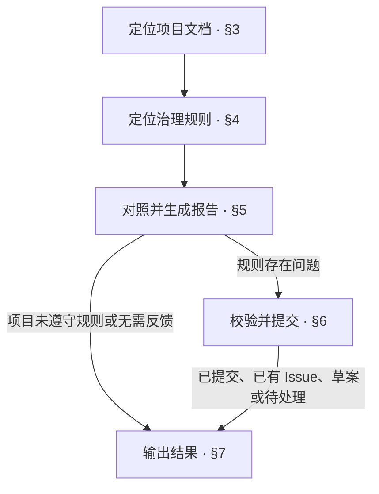

<!-- AUTO-GENERATED from SKILL.md.tmpl — do not edit directly -->
<!-- Regenerate: bash scripts/build-skills.sh --host antigravity-cli -->

# aca-feedback

对照项目实践与 Anyone Can Architect 治理规则，整理具体偏差
开发者明确要求反馈时，校验报告并提交 Issue
不修改项目文档或代码

## 1 原则

1. **实践依据**
   以具体项目实践判断治理规则是否适用
2. **归因明确**
   区分规则本身的问题与项目未遵守规则的问题
3. **证据对应**
   当前规则、项目实际、影响与建议指向同一处偏差
4. **职责约束**
   反馈处理治理规则问题，项目修正由对应流程承担

## 2 执行流程



第三至第五章无法继续时，按[输出结果](#7-输出结果)报告已核实的事实、缺失信息与下一步

## 3 定位项目文档

1. 定位反馈对象
   开发者已提供文件位置时直接读取
   否则从根 README 沿相关引用定位反馈对象
2. 核实工程类型与术语
   运行 `bash ~/.gemini/antigravity-cli/skills/aca/bin/aca-repo-type-check` 检查工程类型
   读取 `CONTEXT.md` 中与反馈相关的术语定义
   无法取得有效工程类型或 Context 缺失时，记录原因，继续核实能够确认的项目事实
3. 记录项目实际
   明确反馈对应的文件、章节或字段及实际处理方式
   内容缺失时，记录缺失事实
4. 补齐必要背景
   项目中能够确认的信息自行读取
   只追问无法确认且影响判断的背景或决定

## 4 定位治理规则

1. 定位规则入口
   类型有效时，从 `~/.gemini/antigravity-cli/skills/aca/doc-design/repo-types/<repo-type>.md` 定位对应的文档设计
   类型不可用时，根据反馈对象定位类型定义或相关治理规则
2. 读取关联规则
   沿引用读取与本次反馈相关的 pattern、reference 与 skill
3. 核实规则覆盖与归属
   未找到对应规则时，检查现有规则能否覆盖该内容
   仍无法覆盖时，记录缺失及建议归属的位置
   项目文档缺失时，依据相关规则确定其应在的位置
4. 记录规则依据
   记录规则文件、具体章节或字段，以及原文或准确含义
   涉及多处规定时，分别记录，供第五章对照判断

## 5 对照并生成报告

1. 对照并判断
   根据第三章的项目事实与第四章的规则依据，按下表确定处理方式

   | 情况 | 处理 |
   | --- | --- |
   | 规则明确，项目未遵守 | 指出项目应调整的位置，不生成规则反馈，按第七章汇报 |
   | 规则缺失、含糊、冲突或无法执行 | 继续整理反馈内容并生成报告 |
   | 未发现规则问题 | 按第七章汇报无需反馈 |
   | 证据不足，无法判断 | 记录缺失信息，按第七章汇报待处理 |

2. 整理反馈内容
   以下四项围绕同一处偏差展开

   | 内容 | 要求 |
   | --- | --- |
   | 当前规则 | 文件位置与具体规定，缺失时注明建议归属的位置 |
   | 项目实际 | 项目文件位置与实际处理方式，内容缺失时注明缺失事实 |
   | 影响 | 规则问题造成的具体影响 |
   | 建议 | 明确规则调整前后内容，或说明保留项目特例、等待更多案例的依据 |

3. 填写报告
   `target_outline`、`target_chapter`、当前规则和项目实际必须有明确内容
   必需内容无法确认时，按第七章汇报待处理
   `repo_type`、`aca_version` 等辅助信息确实无法取得时，才允许写 `unknown`
   按以下模板填写报告

```markdown
---
source: aca-feedback
created_at: <UTC ISO 8601>
repo: <git remote 的 org/名；无 remote 时取目录名>
repo_type: <README footer 中的 Repo-Type；没有则 unknown>
project_branch: <当前分支>
commit: <当前 commit>
target_outline: <对应的文档设计 / pattern / skill>
target_chapter: <具体章节、段落或字段>
aca_version: <当前版本；无法取得则 unknown>
---
# <一句话概括这次偏差>

## 现场背景

<项目在做什么，当前场景为什么需要这样处理，只保留判断能否推广所需的背景>

## 实际偏差

- 当前规则：<对应的文档设计 / pattern / skill 现在怎样规定>
- 项目实际：<项目文档实际怎样处理>
- 产生的问题：<两者不一致造成了什么具体问题>

## 处理建议

<建议修改规则并写清 before → after、保留为项目特例，或暂时等待更多案例；同时说明判断依据>
```

## 6 校验并提交

### 6.1 校验报告

1. 检查模板占位符是否全部替换
2. 检查当前规则和项目实际是否有具体证据
3. 检查现有内容是否注明文件位置与具体内容
   缺失内容注明缺失事实与建议归属位置
4. 检查标题、现场背景、实际偏差和处理建议是否指向同一处偏差
5. 检查报告是否经过整理，避免直接搬运原始对话
6. 检查报告是否含凭据、内网地址、客户数据等敏感信息
   必要时脱敏后重新校验

处理建议存在影响提交内容的关键分歧时，先与开发者确认决定，再完成报告校验
校验未通过时，先修正报告
无法补齐或脱敏时，保留报告，按第七章汇报待处理
校验通过后进入下一节

### 6.2 确认授权与提交准备

1. 核实提交授权
   开发者触发 `/aca-feedback` 或明确要求提 Issue，即为本次反馈的提交授权
   已有授权直接沿用，无需重复确认
   明确要求先看草案时，展示报告，按第七章汇报草案，等待提交指示
   未获提交授权时，只汇报发现，不上传
2. 确定目标仓库
   默认提交到 Anyone Can Architect
   开发者指定其他仓库时，在报告 frontmatter 中填写 `target_repo: owner/repo`
3. 保存本次报告
   报告保存到 `~/.aca/outbox/field-reports/<created_at-with-underscores>_<repo>.md`
   记录本次报告的绝对路径
4. 检查提交凭据
   提交使用已有的 GitHub 凭据，需要 Issues 写权限
   凭据依次取自 `GITHUB_TOKEN`、`GH_TOKEN`、`.env`、`gh auth token` 与 git 凭据助手
   凭据缺失时，保留报告，请开发者在本地配置，按第七章汇报待处理
   不要求在对话中提供 Token，不回显凭据

本节准备完成后，进入下一节

### 6.3 提交与核实结果

1. 提交本次报告
   6.1 校验通过且 6.2 准备完成后，直接调用提交脚本
   将以下占位符替换为本次报告的绝对路径，只提交本次报告

   ```bash
   bash ~/.gemini/antigravity-cli/skills/aca/bin/aca-feedback-submit "<本次报告的绝对路径>"
   ```

2. 核实提交结果
   根据本次报告的上传、查重或待处理结果，区分已提交、已有 Issue 或待处理
   不只凭脚本退出码判定成功
   编号与链接从实际结果或查询取得，未取得时如实注明，不猜测
3. 处理后续状态
   上传成功或查重命中后，本地报告由脚本清理
   已确认提交成功但未取得链接时，不重复提交
   提交失败时，保留报告并说明原因，不自动重复重试
   按第七章汇报实际状态与下一步

## 7 输出结果

1. 确定本次状态
   已提交、已有 Issue 必须有实际证据
   等待草案确认时，填写草案
   证据、凭据或提交受阻时，填写待处理
   没有规则问题时，填写无需反馈
2. 汇报结果与下一步
   项目未遵守规则时，指出应调整的位置及对应流程
   反馈受阻时，写明补齐条件或恢复动作
   没有剩余事项时，下一步填写无
   按以下样式填写标题与结果

```markdown
# 💬 Feedback：<已提交 / 已有 Issue / 草案 / 待处理 / 无需反馈>

| 项目 | 结果 |
| --- | --- |
| 偏差 | <标题与一句话偏差 / 未发现规则问题> |
| 规则位置 | <对应规则文件与章节> |
| 目标仓库 | <本次目标仓库 / 未涉及> |
| Issue | <已核实的编号与链接 / 已提交但未取得链接 / 已有 Issue 但未取得链接 / 未提交> |
| 本地报告 | <待处理报告位置 / 已清理 / 未生成> |
| 待办 | <未完成项与原因 / 无> |
| 下一步 | <一个立即可执行的动作 / 无> |
```
