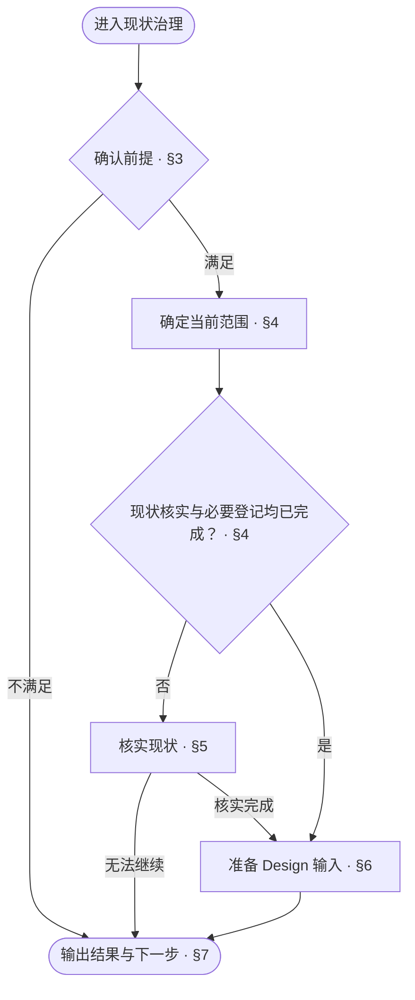
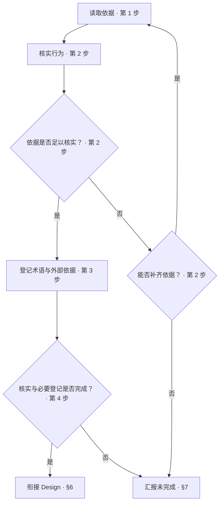

<!-- AUTO-GENERATED from SKILL.md.tmpl — do not edit directly -->
<!-- Regenerate: bash scripts/build-skills.sh --host antigravity -->

# aca-brownfield

核实当前范围的现状，完成后衔接 `/aca-design` 编写或修订文档
新增需求与改进方案归 `/aca-specify`

## 1 原则

1. **事实依据**
   以可核实的实现与运行证据描述当前行为
2. **证据完整**
   核实结论与依据对应，无法核实的内容保持未确认
3. **范围约束**
   以已确认的治理范围决定核实对象与推进边界
4. **职责边界**
   现状核实说明当前行为，新增需求与改进方案由 Specify 论证
   设计文档由 Design 编写，代码与测试由 Implement 修改

## 2 执行流程



## 3 确认前提

1. 运行 `bash ~/.gemini/config/skills/aca/bin/aca-repo-type-check` 取得工程类型
   - 输出有效类型名时，继续
   - `NEEDS_INIT` / `INVALID_TYPE` 时，运行 `/aca-init` 后重新检查
   - `PENDING` 时，告知类型尚未受支持，按 §7 汇报未完成
   - 输出异常或检查无法执行时，记录原因，按 §7 汇报未完成
2. 读取 `~/.gemini/config/skills/aca/doc-design/repo-types/{repo-type}.md`
   文件缺失或无法读取时，记录规则位置与原因，建议修复安装，按 §7 汇报未完成
   已读取规则但未规定治理顺序时，说明本类型不适用 Brownfield，按 §7 汇报后结束

## 4 确定范围

1. 按类型规则与文档组对照现有实现和文档
   开发者已指定对象时，以该范围及必要关联内容为起点
   - 列出需要新建或修订的文档
   - 列出需要调整归属的旧文档及保留、合并、拆分或删除方式
   文档保留、合并、拆分或删除方式作为交给 Design 的处理计划
   Brownfield 核实并记录依据，不在本步骤执行文档重组
   已确认且范围未变化时，沿用已有确认
   范围新增或变化时，与开发者确认
2. 沿用根 README 中的仓库版本与承载本轮治理的分支
   需要新建分支时，按仓库分支规范创建
   - 未规定命名时使用 `feature/docs-align-v{X.Y.Z}`
   - 从规定的集成分支创建，未规定时从默认分支创建
3. 在 `ROADMAP.md` 当前状态中记录治理范围与进展
   保留已有版本目标
4. 确定推进顺序
   项目级总体设计优先
   再按模块依赖关系推进，被依赖模块先处理
   无模块划分时，以项目整体作为一个范围
5. 确定当前范围，核对现状核实进度
   当前范围、相关实现、配置、运行条件及核实要求未变化时，复用已有核实结果
   有变化时，只重新核实受影响部分
   当前范围的行为已核实、依据可定位且必要登记完成时，直接进入 §6
   尚未核实完整时，进入 §5

## 5 现状核实



1. 读取依据
   读取当前范围的代码、配置、资源、运行资料与相关项目级记录
   现有文档作为核对线索
   复用已读取且未变化的资料
2. 核实行为
   按职责核实当前行为，记录适用条件与对应的依据位置
   依据不足时，补查相关资料，重新核实受影响的内容
   仍无法核实时，请开发者补充依据
   无法取得依据时，记录缺口，按 §7 汇报未完成
   发现实现问题时，将问题与已明确的期望行为记入 `ROADMAP.md` 后续目标
   尚未确定的改进做法只记录问题，交给 Specify 论证
3. 登记术语与外部依据
   按 [context 文档设计](~/.gemini/config/skills/aca/doc-design/documents/context.md)筛选术语，复用已有词条
   歧义由开发者确认后登记
   按 [ssot 文档设计](~/.gemini/config/skills/aca/doc-design/documents/ssot.md)核验并登记采用的外部来源
   有依据且 `SSOT.md` 缺失时，从对应模板创建
4. 判定是否完成
   当前范围的行为已核实、依据可定位且必要登记完成时，进入 §6
   仍有无法核实的内容或必要登记未完成时，按 §7 汇报未完成

## 6 衔接 Design

1. 更新治理进度
   更新 `ROADMAP.md` 当前状态中的治理进展
   新事实影响已完成范围时，将相关范围标记为待核实
   记录受影响的范围、影响与待核实内容，不沿用受影响部分的旧核实结果
2. 准备编写输入
   按 [aca-design §3](~/.gemini/config/skills/aca-design/SKILL.md#3-编写输入)准备输入
   提供本轮版本与分支、本轮范围、推进顺序、当前范围与完成进度
   提供已核实的行为、依据位置与相关文档
   提供第四章确认的文档清单、旧文档处理计划及其依据
3. 核对衔接条件
   当前范围核实完成且必要输入齐全后，按 §7 汇报结果，下一步为 `/aca-design`
   有缺口时，回到对应步骤补齐
   无法补齐时，按 §7 汇报未完成

## 7 输出结果

1. 判定当前范围状态
   当前范围的行为已核实、依据可定位、必要登记完成且 Design 输入齐全时，报告当前范围完成
   核实或输入仍有缺口时，报告未完成
   当前范围完成不代表本轮全部范围完成
   已核实的实现缺陷作为现状记录，改进另行论证，不要求在 Brownfield 中修复代码
2. 汇报实际结果
   按以下样式填写标题与结果
   写清当前范围、未核实事项及实际恢复位置
   版本或分支尚未确定时，如实注明

   ```markdown
   # 🧭 Brownfield：<当前范围完成 / 未完成>

   | 项目 | 结果 |
   | --- | --- |
   | 版本与分支 | <本轮版本与分支 / 尚未确定的内容及原因> |
   | 范围 | <本轮治理范围、当前范围与完成进度> |
   | 现状 | <已核实行为与依据位置 / 未核实事项> |
   | 实现问题 | <问题与后续记录位置 / 无> |
   | 提交 | <提交记录 / 未提交> |
   | 待办 | <未完成项、原因与恢复位置 / 无> |
   | 下一步 | <目标 skill 与范围 / 补齐对应缺口 / 无> |
   ```

3. 确定下一步
   条件满足时，下一步为 `/aca-design`
   条件不足时，补齐对应缺口，不将未核实内容作为 Design 的编写依据
