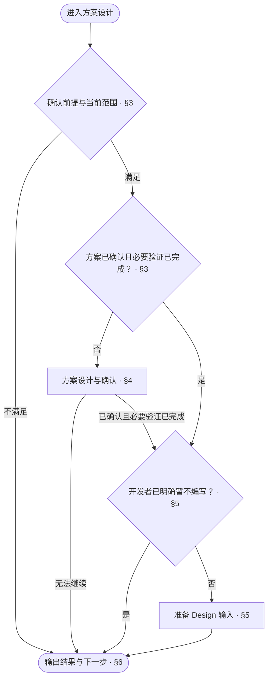
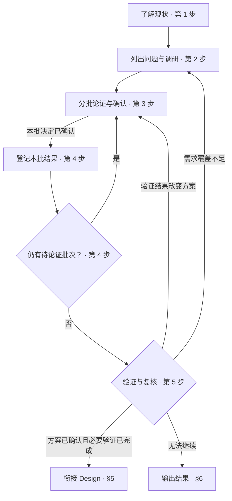

<!-- AUTO-GENERATED from SKILL.md.tmpl — do not edit directly -->
<!-- Regenerate: bash scripts/build-skills.sh --host antigravity -->

# aca-specify

论证新增需求或优化既有设计，确认方案后衔接 `/aca-design` 编写设计文档
只更新方案记录，不改代码

## 1 原则

### 1.1 完整性公理

方案设计遵循以下公理

> **AI 降低「做到位」的成本 —— 能做 100%，就不做 80%**

- 在确定的需求、场景与约束下，论证并确定最佳解决方案
- 不以节省工作量为由，省略已确定范围内的内容与验证
- 未完成的内容不得宣称完成

AI 降低工作的成本，使过去代价过高的完整目标值得追求

> **已经决定要做的事不留尾巴**
> 明确不纳入范围的内容，显式标 out of scope

**反例**

- ❌ 为了减少代码量选择遗漏已确定需求的方案 → 已确定范围内的内容必须完整覆盖
- ❌ 为了节省工作量省略边界与错误处理 → 已确定范围内的边界与错误路径必须完成
- ❌ 验证尚未完成就宣称完成 → 已确定范围内的验证必须完成后才能宣称完成

参考：[Garry Tan, *Boil the Ocean*](~/.gemini/config/skills/aca/SSOT.md#5-理念)

### 1.2 设计方法

从整体需求形成解决思路，按[层层深入](~/.gemini/config/skills/aca/skills/references/drill-down.md)拆解职责、边界与协作关系

涉及模块划分时，按业务能力与责任边界组织模块，不机械地按处理步骤拆分
识别难以确定或容易变化的设计决定，归入负责该职责的模块，接口只暴露协作所需的内容

用代表性业务工况核对各部分能否共同完成业务
发现职责遗漏、重叠或协作不通时，调整划分与对应解决方式，再继续细化

## 2 执行流程



## 3 确认前提

1. 运行 `bash ~/.gemini/config/skills/aca/bin/aca-repo-type-check` 取得工程类型
   - 输出有效类型名时，继续
   - `NEEDS_INIT` / `INVALID_TYPE` 时，运行 `/aca-init` 后重新检查
   - `PENDING` 时，告知类型尚未受支持并停止
   - 输出异常或检查无法执行时，记录原因，按 §6 汇报未完成，不继续方案设计
2. 读取 `~/.gemini/config/skills/aca/doc-design/repo-types/{repo-type}.md`
   未规定治理顺序时，说明本类型不适用 Specify，按 §6 汇报后结束
3. 检查本次设计涉及的既有实现与现状文档
   本次方案依赖既有行为且相关现状依据不足时，按 §6 汇报未完成
   下一步为 `/aca-brownfield` 核实相关范围，现状补齐后回到 Specify
   全新项目没有既有实现时，不因此判定为前提不足
4. 确定本轮目标版本与推进分支
   - 目标版本已确定时，核对变化是否与版本相符
   - 目标版本尚未确定或需要调整时，按 SemVer 提出版本并与开发者确认
   - 沿用承载本轮设计的分支
   - 需要新建时，按仓库分支规范创建
     未规定命名时使用 `feature/{业务简写}-v{X.Y.Z}`
     业务简写使用能识别本轮范围的英文
     从规定的集成分支创建，未规定时从默认分支创建
5. 确定当前范围与推进顺序
   既有设计优化时，确认本轮需要重新审视与编写的范围
   项目级总体方案优先
   再按模块依赖关系推进，被依赖模块先处理
   没有模块划分时，以项目整体作为一个范围处理
6. 核对当前范围的方案与验证结果
   既有设计优化时，重新审视既有方案
   本轮方案已确认且必要验证已完成时，进入 §5
   尚未完成时，进入 §4

## 4 方案设计

### 4.1 职责范围

1. 限定本轮范围
   设计范围以本轮确认的版本需求为准
   范围之外的想法与优化记入 `ROADMAP.md` 的后续目标
2. 处理范围扩展
   说明扩展设计范围的必要性与影响
   经开发者确认后纳入本轮设计
3. 处理跨仓库问题
   发现问题在关联的上下游仓库时，不修改该仓库
   起草 Issue，说明问题、对本仓的影响与期望处理方式
   开发者确认内容和目标仓库后提交
   提交成功时，将 Issue 链接记入 `ROADMAP.md`
   提交失败时，保留草稿并记录失败原因，告知开发者
   跨仓库问题影响当前方案成立时，将相关依赖与影响纳入 4.2 的待决定或待验证问题

### 4.2 执行步骤



1. 首次进入当前范围的方案设计时了解现状
   - 汇总开发者描述及 Review、Implement 反馈中的本轮需求与问题
   - 读取 `ROADMAP.md` 中对应的需求条目
   - 按 `SSOT.md` 中的链接查阅相关需求原件
   - 读取 `CONTEXT.md` 中本轮涉及的词条
     沿用已登记的名称与定义，通用术语采用标准含义
     新增术语与定义歧义纳入待决定问题清单
   - 已有现状设计时，从 `docs/README.md` 查阅本轮涉及的设计文档
     以已核实的现状设计为依据
     现状依据不足时，按 §3 第 3 步补齐
   - 复用本轮已读取且未变化的资料，补读新增或已变更的部分
2. 从当前范围的需求与相关文档的设计要求中列出待决定问题
   既有设计优化时，对照最新规则 重新审视需求覆盖、职责、边界、协作与验证设计
   将遗漏与不合理之处列为待决定问题
   仅有行文问题的内容交给 Design 修订
   按问题性质确定调研与论证方式
   - 拆解与工况核对中发现新问题时，补入清单，按同样规则调研与论证
   - 通用方法与平台约束问题，查阅官方文档、行业标准或成熟开源实现
     记录调研结论及对应出处
   - 业务取舍问题，结合需求、现状与约束论证
     事实依据不足时，补充调研
   - 未找到适用做法时，记录已查来源
     根据业务约束推导方案
   - 仍无法确定的内容列为待验证项
     记录待验证问题、验证方式与判定标准
3. 先给全貌，再分批论证，确认当前范围的方案
   - 按 [§1.2](#12-设计方法)形成并核对方案
   - 用业务语言复述需求，展示方案全貌
   - 列出待决定问题清单，每个问题用一句话概括
   - 对新增术语与定义歧义，提出名称与定义
     与开发者确认后，按 §4.2 第 4 步登记
   - 按问题的依赖关系分批论证
     先论证后续问题依赖的决定
     本批决定确认后，先进入第 4 步登记
   - 只有一种合理方案时，直接说明方案与依据
   - 存在多种合理方案时，对比代价与影响，给出推荐
   - 调研依据引用 §4.2 第 2 步记录的出处
   - 展示待验证项
     与开发者确认验证方式、判定标准和负责人
   - 有异议的问题单独论证
     核对事实依据与业务约束，说明方案成立的条件
     新依据改变判断时，修正方案
     尚未达成一致的决定保持待定
4. 按内容分别登记本批已确认的结果
   - 将本批已确认的决定写入 `ROADMAP.md` 对应版本的目标下
     按所属模块组织并编号
     每条记录结论，并引用对应依据
     待验证项记录问题、验证方式、判定标准与负责人
     修正既有决定时，更新原条目
     新决定影响已完成范围时，记录受影响的范围与待修订内容
   - 本批采纳的外部依据，按 [ssot 文档设计](~/.gemini/config/skills/aca/doc-design/documents/ssot.md)核验并登记到 `SSOT.md`
     有外部依据且文件缺失时，从 `~/.gemini/config/skills/aca/templates/SSOT.md.example` 创建
   - 按 [context 文档设计](~/.gemini/config/skills/aca/doc-design/documents/context.md)的收录范围与行文步骤处理本批已确认的新增术语与定义修订
     符合收录条件的术语写入 `CONTEXT.md`
     修订已有定义时，更新原词条
   - 本批登记完成后，仍有待论证批次时回到第 3 步
     全部批次完成后，进入第 5 步
5. 判定当前范围是否完成
   - 影响当前设计结论的待验证项，先完成验证
     按判定标准确认结果
     结果改变方案时，回到 §4.2 第 3 步重新论证
   - 其余待验证项按 §4.2 第 4 步登记后继续
   - 按 [§1.2](#12-设计方法)复核方案覆盖与工况结果
     未满足当前需求时，回到 §4.2 第 2、3 步补充问题并重新论证
   - 当前方案已确认、必要验证已完成时，进入 §5

## 5 衔接 Design

1. 沿用编写安排
   开发者已明确暂不编写时，提交本次实际修改的方案记录，按 §6 汇报当前进度
   没有实际改动时，不生成提交
   暂不编写时，不准备 Design 输入
   进入编写时，继续下一步
2. 准备编写输入
   按 [aca-design §3](~/.gemini/config/skills/aca-design/SKILL.md#3-编写输入)准备输入
   提供本轮版本与分支、本轮范围、推进顺序、当前范围与完成进度
   提供已确认决定及记录位置、现状依据与验证结果
   既有设计优化时，提供本轮审视结论与文档重写范围
3. 核对衔接条件
   必要输入齐全后，按 §6 汇报结果，下一步为 `/aca-design`
   仍有缺口时，回到对应步骤补齐
   无法补齐时，按 §6 汇报未完成

## 6 输出结果

1. 判定当前范围是否完成
   当前范围的方案已确认、结果已登记且必要验证已完成时，具备方案完成条件
   进入编写时，Design 的必要输入也须齐全
   决定未确认、必要验证未完成或进入编写所需的输入缺失时，报告未完成
   当前范围完成，不代表本轮全部范围完成
2. 汇报事实与剩余事项
   按以下样式填写标题与结果
   写清已确认决定、验证结果、待办与下一步
   尚未确定的版本或分支如实注明，不猜测

   ```markdown
   # 🧭 Specify：<当前范围完成 / 未完成>

   | 项目 | 结果 |
   | --- | --- |
   | 版本与分支 | <目标版本与分支 / 尚未确定的内容及原因> |
   | 范围 | <本轮范围、当前范围与完成进度> |
   | 决定 | <已确认决定与记录位置 / 无> |
   | 验证 | <验证结果与待验证项的影响 / 未执行及原因> |
   | 提交 | <提交记录 / 未提交> |
   | 待办 | <未完成项与原因 / 无> |
   | 下一步 | <目标 skill 与待处理范围 / 继续当前方案设计 / 无> |
   ```

3. 遵守已确认的编写安排
   进入编写且必要输入齐全时，下一步为 `/aca-design`
   开发者已明确暂不编写时，沿用该安排，不将下一步固定为 Design
   当前范围尚未完成时，指出未完成事项与对应的恢复位置
