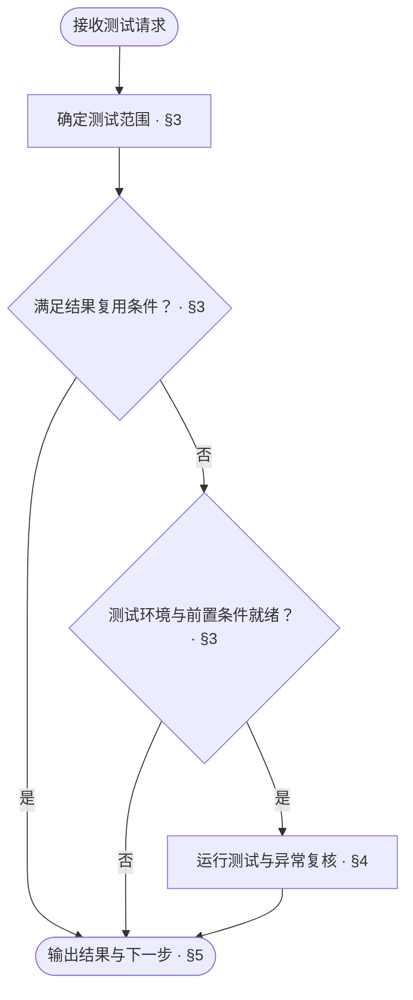

<!-- AUTO-GENERATED from SKILL.md.tmpl — do not edit directly -->
<!-- Regenerate: bash scripts/build-skills.sh --host antigravity -->

# aca-test

根据当前实现范围或改动突破的设计边界，选取并运行对应的最小化测试
只执行测试与验证，不修改设计文档、生产代码或测试代码

## 1 原则

1. **影响定界**
   以本次实现或改动的契约边界与依赖关系确定最小化测试范围
2. **只测不改**
   只运行测试并核实结果，不修改设计文档、生产代码或测试代码
3. **证据绑定**
   测试结果绑定被测提交、测试范围与实际执行的命令，供后续环节直接复用

## 2 执行流程



## 3 确定测试范围

1. **确定被测对象与改动范围**
   - 开发者或上游调用方已明确本次待测范围：直接沿用该范围
   - 未明确范围：读取当前工作区改动与近期提交，对照设计文档定位改动所属的模块、命令或事件
   - 记录本次被测提交及纳入验证的未提交改动
2. **按变更突破的设计边界选取最小化测试集**
   - 仅实现或修改模块、命令或事件内部，模块 `interface`、命令路由与事件调度契约未变化：只选取该单元自身的白盒与黑盒测试
   - 修改模块 `interface`、命令路由、事件调度或跨单元协作：选取本单元测试、调用该契约的模块或命令与事件测试，以及项目级 `testcase` 中设计依据关联该单元的黑盒测试
   - 修改公共基础、全局配置、数据迁移、构建或部署等跨模块共享底座：选取受影响的全量测试与对应环境验证
   - 仓库 `release` 文档对当前验证另有规定时，一并纳入
3. **核对复用条件与执行环境**
   - 已有测试结果覆盖本次选定范围，且被测内容、测试代码、夹具、配置与依赖环境均未变化：直接复用并记录依据，进入[输出结果与下一步](#5-输出结果与下一步)
   - 需要执行测试：按测试设计核对所需环境、夹具及真实依赖或测试替身的就绪状态
   - 环境或依赖未就绪：记录缺失条件，按[输出结果与下一步](#5-输出结果与下一步)报告未完成

## 4 运行与复核

1. **控制并发与资源隔离**
   - 按测试设计建立夹具与隔离环境
   - 涉及容器、数据库、真实平台或模型评测等共享或重型资源时，限制并发度并隔离资源，避免并行争用导致超时
2. **执行选定测试**
   - 运行[确定测试范围](#3-确定测试范围)选定的测试用例及必要的构建或静态检查
   - 执行完成后，按夹具规定清理本次产生的测试数据与临时资源
   - 验证过程中不修改设计文档、生产代码、测试代码或提交记录
3. **复核失败并区分原因**
   - 全部通过：记录执行命令、通过用例数与耗时
   - 出现失败：核对失败日志与诊断信息
   - 疑似宿主高负载或资源争用导致超时：在低并发隔离条件下单独重跑失败项核实
   - 单独重跑稳定通过且确认为环境负载所致：记录初跑异常、重跑命令与通过结果
   - 确认由代码或测试实现问题导致失败：记录失败用例、错误诊断与对应位置
   - 环境故障或诊断无法核实：将对应验证列为未完成并记录原因

## 5 输出结果与下一步

### 5.1 判定结论

| 结论 | 条件 |
| --- | --- |
| 通过 | 本次选定范围的测试与必需检查全部通过（含复用或超时复核通过），无失败项与未完成项 |
| 失败 | 存在已确认的代码或测试失败项 |
| 未完成 | 环境缺失、无法执行或诊断无法核实，且无已确认的失败项 |

同时存在已确认的失败项与未完成项时，结论为失败，并列出未完成项

### 5.2 测试报告

在当前对话中按以下模板输出测试结果

```markdown
# 🧪 Test：<通过 / 失败 / 未完成>

| 项目 | 结果 |
| --- | --- |
| 范围 | <本次被测单元或改动范围> |
| 基线 | <被测提交及纳入验证的未提交改动> |
| 选取依据 | <沿用上游范围 / 契约未变的单元内测试 / 契约变化的依赖链测试 / 全局底座全量测试> |
| 执行命令 | <实际运行的测试与检查命令，或复用依据> |
| 结果 | <通过数、失败数与耗时> |
| 异常复核 | <超时单独重跑核实结果 / 无> |
| 失败项 | <失败用例、原因与对应位置 / 无> |
| 未完成 | <未执行的验证、原因与恢复条件 / 无> |
| 下一步 | <一个立即可执行的动作> |
```

### 5.3 后续动作

按测试结论与本轮进度选择下一步

| 结论 | 情况 | 下一步 |
| --- | --- | --- |
| 未完成 | 测试环境、夹具或外部依赖缺失 | 补齐环境条件后通过 `/aca-test` 重新验证 |
| 失败 | 代码或测试实现问题 | `/aca-implement` 修复，经 `/aca-review` 审查后再运行 `/aca-test` |
| 失败 | 设计缺失或契约冲突 | `/aca-specify` 或 `/aca-design` 修正设计 |
| 通过 | 本轮尚有待实施的后续任务 | `/aca-implement` 继续实施下一范围 |
| 通过 | 本轮实施范围全部验证通过 | 按版本推进安排衔接 `/aca-release` 或结束本次任务 |
