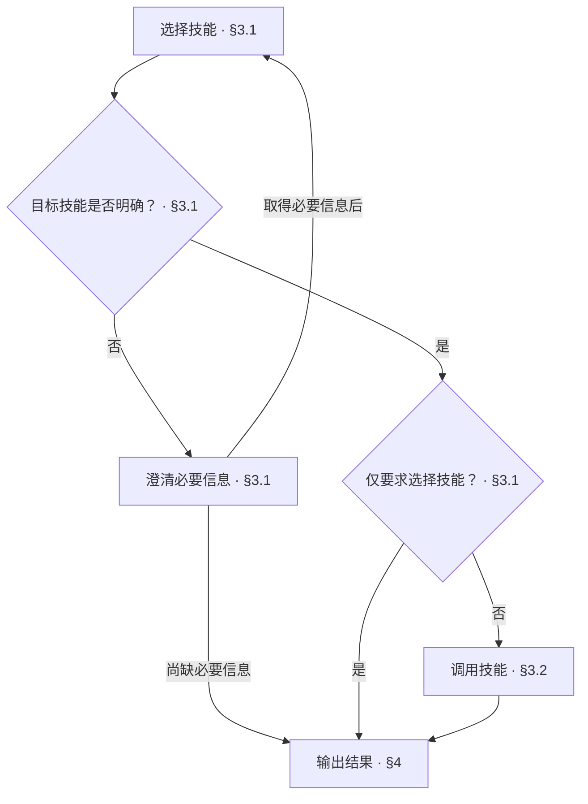

<!-- AUTO-GENERATED from SKILL.md.tmpl — do not edit directly -->
<!-- Regenerate: bash scripts/build-skills.sh --host antigravity -->

# aca

根据开发者意图选择并调用对应 skill

## 1 原则

1. **意图依据**
   以开发者当前请求确定工作目标与技能选择
2. **上下文连续**
   沿用已确认且仍有效的目标、范围与进度
3. **必要澄清**
   只澄清影响技能选择且无法从上下文确定的信息

## 2 执行流程



## 3 选择与调用技能

### 3.1 选择技能

| Skill | 做什么 |
|---|---|
| `/aca-init` | 建立工程类型标识与初始化所需的项目级记录 |
| `/aca-brownfield` | 核实当前范围的现状，完成后衔接 Design |
| `/aca-specify` | 论证新增需求或优化既有设计，确认方案后衔接 Design |
| `/aca-design` | 编写并检查当前范围的设计文档，确定下一范围或完成全局收口 |
| `/aca-walkthrough` | 用业务语言导读设计文档，逐单元确认设计决定，发现的问题经确认后当场修正 |
| `/aca-review` | 确定审查对象与范围，静态审查设计或代码与测试实现，不修改受审文档与代码，不运行代码 |
| `/aca-implement` | 按设计规划文件结构，按模块依赖编写生产代码与测试代码 |
| `/aca-test` | 根据当前实现范围或改动突破的设计边界，选取并运行最小化测试，只测不改 |
| `/aca-repo-audit` | 检查仓库文档，按需核对实现，只读不改 |
| `/aca-release` | 按仓库发布流程收口，合入 main 并锁定 annotated Tag |
| `/aca-feedback` | 收集治理规则偏差，明确授权后提交 Issue |
| `/aca-update` | 更新源码与已安装技能，验证更新结果 |

1. 开发者明确指定技能时，选择该技能
2. 未指定时，根据当前请求、已确认目标与当前进度，对照路由表选择
3. 无法确定时，只澄清影响选择的必要信息
   取得信息后重新判断
   尚缺必要信息时，按第四章汇报待确认

选择完成后，仅要求选择技能的请求按第四章汇报
执行请求继续按 3.2 执行

### 3.2 调用技能

1. 读取目标技能
   读取其完整 instructions 及当前步骤需要的引用
2. 沿用执行上下文
   沿用已确认的目标、范围、当前进度与约束
   已确认且仍有效的信息直接沿用，无需重新确认
   缺失的必要信息按目标技能要求补齐
3. 执行目标技能
   按目标技能的步骤、检查条件和完成要求执行
   结束后进入第四章汇报

## 4 输出结果

1. 确定汇报方式
   已执行目标技能时，沿用该技能的结束汇报
   开发者只要求选择技能时，报告已确定技能
   尚无法确定或执行技能时，报告缺失信息、停止原因与下一步
2. 汇报路由结果
   仅选择技能或尚无法进入目标技能时，按以下样式汇报

   ```markdown
   # 🧭 ACA：<已确定技能 / 待确认 / 无法执行>

   | 项目 | 结果 |
   | --- | --- |
   | 意图 | <本次工作目标> |
   | 技能 | <目标技能 / 待确认> |
   | 原因 | <仅要求选择技能 / 缺失信息或停止原因> |
   | 下一步 | <一个立即可执行的动作 / 无> |
   ```
