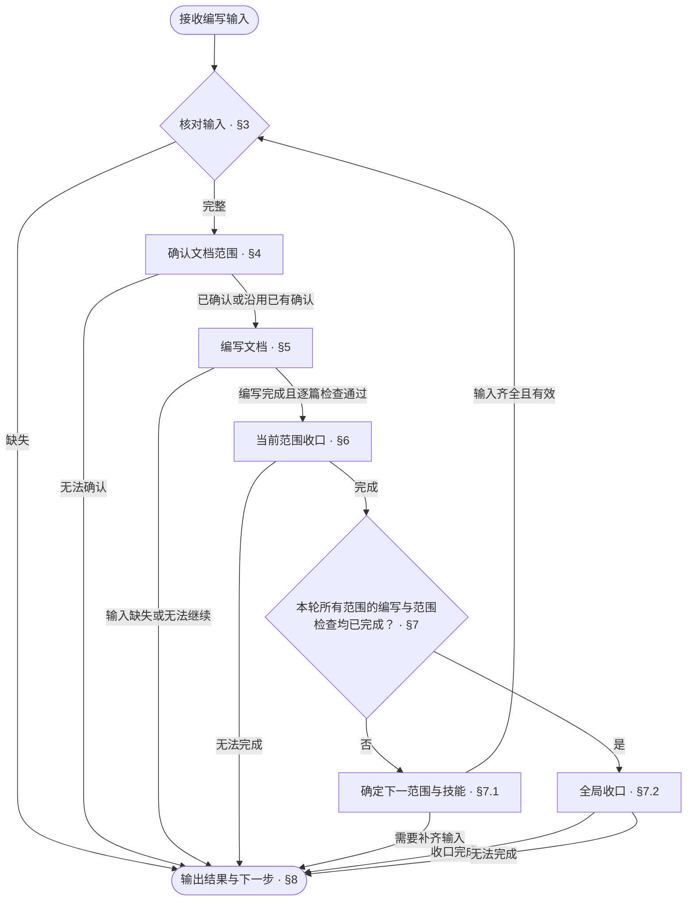

<!-- AUTO-GENERATED from SKILL.md.tmpl — do not edit directly -->
<!-- Regenerate: bash scripts/build-skills.sh --host codex -->

# aca-design

将已确认的方案或已核实的现状编写成完整设计文档
完成当前范围的文档编写与检查
只改文档，不改代码

## 1 原则

### 1.1 行文公理

> 以尽可能低的理解成本，把内容写清楚：无冗余、无遗漏、无歧义

**行文结构**

- 先交代整体，再展开细节，参见[金字塔原理](~/.codex/skills/aca/SSOT.md#2-文档结构)
- 表达判断时，先给结论，再给依据
- 不增加信息的标题层级应当合并
- 有时序或优先级的条目用编号列表，每项有多个属性时属性缩进在该项下
- 表格只用于多行同构、每行有两个以上属性、行之间没有先后关系的内容
- 列表项直接写完整的句子
- 一个条目有分支时，将分支缩进列在该条目下
- 每个分支一行，写成「条件：做什么」
- 执行前必须知道的条件写在动作之前
- 条件控制多个步骤时，把步骤列在该条件下

**表达与排版**

- 设计正文只描述当前有效设计
- 修订设计正文时，删除错误或失效的描述
- 设计正文不解释旧版本差异、改动过程或改动原因
- 以业务语言描述问题、流程和决定，技术语言只作辅助说明
- 同一条规则只在一处定义，其他位置直接引用
- 规则与引用应能直接定位，读者能明确找到需要修改的位置
- 删除不增加信息、也不帮助理解的内容
- 一行一句，每句只表达一个事实
- 操作步骤直接写动作
- 有先后关系的动作分项写
- 执行者、操作对象与指代必须明确
- 上下文已经明确的执行者、操作对象与指代不重复说明
- 行末不落句号
- 同一主题的各行之间不空行，切换主题时空一行
- 表格单元格写片段，不写句子，不落句号
- 单元格里的多个事实不用分号串起来，分行写
- 用户用什么语言，就用什么语言回复
- 中文遵循[中文文案排版指北](~/.codex/skills/aca/SSOT.md#1-行文规范)
- 章节编号遵循 [ISO 2145](~/.codex/skills/aca/SSOT.md#1-行文规范)
- `§` 只用于正文里的交叉引用，不进标题
- 正文引用具体章节时，使用直接指向目标章节锚点的 Markdown 链接
  同文档引用使用本地章节锚点，如 `[§1.2](#12-章节标题)`
  跨文档引用使用目标文件的相对路径与章节锚点，如 `[目标文档 §1.2](other.md#12-章节标题)`
  链接文字可使用章节名称或 `§` 加章节编号
  章节标题或顺序变化时，同步更新受影响的引用并核验目标
  代码块中的算法或命令需要引用章节时，将链接写在代码块前后的正文中
- 引用整篇文档时，链接指向目标文件

参考：[ASD-STE100](~/.codex/skills/aca/SSOT.md#1-行文规范)

### 1.2 编写原则

1. **输入依据**
   以已确认的决定与已核实的现状作为编写依据
2. **结构一致**
   内容组织遵循文档设计，表达方式遵循适用 pattern
3. **验证对应**
   设计行为与对应的黑盒、白盒测试设计保持一致
4. **职责边界**
   编写表达已确定的设计，尚未确定的方案与事实由输入提供方补齐

## 2 执行流程



## 3 编写输入

1. 核对工程类型
   运行 `bash ~/.codex/skills/aca/bin/aca-repo-type-check`，取得有效工程类型并读取对应类型规则
   已有有效检查结果且工程类型标识与适用规则未变化时，沿用结果
   类型缺失或无效时，按 §8 汇报未完成，下一步为 `/aca-init`
   类型尚未支持、检查异常或规则无法读取时，记录原因，按 §8 汇报未完成
2. 确定编写依据
   按以下来源核对已确认的输入

   | 来源 | 编写依据 | 缺失处理 |
   | --- | --- | --- |
   | `/aca-specify` | 当前范围已确认的决定与必要验证结果 | 下一步为 Specify 补充论证与确认 |
   | `/aca-brownfield` | 当前范围已核实的行为与依据位置 | 下一步为 Brownfield 核实现状 |
   | 开发者或调用方直接提供 | 同等完整的已确认方案或已核实现状 | 指出具体缺口，由开发者或调用方补齐 |

   已确认且仍有效的信息直接沿用，不机械要求先调用某个技能
3. 核对必要输入
   核对本轮目标版本与分支、本轮范围、推进顺序、当前范围与完成进度
   核对已确认决定或已核实行为、依据位置与必要验证结果
   影响当前设计结论的验证项必须已完成
   接收已经确认的文档清单、处理计划和依据位置
   当前范围可以是项目级总体设计、一个模块或未拆分项目的整体设计
4. 读取关联内容
   读取相关设计文档与 `CONTEXT.md` 对应词条
   存在外部依据时，读取 `SSOT.md` 对应条目
   必要输入缺失时，指出具体缺口与补齐方，按 §8 汇报未完成，不继续当前编写

## 4 文档范围

1. 沿用开发者或调用方已确定的目标版本 `REPO_VERSION` 与分支
2. 以已确认的文档清单与处理计划为起点，按类型规则与所选文档组核对当前范围的文档组成
3. 核对涉及的现状与目标结构
   结构与职责未变化且已有展示仍有效时，直接沿用
   需要新展示时，用 [hierarchy-tree](~/.codex/skills/aca/doc-design/patterns/hierarchy-tree.md)展示涉及的现状与目标结构
   结构相同时，只展示一棵树
   在目标文件旁标注其承载的职责
   方案输入同时标注对应的决定编号
4. 确认当前修改范围
   已确认且范围未变化时，沿用已有确认
   新增文档、改变职责或调整处理方式影响已确认范围时，说明变化与影响后，与开发者确认

## 5 文档编写

当前范围内，按类型规则的治理顺序编写
文档组内按该组的设计顺序编写
类型或文档组未规定顺序时，按文档引用依赖安排

1. 按类型规则与文档组的引用读取对应文档设计
   复用已读取且未变化的规则
   - 类型规则直接登记的文档，读取对应文档设计
   - 文档组内的文件，先读取组规则，再按文件职责读取文档设计
   - 未登记的文档，按职责查找适用的文档设计
   现有文档设计无法覆盖时，与开发者确认补充表达规则
   提示可通过 `/aca-feedback` 反馈规则缺口
2. 创建或修订目标文档
   - 文件缺失时，按已确认的文档组成与对应文档设计创建
   - 文件已有时，按已确认范围修订
     按对应文档设计调整结构
   移动或删除文档前，检查引用其路径的位置
   同步修正文档中的路径引用
   涉及代码或脚本修改时，交由输入提供方协调处理后再移动或删除
3. 按 §3 的输入编写正文
   输入要求重写时，按最新文档设计、pattern 与行文公理重新编写
   - 编写中发现输入缺失时，按 §3 处理
   - 文档设计未指定表达方式时，按 `~/.codex/skills/aca/doc-design/patterns/` 中的适用场景选用 pattern
     没有适用 pattern 时，按行文公理选择表达方式
   - `CONTEXT.md` 已收录的术语使用对应名称与定义
     新增或修订定义交由输入提供方确认，按 [context 文档设计](~/.codex/skills/aca/doc-design/documents/context.md)的收录范围处理
   - 正文与契约表中的已收录术语链接到对应词条
     链接格式为 `[术语](<CONTEXT.md 的相对路径>#<词条锚点>)`
     标题、代码块、Mermaid 标签与产品文案保留纯文本
4. 同步受影响的测试设计
   - 根据本次新增、修订或删除的契约、流程与内部机制，定位受影响的黑盒与白盒测试设计
   - 按对应文档设计与[测试用例](~/.codex/skills/aca/doc-design/patterns/testcase.md)，依次更新测试设计
     1. 更新夹具
     2. 更新测试场景及其设计依据引用
     3. 根据场景更新测试用例
        新增缺失用例，修订变化用例，删除或替换失效用例
   - 仅修订行文且验证行为未变化时，核对测试设计与引用仍然有效
   - 测试设计所需的方案决定或现状依据缺失时，按 §3 处理
   - 受影响文档不在当前范围时，记录其位置与待同步内容
     交由输入提供方确认是否调整本轮范围
5. 检查本篇文档
   1. 逐项核对文档设计与本篇实际采用的 pattern 的适用检查条件
   2. 运行 `bash ~/.codex/skills/aca/bin/aca-prose-check <文件>`
   3. 修正未通过项
      重新执行受影响的检查，全部适用检查条件与机械检查通过后继续
      缺少输入、规则或工具导致无法继续时，记录原因，按 §8 汇报未完成
6. 当前范围的全部文档编写完成且逐篇检查通过后，进入 §6

## 6 当前范围收口

1. 按 [readme 文档设计](~/.codex/skills/aca/doc-design/documents/readme.md)更新涉及的各级文档入口
2. 运行 `bash ~/.codex/skills/aca/bin/aca-readme-version-sync README.md "$REPO_VERSION"` 同步版本区块
3. 核对当前范围适用的文档组、文档设计与实际采用的 pattern 的检查条件
   已通过且文件、规则与相关依赖未变化的检查，沿用结果
   范围级检查重点核对跨文档关系
   核验当前范围文档引用的文件与词条存在，且链接指向正确
   核对当前范围改动涉及的黑盒与白盒测试设计已同步
   本轮范围内的测试设计尚未同步时，不将本轮标为全部完成
4. 运行当前范围的机械检查
   已通过且文件、检查规则与相关依赖未变化的机械检查，沿用结果
   需要执行时，将以下文件占位符替换为本次修改或新建文件的实际路径

   ```bash
   bash ~/.codex/skills/aca/bin/aca-context-check CONTEXT.md
   bash ~/.codex/skills/aca/bin/aca-prose-check "<本次修改或新建文件的实际路径>"
   ```

5. 处理检查结果并更新进度
   检查或版本同步未通过时，修正对应文件，重新执行受影响的检查或版本同步
   无法修正或执行检查时，记录原因，按 §8 汇报未完成与恢复位置
   检查通过后，更新本轮各范围的完成状态
   受新事实或决定影响的已完成范围，列为待处理范围
   进度更新修改了相关记录时，核对其适用检查条件并重新执行受影响的机械检查
6. 提交当前范围
   全部适用检查通过后，按仓库提交规范提交当前范围的文档及相关记录
   无法提交时，记录原因与未提交内容，按 §8 汇报未完成与恢复位置

## 7 推进与全局收口

### 7.1 下一范围

1. 按推进顺序确定下一范围
2. 核对该范围的输入是否齐全且仍然有效
   已有有效输入直接沿用
3. 按实际缺口选择路径

   | 情况 | 下一步 |
   | --- | --- |
   | 输入齐全且有效 | 将下一范围设为当前范围，返回 §3 继续编写 |
   | 方案决定或必要验证不足 | 衔接 `/aca-specify` |
   | 现状行为或依据不足 | 衔接 `/aca-brownfield` |

   需要补齐输入时，按 §8 汇报具体缺口与待处理范围

### 7.2 全局收口

本轮所有范围的编写与范围检查均已完成后，执行以下步骤

1. 核对全局检查条件
   核对类型规则中适用于本轮范围的检查条件
   重点核对跨范围一致性、整体入口与导航，以及受影响测试设计的同步状态
   已通过且文件、规则与相关依赖未变化的检查，沿用结果
2. 检查实际文档结构
   根据类型规则和本轮实际文档入口确定检查目录
   将以下占位符替换为适用的实际文档目录，存在多个目录时分别执行

   ```bash
   bash ~/.codex/skills/aca/bin/aca-doc-graph-check "<实际文档目录>"
   ```

   工具不支持实际结构时，记录限制，补充对应的文件引用、入口与可达性核验
   类型规则要求的入口缺失或链接失效时，按检查未通过处理
   无法充分核验时，按 §8 汇报未完成
3. 处理检查结果
   检查未通过时，修正对应文件，重新执行受影响的检查
   无法检查或修正时，记录原因与恢复位置，按 §8 汇报未完成
4. 提交并推送收口结果
   全部适用检查通过后，只提交实际收口改动，再推送到远端
   没有实际改动时，不生成空提交，推送本轮已有提交
   无法提交或推送时，记录已完成事实、未完成动作与恢复位置，按 §8 汇报未完成
5. 衔接审查
   全部收口要求完成后，下一步为 `/aca-review`

## 8 输出结果

1. 判定本次状态
   第六章的检查、进度更新与提交已完成时，具备当前范围完成条件
   所有范围完成且全局检查、收口提交与推送均完成时，报告本轮全部完成
   当前范围或已进入的全局收口仍有必需步骤未完成时，报告未完成
   当前范围已完成但尚有下一范围时，报告当前范围完成
2. 汇报实际结果
   按以下样式填写标题与结果
   保留已完成事实，写清实际输入来源、检查复用依据与未完成事项

   ```markdown
   # 📝 Design：<当前范围完成 / 本轮全部完成 / 未完成>

   | 项目 | 结果 |
   | --- | --- |
   | 范围 | <当前范围与本轮进度> |
   | 输入 | <方案或现状及实际来源> |
   | 文档 | <新增、修订、移动或删除的文件 / 无> |
   | 检查 | <实际结果、复用依据与未核验项> |
   | 提交 | <提交与推送结果 / 未提交> |
   | 待办 | <未完成项、原因与恢复位置 / 无> |
   | 下一步 | <目标 skill 与待处理范围 / 补齐对应缺口 / 无> |
   ```

3. 确定下一步
   本轮全部收口后，下一步为 `/aca-review`
   当前范围完成但尚有下一范围时，按 7.1 确定后续路径
   尚未完成时，补齐对应缺口，不仅凭文件已写完判定 Design 完成
