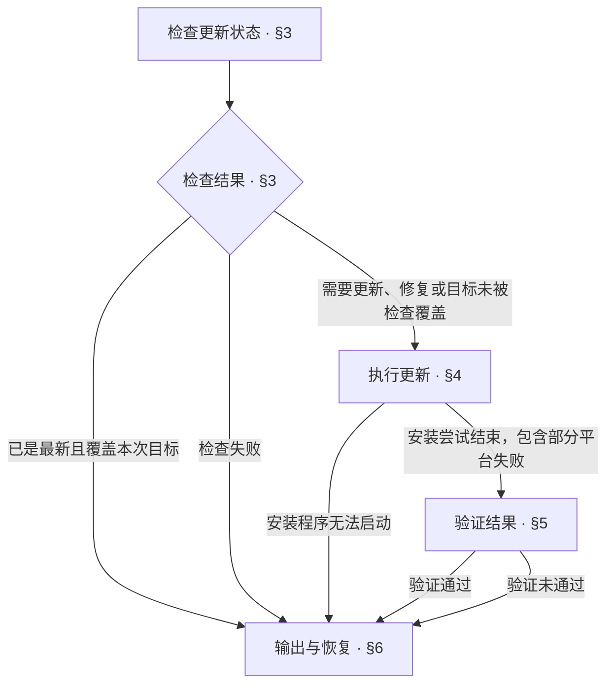

<!-- AUTO-GENERATED from SKILL.md.tmpl — do not edit directly -->
<!-- Regenerate: bash scripts/build-skills.sh --host codex -->

# aca-update

将已安装的 Anyone Can Architect 技能更新到 npm 最新版本
核对最新版本，在目标平台重新安装，并验证结果

## 1 原则

1. **状态依据**
   以实际检查与验证结果判断状态，检查失败保持未确认
2. **范围明确**
   以本次目标平台限定更新范围
3. **事实恢复**
   依据已完成阶段和实际失败原因确定恢复动作

## 2 执行流程



## 3 检查更新状态

1. 运行检查
   执行以下命令，记录输出与退出状态

   ```bash
   bash ~/.codex/skills/aca/bin/aca-update-check
   ```

2. 判断结果
   按以下结果确定路径

   | 结果 | 处理 |
   | --- | --- |
   | 成功返回 `UPDATE_AVAILABLE <old> <new>` | 进入第四章更新或修复安装 |
   | 成功返回 `UP_TO_DATE <version>` 且检查覆盖本次目标 | 按第六章汇报已是最新版本 |
   | 成功返回 `UP_TO_DATE <version>` 但未覆盖明确指定的目标平台 | 进入第四章，按指定平台执行安装与验证 |
   | `CHECK_FAILED <reason>`、空输出、未知输出或执行失败 | 按第六章汇报检查未完成，不判定为已是最新 |

   开发者明确指定平台时，核对该平台实际存在且已被检查脚本覆盖
   目标平台尚未安装时，不因其他平台已是最新而结束本次更新

3. 记录检查依据
   记录 npm 最新版本与涉及的已安装平台
   `UPDATE_AVAILABLE` 的 `<old>` 可能来自任一版本不一致的平台，不代表所有平台的原版本
   各平台更新前后的版本分别核实，不直接用该字段概括整个环境的版本变化

## 4 执行更新

1. 确定目标平台
   默认更新所有已安装平台
   开发者明确指定平台时，使用安装程序的 `--host` 参数
   安装程序覆盖 Claude Code、Codex、Cursor、Grok 及 Antigravity 的 IDE 与 CLI
   记录本次目标平台与更新前版本
2. 运行安装程序
   默认范围执行以下命令

   ```bash
   npx -y anyone-can-architect@latest update
   ```

   明确指定平台时，将以下占位符替换为目标平台标识

   ```bash
   npx -y anyone-can-architect@latest update --host "<claude / codex / cursor / grok / antigravity / antigravity-cli>"
   ```

   安装程序沿用上次安装的语言
   由安装程序完成逐平台安装与验证
   记录输出与退出状态
3. 处理阶段结果
   安装程序无法启动时，例如 Node.js、npm 或网络不可用，按第六章汇报未完成
   某个平台安装或验证失败时，安装程序继续尝试其他目标平台
   安装尝试结束后，保留各平台已完成的事实，进入第五章核对结果

## 5 验证结果

1. 核对目标平台
   重新运行第三章的检查
   逐个平台核对安装版本及全部受管理技能的版本标记与 npm 最新版本一致
   核对范围为第四章确定的本次目标平台
   记录各平台实际安装与验证结果
2. 判定验证结果
   本次目标全部通过时，具备报告更新完成的条件
   任一目标失败或未核验时，整体报告未完成，保留其他目标已成功的事实
   版本号未变化但安装已修复时，明确报告同版本重装结果
   明确指定单个平台时，不将其他平台算作本次失败

本章核对版本与安装状态，不宣称所有文件内容已经逐字比较

## 6 输出与恢复

1. 判定状态
   更新执行完成且本次目标验证通过时，报告已更新
   同版本修复时，在结果中注明同版本重装
   检查成功且覆盖本次目标时，才报告已是最新
   必需阶段失败或未核验时，报告未完成
2. 汇报实际结果
   分开记录各目标平台的版本
   逐个平台说明安装、验证结果及失败位置，保留部分成功的事实
   按以下样式填写标题与结果

   ```markdown
   # 🔄 Update：<已更新 / 已是最新 / 未完成>

   | 项目 | 结果 |
   | --- | --- |
   | 最新版本 | <npm 最新版本 / 未取得> |
   | 目标平台 | <本次目标平台> |
   | 已完成阶段 | <已核实完成的阶段 / 无> |
   | 安装 | <实际结果 / 无需执行 / 未执行> |
   | 验证 | <目标平台验证结果 / 未完成> |
   | 待办 | <未完成项、原因与失败位置 / 无> |
   | 下一步 | <补齐条件与可执行的恢复动作 / 无> |

   | 平台 | 更新前版本 | 更新后版本 | 安装结果 | 验证结果与失败位置 |
   | --- | --- | --- | --- | --- |
   | <目标平台> | <实际版本 / 未取得> | <实际版本 / 未取得> | <实际结果 / 未执行> | <实际结果与失败位置 / 未核验> |
   ```

3. 确定恢复动作
   写清需要补齐的条件、失败阶段与可执行的恢复命令
   沿用第四章的默认安装命令或 `--host` 参数
