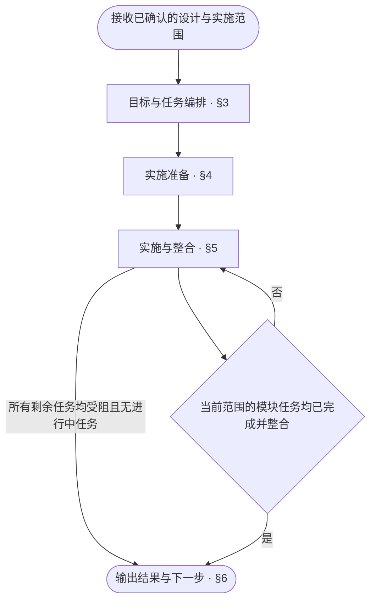

<!-- AUTO-GENERATED from SKILL.md.tmpl — do not edit directly -->
<!-- Regenerate: bash scripts/build-skills.sh --host cursor -->

# aca-implement

按当前范围的设计文档完成生产代码与测试代码的编写
只改代码与测试，不改设计文档，不运行测试

## 1 原则

1. **目标驱动**
   以已确认的交付目标决定实施范围与任务优先级
   以设计要求的覆盖情况判断实施是否完成
2. **依赖驱动并行**
   以依赖关系确定实施顺序
   依赖已满足且不存在文件冲突的任务，尽可能并行推进
3. **代码与测试同步**
   以对外契约、内部设计与测试设计为依据，同步编写生产代码及黑盒、白盒测试代码
4. **只写不测**
   实施阶段只编写或修改代码与测试，测试运行统一交给 `/aca-test`

## 2 执行流程



## 3 目标与任务编排

读取当前范围的设计文档、项目配置、现有代码与测试
检查工作区状态与近期提交，核对当前实施进度及已有改动
保留本次实施范围之外的已有改动

1. **明确交付物与完成条件**
   - 根据已确认的设计与实施范围，列出交付物及各自的完成条件
2. **梳理代码与测试改动清单**
   - 对照交付要求与现有代码、测试，列出需要复用、修改、新增或移除的内容
3. **编排对应的测试范围**
   - 根据黑盒与白盒测试设计，列出本次需要编写或更新的测试用例与夹具
   - 记录当前实施范围对应的待测单元与测试用例范围，供后续 `/aca-test` 直接执行
4. **梳理模块与依赖关系**
   - 根据设计列出本次涉及的模块及其依赖关系
   - 模块包含各级子模块：顶层模块取自 architecture，子模块取自直接父级 class-design 的内部组成
5. **规划源码与测试文件结构**
   - 根据模块边界、内部设计与仓库约定，规划源码与测试文件结构
   - 列出当前实施范围内的全部源码与测试目录、文件
6. **核对文件职责与边界**
   - 明确各文件的职责、所属模块与依赖
   - 核对文件职责是否单一，职责划分是否重叠
   - 职责不单一或存在重叠：调整文件划分
7. **拆分模块实施与整合任务**
   - 将实施准备、模块实施与整合拆成任务
   - 以设计中的模块为最小实施与提交单位
   - 有子模块时，各子模块与父级的组合实现分别成为任务，父级任务依赖其全部子模块任务
   - 明确每项任务的依赖、负责人和完成条件
8. **维护任务状态与进度**
   - 使用当前 AI Agent 环境提供的目标或任务管理能力，维护总目标与任务进度
   - 记录各任务的状态：待实施、进行中、已完成或受阻
   - 恢复任务时，核对任务记录、工作区与近期提交，更新任务状态并继续实施

## 4 实施准备

1. **建立目录与文件占位**
   - 按规划补齐当前范围的全部源码和测试目录与文件占位
   - 已有文件直接复用，新增文件创建为空文件
   - 删除规划中明确移除、且已核实不再承担有效职责的文件
   - 文件用途、依赖或删除范围无法确认：保留并向开发者核实
   - 全部文件占位建立后，再进入模块实现
2. **分配独立工作区**
   - 主 agent 为各子 agent 安排独立工作区
   - 将准备好的文件结构同步到各工作区
3. **下发子 agent 任务上下文**
   - 总体实现目标，以及当前模块需要完成的功能与改动范围
   - 当前模块及其依赖的结构依据、接口、内部设计与测试用例的相关章节链接
     顶层模块的结构依据为 architecture，子模块的结构依据为父级 class-design 的内部组成
   - 各项依赖的就绪状态，以及测试中的真实依赖或替身安排
   - 工作区路径、起始提交、允许修改的文件，以及适用的仓库约定
   - 只修改生产代码与测试代码，不修改设计文档，不运行测试
   - 遵循[异常处理](#52-异常处理)要求
   - 返回改动文件、提交记录、对应测试范围与阻塞原因

   涉及其他任务负责的文件或共享文件时，先交由主 agent 协调

## 5 实施与整合

### 5.1 实施循环

1. **派发可并行模块任务**
   - 主 agent 选择依赖已满足的模块任务，将可并行实施的任务分配给子 agent
2. **编写模块生产代码与测试代码**
   - 按设计复用、编写或更新模块当前范围的黑盒与白盒测试代码及夹具
   - 按设计完成模块当前范围的生产代码改动
   - 设计未规定的实现细节，按仓库约定处理；仓库没有对应约定时，采用最简单且符合设计的实现
   - 设计包含飞书卡片示意时，按[飞书卡片映射](~/.cursor/skills/aca/skills/references/lark-card-mapping.md)实现
   - 按需整理代码结构，保持职责单一与边界清晰
3. **核对模块完成条件并提交**
   - 核对模块当前范围的接口契约、内部机制及黑盒、白盒测试代码已按设计全部写齐
   - 只暂存并提交当前任务的改动
4. **整合模块提交**
   - 主 agent 核对模块提交的文件范围与完成情况
   - 确认模块达到完成条件后，整合其提交
5. **更新进度与推进**
   - 主 agent 更新任务状态、已实现的模块范围与依赖就绪状态
   - 记录受阻任务的原因与恢复条件
   - 将已整合的依赖提交同步到下游模块工作区
   - 仍有可实施任务：回到第 1 步
   - 没有可派发任务且仍有进行中任务：等待执行结果
   - 当前范围全部模块任务完成并整合：进入[输出结果](#6-输出结果)
   - 所有剩余任务均受阻且无进行中任务：按[输出结果](#6-输出结果)报告未完成

### 5.2 异常处理

1. **处理设计缺失或冲突**
   - 发现设计缺失、冲突或无法实现时，执行任务的 agent 暂停受影响任务
   - 子 agent 向主 agent 报告问题及影响范围
   - 主 agent 核实问题及其影响范围，再向开发者报告
   - 需要补充或修订方案时，建议通过 `/aca-specify` 处理
   - 未受影响的独立任务继续推进
2. **处理跨仓库问题**
   - 发现其他仓库的问题时，主 agent 核实后向开发者报告问题及影响
   - 未经授权，不修改其他仓库

## 6 输出结果

当前范围的全部完成条件均已满足时，将目标与任务状态标记为完成
未完成时，报告剩余工作、阻塞原因与恢复动作
本次实施完成后，通过 `/aca-review` 对本次实施范围进行实现审查
向 Review 与后续 `/aca-test` 提供总体目标、对应设计、实施范围、编排好的待测范围及比较基线
注明受审提交及未提交改动
结束汇报使用以下样式，按实际状态填写标题与结果

```markdown
# 🛠️ Implement：<完成 / 未完成>

| 项目 | 结果 |
| --- | --- |
| 目标 | <总目标及完成条件的满足情况> |
| 范围 | <实现范围与模块进度> |
| 改动 | <主要生产代码与测试代码改动> |
| 待测范围 | <为 /aca-test 编排的本次待测单元与测试用例范围> |
| 提交 | <提交记录 / 未提交> |
| 阻塞 | <阻塞项与原因 / 无> |
| 建议 | <扩展建议 / 无> |
| 下一步 | <一个立即可执行的动作> |
```
