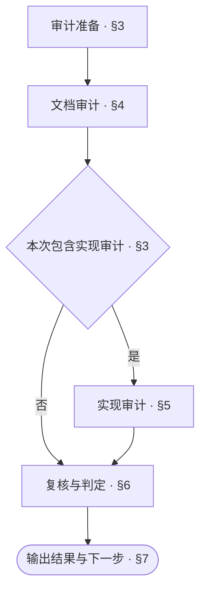

<!-- AUTO-GENERATED from SKILL.md.tmpl — do not edit directly -->
<!-- Regenerate: bash scripts/build-skills.sh --host cursor -->

# aca-repo-audit

检查项目文档的连接、主线、矛盾与冗余
开发者要求或 `/aca-release` 调用时，核对实现与设计的一致性
只读不改，结果在当前对话输出

需要判断业务目标和设计方案本身是否合理时，使用 `/aca-review`

## 1 原则

### 1.1 审计原则

1. **依据驱动**
   以适用的工程类型规则与文档约定核对文档体系
   以已确认的设计核对实现
2. **证据判定**
   以可核验的内容与运行结果判定问题及审计结论
3. **范围约束**
   审计结论仅覆盖本次范围

### 1.2 行文公理

> 以尽可能低的理解成本，把内容写清楚：无冗余、无遗漏、无歧义

**行文结构**

- 先交代整体，再展开细节，参见[金字塔原理](~/.cursor/skills/aca/SSOT.md#2-文档结构)
- 表达判断时，先给结论，再给依据
- 不增加信息的标题层级应当合并
- 有时序或优先级的条目用编号列表，包含子项时每步以加粗短语开头表达目的，具体操作与条件分支缩进在该步下
- 表格只用于多行同构、每行有两个以上属性、行之间没有先后关系的内容
- 列表项直接写完整的句子
- 一个条目有分支时，将分支缩进列在该条目下
- 每个分支一行，写成「条件：做什么」
- 执行前必须知道的条件写在动作之前
- 条件控制多个步骤时，把步骤列在该条件下

**表达与排版**

- 设计正文只描述当前有效设计
- 修订设计正文时，删除错误或失效的描述
- 设计正文不解释旧版本差异、改动过程或改动原因
- 以业务语言描述问题、流程和决定，技术语言只作辅助说明
- 同一条规则只在一处定义，其他位置直接引用
- 规则与引用应能直接定位，读者能明确找到需要修改的位置
- 删除不增加信息、也不帮助理解的内容
- 一行一句，每句只表达一个事实
- 操作步骤直接写动作
- 有先后关系的动作分项写
- 执行者、操作对象与指代必须明确
- 上下文已经明确的执行者、操作对象与指代不重复说明
- 行末不落句号
- 同一主题的各行之间不空行，切换主题时空一行
- 表格单元格写片段，不写句子，不落句号
- 单元格里的多个事实不用分号串起来，分行写
- 用户用什么语言，就用什么语言回复
- 中文遵循[中文文案排版指北](~/.cursor/skills/aca/SSOT.md#1-行文规范)
- 章节编号遵循 [ISO 2145](~/.cursor/skills/aca/SSOT.md#1-行文规范)
- `§` 只用于正文里的交叉引用，不进标题
- 正文引用具体章节时，使用直接指向目标章节锚点的 Markdown 链接
  同文档引用使用本地章节锚点，如 `[§1.2](#12-章节标题)`
  跨文档引用使用目标文件的相对路径与章节锚点，如 `[目标文档 §1.2](other.md#12-章节标题)`
  链接文字可使用章节名称或 `§` 加章节编号
  章节标题或顺序变化时，同步更新受影响的引用并核验目标
  代码块中的算法或命令需要引用章节时，将链接写在代码块前后的正文中
- 引用整篇文档时，链接指向目标文件

参考：[ASD-STE100](~/.cursor/skills/aca/SSOT.md#1-行文规范)

## 2 执行流程



## 3 审计准备

1. **确定本次审计范围**
   优先采用开发者指定的范围，其次沿用调用方明确的范围
   未指定时，默认审计整个仓库
   记录本次检查对应的提交及纳入范围的未提交改动
2. **检查工程类型**
   运行 `bash ~/.cursor/skills/aca/bin/aca-repo-type-check` 检查工程类型
   类型缺失、无效或尚未支持时，将类型规则核对列为未完成
   类型缺失或无效时，建议通过 `/aca-init` 修正
   继续其余不依赖类型规则的检查
3. **确定是否包含实现审计**
   开发者要求或 `/aca-release` 调用时，包含实现审计
   其他情况执行文档审计
4. **读取规则并定位入口**
   读取有效类型的规则与 `CONTEXT.md`，核对项目术语
   从根 README 定位本次审计范围的文档入口
   入口无法定位时，请开发者提供位置
   位置明确前，将依赖这些内容的检查列为未完成

## 4 文档审计

### 4.1 读取文档

1. **建立本次范围的文档清单**
   根据类型规则的必要条件与已选用的文档组，列出应有的文档
   对照 README 入口与实际目录，记录缺失文档及未登记的文档
2. **读取清单文档与关联引用**
   读取清单中的文档，沿引用补齐理解与核验所需的内容
   范围外的引用作为关联依据，不自动扩大审计范围
3. **提取适用检查条件**
   读取对应的文档组、Doc Design 与实际采用的 Pattern
   提取适用检查条件，作为后续逐项核对的依据

### 4.2 机械检查

1. **确定实际检查路径**
   根据[文档清单](#41-读取文档)确定实际检查路径
   文档图检查覆盖本次审计的文档目录
   行文检查覆盖本次审计的全部文档，包括涉及的项目级文件
   审计范围包含 Context 时，检查其结构与格式
2. **执行或复用机械检查**
   本会话已有相同范围的结果，且相关文件、检查规则与工具均未变化时，可复用
   在报告中注明原检查结果与复用依据
   不满足复用条件时，将以下占位符替换为实际路径并执行对应检查

   ```bash
   bash ~/.cursor/skills/aca/bin/aca-doc-graph-check <文档目录>
   bash ~/.cursor/skills/aca/bin/aca-prose-check <本次审计的全部文档>
   bash ~/.cursor/skills/aca/bin/aca-context-check <本次审计的 Context 文档>
   ```

3. **根据实际诊断处理检查结果**
   检查通过时，记录结果与依据
   检出问题时，核实诊断，将成立的问题列为必须处理
   工具缺失或运行失败时，将对应检查列为未完成并说明原因
   诊断无法核实时，将对应问题核验列为未完成并说明原因
   继续其余可执行检查

### 4.3 内容检查

1. **逐项核对适用检查条件**
   逐项核对[读取文档](#41-读取文档)中提取的适用检查条件
   结合[行文公理](#12-行文公理)核对表达
   每项记录核验结果、对应位置与依据
   不适用的条件说明原因
2. **顺着文档主线核对跨文档关系**
   - 入口和阅读顺序是否明确
   - 同一功能、术语、版本或流程是否互相矛盾
   - 同一信息是否由多篇文档重复维护
   - 是否存在过时内容、残稿、空文档或无法指导行动的空话
   - 设计正文是否只描述当前目标设计，未混入旧版本差异、改动过程或改动原因
3. **记录问题与未完成项**
   问题记录位置、依据、影响和处理建议
   跨文档重复时，指出信息应保留的位置
   其他位置建议删除重复内容或改为引用
   形成多个权威位置或存在漂移风险时列为必须处理
   仅影响篇幅时列为可选精简
   无法核验的项目记录原因，继续其余可执行检查

## 5 实现审计

### 5.1 一致性核对

本次包含实现审计时，双向核对本次范围内的全部设计项，不抽样

1. **列出应实现的设计项**
   以本次已确认的交付范围为依据，列出模块、行为、接口、状态、错误处理与验收条件
2. **从设计核对实现**
   为每个设计项定位对应代码、测试和配置
   核对是否完整实现、是否符合设计约定
3. **从实现核对设计**
   检查实际业务行为能否对应到设计说明
   辅助函数、工具代码与工程样板，核对其对设计行为的影响
4. **记录对应关系与偏移**
   每个设计项记录核对结果与依据
   每个偏移给出设计文档与实现位置
   缺少一侧时，说明缺失内容
   无法核验的项目记录原因，继续其余可执行检查

### 5.2 运行验证

1. **确定验证要求**
   按 `/aca-test` 的边界规则与仓库 `release` 文档，确定本次范围所需的测试与构建命令
   仓库未规定分级时，默认执行完整测试与构建
   核对所需环境、配置与夹具
2. **执行或复用验证结果**
   已有 `/aca-test` 或构建结果覆盖所需范围，且受审提交、测试、夹具、配置、依赖环境及命令均未变化时，可复用
   在报告中注明原验证结果与复用依据
   不满足复用条件时，在隔离环境中按 `/aca-test` 的执行规则运行所需测试与构建
   静态阅读不能代替执行验证
   验证过程中不修改项目源码、设计文档或提交记录
3. **记录结果并处理异常**
   验证通过时，记录结果与依据
   验证失败时，核实诊断并记录成立的问题
   环境缺失或无法执行时，将对应验证列为未完成并说明原因
   诊断无法核实时，将对应问题核验列为未完成并说明原因
   继续其余可执行检查

## 6 复核与判定

### 6.1 复核结果

1. **核对证据对应关系**
   确认检查结果与本次受审内容一致
   核对复用结果是否满足对应条件
2. **复核问题清单**
   核对问题涉及的文件与证据，确认成立后纳入报告
   已证伪的问题排除
   证据不足的问题列为未完成核验
   合并重复问题，保留相关位置、依据与影响
3. **核对检查覆盖**
   对照文档清单、适用检查条件及本次实现审计要求，核对是否遗漏
   能补查的项目完成补查
   仍无法完成的项目，记录范围、原因与恢复条件

### 6.2 判定结论

| 结论 | 条件 |
| --- | --- |
| 通过 | 本次必需检查全部完成并通过，无必须处理项 |
| 需要处理 | 存在已确认的必须处理项 |
| 未完成 | 未满足通过条件，且无已确认的必须处理项 |

必需检查包括本次范围的文档读取、机械检查与内容检查
包含实现审计时，还包括全部一致性核对、本次范围所需的测试与构建
同时存在必须处理项与未完成检查时，结论为需要处理，并列出未完成项
可选精简不影响通过

## 7 输出结果与下一步

### 7.1 审计报告

在当前对话中按以下模板汇报审计结论、问题与下一步

```markdown
# 🩺 Repo Audit：<通过 / 需要处理 / 未完成>

| 项目 | 结果 |
| --- | --- |
| 范围 | <本次审计范围> |
| 基线 | <受审提交及纳入范围的未提交改动> |
| 结论依据 | <满足通过条件的情况，或阻止通过的问题与未完成检查> |
| 文档检查 | <文件连接与文档检查结果> |
| 实现核对 | <实际结果 / 未完成 / 未纳入本次审计> |
| 测试与构建 | <实际结果 / 未完成 / 未纳入本次审计> |
| 必须处理 | <问题数量与主要影响 / 无> |
| 未完成 | <未完成的检查、范围、原因与恢复条件 / 无> |
| 下一步 | <一个立即可执行的动作> |

## 必须处理

- <文档章节链接 / 代码文件链接与行号>：<问题、违反的约定或检查条件、依据、影响和处理建议>

## 可选精简

- <文档章节链接 / 代码文件链接与行号>：<可以合并、删除或改写的内容及预期收益>

## 检查范围

- 阅读：<实际读取的文档与代码>
- 检查条件：<条件来源、逐项核验结果、不适用依据与未完成原因>
- 实现一致性：<设计项与实现的对应关系、核验结果 / 未纳入本次审计>
- 工具：<实际执行的命令与结果，或复用的原结果及依据>
```

### 7.2 后续动作

根据问题性质与核验条件选择一个立即可执行的动作

| 情况 | 下一步 |
| --- | --- |
| 缺少核验条件 | 补齐后通过 `/aca-repo-audit` 继续本次审计 |
| 方案仍需论证 | `/aca-specify` 论证方案 |
| 修订方案已明确，仅需改文档 | `/aca-design` 修订文档 |
| 实现偏移 | `/aca-implement` 修复代码或测试 |
| 测试或构建未完成 | `/aca-test` 执行验证 |
| 审计通过 | 返回调用方，按已确认的安排继续 |

问题修正后，重新审计受影响范围
