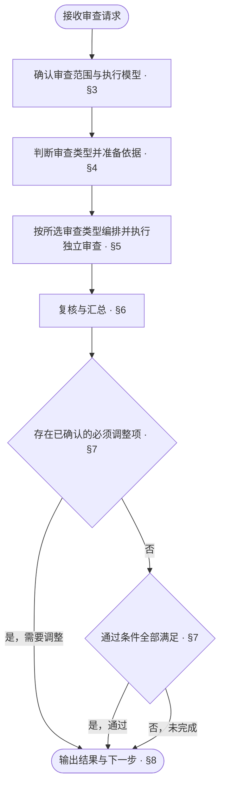
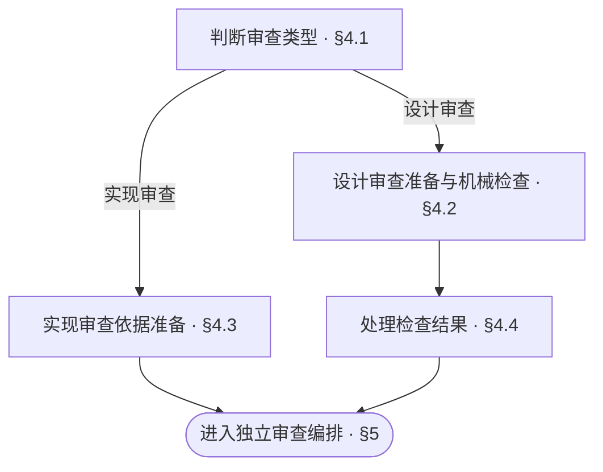

<!-- AUTO-GENERATED from SKILL.md.tmpl — do not edit directly -->
<!-- Regenerate: bash scripts/build-skills.sh --host cursor -->

# aca-review

审查当前范围的设计文档或代码实现，判定通过、需要调整或未完成
不修改设计文档、项目源码与测试代码，不运行受审代码与测试
发布前的仓库整体审计由 `/aca-repo-audit` 执行

## 1 原则

### 1.1 审查原则

1. **依据驱动**
   以已确认的需求与适用规则审查设计
   以已确认的设计审查代码与测试实现
2. **独立判断**
   各审查任务独立形成结论
3. **证据判定**
   以逐项核验结果与代码、文档事实判定问题及审查结论
4. **范围约束**
   审查结论仅覆盖本次范围

### 1.2 行文公理

行文公理用于设计文档的行文审查与审查报告的表达

> 以尽可能低的理解成本，把内容写清楚：无冗余、无遗漏、无歧义

**行文结构**

- 先交代整体，再展开细节，参见[金字塔原理](~/.cursor/skills/aca/SSOT.md#2-文档结构)
- 表达判断时，先给结论，再给依据
- 不增加信息的标题层级应当合并
- 有时序或优先级的条目用编号列表，包含子项时每步以加粗短语开头表达目的，具体操作与条件分支缩进在该步下
- 表格只用于多行同构、每行有两个以上属性、行之间没有先后关系的内容
- 列表项直接写完整的句子
- 一个条目有分支时，将分支缩进列在该条目下
- 每个分支一行，写成「条件：做什么」
- 执行前必须知道的条件写在动作之前
- 条件控制多个步骤时，把步骤列在该条件下

**表达与排版**

- 设计正文只描述当前有效设计
- 修订设计正文时，删除错误或失效的描述
- 设计正文不解释旧版本差异、改动过程或改动原因
- 以业务语言描述问题、流程和决定，技术语言只作辅助说明
- 同一条规则只在一处定义，其他位置直接引用
- 规则与引用应能直接定位，读者能明确找到需要修改的位置
- 删除不增加信息、也不帮助理解的内容
- 一行一句，每句只表达一个事实
- 操作步骤直接写动作
- 有先后关系的动作分项写
- 执行者、操作对象与指代必须明确
- 上下文已经明确的执行者、操作对象与指代不重复说明
- 行末不落句号
- 同一主题的各行之间不空行，切换主题时空一行
- 表格单元格写片段，不写句子，不落句号
- 单元格里的多个事实不用分号串起来，分行写
- 用户用什么语言，就用什么语言回复
- 中文遵循[中文文案排版指北](~/.cursor/skills/aca/SSOT.md#1-行文规范)
- 章节编号遵循 [ISO 2145](~/.cursor/skills/aca/SSOT.md#1-行文规范)
- `§` 只用于正文里的交叉引用，不进标题
- 正文引用具体章节时，使用直接指向目标章节锚点的 Markdown 链接
  同文档引用使用本地章节锚点，如 `[§1.2](#12-章节标题)`
  跨文档引用使用目标文件的相对路径与章节锚点，如 `[目标文档 §1.2](other.md#12-章节标题)`
  链接文字可使用章节名称或 `§` 加章节编号
  章节标题或顺序变化时，同步更新受影响的引用并核验目标
  代码块中的算法或命令需要引用章节时，将链接写在代码块前后的正文中
- 引用整篇文档时，链接指向目标文件

参考：[ASD-STE100](~/.cursor/skills/aca/SSOT.md#1-行文规范)

## 2 执行流程



## 3 审查准备

### 3.1 对象、范围与前提

1. **确认审查对象与范围**
   - 开发者已指定审查对象与范围：优先按其指定执行
   - 开发者未指定：沿用调用方已明确的审查对象与范围
   - 对象或范围仍未明确：结合当前工作区改动与近期相关提交确定，读取近期相关提交的说明与 diff
   - 仍无法确定审查对象或范围：请开发者明确
2. **记录比较基线**
   - 记录审查对象、范围与比较基线
   - 注明本次受审提交及纳入审查的未提交改动
3. **检查工程类型**
   - 运行 `bash ~/.cursor/skills/aca/bin/aca-repo-type-check` 检查工程类型
   - 工程类型缺失或无效：将类型规则核对列为未完成，并建议运行 `/aca-init`
   - 工程类型尚未支持：将类型规则核对列为未完成，并注明缺少对应规则
4. **定位并读取通用审查依据**
   - 输入未包含设计文档位置时，从根 README 的文档入口定位；无法定位时请开发者提供位置，位置明确前将依赖这些内容的检查列为未完成
   - 读取本次已确认的问题、目标与改动范围
   - 工程类型有效且已支持时，读取对应的 Repo Type 规则
   - 读取 `CONTEXT.md`，核对本次审查涉及的业务概念与定义
   - 读取本次范围的设计文档，并沿引用补齐理解与核验所需的文档

### 3.2 Agent 与模型选择

1. **扫描可用 Agent 环境与模型**
   - 扫描当前 AI Agent 环境及本机已有的其他 AI Agent 环境
   - 记录各环境的 Agent 工具种类与实际模型标识，与主 agent 比较
   - 通过现有工具入口、配置与模型列表，核对调用方式及可用状态
   - 已安装或存在配置不能单独证明可调用，无法核实的信息注明未知
2. **提出执行组合**
   - 优先使用可调用的旗舰模型，依据当前可核实的信息判断旗舰定位
   - 优先选择 Agent 环境与模型均不同于主 agent 的组合，不固定品牌、型号或尝试顺序
   - 没有其他适合且可调用的候选时，提出使用本模型的方案
3. **确认执行组合**
   - 展示候选的 Agent、模型、可用状态、调用方式及与主 agent 的差异
   - 说明推荐依据与可选的备选组合，请开发者确认后再执行审查
   - 已确认的选择与可用条件未变化时，沿用已有确认
4. **处理执行回落**
   - 将确认的执行组合用于[模型与任务编排](#53-模型与任务编排)
   - 所选组合无法调用时，使用已确认的备选；无已确认备选时，报告变化并请开发者确认新的组合
   - 在报告中注明实际选择、回落及原因

## 4 读取依据与执行检查



### 4.1 判断审查类型

1. **确定本次审查类型**
   - 开发者已指定审查类型：优先按其指定执行
   - 开发者未指定：沿用调用方已明确的审查类型
   - 审查类型未明确：根据受审对象与实际改动判断（设计文档执行设计审查，代码、测试或运行配置执行实现审查，同时涉及两者时分别执行两类审查）
   - 仍无法确定审查类型：请开发者明确

选择两类审查时，两条分支均执行

### 4.2 设计审查

1. **提取适用检查条件**
   - 读取本次范围对应的文档组、Doc Design 与实际采用的 Pattern
   - 提取其中适用的检查条件，作为逐项核验的依据
2. **确定机械检查路径**
   - 行文检查覆盖本次受审的全部文档，包括纳入审查范围的项目级记录
   - 文档图检查选择包含本次受审文档、且具有 README 入口的文档树
   - Context 的机械检查用于核对结构与格式，内容按对应 Doc Design 的检查条件核验
3. **执行或复用机械检查**
   - 本会话已有相同范围的机械检查结果，且相关文件、检查规则与工具均未变化时，可复用并在报告中注明原结果及复用条件
   - 不满足复用条件时，将以下命令中的占位路径替换为第 2 步确定的实际路径并执行

   ```bash
   bash ~/.cursor/skills/aca/bin/aca-doc-graph-check <文档目录>
   bash ~/.cursor/skills/aca/bin/aca-context-check CONTEXT.md
   bash ~/.cursor/skills/aca/bin/aca-prose-check <本次受审的全部文档路径>
   ```

### 4.3 实现审查

1. **读取设计与实现约定**
   - 读取本次范围对应的已确认设计、测试设计与仓库实现约定
2. **读取受审代码与测试**
   - 按已确定的比较基线读取本次 diff 与改动文件
   - 读取受影响的调用方与依赖代码
   - 读取改动所在函数、类、测试文件及相关调用链，理解其执行上下文
3. **建立设计与实现的映射**
   - 将生产代码实现与测试代码实现分别对应到设计约定和测试场景，供第五章逐项静态审查
   - 实现审查不直接运行代码、测试或构建，运行验证在审查通过后由 `/aca-test` 执行

### 4.4 处理检查结果

设计审查的机械检查按本节处理

| 检查情况 | 处理 |
| --- | --- |
| 通过 | 记录结果与验证依据 |
| 返回失败 | 核对诊断，将已确认的问题列为必须调整 |
| 无法运行或诊断无法核实 | 对应检查或问题核验列为未完成，注明原因 |

## 5 审查编排与执行

### 5.1 设计审查维度

1. **产品视角**
   核对设计是否完整承接本次已确认的问题、目标与范围
2. **设计视角**
   核对职责与边界的划分是否符合业务分工
   核对协作与处理机制能否实现已确认的业务目标
   涉及用户交互时，核对用户能否按设计流程完成目标
   核对各交互状态及成功、失败路径是否提供明确的反馈与操作指引
3. **实现视角**
   核对模块依赖与接口约定是否足以指导模块协作
   核对数据、状态变化、错误处理与边界行为是否足以指导具体实现
   核对测试设计是否明确夹具、场景、执行方式与预期结果
   核对测试结果能否判定对应验收条件是否满足
   核对设计是否存在会导致业务行为不同的歧义
   核对实施前是否仍需补充设计决定
4. **整体视角**
   核对文档入口与引用能否准确定位本次设计及其依赖
   核对相关文档之间是否存在设计遗漏、约定冲突、重复定义或术语不一致

### 5.2 实现审查维度

以已确认的设计文档为依据，逐项静态核对以下内容

1. **结构设定**
   核对模块与文件划分、职责归属、接口定义及依赖关系是否符合设计
2. **具体逻辑实现**
   核对输入输出与处理流程是否符合设计
   核对数据与状态变化、错误处理及边界行为是否符合设计
   核对黑盒与白盒测试代码中的夹具、场景及断言是否完整覆盖对应测试设计
   核对测试断言能否识别实际行为与预期结果的偏差
3. **整体结构实现**
   核对模块间的组装、调用链与协作方式是否符合整体架构设计
   核对跨模块接线是否符合设计中的流程与契约边界

### 5.3 模型与任务编排

1. **创建独立审查任务**
   - 设计审查为每个视角分别分配独立子 agent
   - 实现审查为结构设定、具体逻辑实现与整体结构实现分别分配独立子 agent
   - 各子 agent 独立形成结论，不预先读取其他子 agent 的审查结果
2. **安排执行模型**
   - 按[Agent 与模型选择](#32-agent-与模型选择)中已确认的组合安排执行
   - 使用本模型时，各审查任务仍独立执行
3. **提供任务上下文**
   - 负责的审查项及分配的适用检查条件
   - 审查对象、范围与比较基线，以及受审提交和纳入审查的未提交改动
   - 受审内容的位置及对应设计依据
   - 第四章已有的机械检查结果与证据
   - 实现审查所需的 diff、改动文件、测试文件、受影响的调用与依赖代码、仓库实现约定

### 5.4 执行审查

1. **逐项核验检查条件**
   - 各子 agent 逐项核验所分配的检查条件
   - 检查条件不适用于本次范围时，记录不适用及其依据
2. **记录核验结果与问题**
   - 每项检查记录核验结果、对应文件位置与判断依据
   - 每条问题按[审查报告](#81-审查报告)中的问题格式记录位置、问题、影响与调整建议
3. **汇总返回主 agent**
   - 将完整检查记录、问题清单及未完成项返回主 agent

## 6 复核与汇总

1. **读取各子 agent 检查记录**
   - 主 agent 读取各子 agent 的检查记录，核对检查证据是否对应本次受审内容
2. **复核并归并问题**
   - 逐条核对问题涉及的文件与证据，确认成立后纳入报告
   - 已证伪的问题排除，证据不足的问题列为未完成核验
   - 主 agent 可补充自行发现的问题，经同样的证据核验后纳入报告
   - 合并重复问题，保留发生位置、证据与影响
3. **核对审查覆盖度**
   - 汇总各审查项的检查记录，逐项核对检查条件的适用性与核验结果
   - 子 agent 未覆盖分配的范围、遗漏检查或缺少核验依据时，补充分派对应检查并复核结果
   - 仍无法完成的审查项或检查，列为未完成并注明原因
4. **形成判定依据**
   - 汇总已确认的问题与检查完成情况，作为结论判定的依据

## 7 判定结论

| 结论 | 条件 |
| --- | --- |
| 通过 | 所选审查任务全部完成、适用检查条件全部核验通过、适用机械检查通过、无必须调整项 |
| 需要调整 | 存在已确认的必须调整项 |
| 未完成 | 未满足通过条件，且无已确认的必须调整项 |

同时存在必须调整项与未完成检查时，结论为需要调整，并列出未完成项
可选优化不影响通过
受审内容发生变化后，重新审查受影响范围，并更新对应结论

## 8 输出结果与下一步

### 8.1 审查报告

在当前对话中按以下模板输出审查结果，不写入项目文件

```markdown
# 🔎 Review：<通过 / 需要调整 / 未完成>

| 项目 | 结果 |
| --- | --- |
| 对象 | <设计文档 / 代码实现 / 两者> |
| 范围 | <受审模块、文件或改动范围> |
| 基线 | <比较基线、受审提交及未提交改动> |
| 结论依据 | <满足通过条件的情况，或阻止通过的问题与未完成检查> |
| 必须调整 | <问题数量与主要影响 / 无> |
| 工具检查 | <设计审查机械检查的通过、失败及未完成情况 / 实现审查不适用> |
| 未完成 | <本次范围内未完成的审查任务、检查及原因 / 无> |
| 下一步 | <一个立即可执行的动作> |

## 必须调整

- <文档章节链接 / 代码文件链接与行号>
  - 问题：<实际内容、违反的设计约定或检查条件及具体偏差>
  - 影响：<对设计理解、实施或运行行为的影响，以及适用的发生条件>
  - 调整：<需要修正或确认的内容，以及修正后应满足的约定或检查条件>

## 可选优化

- <不影响审查通过的改善建议、对应位置与预期收益>

## 检查范围

- 阅读：<本次实际读取的文件>
- 检查条件：<条件及来源、逐项核验结果、不适用依据与未完成原因>
- 工具：<实际执行的机械检查命令与结果，或复用的原结果及复用依据 / 实现审查不适用>

| 审查项 | Agent 环境 | 模型 | 完成状态 | 说明 |
| --- | --- | --- | --- | --- |
| <设计审查视角 / 实现审查项> | <实际 Agent 环境> | <实际模型及可核实的版本> | <已完成 / 未完成> | <回落或未完成原因 / 无> |
```

设计审查列出产品、设计、实现与整体四个视角
实现审查列出结构设定、具体逻辑实现与整体结构实现三项

### 8.2 后续动作

按审查结论与本轮进度选择下一步

| 结论 | 情况 | 下一步 |
| --- | --- | --- |
| 未完成 | 输入或核验条件缺失 | 报告恢复条件，补齐后通过 `/aca-review` 继续本次审查 |
| 需要调整 | 设计方案仍需论证或决定 | `/aca-specify` 补充或修订方案 |
| 需要调整 | 方案已明确，仅需修订设计文档 | `/aca-design` 修订文档 |
| 需要调整 | 代码或测试实现问题 | `/aca-implement` 修复 |
| 通过 | 设计审查通过，本轮需要实施代码 | `/aca-implement` |
| 通过 | 设计审查通过，本轮仅改设计文档 | 按已确认的版本推进安排衔接 `/aca-release` |
| 通过 | 实现审查通过 | `/aca-test` 执行当前范围的测试验证 |

设计或实现修正后，通过 `/aca-review` 复审受影响范围
