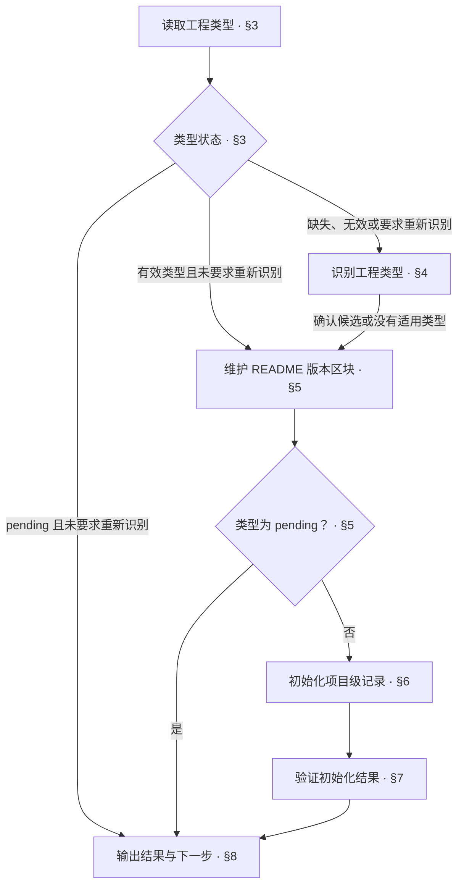

<!-- AUTO-GENERATED from SKILL.md.tmpl — do not edit directly -->
<!-- Regenerate: bash scripts/build-skills.sh --host grok -->

# aca-init：项目初始化

建立项目的工程类型标识与初始化所需的项目级记录

需求与方案确认归 `/aca-specify`
项目设计文档的编写归 `/aca-design`
既有项目的现状治理归 `/aca-brownfield`

工程类型及适用范围见[工程类型与文档设计](~/.grok/skills/aca/doc-design/README.md#工程类型与文档设计)，具体要求见对应类型规则

## 1 原则

1. **事实依据**
   以已确认的工程类型与实际版本记录建立项目标识
2. **按需初始化**
   以类型规则的必要条件决定需要建立的项目级记录
3. **保留既有内容**
   初始化补齐缺失记录，保留项目已有的有效内容
4. **职责限定**
   初始化建立项目标识与基础记录，需求论证、设计编写与现状治理由对应流程承担

## 2 执行流程



第三至第七章无法继续时，按[输出结果与下一步](#8-输出结果与下一步)报告已完成事实、停止原因与恢复条件

## 3 读取工程类型

1. 读取初始化信息
   根 README footer 是 Repo-Type 的唯一事实来源
   确定项目目录，读取 Anyone Can Architect 版本，运行工程类型检查并保留退出状态

   ```bash
   PROJECT_DIR="$(pwd)"
   ACA_VERSION_STATUS=0
   ACA_VERSION=$(cat ~/.grok/skills/aca/VERSION) || ACA_VERSION_STATUS=$?
   TYPE_CHECK_STATUS=0
   TYPE_VALUE=$(bash ~/.grok/skills/aca/bin/aca-repo-type-check "$PROJECT_DIR") || TYPE_CHECK_STATUS=$?
   ```

   Anyone Can Architect 版本无法读取或内容为空时，按第八章汇报未完成，不写入版本区块
   类型检查返回下表之外的输出或退出状态时，记录原因，按第八章汇报未完成
2. 判断是否重新识别
   开发者明确要求重新识别时，进入第四章
   否则，按下一步的检查结果继续
3. 按检查结果继续

   | 检查输出 | 退出状态 | 处理 |
   | --- | --- | --- |
   | `NEEDS_INIT` 或 `INVALID_TYPE <值>` | `1` | 进入第四章 |
   | `PENDING` | `1` | 告知类型尚未支持，按第八章汇报未完成 |
   | 受支持的有效类型名 | `0` | 赋给 `REPO_TYPE`，进入第五章刷新版本区块 |

## 4 识别工程类型

1. 收集识别依据
   阅读根 README、项目结构与主要产物
   对照[工程类型索引](~/.grok/skills/aca/doc-design/README.md#工程类型与文档设计)及候选类型的适用范围
2. 提出候选并确认
   给出候选类型与判断依据，由开发者确认
   需要调整时，根据开发者补充的信息重新判断，不提前写入类型
3. 确定后续路径
   确认受支持类型后，将该类型赋给 `REPO_TYPE`，进入第五章
   确认没有适用类型后，将 `REPO_TYPE` 设为 `pending`，进入第五章写入版本区块后停止初始化
   类型缺口可建议通过 `/aca-feedback` 反馈，不自动提交 Issue
   尚未确认时，不写入类型，按第八章汇报待确认

## 5 维护 README 版本区块

1. 确定仓库名
   `REPO_NAME` 优先取 `origin` 的仓库名，没有 `origin` 时采用唯一 remote
   存在多个其他 remote 时请开发者确认
   没有 remote 时取根 README 的 H1，两者都没有时请开发者确认
2. 确定项目版本
   根据当前分支的版本记录确定 `REPO_VERSION`，类型有效时仅读取工程类型允许的文件
   当前分支缺少记录时，依次查找本地 `main`、`master` 与 `origin` 默认分支的版本记录
   `origin` 默认分支未标识时，依次查找 `origin/main`、`origin/master`
   区分正在开发的版本与已发布 Tag，无法确定时请开发者确认
   没有版本记录时，由开发者确认初始版本，默认建议 `0.1.0`
   `pending` 没有对应类型规则时，依据项目已有版本记录判断，不套用其他类型规则
3. 维护并校验版本区块
   在根 README 末尾维护唯一的两行版本区块，已有区块时原位更新并移至末尾
   README 不存在时，以仓库名创建 H1
   先建立或修正区块，再调用同步脚本
   版本区块格式固定：

   ```markdown
   ---

   > 📦 **<REPO_NAME> v<REPO_VERSION>**
   > 🤝 Powered by [Anyone Can Architect](https://github.com/ruozi/anyone-can-architect) v<ACA_VERSION> · Repo-Type: `<REPO_TYPE>`
   ```

   运行 `bash ~/.grok/skills/aca/bin/aca-readme-version-sync README.md "$REPO_VERSION" "$ACA_VERSION"` 同步版本并检查区块格式
   失败时根据错误提示修正后重跑
   无法修正时，按第八章汇报未完成
   检查通过后，有效类型进入第六章
   `REPO_TYPE` 为 `pending` 时，按第八章汇报未完成，不进入第六章

## 6 初始化项目级记录

1. 确定初始化清单
   读取 `~/.grok/skills/aca/doc-design/repo-types/{repo-type}.md` 的「项目结构」
   按必要条件筛选需要初始化的根目录文件，记录适用条件与已有、缺失状态
   项目已实际采用外部依据且类型规则要求时，将 `SSOT.md` 纳入清单
   没有外部依据时，不创建空的 SSOT 文件
2. 保留已有、补齐缺失
   已有文件保留，缺失文件从 `~/.grok/skills/aca/templates/<文件名>.example` 创建并填写
   按以下文档设计填写已确认的信息

   | 文件 | 行文依据与内容 |
   | --- | --- |
   | `CONTEXT.md` | 按 [context 文档设计](~/.grok/skills/aca/doc-design/documents/context.md)筛选并登记术语与定义 |
   | `ROADMAP.md` | 按 [roadmap 文档设计](~/.grok/skills/aca/doc-design/documents/roadmap.md)记录实际状态与已确认的后续版本规划 |
   | `CHANGELOG.md` | 按 [changelog 文档设计](~/.grok/skills/aca/doc-design/documents/changelog.md)保留未发布区块并登记已有发布事实 |
   | `SSOT.md` | 按 [ssot 文档设计](~/.grok/skills/aca/doc-design/documents/ssot.md)登记已核实的外部依据及其出处 |

   删除新建文件中模板带入的示例、占位内容与不适用的可选部分
3. 处理缺失条件
   必要信息缺失时，从项目中核实，仍无法确认时请开发者补充
   模板缺失时，运行 `npx -y anyone-can-architect@latest install` 修复安装
   修复安装后重新检查模板，取得模板后继续
   必要信息或模板仍无法取得时，报告缺失内容与路径，按第八章汇报未完成

## 7 验证初始化结果

1. 核对初始化清单
   运行 `bash ~/.grok/skills/aca/bin/aca-repo-type-check "$PROJECT_DIR"`，确认结果与已确认的 `REPO_TYPE` 一致
   核对 README 版本区块有效，初始化清单中的所需文件已存在
   第五章已通过且未受后续改动影响的检查，沿用结果
2. 检查初始化内容
   对新增或更新的文件，核对对应文档设计的适用检查条件，并运行 `aca-prose-check`
   将以下占位符替换为本次新增或更新文件的实际路径

   ```bash
   bash ~/.grok/skills/aca/bin/aca-prose-check "<本次新增或更新文件的路径>"
   ```

   `CONTEXT.md` 在本次初始化清单中时，运行以下检查

   ```bash
   bash ~/.grok/skills/aca/bin/aca-context-check "$PROJECT_DIR/CONTEXT.md"
   ```

   确认新建文件中模板带入的示例与占位内容已清除，新增或更新内容中的引用位置有效
3. 处理检查结果
   初始化造成的问题修正后，重新执行受影响的检查
   既有内容需要重新设计时，记录问题并按第八章衔接对应流程
   必需检查未通过或未核验时，按第八章汇报未完成

本章验证项目标识与基础记录，不扩展到代码测试或整仓审计

## 8 输出结果与下一步

1. 判定初始化状态
   受支持的工程类型已确认、README 版本区块有效、所需记录齐全且必需检查通过时，报告完成
   类型为 `pending`、尚未确认或必需步骤受阻、未核验时，报告未完成
2. 汇报实际结果
   按以下样式填写标题与结果
   只填写已核实的版本、文件改动与检查事实

   ```markdown
   # 🌱 Init：<完成 / 未完成>

   | 项目 | 结果 |
   | --- | --- |
   | 工程类型 | <已确认类型 / pending / 待确认> |
   | 版本 | <已核实的项目版本与 Anyone Can Architect 版本 / 未确认项及原因> |
   | 文件 | <新增或更新的文件 / 无> |
   | 检查 | <实际结果与未完成项 / 未执行> |
   | 待办 | <未完成项与原因 / 无> |
   | 下一步 | <一个立即可执行的动作 / 无> |
   ```

3. 衔接下一步
   初始化未完成时，说明缺失条件与恢复位置
   初始化完成时，沿用已确认的后续安排
   尚无安排时，根据实际任务提出下一步
   需求论证归 `/aca-specify`，已确认方案的文档编写归 `/aca-design`，既有项目的现状核实归 `/aca-brownfield`
   不仅凭类型规则是否包含治理顺序决定后续流程
