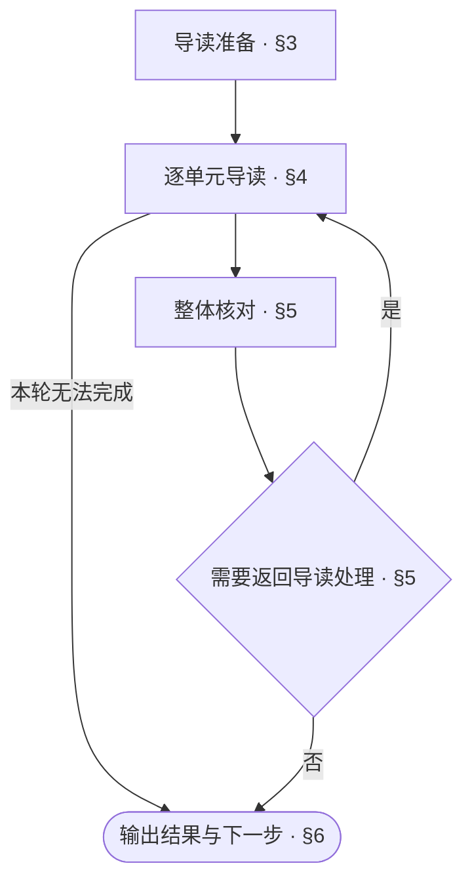
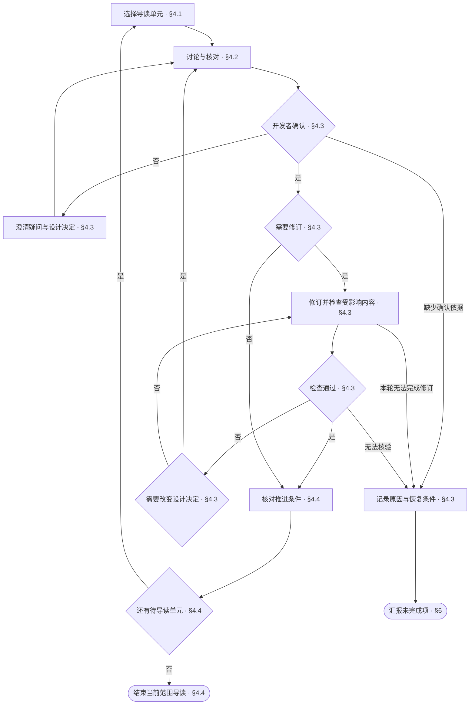

<!-- AUTO-GENERATED from SKILL.md.tmpl — do not edit directly -->
<!-- Regenerate: bash scripts/build-skills.sh --host grok -->

# aca-walkthrough

用业务语言导读当前范围的设计文档
逐单元确认设计决定，发现的问题经确认后当场修正

## 1 原则

### 1.1 导读原则

1. **业务导向**
   以业务问题与需求解释设计决定
   技术语言只作辅助说明
2. **逐层确认**
   从整体到细节形成共同理解
   以开发者的确认作为推进与修订的依据
3. **职责边界**
   导读不判定审查是否通过
   审查结论归 `/aca-review`

### 1.2 行文公理

> 以尽可能低的理解成本，把内容写清楚：无冗余、无遗漏、无歧义

**行文结构**

- 先交代整体，再展开细节，参见[金字塔原理](~/.grok/skills/aca/SSOT.md#2-文档结构)
- 表达判断时，先给结论，再给依据
- 不增加信息的标题层级应当合并
- 有时序或优先级的条目用编号列表，每项有多个属性时属性缩进在该项下
- 表格只用于多行同构、每行有两个以上属性、行之间没有先后关系的内容
- 列表项直接写完整的句子
- 一个条目有分支时，将分支缩进列在该条目下
- 每个分支一行，写成「条件：做什么」
- 执行前必须知道的条件写在动作之前
- 条件控制多个步骤时，把步骤列在该条件下

**表达与排版**

- 设计正文只描述当前有效设计
- 修订设计正文时，删除错误或失效的描述
- 设计正文不解释旧版本差异、改动过程或改动原因
- 以业务语言描述问题、流程和决定，技术语言只作辅助说明
- 同一条规则只在一处定义，其他位置直接引用
- 规则与引用应能直接定位，读者能明确找到需要修改的位置
- 删除不增加信息、也不帮助理解的内容
- 一行一句，每句只表达一个事实
- 操作步骤直接写动作
- 有先后关系的动作分项写
- 执行者、操作对象与指代必须明确
- 上下文已经明确的执行者、操作对象与指代不重复说明
- 行末不落句号
- 同一主题的各行之间不空行，切换主题时空一行
- 表格单元格写片段，不写句子，不落句号
- 单元格里的多个事实不用分号串起来，分行写
- 用户用什么语言，就用什么语言回复
- 中文遵循[中文文案排版指北](~/.grok/skills/aca/SSOT.md#1-行文规范)
- 章节编号遵循 [ISO 2145](~/.grok/skills/aca/SSOT.md#1-行文规范)
- `§` 只用于正文里的交叉引用，不进标题
- 正文引用具体章节时，使用直接指向目标章节锚点的 Markdown 链接
  同文档引用使用本地章节锚点，如 `[§1.2](#12-章节标题)`
  跨文档引用使用目标文件的相对路径与章节锚点，如 `[目标文档 §1.2](other.md#12-章节标题)`
  链接文字可使用章节名称或 `§` 加章节编号
  章节标题或顺序变化时，同步更新受影响的引用并核验目标
  代码块中的算法或命令需要引用章节时，将链接写在代码块前后的正文中
- 引用整篇文档时，链接指向目标文件

参考：[ASD-STE100](~/.grok/skills/aca/SSOT.md#1-行文规范)

## 2 执行流程



## 3 导读准备

1. 核对工程类型
   运行 `bash ~/.grok/skills/aca/bin/aca-repo-type-check`
   - `NEEDS_INIT`：先运行 `/aca-init`
   - `PENDING`：停止导读
   Repo-Type 只从根 README footer 读取
2. 确定起始范围
   默认从项目级开始
   开发者已指定范围时，只导读该对象及其下层
3. 从根 README 沿文档入口定位当前范围
   仍无法定位时，请开发者指定文档位置
   读取 `~/.grok/skills/aca/doc-design/repo-types/{repo-type}.md`
   读取 `CONTEXT.md` 与当前范围的设计文档
   读取对应的文档组、文档设计与实际采用的 pattern
4. 安排导读顺序
   按类型规则的治理顺序安排导读
   文档组内部按对应文档组规定的顺序安排
   未规定顺序时，按文档引用依赖安排
5. 确认范围与顺序
   列出范围与顺序
   尚未确认或发生变化时，与开发者确认
   已确认且未变化时，直接继续

## 4 逐单元导读



### 4.1 选择导读单元

1. 按已确认的范围与顺序选择当前对象
   从整体到细节展开
   每次讨论一个单元
2. 进入一篇文档时，先将整体行文结构作为讨论单元
   列出当前文档的 Chapter、Section 及各自承载的内容
3. 文档整体结构确认、必要修订完成且受影响检查通过后，按 Chapter 或 Section 选择内容单元
   最细讨论粒度为 Section

| 层级 | 导读重点 |
| --- | --- |
| 项目 | 整体需求、设计目标与职责划分 |
| 模块 | 负责的需求、对外能力、协作关系与文档分工 |
| 文档 | 文档职责、整体章节划分、内容归属与展开顺序 |
| Chapter 或 Section | 具体需求、解决方式与待明确的设计决定 |

### 4.2 讨论与核对

1. 先用业务语言说明当前单元要解决的问题与需求
   再说明设计如何满足这些需求
   涉及业务概念时，链接项目 `CONTEXT.md` 中的对应词条
   说明概念的含义及其在当前设计中的作用
2. 核对当前单元的设计
   逐项核对文档组、文档设计与实际采用的 pattern 中适用于当前单元的检查条件
   导读文档整体结构时，对照对应 Doc Design 讨论章节划分、内容归属与展开顺序
   明确需要合并、拆分或重排的内容

   | 检查项 | 关注内容 |
   | --- | --- |
   | 需求匹配 | 设计对当前问题与需求的满足程度 |
   | 完整性 | 职责、行为、边界与异常处理的遗漏 |
   | 歧义与实现唯一性 | 多种合理解读、符合描述但行为不同的实现、尚未明确的设计决定 |
   | 冗余 | 重复维护、不增加信息的内容 |
   | 表达 | 行文公理、对应文档设计与术语一致性 |

### 4.3 确认、修订与检查

1. 请开发者确认当前单元的设计决定
   开发者不理解或有异议时，澄清含义与依据
   尚未确认时，按[讨论与核对](#42-讨论与核对)继续讨论当前单元
2. 存在已确认的调整时，按对应文档设计当场修订
   涉及章节调整时，同步更新受影响的引用与关联设计
3. 修订后，重新执行受影响的检查条件与机械检查
   报告修正内容与检查结果
   检查未通过且可按已确认的设计修正时，修正并复检
   需要改变设计决定时，按[讨论与核对](#42-讨论与核对)重新讨论并请开发者确认
4. 本轮无法完成确认、修订或核验时，记录当前单元、原因与恢复条件
   按[输出结果与下一步](#6-输出结果与下一步)汇报未完成项
   正常等待开发者确认时，保留当前单元，不据此判定本轮无法完成

### 4.4 推进导读

1. 核对当前单元的推进条件
   当前设计决定已确认，且必要修订完成、受影响检查通过后，进入下一单元
   未满足条件时，按[确认、修订与检查](#43-确认修订与检查)继续处理当前单元
2. 当前层级的内容确认后，按 [readme 文档设计 §3 第 5 步](~/.grok/skills/aca/doc-design/documents/readme.md#3-行文步骤)核对入口与导航
3. 当前范围仍有待导读单元时，按[选择导读单元](#41-选择导读单元)继续
   当前范围全部单元完成后，进入[整体核对](#5-整体核对)

## 5 整体核对

1. 核对需要结合整个范围才能判断的适用检查条件
   已核对且未受后续修订影响的检查项，沿用已有结果
2. 发现需要调整的内容时，按[逐单元导读](#4-逐单元导读)处理受影响单元
   处理后，重新核对受影响的整体检查条件
3. 无法核验或无法完成的项目，记录原因与待办
   按[输出结果与下一步](#6-输出结果与下一步)汇报本次导读结果

## 6 输出结果与下一步

### 6.1 判定完成状态

| 状态 | 条件 |
| --- | --- |
| 完成 | 当前范围的单元均已确认、必要修订完成、适用检查全部核验通过 |
| 未完成 | 未满足完成条件 |

未完成时，列出剩余内容与原因

### 6.2 导读报告

发现文档设计或 pattern 的缺失、矛盾、无法执行时，记录为规则问题
可建议通过 `/aca-feedback` 反馈

结束汇报使用以下样式，按实际状态填写标题与结果

```markdown
# 📖 Walkthrough：<完成 / 未完成>

| 项目 | 结果 |
| --- | --- |
| 范围 | <已导读范围与进度> |
| 决定 | <已确认决定> |
| 修正 | <已落盘的修正 / 无> |
| 检查 | <检查结果与未核验项 / 未执行> |
| 待办 | <待导读或需重新设计的内容 / 无> |
| 规则问题 | <发现的规则问题 / 无> |
| 提交 | <提交记录 / 未提交> |
| 下一步 | <一个立即可执行的动作> |
```

### 6.3 后续动作

按完成状态与本轮进度选择一个立即可执行的动作

| 状态 | 情况 | 下一步 |
| --- | --- | --- |
| 未完成 | 尚有未导读单元或缺少核验条件 | 补齐条件后，通过 `/aca-walkthrough` 继续本次导读 |
| 未完成 | 设计方案在本轮无法确定 | `/aca-specify` 论证方案 |
| 完成 | 当前范围导读完成 | 按已确认的安排，通过 `/aca-review` 审查设计 |
