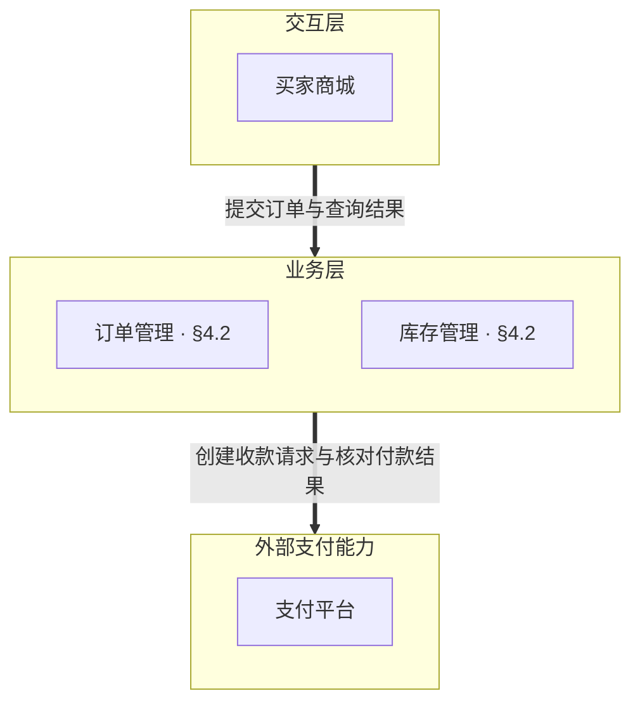
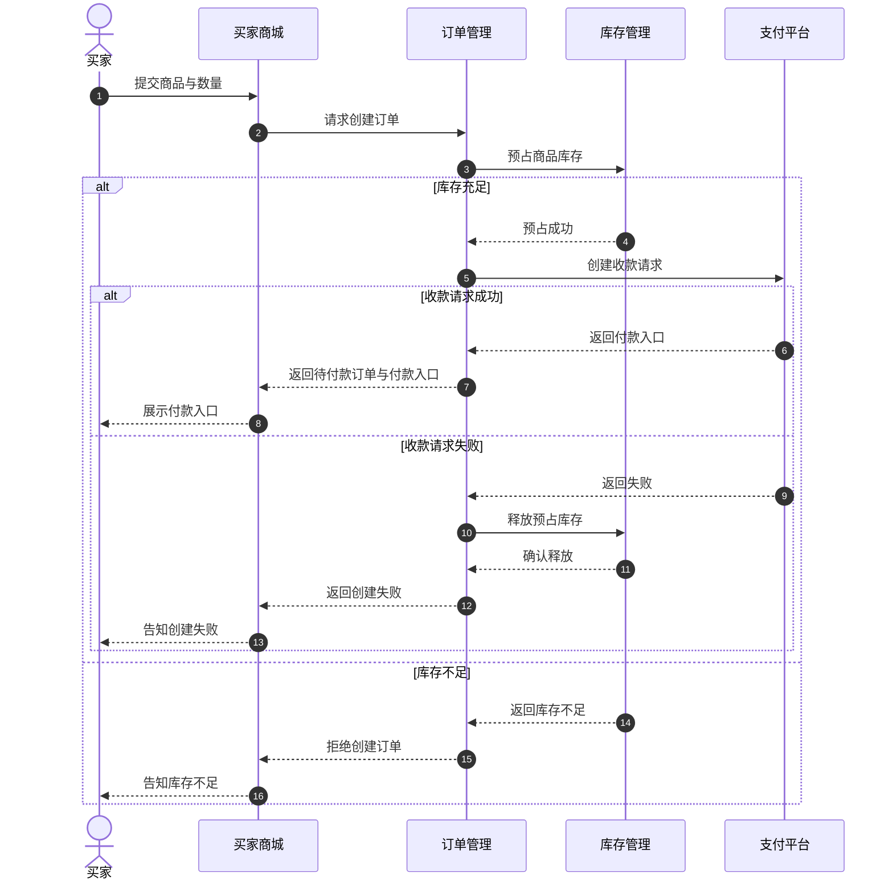

# 文档设计：architecture

## 1 文档定位

系统整体的模块划分与协作设计，定义模块职责、边界、依赖关系及分层组织

模块内部实现与接口契约归对应模块文档
本文只定义顶层模块，子模块的划分与协作归父模块的 class-design

## 2 文档结构

| 章节 | 表达形式 | 内容 |
| --- | --- | --- |
| 整体结构 | [分层视图](../patterns/layered-view.md)的层级关系视图 | 模块组成、分层与依赖关系，引用相关设计位置 |
| 模块职责 | 模块表：模块、能力、责任边界 | 各模块交付的能力与责任边界，模块名链接对应 README |
| 模块协作 | 关系表：发起方、承接方、协作职责、触发条件、结果处理 | 每行一项模块协作 |
| 业务工况 | 各工况独立成节，以[时序图](../patterns/sequence-diagram.md)表达 | 触发、参与模块、调用顺序与业务结果 |

协作关系表的结果处理包含成功与失败分支，已有契约通过引用衔接
涉及事务时，定义事务归属与跨模块交互边界

业务工况用于验证模块划分能否支撑业务，只表达模块间的关键协作与业务结果，不展开实现细节
失败分支只展示影响模块协作的关键情况，参与者为模块、入口与外部依赖
Command 或 Event 已定义的协作流程直接引用，不重复绘制

结构示意：

```text
## 1 整体结构
## 2 模块职责
## 3 模块协作
## 4 业务工况
### 4.1 <工况一>
### 4.2 <工况二>
```

## 3 行文步骤

1. 汇总模块划分、职责边界与依赖关系，列出待表达的协作规则与业务工况
2. 编排整体结构，关联模块职责与相关设计位置
3. 整理各模块交付的能力与责任边界
4. 整理模块协作，定义调用条件、方向、结果与失败处理
5. 选择代表性业务工况，验证模块职责与协作关系能否共同完成业务
6. 按 [§2](#2-文档结构)组织各章，核对结构、模块职责与协作规则的一致性，以及业务工况对系统职责的覆盖

## 4 示例

### 4.1 整体结构



### 4.2 模块职责

```markdown
| 模块 | 能力 | 责任边界 |
| --- | --- | --- |
| [订单管理](module-order/README.md) | 创建订单、维护订单状态与协调付款 | 库存数量与预占记录归库存管理，收款与付款结果归支付平台 |
| [库存管理](module-stock/README.md) | 预占、查询与释放商品库存 | 订单是否成立与付款状态归订单管理 |
```

### 4.3 模块协作

| 发起方 | 承接方 | 协作职责 | 触发条件 | 结果处理 |
| --- | --- | --- | --- | --- |
| 买家商城 | 订单管理 | 创建订单 | 买家提交商品与数量 | 成功展示付款入口，拒绝展示原因，结果未定时查询订单结果 |
| 订单管理 | 库存管理 | 预占库存 | 创建订单且参数校验通过 | 成功后请求收款，库存不足时拒绝，结果未定时查询预占记录 |
| 订单管理 | 库存管理 | 查询预占结果 | 预占调用结果未定 | 已预占则继续，明确未预占则拒绝，仍未定则保留处理中 |
| 订单管理 | 支付平台 | 创建收款请求 | 库存预占成功 | 成功返回付款入口，明确失败时释放库存，结果未定时核对收款请求 |
| 订单管理 | 库存管理 | 释放预占库存 | 收款请求明确失败或未付款订单取消 | 成功结束处理，失败或结果未定时按预占记录重试释放 |

### 4.4 业务工况

#### 4.4.1 创建订单工况



## 5 检查条件

- [ ] 整体结构使用分层视图的层级关系视图，模块组成、分层与依赖关系符合实际设计
- [ ] 模块表包含模块、能力与责任边界，模块名链接对应 README，模块清单与目录一致
- [ ] 协作关系表每行一项协作，包含发起方、承接方、协作职责、触发条件与结果处理
- [ ] 协作结果包含成功与失败分支，已有契约通过引用衔接，涉及事务时归属与交互边界已定义
- [ ] 业务工况统一放在第四章，每个工况独立成节，按时序图表达，已有 Command 或 Event 流程直接引用
- [ ] 工况包含触发、参与模块、关键协作与业务结果，失败分支仅保留影响协作的关键情况，不展开实现细节
- [ ] 整体结构、模块职责与协作规则一致，业务工况展示模块划分怎样支撑系统职责
- [ ] 模块内部实现与接口契约通过引用衔接，没有重复展开
