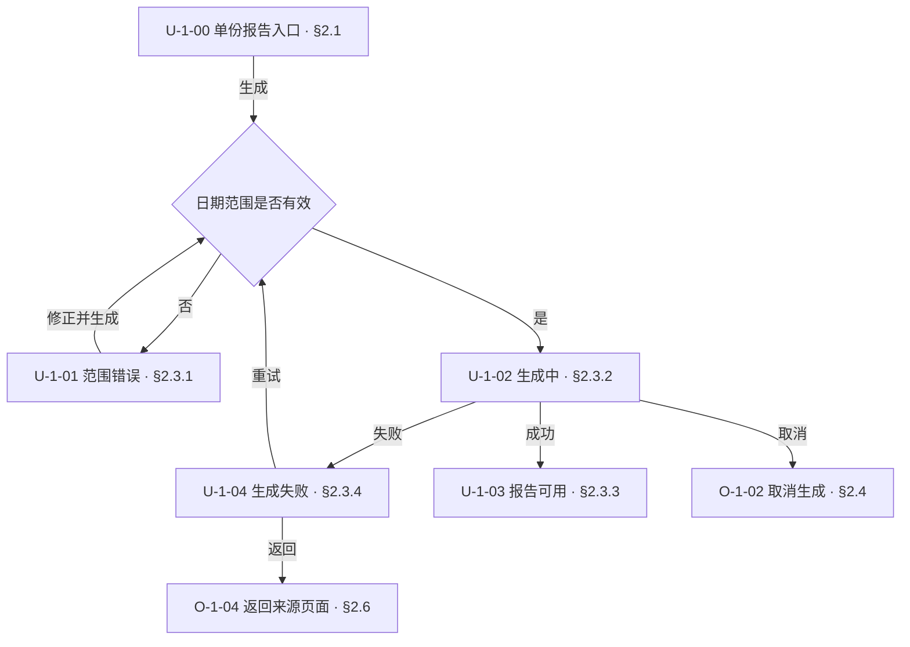
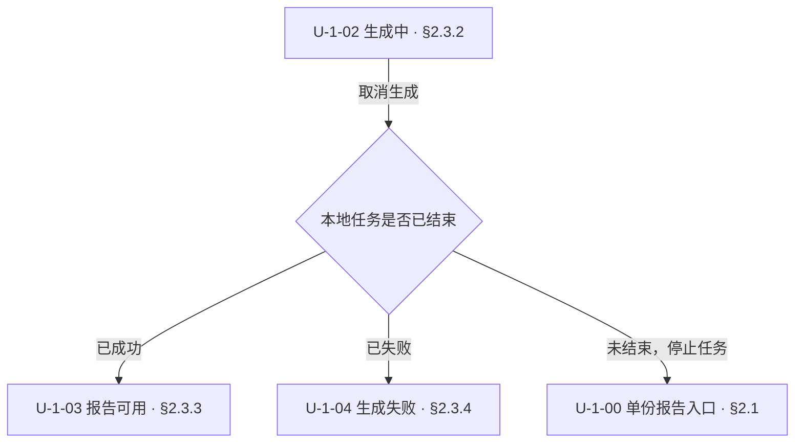
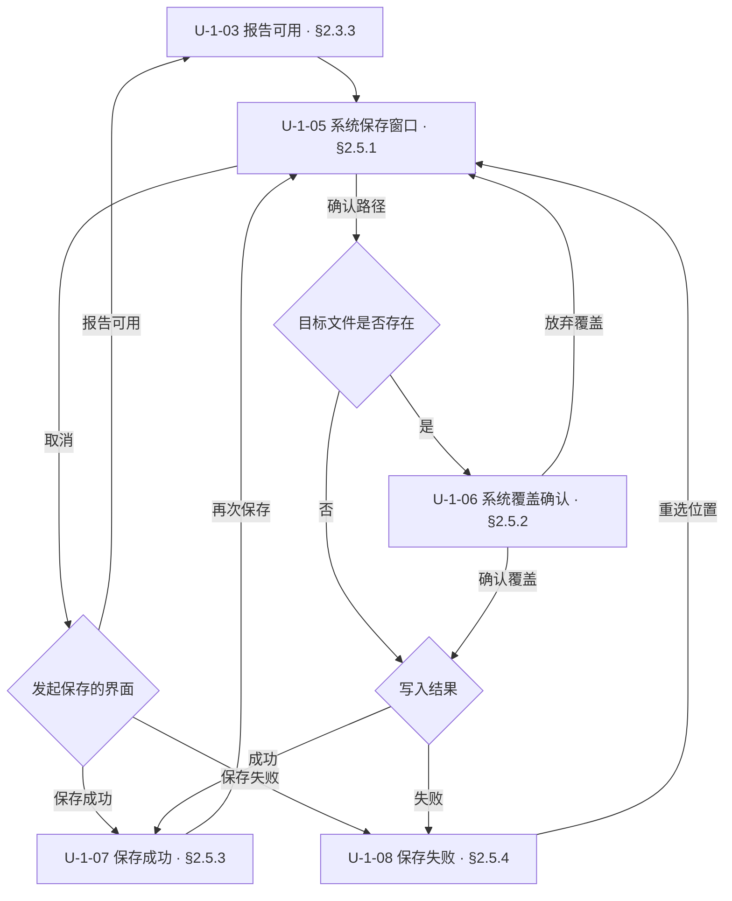
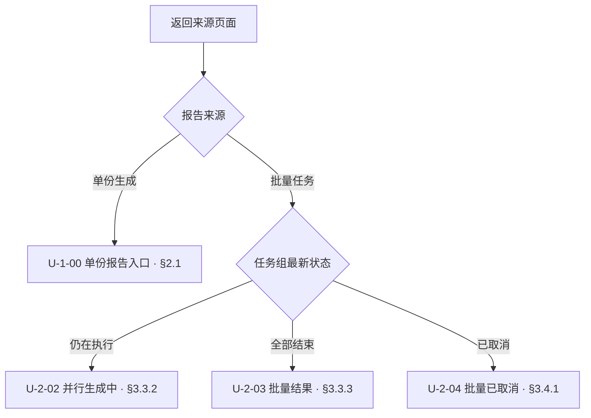
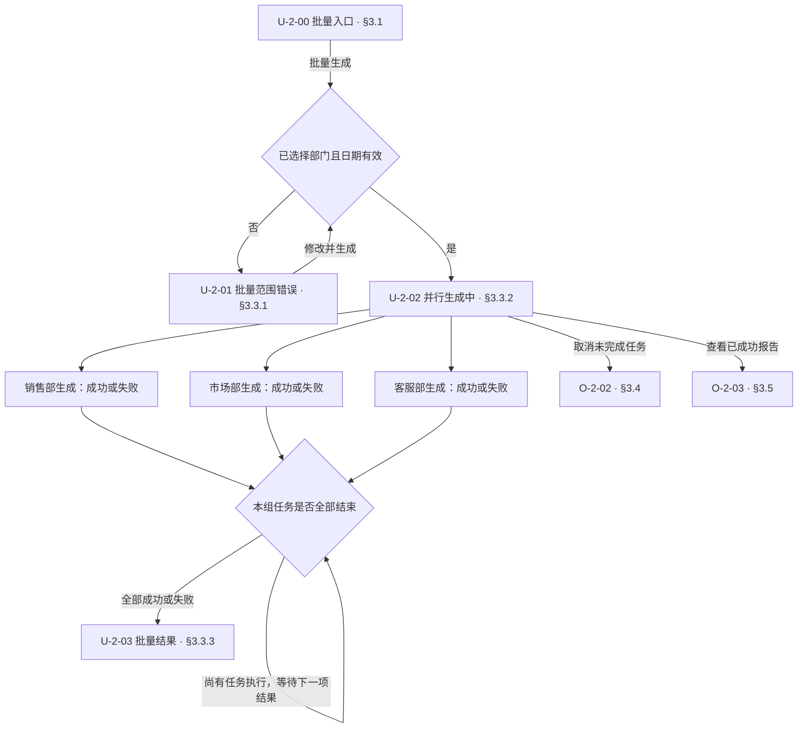
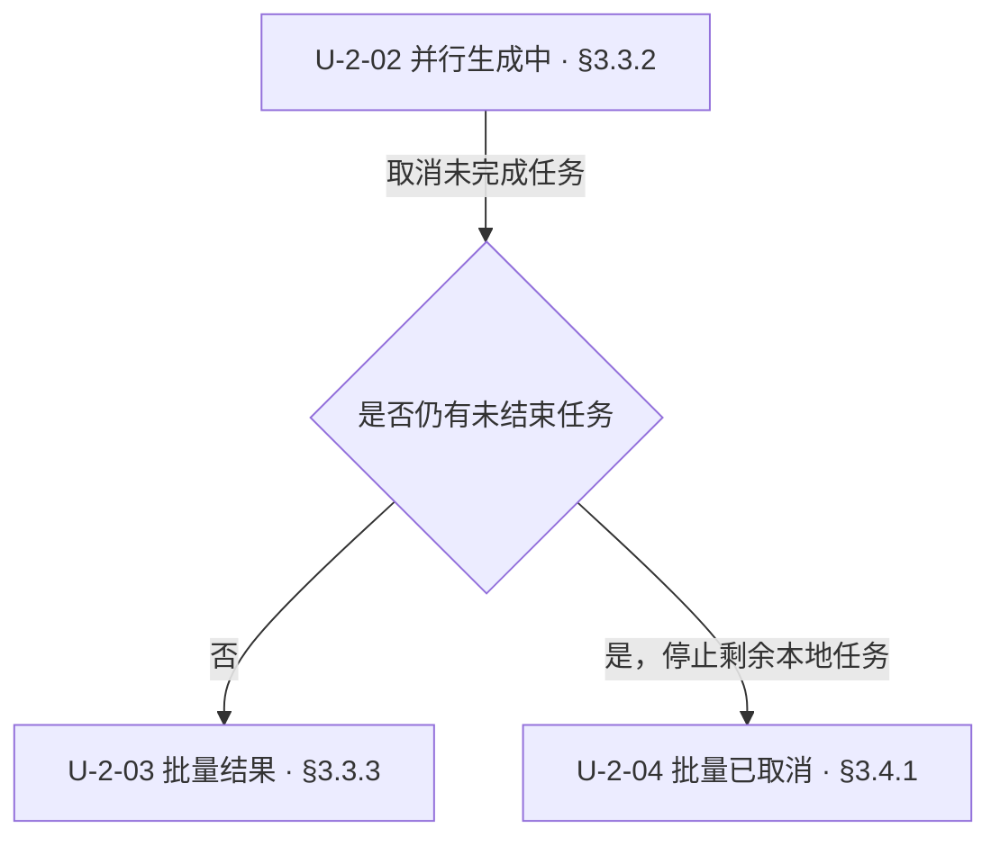
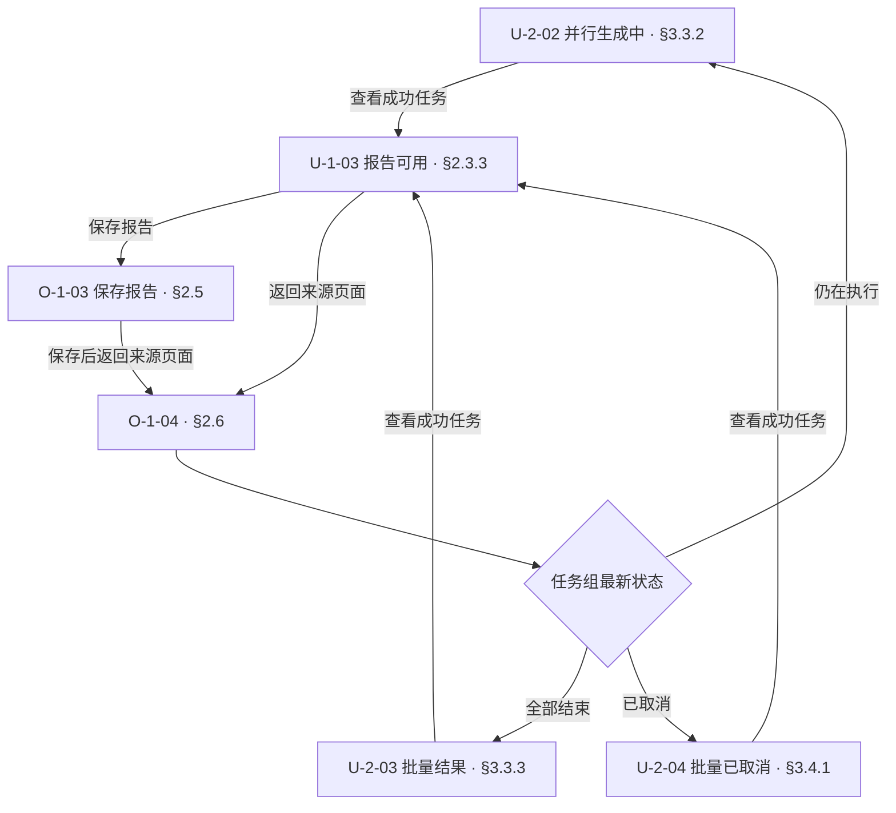
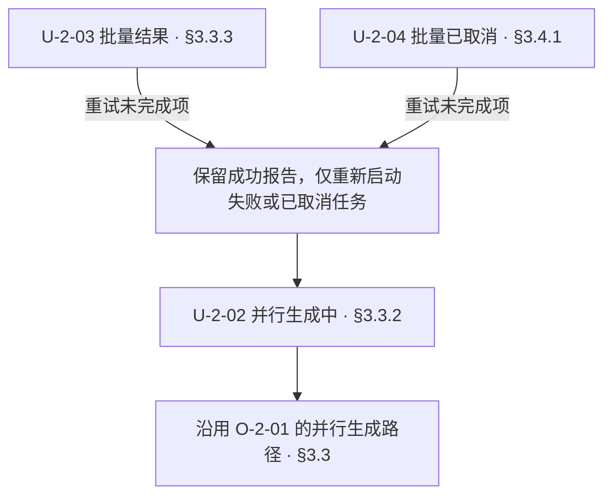

# 文档设计：interaction

## 1 文档定位

从用户视角定义产品的交互行为，使用户操作、界面与反馈能够被一致地理解、实现和验证

内部实现归对应的模块设计
使用指导归 [user-manual](user-manual.md)
交互行为的黑盒测试归 [testcase](testcase.md)

## 2 文档结构

第一个 [chapter](../../CONTEXT.md#chapter)“使用场景”汇总功能组、用户目标、入口与对应位置
后续按功能组 F 展开，按用户操作[层层深入](../../skills/references/drill-down.md)

### 2.1 功能、操作与界面

| 对象 | 含义 | 文档层级与位置 |
| --- | --- | --- |
| F 功能组 | 一组相关的用户功能 | 一个 [chapter](../../CONTEXT.md#chapter) 对应一个 F |
| O 用户操作 | 用户实际执行的动作 | F 内从第三个 [section](../../CONTEXT.md#section) 开始展开 |
| U 界面 | 用户可能遇到并操作的页面，至少覆盖全部页面范式 | 入口 U 放在 F 的第一个 [section](../../CONTEXT.md#section)，其余 U 放在对应 O 的 [subsection](../../CONTEXT.md#subsection) |

每个 F 对应的 [chapter](../../CONTEXT.md#chapter) 内，按以下[层级树](../patterns/hierarchy-tree.md#21-树)安排各个 [section](../../CONTEXT.md#section) 及其 [subsection](../../CONTEXT.md#subsection)

```text
<交互设计文档>
├─ 1 使用场景                         chapter
├─ 2 F1 <功能组>                      chapter
│  ├─ 2.1 U-1-00 <入口界面>           section
│  ├─ 2.2 操作概览                    section
│  ├─ 2.3 O-1-01 <用户操作>           section
│  │  ├─ 2.3.1 U-1-01 <界面>         subsection
│  │  └─ 2.3.2 U-1-02 <界面>         subsection
│  └─ 2.4 O-1-02 <用户操作>           section
│     └─ 2.4.1 U-1-03 <界面>         subsection
└─ 3 F2 <功能组>                      chapter
   ├─ 3.1 U-2-00 <入口界面>           section
   ├─ 3.2 操作概览                    section
   ├─ 3.3 O-2-01 <用户操作>           section
   │  └─ 3.3.1 U-2-01 <界面>         subsection
   └─ …
```

每个 F 有且只有一个入口 U，作为遍历该功能的起点
每个 F 内的第二个 [section](../../CONTEXT.md#section) 为操作概览，汇总该 F 全部 U 上的操作、发起界面与详细说明链接，包括后续结果页和失败页上的操作
已有 O 被复用时，概览引用原 O

### 2.2 编号

| 对象 | 编号 | 示例 |
| --- | --- | --- |
| 功能组 | F 加功能组号 | `F1`、`F2` |
| 用户操作 | O-功能组号-操作序号 | `O-1-01`、`O-1-02` |
| 唯一入口 | U-功能组号-00 | `U-1-00`、`U-2-00` |
| 其他界面 | U-功能组号-界面序号 | `U-1-01`、`U-1-02` |

F 按正文顺序编号
O 与非入口 U 在所属 F 内各自按首次定义的正文顺序从 `01` 连续编号
U 编号不包含 O 编号
复用时沿用已有编号

### 2.3 操作路径

每个 O 开头引用起点 U，说明用户动作与执行条件
尽可能用 [flowchart](../patterns/flowchart.md#21-流程图)统领操作路径，只有特别简单、无需展开的操作可以使用简短文字
图中页面节点标注 U 编号、名称及章节位置，并链接到对应示意
沿正常、失败、中断及恢复分支表达后续 U，重试、返回与取消路径有明确去向
多个区域同时执行时，图中表达并行路径及汇合条件

### 2.4 界面示意

以正文内的 HTML 界面示意作为主要表达方式，展示用户实际看到的布局、内容、控件与反馈
U 编号放在文档标题，设计说明、进入条件及内部处理写在示意外
操作顺序、即时反馈或动态变化难以通过静态示意表达时，附加可操作原型
飞书卡片使用[卡片示意](../patterns/lark-card-mockup.md)

局部示意标明所属 U 编号和页面内的位置，并链接到该 U
并行页面在同一张示意中展示各区域的进度、按钮状态和错误信息
错误示意展示具体错误文案及对应的处理按钮
需要用户修改内容时，标出问题位置并给出修改建议

系统原生窗口也纳入 U 的覆盖范围，例如选择目录、保存文件及授权窗口

## 3 行文步骤

1. **确定 F 与入口 U**
   - 按用户目标划分 F，按[文档结构](#2-文档结构)建立各 F 的内容
   - 绘制每个 F 的唯一入口 U，涉及角色差异时说明可用操作与权限
2. **从当前 U 展开 O**
   - 从入口 U 开始，列出用户可执行的 O，已有 O 直接引用
   - 按[操作路径](#23-操作路径)表达各 O，借助内部处理的正常、失败、中断与恢复分支找全后续 U
   - 补充图与示意未表达的权限、校验、控件启用条件，以及保存、取消、离开或重试后的保留内容
3. **展示后续 U 并继续遍历**
   - 按[界面示意](#24-界面示意)绘制后续 U，已有 U 引用原定义并说明本次差异与返回位置
   - 布局、操作方式或反馈方式有差异时补充示意，仅数据不同的同类页面使用代表性示例
   - 从后续 U 回到第 2 步继续展开，直到覆盖该 F 的全部用户操作与页面范式
4. **汇总并核对**
   - 填写场景索引与各 F 的操作概览，按[编号](#22-编号)核对 F、O、U
   - 从每个入口 U 走通全部路径，按[检查条件](#5-检查条件)核对图、正文与示意
   - 列明本轮覆盖范围，未设计内容与实现差异记入项目相应记录

## 4 示例

### 4.1 结构短例

以下节选展示登录功能的组织方式，完整文档还需覆盖该功能的其他操作与分支

```text
## 1 使用场景
  F1 登录：取得使用资格，入口为 U-1-00，链接到第 2 章
## 2 F1 登录
### 2.1 U-1-00 登录入口
  账号、密码与登录按钮的界面示意
### 2.2 操作概览
  汇总各 U 上的操作、发起界面与详细说明链接
### 2.3 O-1-01 账号密码登录
  起点 U、用户动作、条件与 flowchart
#### 2.3.1 U-1-01 提交中
  提交进度与控件状态的界面示意
#### 2.3.2 U-1-02 登录失败
  错误与重新提交操作的界面示意
### 2.4 O-1-02 再次启动软件
  flowchart 表达登录有效时进入工作台，失效时返回 U-1-00
#### 2.4.1 U-1-03 确认登录状态
  确认进度的界面示意
```

### 4.2 两个相关功能的完整文档示例

以下 Markdown 可作为独立的 interaction 文档阅读，HTML 直接放在对应 U 正文
示例范围为单份报告与批量生成，通过页面按钮在两个入口之间切换
原生保存窗口采用 Windows 范式说明

````markdown
# 部门报告工具交互设计

## 1 使用场景

| 功能组 | 用途 | 唯一入口 | 交互设计 |
| --- | --- | --- | --- |
| F1 单份报告 | 生成并保存一个部门的报告 | U-1-00，启动工具时显示 | [§2](#2-f1-单份报告) |
| F2 批量生成 | 并行生成多个部门的报告 | U-2-00，从单份入口进入 | [§3](#3-f2-批量生成) |

## 2 F1 单份报告

### 2.1 U-1-00 单份报告入口

<div style="max-width:640px;padding:20px;border:1px solid #cbd5e1;border-radius:8px;font:14px/1.6 sans-serif;background:#fff;color:#1e293b">
  <h3>生成部门报告</h3>
  <p><label>部门 <select><option>销售部</option><option>市场部</option></select></label></p>
  <p><label>开始日期 <input type="date" value="2026-09-01"></label> <label>结束日期 <input type="date" value="2026-09-30"></label></p>
  <button type="button">生成报告</button> <button type="button">批量生成</button>
</div>

部门列表仅显示当前账号有权限的部门，默认选择所属部门，日期默认本月
本例在本地生成报告，每份生成中的报告均可取消

### 2.2 操作概览

| 操作 | 发起界面 | 用途 | 详细说明 |
| --- | --- | --- | --- |
| O-1-01 生成报告 | U-1-00、U-1-01、U-1-04 | 填写范围并生成，或重试失败报告 | [§2.3](#23-o-1-01-生成报告) |
| O-1-02 取消生成 | U-1-02 | 停止当前生成并返回入口 | [§2.4](#24-o-1-02-取消生成) |
| O-1-03 保存报告 | U-1-03、U-1-07、U-1-08 | 选择保存位置并写入 PDF | [§2.5](#25-o-1-03-保存报告) |
| O-1-04 返回来源页面 | U-1-03、U-1-04、U-1-07、U-1-08 | 返回生成入口或原批量列表 | [§2.6](#26-o-1-04-返回来源页面) |
| O-1-05 切换批量生成 | U-1-00 | 进入批量入口 | [§2.7](#27-o-1-05-切换批量生成) |

### 2.3 O-1-01 生成报告

在 [U-1-00](#21-u-1-00-单份报告入口) 或 [U-1-01](#231-u-1-01-范围错误) 选择部门、填写日期并点击「生成报告」
在 [U-1-04](#234-u-1-04-生成失败) 点击「重试」，沿用原范围重新生成



起止日期均为必填，开始日期不得晚于结束日期
进入生成中后只受理一次生成，关闭工具会停止尚未完成的本地任务，再次启动显示入口并恢复上次选择范围

#### 2.3.1 U-1-01 范围错误

<div style="max-width:640px;padding:20px;border:1px solid #cbd5e1;border-radius:8px;font:14px/1.6 sans-serif;background:#fff;color:#1e293b">
  <h3>生成部门报告</h3>
  <p><label>部门 <select><option>销售部</option></select></label></p>
  <p><label>开始日期 <input type="date" value="2026-09-30"></label> <label>结束日期 <input type="date" value="2026-09-01"></label></p>
  <p role="alert" style="color:#b91c1c">开始日期不得晚于结束日期，请修改日期后重新生成</p>
  <button type="button">生成报告</button>
</div>

缺少日期时，错误显示在缺失的日期字段下，提示「请选择开始日期」或「请选择结束日期」
填写与重新生成沿用 [O-1-01](#23-o-1-01-生成报告)

#### 2.3.2 U-1-02 生成中

<div style="max-width:640px;padding:20px;border:1px solid #cbd5e1;border-radius:8px;font:14px/1.6 sans-serif;background:#fff;color:#1e293b">
  <h3>生成部门报告</h3><p>销售部 · 2026-09-01 至 2026-09-30</p>
  <p role="status">正在生成报告</p><progress value="45" max="100">45%</progress>
  <p><button type="button">取消生成</button></p>
</div>

#### 2.3.3 U-1-03 报告可用

<div style="max-width:640px;padding:20px;border:1px solid #cbd5e1;border-radius:8px;font:14px/1.6 sans-serif;background:#fff;color:#1e293b">
  <h3>报告已生成</h3><p>销售部 · 2026-09-01 至 2026-09-30 · 共 128 条记录</p>
  <button type="button">保存报告</button> <button type="button">返回来源页面</button>
</div>

从批量列表打开报告时沿用本界面，部门、日期及记录数采用对应任务结果，并保留来源列表
「保存报告」执行 [O-1-03](#25-o-1-03-保存报告)，「返回来源页面」执行 [O-1-04](#26-o-1-04-返回来源页面)

#### 2.3.4 U-1-04 生成失败

<div style="max-width:640px;padding:20px;border:1px solid #cbd5e1;border-radius:8px;font:14px/1.6 sans-serif;background:#fff;color:#1e293b">
  <h3>报告生成失败</h3><p>销售部 · 2026-09-01 至 2026-09-30</p>
  <p role="alert" style="color:#b91c1c">读取部门数据超时，请稍后重试</p>
  <button type="button">重试</button> <button type="button">返回来源页面</button>
</div>

### 2.4 O-1-02 取消生成

在 [U-1-02](#232-u-1-02-生成中) 点击「取消生成」



取消与生成结果按本地任务先确认的结果处理
取消成功后保留选择范围，在 [U-1-00](#21-u-1-00-单份报告入口) 表单下补充以下即时提示

<p role="status">已取消生成，可以修改范围后重新生成</p>

### 2.5 O-1-03 保存报告

在 [U-1-03](#233-u-1-03-报告可用)、[U-1-07](#253-u-1-07-保存成功) 或 [U-1-08](#254-u-1-08-保存失败) 点击「保存报告」



保存期间沿用发起页面，在保存按钮旁显示「正在保存」，保存与返回按钮暂时禁用
以下局部示意位于该页面的底部操作区，报告摘要沿用发起页面

<div><span role="status">正在保存</span> <button type="button" disabled>保存报告</button> <button type="button" disabled>返回来源页面</button></div>

取消窗口或写入失败均保留已生成报告，关闭工具后需重新生成才能再次保存

#### 2.5.1 U-1-05 系统保存窗口

调用 Windows 原生“另存为”窗口，初始目录采用上次成功保存目录，首次使用为当前用户的文档目录
默认文件名为「销售部-2026-09.pdf」，文件类型限定为 PDF
用户可以更改目录与文件名
目标重名时进入 [U-1-06](#252-u-1-06-系统覆盖确认)，取消另存为返回发起保存的 U
未执行窗口确认前保持原报告和目标文件不变
其他部门与日期沿用相同原生窗口范式，替换默认文件名

```text
Windows 原生“另存为”窗口
当前位置：文档
文件名：销售部-2026-09.pdf
保存类型：PDF (*.pdf)
操作：保存 / 取消
```

#### 2.5.2 U-1-06 系统覆盖确认

Windows 原生重名确认窗口显示目标文件名，用户确认覆盖才写入，放弃覆盖返回 [U-1-05](#251-u-1-05-系统保存窗口)

```text
Windows 原生覆盖确认窗口
销售部-2026-09.pdf 已存在
是否替换？
操作：是 / 否
```

#### 2.5.3 U-1-07 保存成功

<div style="max-width:640px;padding:20px;border:1px solid #cbd5e1;border-radius:8px;font:14px/1.6 sans-serif;background:#fff;color:#1e293b">
  <h3>报告已保存</h3><p>销售部 · 2026-09-01 至 2026-09-30</p>
  <p role="status">已保存到 C:/Reports/销售部-2026-09.pdf</p>
  <button type="button">保存报告</button> <button type="button">返回来源页面</button>
</div>

#### 2.5.4 U-1-08 保存失败

<div style="max-width:640px;padding:20px;border:1px solid #cbd5e1;border-radius:8px;font:14px/1.6 sans-serif;background:#fff;color:#1e293b">
  <h3>报告保存失败</h3><p>销售部 · 2026-09-01 至 2026-09-30</p>
  <p role="alert" style="color:#b91c1c">所选目录无法写入，请重新选择保存位置</p>
  <button type="button">保存报告</button> <button type="button">返回来源页面</button>
</div>

### 2.6 O-1-04 返回来源页面

在 [U-1-03](#233-u-1-03-报告可用)、[U-1-04](#234-u-1-04-生成失败)、[U-1-07](#253-u-1-07-保存成功) 或 [U-1-08](#254-u-1-08-保存失败) 点击「返回来源页面」



单份入口保留上次选择范围，批量列表显示任务最新状态并恢复原选中任务

### 2.7 O-1-05 切换批量生成

在 [U-1-00](#21-u-1-00-单份报告入口) 点击「批量生成」，进入 [U-2-00](#31-u-2-00-批量生成入口)，沿用当前日期范围

## 3 F2 批量生成

### 3.1 U-2-00 批量生成入口

<div style="max-width:640px;padding:20px;border:1px solid #cbd5e1;border-radius:8px;font:14px/1.6 sans-serif;background:#fff;color:#1e293b">
  <h3>批量生成部门报告</h3>
  <p><label><input type="checkbox" checked>销售部</label> <label><input type="checkbox" checked>市场部</label> <label><input type="checkbox" checked>客服部</label></p>
  <p><label>开始日期 <input type="date" value="2026-09-01"></label> <label>结束日期 <input type="date" value="2026-09-30"></label></p>
  <button type="button">批量生成</button> <button type="button">单份报告</button>
</div>

部门范围沿用 [U-1-00](#21-u-1-00-单份报告入口) 的权限约束
从单份入口首次进入时勾选该入口已选部门，示意展示用户已选择三个部门的同一页面范式

### 3.2 操作概览

| 操作 | 发起界面 | 用途 | 详细说明 |
| --- | --- | --- | --- |
| O-2-01 批量生成 | U-2-00、U-2-01 | 选择部门与日期并启动任务组 | [§3.3](#33-o-2-01-批量生成) |
| O-2-02 取消未完成任务 | U-2-02 | 保留已有结果，停止其余任务 | [§3.4](#34-o-2-02-取消未完成任务) |
| O-2-03 查看报告 | U-2-02、U-2-03、U-2-04 | 查看已成功任务的报告 | [§3.5](#35-o-2-03-查看报告) |
| O-2-04 重试未完成项 | U-2-03、U-2-04 | 重试失败或取消的任务 | [§3.6](#36-o-2-04-重试未完成项) |
| O-2-05 返回选择 | U-2-03、U-2-04 | 返回批量入口调整选择 | [§3.7](#37-o-2-05-返回选择) |
| O-2-06 切换单份报告 | U-2-00 | 返回单份入口 | [§3.8](#38-o-2-06-切换单份报告) |
| 复用 O-1-03 保存报告 | U-1-03、U-1-07、U-1-08 | 保存从列表打开的报告 | [§2.5](#25-o-1-03-保存报告) |
| 复用 O-1-04 返回来源页面 | U-1-03、U-1-07、U-1-08 | 回到原批量列表 | [§2.6](#26-o-1-04-返回来源页面) |

### 3.3 O-2-01 批量生成

在 [U-2-00](#31-u-2-00-批量生成入口) 或 [U-2-01](#331-u-2-01-批量范围错误) 勾选部门、填写日期并点击「批量生成」



日期校验沿用 [O-1-01](#23-o-1-01-生成报告)，至少选择一个部门
每个选中部门对应一个任务，进度独立更新，一项失败后其他任务继续执行
本例三个任务可同时生成，百分比与完成顺序变化沿用同一并行页面范式
关闭工具会停止未完成的本地任务，已保存文件保留，尚未保存的报告与任务列表在退出后清除

#### 3.3.1 U-2-01 批量范围错误

<div style="max-width:640px;padding:20px;border:1px solid #cbd5e1;border-radius:8px;font:14px/1.6 sans-serif;background:#fff;color:#1e293b">
  <h3>批量生成部门报告</h3>
  <p><label><input type="checkbox">销售部</label> <label><input type="checkbox">市场部</label> <label><input type="checkbox">客服部</label></p>
  <p role="alert" style="color:#b91c1c">请至少选择一个部门</p>
  <p><label>开始日期 <input type="date" value="2026-09-01"></label> <label>结束日期 <input type="date" value="2026-09-30"></label></p>
  <button type="button">批量生成</button>
</div>

日期错误在对应日期字段下采用 [U-1-01](#231-u-1-01-范围错误) 的提示方式，选择部门与修正日期均归入 [O-2-01](#33-o-2-01-批量生成)

#### 3.3.2 U-2-02 并行生成中

<div style="max-width:640px;padding:20px;border:1px solid #cbd5e1;border-radius:8px;font:14px/1.6 sans-serif;background:#fff;color:#1e293b">
  <h3>批量生成部门报告</h3><p role="status">已结束 1 / 3 · 2026-09-01 至 2026-09-30</p>
  <ul>
    <li>销售部：已生成 <button type="button">查看报告</button></li>
    <li>市场部：生成中 <progress value="60" max="100">60%</progress></li>
    <li>客服部：生成中 <progress value="20" max="100">20%</progress></li>
  </ul>
  <button type="button">取消未完成任务</button>
</div>

任务失败时，在该行展示 [U-2-03](#333-u-2-03-批量结果) 的失败摘要，其他进度区域保持显示
仅成功任务提供「查看报告」；全部任务结束后才提供重试与返回选择

#### 3.3.3 U-2-03 批量结果

<div style="max-width:640px;padding:20px;border:1px solid #cbd5e1;border-radius:8px;font:14px/1.6 sans-serif;background:#fff;color:#1e293b">
  <h3>批量生成结束</h3><p>成功 2 项，失败 1 项 · 2026-09-01 至 2026-09-30</p>
  <ul>
    <li>销售部：已生成 <button type="button">查看报告</button></li>
    <li style="color:#b91c1c">市场部：读取数据超时，可重试</li>
    <li>客服部：已生成 <button type="button">查看报告</button></li>
  </ul>
  <button type="button">重试未完成项</button> <button type="button">返回选择</button>
</div>

全部成功时，各行均显示查看操作，隐藏「重试未完成项」；全部失败时，各行均显示失败摘要，保留重试与返回操作
失败任务使用与 [U-1-04](#234-u-1-04-生成失败) 相同的错误事实，按部门汇总到所在任务行

### 3.4 O-2-02 取消未完成任务

在 [U-2-02](#332-u-2-02-并行生成中) 点击「取消未完成任务」



已确认成功或失败的任务保留原结果，其余任务标为已取消

#### 3.4.1 U-2-04 批量已取消

<div style="max-width:640px;padding:20px;border:1px solid #cbd5e1;border-radius:8px;font:14px/1.6 sans-serif;background:#fff;color:#1e293b">
  <h3>已取消未完成任务</h3><p>保留已生成报告 · 2026-09-01 至 2026-09-30</p>
  <ul>
    <li>销售部：已生成 <button type="button">查看报告</button></li>
    <li>市场部：已取消</li><li>客服部：已取消</li>
  </ul>
  <button type="button">重试未完成项</button> <button type="button">返回选择</button>
</div>

已失败任务继续展示 [U-2-03](#333-u-2-03-批量结果) 的失败摘要

### 3.5 O-2-03 查看报告

在 [U-2-02](#332-u-2-02-并行生成中)、[U-2-03](#333-u-2-03-批量结果) 或 [U-2-04](#341-u-2-04-批量已取消) 点击成功任务行的「查看报告」



报告与保存界面复用 F1 的定义，显示当前部门的报告数据，记录来源任务组及任务行
查看和保存报告期间，其余批量任务继续执行，返回时按最新结果显示对应列表 U

### 3.6 O-2-04 重试未完成项

在 [U-2-03](#333-u-2-03-批量结果) 或 [U-2-04](#341-u-2-04-批量已取消) 点击「重试未完成项」



### 3.7 O-2-05 返回选择

在 [U-2-03](#333-u-2-03-批量结果) 或 [U-2-04](#341-u-2-04-批量已取消) 点击「返回选择」，回到 [U-2-00](#31-u-2-00-批量生成入口)，保留部门与日期
再次生成时创建新任务组并替换旧列表，已保存文件保留

### 3.8 O-2-06 切换单份报告

在 [U-2-00](#31-u-2-00-批量生成入口) 点击「单份报告」，回到 [U-1-00](#21-u-1-00-单份报告入口)，恢复上次单份选择，首次使用时采用入口默认值
````

## 5 检查条件

- [ ] 场景索引覆盖本轮全部 F，用户目标、入口与对应章节可定位
- [ ] 每个 F 有且只有一个入口 U，编号为 U-功能组号-00，位于第一个 [section](../../CONTEXT.md#section)
- [ ] 第二个 [section](../../CONTEXT.md#section) 为操作概览，汇总全部 U 上的 O，并链接到操作说明
- [ ] F、O 与 U 分别按 [chapter](../../CONTEXT.md#chapter)、[section](../../CONTEXT.md#section) 与 [subsection](../../CONTEXT.md#subsection) 组织，入口 U 按规定放在第一个 [section](../../CONTEXT.md#section)
- [ ] O 以用户实际动作划分，自动处理归入触发它的 O
- [ ] 从入口 U 沿 U → O → U 能遍历当前范围的全部操作和页面范式
- [ ] 内部状态与分支已用于找全 U，正常、失败、中断与恢复路径的去向明确
- [ ] O 尽可能使用 flowchart，省略图的操作特别简单且路径明确
- [ ] 图中页面节点的 U 编号、名称、章节位置及链接与正文对应
- [ ] O 的起点、用户动作、执行条件与后续 U 明确，各 U 上的操作均有对应 O 或引用
- [ ] F、O 与非入口 U 按正文顺序独立连续编号，U 编号不包含 O 编号
- [ ] 共用 O、U 与规则只有一处定义，引用保留当前上下文、差异与返回位置
- [ ] 用户页面至少覆盖全部范式，局部示意能够定位所在页面与区域
- [ ] 示意展示真实内容、控件与反馈，设计说明位于示意外
- [ ] 错误摘要、定位明细、修改建议与恢复操作符合当前用户任务
- [ ] 并行路径、汇合条件、各区域进度、部分失败与可用操作一致
- [ ] 用户操作涉及的系统原生窗口已纳入 U 与操作路径
- [ ] 权限、校验与控件启用条件完整，保存、取消、离开及重试的结果与保留内容明确
- [ ] 整篇文档的索引、概览、流程图、示意及跨文档引用已同步，无重复或悬空编号
- [ ] 本轮交互设计覆盖范围明确，未设计内容与实现差异有对应记录
