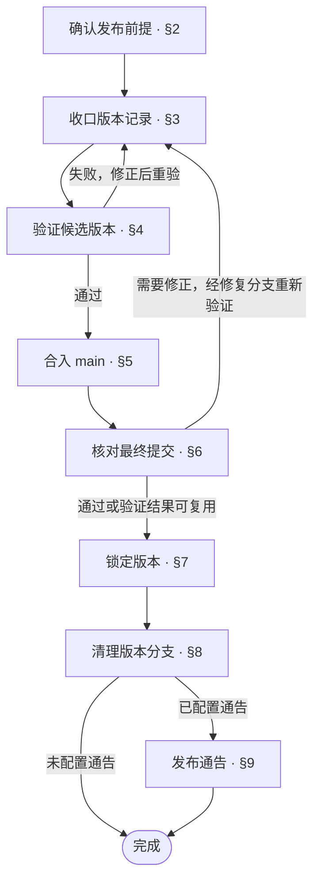

# 文档设计：release

## 1 文档定位

定义本仓库从发布前验证到合入 main、锁定 Tag 的完整流程，包括每一步的执行方式、通过条件、失败处理与恢复位置
同仓交付的各部分使用同一个仓库版本，统一定义发布流程

## 2 文档结构

第一个 [chapter](../../CONTEXT.md#chapter) 用 [flowchart](../patterns/flowchart.md#21-流程图) 展示发布流程，节点引用对应阶段
后续按阶段展开，可以各用一个 [chapter](../../CONTEXT.md#chapter)
阶段较少时，可以合并在一个 [chapter](../../CONTEXT.md#chapter) 内，用 [section](../../CONTEXT.md#section) 分开
每个阶段说明执行方式、通过条件、失败处理与恢复位置
复杂阶段按实际内容[层层深入](../../skills/references/drill-down.md)

发布前提作为需要核对的阶段，说明版本来源、版本记录、合并链及执行条件
验证步骤按仓库需要安排，包括测试、构建、真实平台验证及其他必要操作，可统一执行全量验证，或按改动突破的设计边界与依赖范围分级定义
发布摘要归入锁定 Tag 的阶段
分支清理按仓库策略安排，范围为本次已合并且不再承担后续工作的分支
发布通告按需安排

以下[层级树](../patterns/hierarchy-tree.md#21-树)展示阶段分别成章的组织示例，具体阶段按仓库流程确定

```text
<发布文档>
├─ 1 发布流程                         chapter
├─ 2 确认发布前提                     chapter
├─ 3 收口版本记录                     chapter
├─ 4 验证候选版本                     chapter
├─ 5 合入 main                        chapter
├─ 6 核对最终提交                     chapter
├─ 7 锁定版本                         chapter
├─ 8 清理版本分支                     chapter
└─ 9 发布通告                         chapter，按需
```

## 3 行文步骤

1. **确定发布输入**
   - 确定版本来源、版本记录、合并链与目标 Tag
   - 定位执行所需的环境、权限、工具与外部依赖
2. **编排阶段与验证**
   - 按依赖关系安排前提核对、版本记录收口、验证与合并，绘制流程总图
   - 定义各阶段的操作、通过条件与失败后的恢复位置
   - 按改动影响分级验证时，定义对应测试集、升级为全量验证的条件及定期兜底
   - 验证涉及真实平台或模型评测时，定义所需环境、数据与结果判定
   - 最终核验按已有结果的复用条件判断是否重验，验证结果关联最终提交
3. **定义版本固化与后续处理**
   - 定义最终版本记录核对、发布摘要的来源、格式与校验方式
   - 在已验证的 main 提交上创建 annotated Tag，推送后核对远端指向与注解
   - Tag 创建后不移动、不重建，推送失败只重推，同名 Tag 冲突时停止
   - 按仓库策略安排本次已合并分支的清理
   - 需要通告时，定义从 Tag 注解提取内容的方式、渠道、发送结果核对与失败重发
     使用飞书卡片时按[卡片示意](../patterns/lark-card-mockup.md)绘制
4. **组织正文并核对**
   - 按[文档结构](#2-文档结构)展开各阶段，核对前后步骤与失败恢复路径
   - 按[检查条件](#5-检查条件)核对版本、Tag、最终提交与验证结果

## 4 示例

````markdown
# 报告服务发布

## 1 发布流程



## 2 确认发布前提

核对以下条件，未满足的条件补齐后继续

| 内容 | 本版要求 |
| --- | --- |
| 版本来源 | VERSION，本次为 2.0.0 |
| 版本记录 | CHANGELOG 本版定版段 |
| 一致性要求 | VERSION、pyproject.toml 与目标 Tag 版本一致 |
| 合并链 | feature/report-export-v2.0.0 → main，通过 Pull Request 合并 |
| Tag | v2.0.0，annotated Tag |
| 执行环境 | Bash、Git、项目 Python 环境与容器构建工具 |
| 仓库权限 | 提交版本记录、合并 Pull Request 与推送 Tag |
| 验证环境 | 独立测试数据库与对象存储，使用[测试夹具](testcase.md#1-夹具)中定义的隔离资源 |

`scripts/release-verify.sh` 执行单元测试、数据库迁移测试、镜像构建及对象存储上传与下载验证
验证结果关联源码提交、验证输入、各项结果与镜像摘要，任一检查失败时返回非零退出码
验证后清理本次测试数据

## 3 收口版本记录

1. 将 VERSION 与 pyproject.toml 的项目版本更新为 2.0.0，收口 CHANGELOG 本版定版段并提交
2. 运行 `bash scripts/check-version.sh 2.0.0`
   - 返回 0 且工作区干净：进入[候选验证](#4-验证候选版本)
   - 校验失败：修正版本记录并提交后重新校验

## 4 验证候选版本

1. 运行 `bash scripts/release-verify.sh`
2. 核对执行结果
   - 全部通过，结果关联当前候选提交：进入[合入 main](#5-合入-main)
   - 验证失败：修正后重新执行本阶段
   - 测试数据清理失败：先清理本次数据，再重新验证

## 5 合入 main

1. 创建或更新 Pull Request，完成分支保护要求的审查与检查，再合入 main
   - 需要解决冲突或修改内容：经[候选验证](#4-验证候选版本)后更新 Pull Request
   - Pull Request 尚未合并：停在本阶段
   - Pull Request 已合并：继续[最终核验](#6-核对最终提交)
2. 恢复执行时先核对合并状态，已合并的 Pull Request 沿用其合并结果

## 6 核对最终提交

1. 执行 `git fetch origin`，切换 main 并通过 `git pull --ff-only origin main` 同步
2. 核对本地与远端 main 一致，工作区干净，运行 `bash scripts/check-version.sh 2.0.0` 通过
3. 核对[候选验证](#4-验证候选版本)的结果是否适用于当前 main
   - 被测内容、测试、夹具、配置、工具链与依赖环境一致，且验证不依赖变化的提交元数据：复用已有结果，并关联当前 main 提交
   - 复用条件不满足：在当前 main 上运行 `bash scripts/release-verify.sh`
4. 必需核对与验证均通过后，进入[锁定版本](#7-锁定版本)
   核对或验证未通过时，停在本阶段处理失败原因并重验
   需要修正内容时，经修复分支验证并合入 main 后，重新执行本阶段

仅提交号变化时仍需核对上述验证条件，源码内容可用 `git diff --exit-code <候选提交> HEAD` 比较

## 7 锁定版本

1. 从 CHANGELOG 本版定版段生成仓库外的摘要文件，按[摘要校验工具](../../bin/aca-tag-notify-check)校验格式
   摘要末条采用[最终核验](#6-核对最终提交)的验证结果
   校验失败时，修正摘要并重新校验后继续

   ```text
   v2.0.0：报告导出

   ---NOTIFY-BEGIN---
   📄 报告 · 支持导出并下载业务报告
   ✅ 验证 · 单元测试、迁移测试、镜像构建与对象存储验证通过
   ---NOTIFY-END---
   ```

2. 再次同步远端，确认 main 仍指向已验证提交，核对本地与远端目标 Tag
   - 本地与远端均无目标 Tag：使用 `git tag -a v2.0.0 <已验证的main提交> -F /tmp/report-service-v2.0.0.md` 创建 Tag，再执行 `git push origin v2.0.0`
   - main 已变化：回到[最终核验](#6-核对最终提交)
   - Tag 已存在且指向与注解匹配：沿用已有 Tag，远端尚无该 Tag 时补推送
   - 同名 Tag 的指向或注解不匹配：停止并报告冲突
3. 核对远端为 annotated Tag，指向已验证的 main 提交，注解包含本版摘要

## 8 清理版本分支

1. 核对远端 Tag 已通过验证，确认本次版本分支已经合入 main，且不再承担后续工作
2. 按本仓库策略清理该版本分支
   - 满足清理条件：删除本次已合并的本地与远端版本分支
   - 仍承担后续工作或无法确认合并情况：保留该分支
   - 清理失败：保留已固化的 Tag，修复清理问题后继续本阶段

## 9 发布通告

远端 v* Tag 推送触发通告流水线，使用[通告提取工具](../../bin/aca-tag-notify-extract)从 Tag 注解提取内容，发送到研发发布群
机器人凭据来源与泄露处置见[发布机器人](security.md#3-发布机器人)

核对通告任务的实际发送结果
凭据缺失或发送失败时，补齐凭据或修复故障后，使用同一 Tag 重跑通告任务
````

## 5 检查条件

- [ ] 总图与对应阶段一致，发布前提包含版本来源、版本记录、合并链、目标 Tag 与执行条件
- [ ] 流程覆盖本仓库从发布前验证到合入 main、锁定 Tag 的全部必要操作
- [ ] 每个阶段有执行方式、通过条件、失败处理与恢复位置
- [ ] 验证环境、命令与结果判定已定义，已有结果按复用条件核对并关联最终提交
- [ ] 如采用分级验证，不同影响范围对应的测试集、升级为全量验证的条件及全量验证的兜底方式已定义
- [ ] 各阶段的前提与结果能够衔接，恢复执行有明确位置
- [ ] 版本记录一致，摘要来源、格式与校验方式已定义
- [ ] 远端 annotated Tag 指向已验证的 main 最终提交，版本、提交与验证结果可追溯
- [ ] Tag 不移动、不重建，推送失败只重推，同名 Tag 的指向或注解冲突时停止
- [ ] 如配置分支清理，范围限定为本次已合并且不再承担后续工作的分支
- [ ] 如配置通告，触发、内容提取、渠道、凭据来源、发送结果核对与失败重发方式明确
- [ ] 清理或通告失败时，继续对应阶段并沿用已固化版本
