# 流程图（Flowchart）

## 1 适用场景

子模块或单模块内部有分支与循环的流程表达
按明确规则执行的流程用[流程图](#21-流程图)表达
包含模型判断或自主执行的流程添加[执行主体标记](#22-执行主体标记)

无分支、无循环的固定步骤使用编号列表
侧重多个参与方之间的协作时，使用[时序图](sequence-diagram.md)

## 2 表达原则

| 内容 | 必需条件 | 表达规则 |
| --- | --- | --- |
| 流程图 | 始终必需 | [§2.1](#21-流程图) |
| 执行主体标记 | 包含 LLM／Agent 的流程时必需 | [§2.2](#22-执行主体标记) |

### 2.1 流程图

流程图统领所在章节，需要展开的节点引用对应子章节，不另编步骤序号

- 使用 Mermaid `flowchart TD`，语法遵循[官方流程图文档](https://mermaid.ai/open-source/syntax/flowchart.html)
- 按阶段性的业务目的划分并命名节点，不按具体操作拆分
- 子章节按执行顺序列明具体步骤，明确判断条件，不复述图中路径

### 2.2 执行主体标记

包含 LLM／Agent 的流程遵循 [§2.1](#21-流程图)，每个步骤节点在名称前带执行主体标记

| 标记 | 执行主体 | 含义 |
| --- | --- | --- |
| ⚙️ | 程序 | 按既定规则执行 |
| 🧠 | LLM | 单次模型调用 |
| 🤖 | Agent | 围绕目标自主组织执行过程 |
| 👤 | 人工 | 由人判断或执行 |

## 3 示例

### 3.1 购物结算

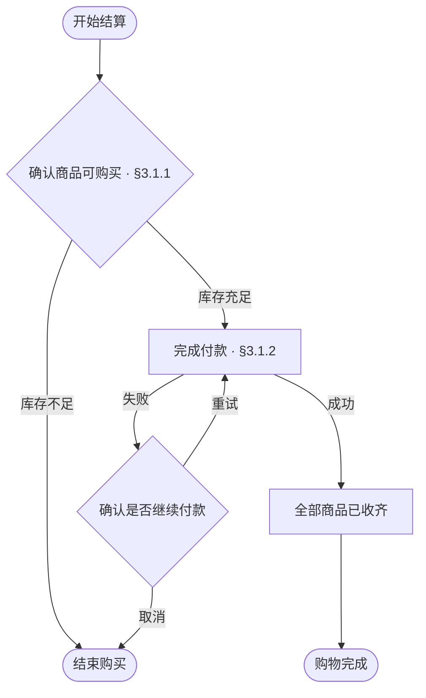

#### 3.1.1 确认商品可购买

1. 按商品及规格查询可用库存
2. 任一项无记录或库存少于购买数量，走「库存不足」分支
3. 全部满足购买数量，走「库存充足」分支

#### 3.1.2 完成付款

1. 确认含运费、扣除优惠后的应付总额
2. 重试前核实上次付款结果：已成功则走「成功」分支，结果未定则等待确认
3. 首次付款或确认上次失败后，按应付总额发起付款
4. 根据确定的付款结果，走「成功」或「失败」分支

### 3.2 订单咨询

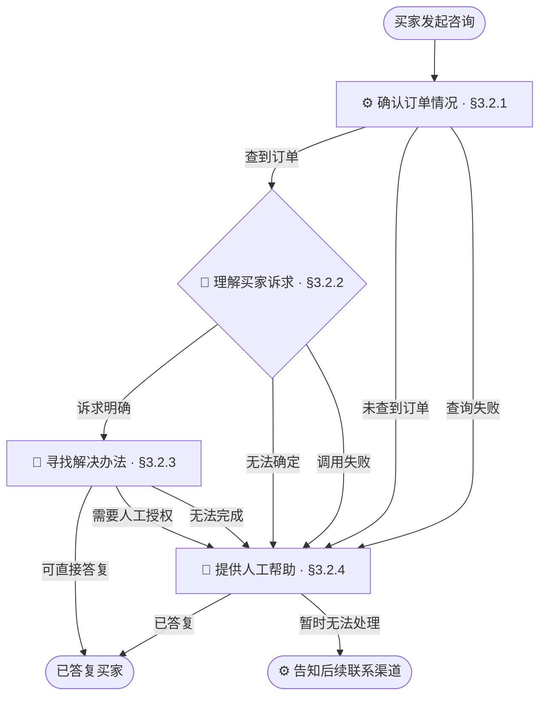

#### 3.2.1 确认订单情况

1. 获取买家选定的订单
2. 未选择订单、订单不存在或无权查看，走「未查到订单」分支
3. 查询商品、付款与物流状态，查询失败走「查询失败」分支
4. 隐去完整地址与电话号码，走「查到订单」分支

#### 3.2.2 理解买家诉求

1. 将买家描述与订单情况交给 LLM，提取咨询对象和期望结果
2. 对象与期望结果明确，且不依赖猜测，走「诉求明确」分支
3. 信息缺失、相互矛盾或输出不符合要求，走「无法确定」分支
4. 模型调用失败，走「调用失败」分支

#### 3.2.3 寻找解决办法

1. 根据诉求查阅商品说明、物流记录或售后规则
2. 仅需解释或建议且资料足以支持答复时，附上依据答复买家，走「可直接答复」分支
3. 涉及退款或补偿授权，走「需要人工授权」分支
4. 资料不足、相互矛盾或执行失败，走「无法完成」分支

#### 3.2.4 提供人工帮助

1. 阅读已有诉求与查询记录，仅向买家补问缺失信息
2. 涉及退款或补偿时，核对授权额度，记录处理人、金额与理由
3. 在授权范围内完成处理并答复买家，走「已答复」分支
4. 无人接入、超出权限或暂时无法处理，走「暂时无法处理」分支

## 4 检查条件

### 4.1 固定步骤画成流程图

- [ ] 无分支、无循环的固定步骤用编号列表，不使用流程图

**反例**

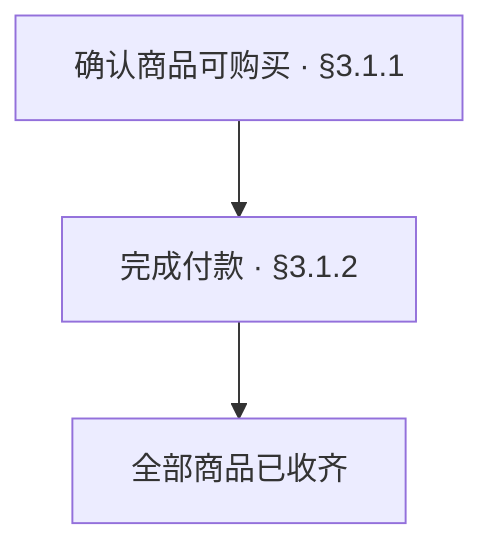

### 4.2 按具体操作拆分节点

- [ ] 节点按阶段性的业务目的划分并命名，不把阶段内部操作逐个画成节点

**反例**

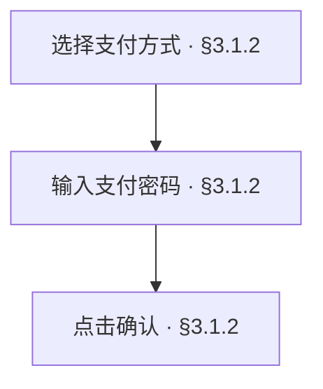

这些操作共同服务于「完成付款」，应在该阶段的子章节展开

### 4.3 额外编排步骤序号

- [ ] 节点不另编步骤序号

**反例**

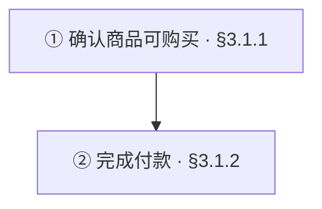

### 4.4 章节引用失配

- [ ] 需要展开的节点有章节引用，引用的子章节存在且内容与节点含义一致

**反例**

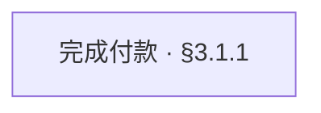

§3.1.1 说明库存核对，付款实际在 §3.1.2 展开

### 4.5 分支条件不明确

- [ ] 存在分支的节点，其各分支条件明确

**反例**

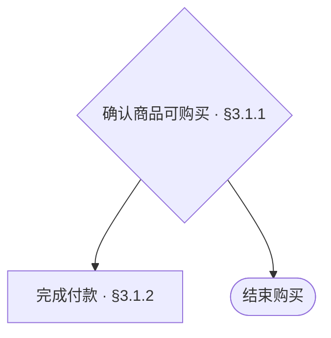

### 4.6 路径意外断流

- [ ] 非终止节点都有后续路径

**反例**

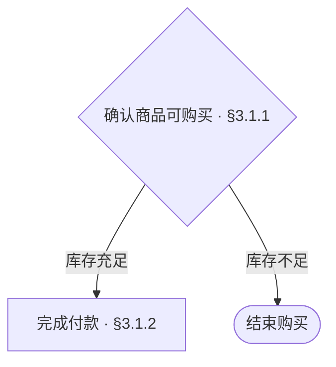

「完成付款」之后没有结果或去向

### 4.7 循环缺少返回位置或退出条件

- [ ] 循环与重试的返回位置、退出条件明确

**反例**

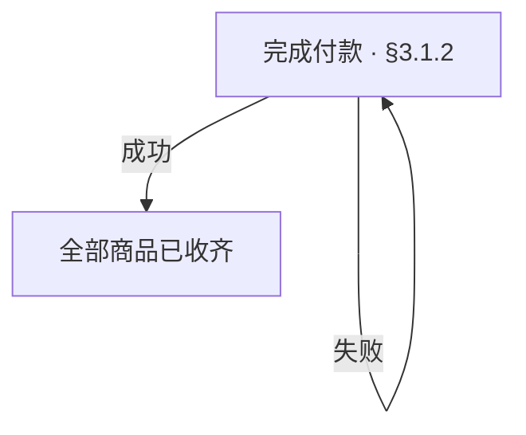

失败会无限重试，没有退出条件

### 4.8 执行主体标记失配

- [ ] 包含 LLM／Agent 的流程中，步骤节点标记与实际执行主体一致

**反例**

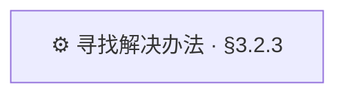

§3.2.3 由 Agent 自主检索，应标为 🤖

### 4.9 未使用自上而下的流程图

- [ ] 使用 Mermaid `flowchart TD`

**反例**

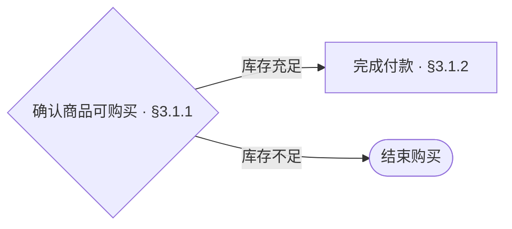

`LR` 为从左到右，应使用 `TD`

### 4.10 文字复述了图已表达的内容

- [ ] 子章节补充具体步骤与判断条件，不复述图中路径

**反例**

> 有货则付款，无货则结束

没有说明如何判定库存是否充足
