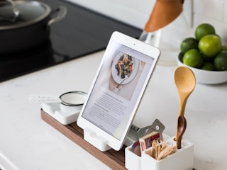
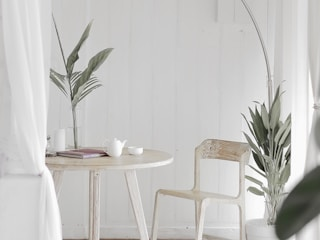

# 飞书卡片示意（Lark Card Mockup）

## 1 适用场景

设计文档中飞书卡片的外观与交互表达
使用 HTML 模拟真实场景展示卡片示意，以指导卡片 JSON 的实现

## 2 整体表达原则

覆盖所有用户能看到的场景与状态，每种状态都展示完整的[卡片示意](../../CONTEXT.md#card-mockup)
卡片示意尽可能贴近实际场景中的视觉与交互效果
尽可能用卡片示意充分表达信息，凡是能用卡片示意表达的信息，不再用解释性文字描述
动态内容使用符合当前场景与状态的具体示例值，极端情况可适当妥协或补充新的卡片示意

私聊文案面向收信人，群聊文案明确需要谁行动
文案语气友好，照顾收信人的感受，用贴近业务的表达说清事实与用户要做的事

## 3 卡片示意的整体表达

### 3.1 画布

根节点使用 `class="card-mockup"`
卡片宽度随宿主可用宽度自适应，充分使用可用空间
根据使用环境确定最小支持宽度，布局在该宽度下仍应完整可用
外框白底，1px `#dee0e3` 边框，8px 圆角，正文 14px，行高 1.6

### 3.2 长内容与分页

**不分页的场景**

完整内容同时满足以下[容量限制](../../SSOT.md#7-平台与工具)
- 卡片消息体不超过 30 KB
- 元素与组件合计不超过 200 个

确认卡片
- 确认明细超出容量时，每项只保留识别对象的字段
- 精简字段后仍超出容量时，展示可容纳的前几项与最后一项，中间用省略号
- 未全部列出时，末尾写明总数

商品资料导入 · ⏳ 待确认

文件

栗子商城商品资料.xlsx

序号

商品编号

商品名称

1

<code>A3K9F2</code>

栗子礼盒

2

<code>B7M2Q8</code>

榛子礼盒

3

<code>C4P6R1</code>

开心果礼盒

……

200

<code>Z8N5T3</code>

腰果礼盒

共 200 条商品资料

✅ 确认导入
🚫 取消

表单卡片
- 超出容量时，保留必要字段，减少非必要说明
- 必要字段仍超出容量时，调整填写流程

跟进任务 · ⏳ 待填写

<form name="form_followup_task" style="padding:10px 12px">

任务名称 *

回访栗子礼盒的差评用户

负责人 *

请选择负责人 ▾

✅ 创建任务
🚫 取消

</form>

极端超长内容
- 非关键内容使用摘要，在容量内单张展示
- 摘要保留识别对象、判断状态与操作所需的信息

售后沟通 · ✅ 已整理

订单

<code>A3K9F2</code>

📝 沟通摘要

客户收到的礼盒破损，要求更换

已同意免费补发，客户无需退回原礼盒

⚡ 下一步

今天 18:00 前寄出补发礼盒

<a class="card-button button-default button-open-url" href="https://example.com/orders/A3K9F2/communications" style="display:inline-block;padding:4px 12px;border:1px solid #dee0e3;border-radius:6px;color:#1f2329;text-decoration:none">📜 查看完整沟通记录</a>

**分页的方法**

私聊翻页更新原卡片
群聊翻页默认更新原卡片，可见卡片的成员共同查看当前页并可翻页
需要各自独立浏览时，向点击人私聊发送引用同一结果的浏览卡，群聊原卡保持不变
私聊浏览卡只保留浏览与翻页操作，业务确认、取消与提交仍在原卡执行
翻页不改变原卡归属与业务操作权限
具体设计写明群聊卡片采用的翻页方式

标题与总数在每页保留
翻页只切换明细
嵌套列表或超长记录跨页时，续页保留所属对象的标识与标题
任务进度变化需要刷新分页内容时，保留当前页首个展示单元所在的阅读位置
重新分页与定位按[卡片映射](../../skills/references/lark-card-mapping.md#32-长内容与分页)执行

页尾用分割线隔出独立翻页区域
翻页区域包含当前展示范围、总数与翻页按钮
非首页显示「⬅️ 上一页」
有后续内容时显示「➡️ 下一页」

商品资料查询

📦 坚果礼盒系列（续）

序号

商品编号

商品名称

27

<code>P00027</code>

栗子礼盒 1kg

28

<code>P00028</code>

榛子礼盒 1kg

29

<code>P00029</code>

开心果礼盒 1kg

📦 果干礼盒系列

序号

商品编号

商品名称

30

<code>P00030</code>

葡萄干礼盒 250g

31

<code>P00031</code>

蔓越莓礼盒 250g

第 27～31 条，共 200 条

⬅️ 上一页
➡️ 下一页

## 4 标题栏

标题栏使用 `card-header`，并声明表中唯一一个主题 class
内边距上下 8px，左右 12px
主标题使用 `card-title`，必需且唯一，14px，字重 600，行高 22px，文字颜色继承标题栏
副标题使用 `card-subtitle`，可选且最多一个，14px，常规，行高 22px，文字颜色继承标题栏

| 主题 class | 底色 | 文字颜色 | 常规含义 |
| --- | --- | --- | --- |
| `theme-default` | `ffffff` | `1f2329` | 明确要求无彩色标题时使用 |
| `theme-blue` | `e8f1ff` | `1f5bd6` | 常规卡片：详情、查询及无匹配结果、填写、选择、普通确认、处理中与进展通知 |
| `theme-green` | `eaf9e6` | `237804` | 成功、完成 |
| `theme-orange` | `fff1e6` | `d46b08` | 警告、时间预警、需要补充或澄清后才能继续 |
| `theme-red` | `fdecec` | `d83931` | 失败、异常、已逾期、按具体标识查找的对象不存在 |
| `theme-grey` | `646a73` | `ffffff` | 失效、过期、撤销、取消或终止性的确认 |

示例：

商品资料查询

订单详情 · ⏳ 待发货

栗子礼盒 · 共 3 件

资料导入 · ✅ 已完成

资料导入 · ⚠️ 部分失败

资料导入 · ❌ 失败

商品查询 · 无匹配结果

资料导入 · 已取消

## 5 布局

### 5.1 字段行

使用描述列表（description list），将标签与取值分为两列
字段行使用 `field-row`，标签与取值分别使用 `field-label`、`field-value`
标签列固定宽度为 64px，列间距为 12px，取值列左对齐，长内容在列内换行，不使用空格补齐
标签与取值都用 14px，标签颜色为 `#646a73`，取值颜色为 `#1f2329`

状态

⏳ 进行中

预期时间

明天 18:30

配送地址

上海市浦东新区张江路 88 号 3 号楼 2 单元 1203 室

### 5.2 分割线

不同的信息块之间用分割线分隔，分割线独占一行
已用描边框分隔的对象之间不再加分割线
独立操作区与上方内容之间用分割线隔开，行内按钮前不加分割线
分割线为 1px `#dee0e3` 实线，上下间距各 12px

商品资料导入 · ⏳ 待确认

栗子商城商品资料.xlsx

共 200 条商品资料

✅ 确认导入
🚫 取消

### 5.3 描边框

同一张卡里有多个同类对象，每个对象需要展示多项属性或独立操作时，每个对象用一个描边框
描边框使用 `outlined-block`
描边框为 1px `#dfe1e3` 实线，8px 圆角，内边距上下 8px、左右 12px
相邻描边框之间的间距为 8px
详情按钮放在框内最右侧，与左侧整块内容上下居中

🧩 子任务 1 · 设计登录页

预期时间

明天 18:30

🔎 详情

🧩 子任务 2 · 联调接口

预期时间

周五 18:30

🔎 详情

### 5.4 灰底块

说明当前对象所属关系的内容放在灰底块里，如子任务所属的总任务
灰底块使用 `grey-block`
背景色为 `#f5f6f7`，4px 圆角，内边距上下 8px、左右 12px

🗂 所属总任务

任务

产品发布会准备 <code>a3Kf9X</code>

### 5.5 行动区块

需要突出用户应采取的行动时，在相关内容之后使用行动区块
行动区块使用 `action-block`，颜色按所属卡片的标题主题 class 选择
区块左侧为 4px 竖线，背景色与竖线颜色按下表选择
区块为 4px 圆角，内边距上下 8px、左右 12px
区块标题颜色为 `#1f2329`，字重为 `font-weight:700`

| 主题 class | 竖线 | 底色 |
| --- | --- | --- |
| `theme-orange` | `#ff811a` | `#fff3e5` |
| `theme-red` | `#ff7570` | `#fef0f0` |
| `theme-blue` | `#7aa2ff` | `#f0f4ff` |
| `theme-green` | `#35bd4b` | `#e4fae1` |
| `theme-default` | `#7aa2ff` | `#f0f4ff` |
| `theme-grey` | `#7aa2ff` | `#f0f4ff` |

⏰ 还有 1 小时到承诺时间

设计登录页 <code>b7Xy2Z</code>

⚡ 现在要做的

无法按时完成时，回复这张消息，说明新的预计完成时间

### 5.6 折叠

非关键信息可按需折叠，摘要、关键状态与操作所需信息保留在折叠区外
标题行写明折叠内容与数量
示意用 `
` 画，默认收起

📜 历史记录 · 3 条

9/28 18:30 张三调整了承诺时间

9/28 16:20 李四补充了交付要求

9/28 14:00 张三开始处理任务

### 5.7 表格布局

表格容器使用 `table-layout`，表头使用 `table-header`，记录行使用 `table-row`
表头与记录行共用容器上的 `--table-columns` 列宽定义，列间距为 8px
每行一条记录，同一字段按列对齐，内容列左对齐
表头加粗，操作列放在最右侧，操作表头与按钮在列内居中，按钮与该行内容上下居中
表头与每条记录底部使用 1px `#dee0e3` 实线分隔，上下内边距各 8px

标签查询

标签应用数操作

解谜2🔎 查看

独立游戏1🔎 查看

### 5.8 文字层级间距

正文标题与所属正文或首个子标题之间的间距为 4px
相邻正文段落之间的间距为 8px
新部分的标题与前一个部分之间，按当前标题的层级确定间距

| 标题层级 | 字号 | 前置间距 |
| --- | --- | --- |
| 第一层 | 16px | 12px |
| 第二层 | 18px | 16px |
| 第三层 | 20px | 20px |
| 第四层 | 24px | 24px |
| 第五层 | 30px | 28px |

容器内首个标题的前置间距为 0px，保留容器自身内边距
标题紧随上级标题时使用 4px，不叠加表中的前置间距
间距统一写在后一个元素的 `margin-top`，前一个元素的 `margin-bottom` 为 0px
标题栏、字段行、表单、按钮区与其他组件的内部间距按各自规则执行

## 6 文字

文字样式由字号、颜色与字重组合确定，三个维度分别按使用场景选择

### 6.1 字号

正文以 14px 为基准，正文内的标题加粗，从最接近正文的一层起逐层增大字号
正文内的标题使用 `text-heading`，独立成行，前面加一个表示主题含义的 emoji，只写主题名
正文标题与段落的间距按 [§5.8](#58-文字层级间距)设置

| 字号 | 使用场景 |
| --- | --- |
| 30px | 第五层标题，Heading 0 |
| 24px | 第四层标题，Heading 1 |
| 20px | 第三层标题，Heading 2 |
| 18px | 第二层标题，Heading 3 |
| 16px | 第一层标题，Heading 4 |
| 14px | 正文、字段标签、字段取值、表单字段名、错误原因、操作文案 |
| 12px | 时间、来源、补充说明等辅助信息 |
| 10px | 暂时不用 |

🎉 栗子商城 v2.0.0 发布

🎯 下单流程重做

📍 范围

购物车、结算与订单详情

📢 影响

老订单照常查看，无需任何操作

⏰ 2026-09-29 18:30

### 6.2 文字颜色

| 文字颜色 | HTML 色号（浅色模式） | 使用场景 |
| --- | --- | --- |
| 深色 | `#1f2329` | 正文内标题、正文、字段取值、错误原因与操作要求 |
| 灰色 `text-grey` | `#646a73` | 字段标签、时间、来源、补充说明 |
| 浅灰色 | `#8f959e` | 输入框的占位提示、禁用控件的文字 |
| 红色 `text-red` | `#c02a26` | 需要突出显示的严重警告或错误、必填标记 |

占位提示文本使用 `is-placeholder`，禁用控件使用 `is-disabled`

创建跟进任务

<form name="form_followup_task" style="padding:10px 12px">

任务名称 *

回访栗子礼盒的差评用户

负责人 *

请选择负责人 ▾

请选择负责人

来源：栗子商城售后群

✅ 创建任务
🚫 取消

</form>

### 6.3 字重

| 字重 | HTML 设置 | 使用场景 |
| --- | --- | --- |
| 常规 | `font-weight:400` | 正文、副标题与辅助信息 |
| 半粗 | `font-weight:600` | 卡片主标题 |
| 加粗 | `font-weight:700` | 正文标题、表单字段名与关键内容 |

除 [§6.2](#62-文字颜色) 的严重提醒外，局部强调只改字重

### 6.4 代码样式

业务编号使用行内代码样式，与普通正文区分，如任务号、订单号、商品编号
示意使用 `<code>` 展示编号，14px 等宽字体，文字颜色 `#1f2329`，背景色 `#f5f6f7`，4px 圆角，内边距上下 2px、左右 4px

订单详情

订单号

<code style="font-family:ui-monospace,Consolas,monospace;font-size:14px;color:#1f2329;background:#f5f6f7;border-radius:4px;padding:2px 4px">A3K9F2</code>

商品名称

栗子礼盒

### 6.5 常用文字样式

| 使用场景 | 字号 | 颜色（浅色模式） | 字重 |
| --- | --- | --- | --- |
| 正文内标题 | 按标题层级取 16、18、20、24 或 30px | `#1f2329` | 700 |
| 表单字段名 | 14px | `#1f2329` | 700 |
| 正文、字段取值、操作要求 | 14px | `#1f2329` | 400 |
| 字段行标签 | 14px | `#646a73` | 400 |
| 时间、来源、补充说明、分页范围与总数 | 12px | `#646a73` | 400 |
| 输入框占位提示 | 14px | `#8f959e` | 400 |
| 错误提示 | 14px | `#c02a26` | 400 |
| 需要强调的严重警告 | 14px | `#c02a26` | 700 |

## 7 图标与标记

按主题或动作选择 emoji，同类信息使用一致的标记
emoji 与文字一起出现

### 7.1 状态标记

| 标记 | 含义 | 示例 |
| --- | --- | --- |
| ✅ | 成功 | ✅ 导入成功 |
| ⏳ | 等待、处理中 | ⏳ 尚未生成 |
| ⚪ | 尚未开始 | ⚪ 未开始 |
| ⚠️ | 警告、需要关注 | ⚠️ 部分导入失败 |
| ❌ | 失败、异常 | ❌ 读取失败 |
| ❔ | 结果未知、待确认 | ❔ 结果待确认 |
| — | 不适用、不执行 | — 不适用 |

状态标记与文字成对出现，不只靠颜色区分状态

### 7.2 行首图标

需要标出平台、品牌或应用时，在名称前展示对应的真实图标
图标宽高均为相邻文字字号的 1 倍，保持原始比例，与名称上下居中
示意用 `` 画出真实图标，不用 emoji 近似

 <a href="https://apps.apple.com/app/id728293409">Monument Valley</a>

 <a href="https://play.google.com/store/apps/details?id=com.ustwo.monumentvalley">Monument Valley</a>

 <a href="https://apps.apple.com/">App Store</a>

 <a href="https://play.google.com/store/apps">Google Play</a>

## 8 人员

正文中的人员使用头像胶囊，左侧为圆形头像，右侧为姓名
头像胶囊使用 `person-capsule`，`data-person-key` 标识对应的业务人员
头像为 20 × 20px，姓名为 14px `#1f2329` 常规字，头像与姓名间距为 4px
胶囊背景色为 `#f5f6f7`，圆角为 999px，内边距上下 2px、左右 8px
字段行里多个人并排，胶囊间距为 8px，当前宽度容纳不下时换行
每个胶囊内的头像与姓名保持在一起，不压缩头像或姓名
标题和按钮中的人员只写姓名
取不到人员信息时写对应的缺失文案，不画空胶囊

负责人

张三

相关人

李四王五

## 9 操作与输入

### 9.1 按钮

按钮使用 `card-button`，并且只带一个样式 class
回调按钮使用 `button-callback`，`data-action` 标识操作，`data-object-key` 标识业务对象
链接按钮使用 `<a>` 与 `button-open-url`，`href` 指定目标 URL
每个按钮只带一种交互 class

| 样式 class | 边框 | 文字 | 使用场景 |
| --- | --- | --- | --- |
| `button-default` | `#dee0e3` | `#1f2329` | 常规操作 |
| `button-primary` | `#94b4ff` | `#1456f0` | 当前操作区的主要操作 |
| `button-danger` | `#f89e9b` | `#f54a45` | 作废、删除、移除这类不可逆操作 |
| 禁用状态 | `#eff0f1` | `#8f959e` | 当前不可执行的操作 |

按钮背景色为 `#ffffff`，1px 实线边框，6px 圆角，内边距上下 4px、左右 12px
按钮文字为 14px 常规字，多个按钮之间的间距为 8px
独立操作区使用 `button-area`，放在对象或卡片的末尾
多个按钮横排，当前宽度容纳不下时换行
主要操作在左，次要操作随后，取消与放弃类在最右
按钮文案只写当前动作，前面加一个表示动作含义的 emoji
对象数量等明细写在正文中

跟进任务 · ⏳ 待确认

回访栗子礼盒的差评用户

✅ 确认创建
🚫 取消

商品资料作废 · ⏳ 待确认

栗子礼盒

作废后无法恢复

🗑 确认作废
🚫 取消

跟进任务 · ⏳ 创建中

回访栗子礼盒的差评用户

⏳ 创建中

### 9.2 表单

表单使用 `<form name="表单标识">`，名称在同一卡片内唯一
需要用户填写或选择时用表单，底部为提交与取消操作区
字段名使用 `form-label`，`data-field-name` 对应控件的名称
必填控件使用 `is-required`
提交按钮使用 `form-submit`，`data-field-name` 提供按钮名称
取消按钮使用 `form-cancel`，`data-field-name` 提供按钮名称
字段名在控件上方，使用 14px `#1f2329` 加粗字，必填字段名后加 `#c02a26` 的「*」
字段名与控件之间的间距为 4px，相邻字段组之间的间距为 12px
输入框使用 `card-input`，单行与多行分别使用 `input-single`、`input-multiline`
输入框的预填值使用 `data-value`，预填内容直接展示在对应控件内
下拉选择使用 `card-select`，类型使用 `select-single`、`select-multi`、`select-person-single` 或 `select-person-multi`
下拉控件使用 `data-options-key` 标识候选列表
普通单选的初始值使用 `data-value`，多选使用 `data-values` JSON 字符串数组
选人单选的初始人员使用 `data-person-key`，多选使用 `data-person-keys` JSON 标识数组
下拉选择在右侧展示「▾」，选人控件按下拉绘制，已选人员显示姓名
字段校验错误显示在对应控件下方，使用 14px `#c02a26` 常规字
提交失败的提示放在底部操作区的按钮上方，控件内保留已填写的内容

创建跟进任务

<form name="form_followup_task" style="padding:10px 12px">

任务名称 *

回访栗子礼盒的差评用户

负责人 *

请选择负责人 ▾

补充说明

可不填，可换行

✅ 创建任务
🚫 取消

</form>

创建跟进任务 · ⚠️ 请补全信息

<form name="form_followup_task" style="padding:10px 12px">

任务名称 *

回访栗子礼盒的差评用户

负责人 *

请选择负责人 ▾

请选择负责人

补充说明

可不填，可换行

✅ 创建任务
🚫 取消

</form>

创建跟进任务 · ❌ 创建失败

<form name="form_followup_task" style="padding:10px 12px">

任务名称 *

回访栗子礼盒的差评用户

负责人 *

李四 ▾

补充说明

确认收到的礼盒是否有破损

保存失败，请重试

✅ 创建任务
🚫 取消

</form>

### 9.3 日期时间

日期时间控件使用 `card-datetime`，预填值使用 `data-value`
`data-timezone` 指定业务时区，字段名展示对应的时区名称
日期时间控件未选时显示「📅 选择时间」，使用 14px `#8f959e` 常规字
已选时显示具体日期与时间，如「2026-10-08 18:30」，使用 14px `#1f2329` 常规字

调整交付时间

<form name="form_delivery_time" style="padding:10px 12px">

设计登录页

交付时间（北京时间） *

📅 选择时间

✅ 保存
🚫 取消

</form>

调整交付时间

<form name="form_delivery_time" style="padding:10px 12px">

设计登录页

交付时间（北京时间） *

2026-10-08 18:30

✅ 保存
🚫 取消

</form>

## 10 进度展示

### 10.1 进度条

进度条使用 `progress-bar`，`data-completed` 为已结束项数，`data-total` 为总项数
`data-length` 指定字符条格数，按布局的可用宽度、字号与右侧文案长度确定
整张卡有可计算的总进度时，用字符条展示已结束项的占比
已结束项数包含成功与失败项，处理中、未开始和结果未知的项不计入
已结束部分用「█」，剩余部分用「░」，已结束格数为已结束项数除以总项数再乘以字符条格数，向下取整
进度条使用行内代码样式，与右侧数量上下居中
`data-format` 为 `ratio` 或 `percent`，默认使用 `ratio`
进度条右侧用 14px 加粗字展示数量比例或百分比，如「1/2」「3/16」或「50%」

资料导入 · ⏳ 处理中

<code style="flex:0 0 auto;font-family:Consolas,'Cascadia Mono','DejaVu Sans Mono',monospace;font-size:16px;line-height:16px;color:#1f2329;background:#f5f6f7;border-radius:4px;padding:2px 4px;white-space:nowrap">████████░░░░░░░░</code>1/2

### 10.2 步骤进度

步骤进度使用 `<ol class="step-progress">`
按流程顺序展示各步骤及状态，相关明细放在对应步骤下方

资料导入 · ⏳ 处理中

商品资料.xlsx

<ol class="step-progress" style="margin:4px 0 0;padding-left:20px">
<li>读取：✅ 已完成</li>
<li>校验：✅ 已完成</li>
<li>写入：⏳ 处理中
已写入 120/300 行
</li>
<li>生成结果：⚪ 未开始</li>
</ol>

## 11 附件

图片缩略图使用 ``
缩略图组使用 `attachment-gallery`
图片附件使用真实图片缩略图，尺寸为 56 × 56px，6px 圆角，按比例居中裁切
设计时根据使用环境的可用宽度确定单行展示数量，缩略图间距为 8px
未全部展示时，在底部操作区提供「🖼️ 查看全部」按钮
图片总数写在缩略图下方，使用 12px `#646a73` 常规字
文件写成「📄 文件名」的链接

场地资料

📎 附件

共 8 张图片

📄 <a href="https://example.com/files/venue-info.pdf">场地介绍.pdf</a>

🖼️ 查看全部

## 12 检查条件

### 12.1 场景与状态

- [ ] 用户可见的场景与状态均有完整卡片示意
- [ ] 动态内容使用符合当前场景与状态的具体示例值
- [ ] 关键状态与操作所需信息直接可见

### 12.2 布局

- [ ] 卡片随宿主可用宽度自适应，在最小支持宽度下信息与操作仍完整可用
- [ ] 字段行采用真实两列结构，长取值在自己的列内换行
- [ ] 独立操作区与正文之间有分割线，行内按钮与内容上下居中
- [ ] 表格布局按列对齐，内容列左对齐，最右操作列的表头与按钮居中
- [ ] 描边框、灰底块与行动区块符合对应的适用范围
- [ ] 正文标题与段落的间距符合 [§5.8](#58-文字层级间距)，同一间隔没有重复叠加

### 12.3 平台能力

- [ ] 示意中的组件与交互能映射到飞书支持的能力
- [ ] HTML 效果没有被当作飞书支持的证据
- [ ] 需要业务实现的行为在设计或 mapping 中有明确依据

### 12.4 进度与结果

- [ ] 进度统计口径明确，填充格数与右侧数量比例或百分比一致
- [ ] 字符条深浅两部分高度一致，与右侧数值上下居中
- [ ] 处理结束与全部成功可区分，未知结果没有展示为失败
- [ ] 步骤按流程顺序展示，明细归属对应步骤

### 12.5 操作与表单

- [ ] 按钮样式与用途一致，文案只写动作并带 emoji
- [ ] 主要、次要和取消操作的排列顺序明确，禁用状态可辨认
- [ ] 必填字段、占位提示与预填内容可区分
- [ ] 字段校验错误位于对应控件下方，提交失败提示位于底部按钮上方
- [ ] 提交失败后仍展示已填写的内容

### 12.6 容量与分页

- [ ] 容量与分页符合 [§3.2](#32-长内容与分页)
- [ ] 群聊翻页方式与卡片用途一致，并在设计中写明
- [ ] 翻页没有改变原卡归属与业务操作权限
- [ ] 确认卡与表单卡未分页，超容量处理符合各自规则
- [ ] 分页示意保留所属对象、标题与总数，翻页区域独立展示
- [ ] 未全部列出的确认明细明确总数，省略展示没有改变确认范围

### 12.7 文字与标记

- [ ] 标题栏、主题、主副标题的 class、数量与样式符合 [§4](#4-标题栏)
- [ ] 正文标题以 14px 正文为基准逐层增大，字号、颜色与字重组合符合 [§6](#6-文字)
- [ ] 业务编号使用代码样式，字段标签为 14px 灰字
- [ ] 同类信息的 emoji 一致，状态标记与文字含义一致

### 12.8 人员与附件

- [ ] 正文人员使用头像胶囊，标题与按钮中的人员只写姓名
- [ ] 行首图标使用真实素材，大小随相邻字号缩放
- [ ] 人员头像与附件缩略图使用实际图片，素材来源已登记
- [ ] 图片展示数量已在设计中确定，总数与查看全部入口符合附件规则

### 12.9 表达与引用

- [ ] 示意之外的文字没有复述示意已经表达的信息
- [ ] 章节引用可定位，本地图片可加载，HTML 结构完整
- [ ] 素材随文档保存，图片路径没有指向本机临时目录
