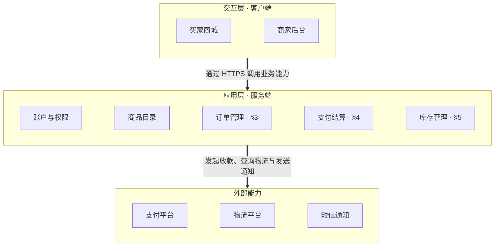
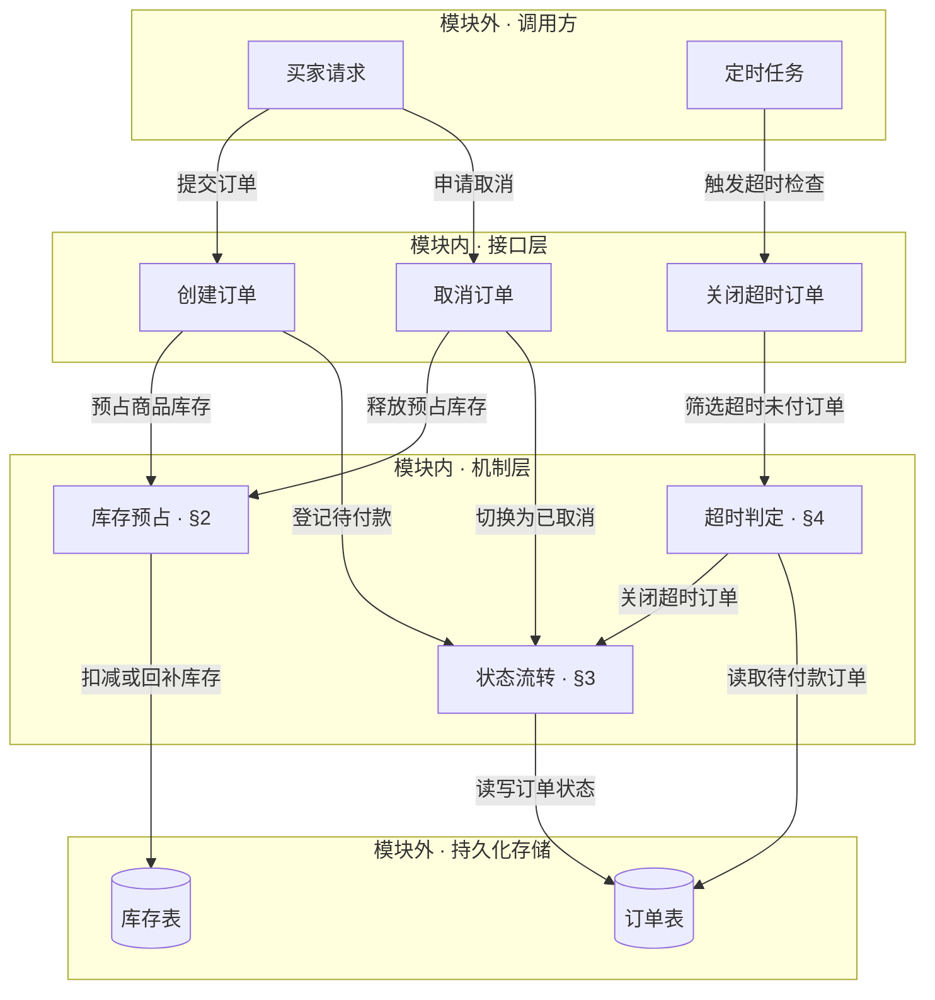
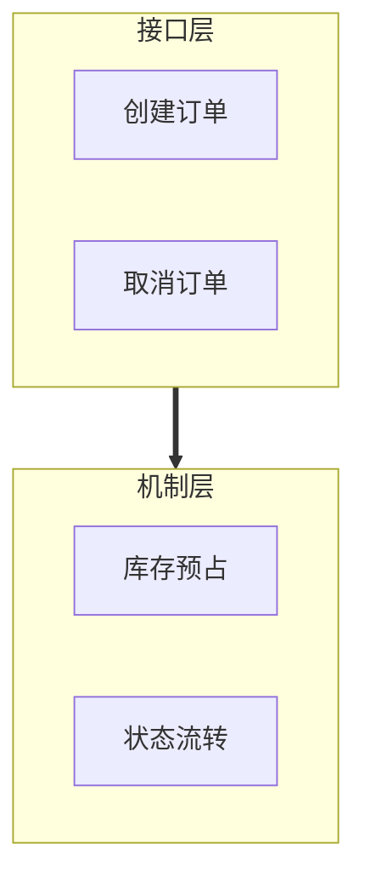
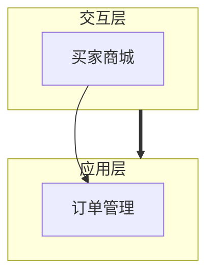
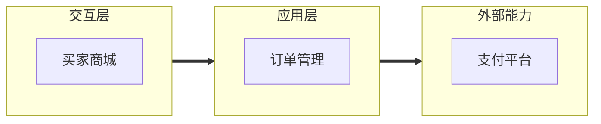
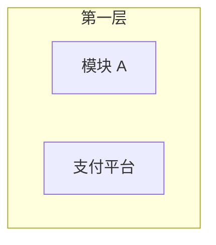
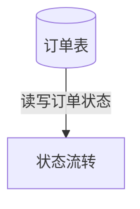
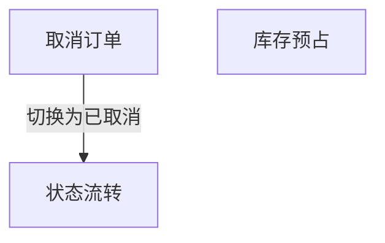
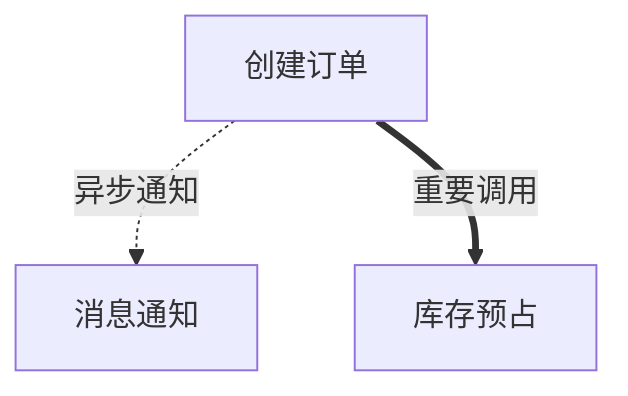

# 分层视图（Layered View）

## 1 适用场景

系统或模块的层级组成与依赖关系表达

每处使用分层视图时，**有且只能选择一种表达方式**

| 表达方式 | 适用目的 | 示例 |
| --- | --- | --- |
| 层级关系视图 | 展示系统整体架构，说明各层组成与层间关系 | [§3](#3-示例：电商订单系统的整体架构（层级关系视图）) |
| 分层模块依赖视图 | 展示业务模块的实现结构，明确具体构件之间的依赖与接线 | [§4](#4-示例：订单模块的内部结构（分层模块依赖视图）) |

## 2 表达原则

- 使用 Mermaid `flowchart TB`，语法遵循[官方语法文档](https://mermaid.ai/open-source/syntax/flowchart.html)
- 不同层级**必须自上而下纵向排列，不得横向并列**，同层节点可以横向排列
  必要时用隐藏边 `~~~` 辅助排版，并注释说明其不表示依赖
- 用 `subgraph` 表示层，分组名称说明该层职责，节点名称说明节点职责
- 每一层都要让上面的层不再强依赖某样具体的东西，做不到的不单独成层
- 整张图不再套系统或模块外框，内部嵌套分组只表示实际存在的职责或运行边界
- 箭头由使用方指向被依赖方，边标签说明关系用途
- 需要展开的层或节点引用对应章节

| 区别 | 层级关系视图 | 分层模块依赖视图 |
| --- | --- | --- |
| 节点 | 该层包含的模块 | 具体接口、内部机制或底层依赖 |
| 可见连线 | 层与层之间，粗箭头 `==>` | 具体构件之间，实线箭头 `-->` |
| 边标签 | 依赖用途 | 调用、使用或订阅的含义 |
| 外部能力 | 单独分层，不放入系统内部业务层 | 调用方与外部依赖各自分组，不混入内部实现层 |
| 依赖范围 | 层间依赖 | 同层与跨层依赖均按实际关系绘制 |

## 3 示例：电商订单系统的整体架构（层级关系视图）

## 4 示例：订单模块的内部结构（分层模块依赖视图）

## 5 检查条件

### 5.1 未按表达目的二选一

- [ ] 展示系统整体架构时选择层级关系视图，展开业务模块实现与接线时选择分层模块依赖视图
- [ ] 同一处只使用一种视图

**反例**

模块内部设计需要说明每个接口用到哪些机制，层级连线给不出接线

### 5.2 混用连线粒度

- [ ] 层级关系视图的可见连线两端都是层，分层模块依赖视图的可见连线两端都是具体构件

**反例**

同一张图同时使用层级连线与构件连线

### 5.3 层级横向排列

- [ ] 不同层级在实际渲染结果中自上而下排列，同层构件才可横向排列

**反例**

层级从左到右排成一行，无法按从上到下的顺序阅读架构

### 5.4 层与节点的表达或归属不清

- [ ] 层使用 `subgraph`，分组名称说明该层职责
- [ ] 拿掉任何一层，都会让两个不该直接对接的角色直接对接
- [ ] 节点名称说明模块或构件职责
- [ ] 构件位于其实际所属层，调用方与外部依赖不混入内部实现层
- [ ] 不为整张图额外添加系统或模块外框

**反例**

层名和节点名都不说明职责，支付平台是外部能力，却与内部模块同层

### 5.5 关系方向或含义不明确

- [ ] 箭头由使用方指向被依赖方，边标签说明关系用途
- [ ] 不为调整布局反转箭头或增加实际不存在的依赖

**反例**

状态流转使用订单表，箭头方向画反

### 5.6 遗漏具体依赖

- [ ] 分层模块依赖视图画全所描述范围内影响接口接线与职责划分的依赖

**反例**

取消订单需要释放预占库存，图中没有这条依赖

### 5.7 章节引用失配

- [ ] 需要展开的层或构件有章节引用，引用目标存在且内容对应

**反例**

在 [§4](#4-示例：订单模块的内部结构（分层模块依赖视图）) 的示例中把超时判定标注为「§3」

目标文档的 §3 是状态流转，超时判定应引用 §4

### 5.8 图格式或线型不符

- [ ] 使用 Mermaid `flowchart TB`，语法正确且能够正常渲染
- [ ] 可见连线中，层级关系使用粗箭头 `==>`，构件依赖使用实线箭头 `-->`
- [ ] 隐藏边 `~~~` 注明仅用于排版，不表示依赖

**反例**

用虚线表示异步、粗线表示重要，线型被赋予了含义，关系含义应由边标签说明

### 5.9 文字复述了图已表达的内容

- [ ] 图后的文字没有逐条复述图中的层、节点或连线

**反例**

> 买家请求提交订单后进入创建订单，创建订单预占商品库存并登记待付款，定时任务触发超时检查，超时判定关闭超时订单并读取待付款订单

这段话把图中的边挨个念了一遍，没有增加图之外的信息
