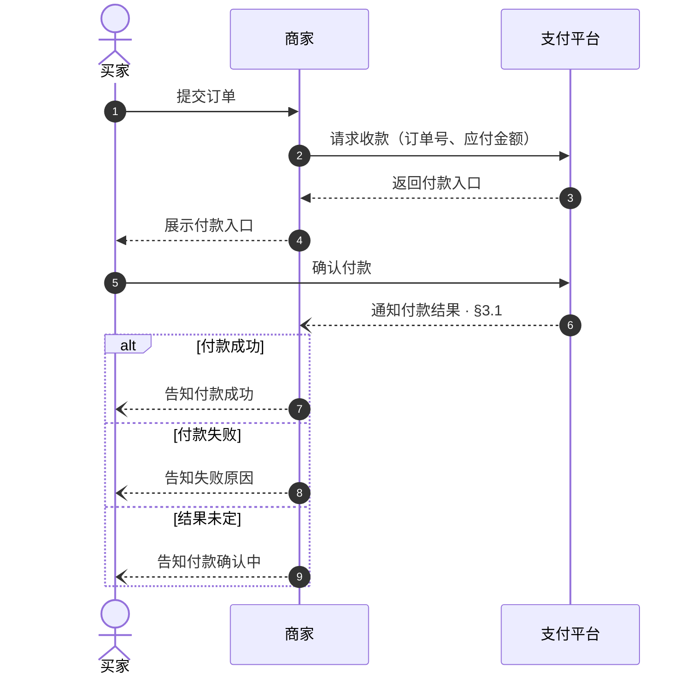
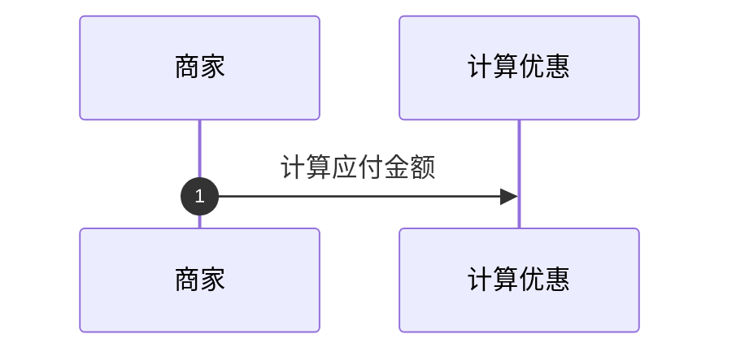
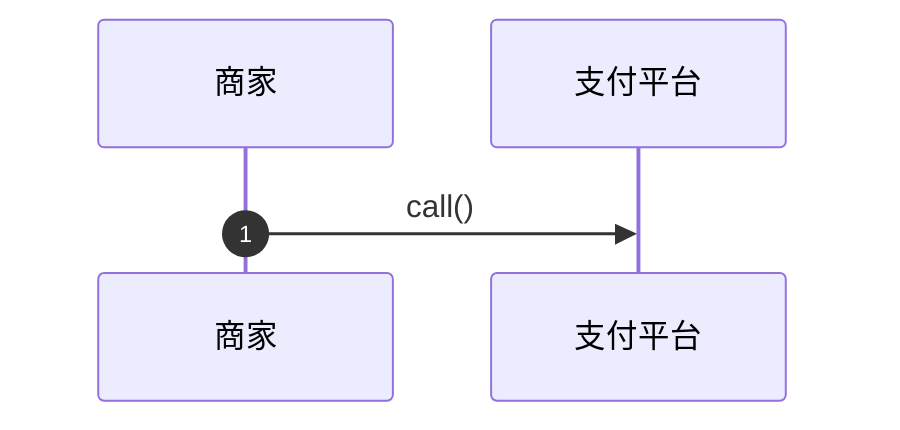
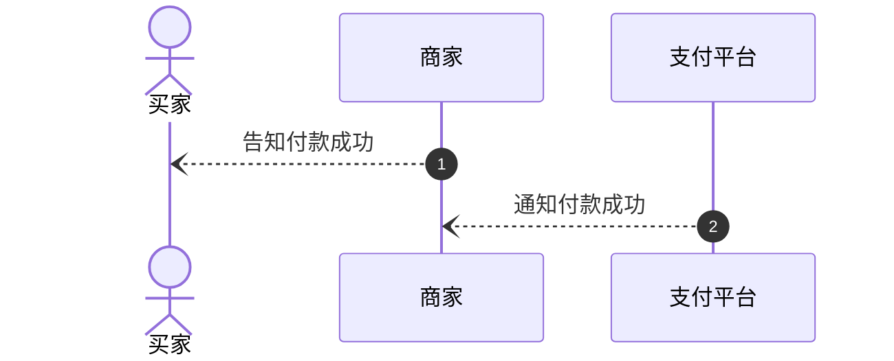
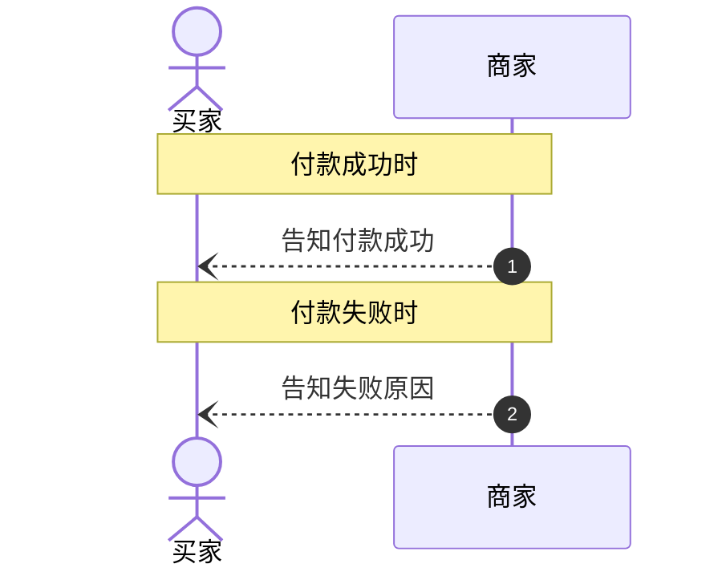
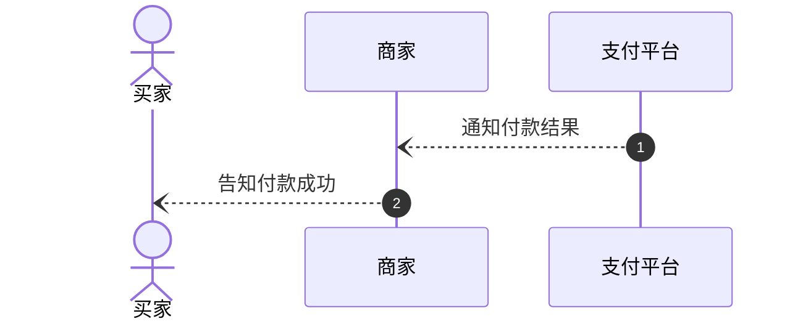
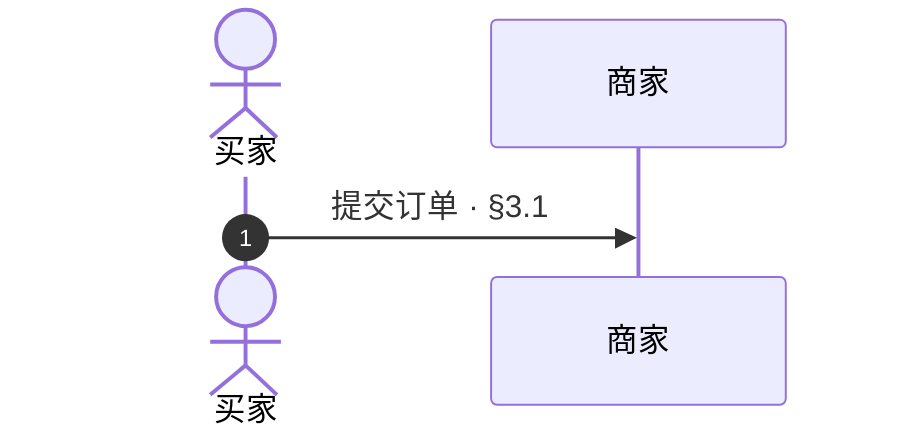
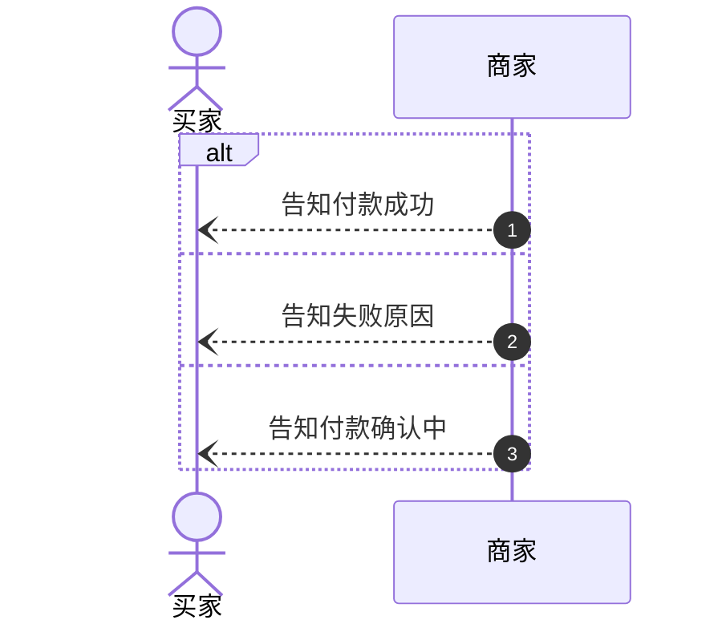

# 时序图（Sequence Diagram）

## 1 适用场景

多个参与方之间按时间顺序交互的流程表达

侧重单模块内部的处理与分支时，使用[流程图](flowchart.md)

## 2 表达原则

时序图统领所在章节，需要展开的交互引用对应子章节

- 使用 Mermaid `sequenceDiagram`，语法遵循[官方时序图文档](https://mermaid.ai/open-source/syntax/sequenceDiagram.html)
- 使用 `autonumber` 为每条交互消息自动编号
- 参与方对应实际协作的角色或系统，不把内部处理步骤拆成参与方
- 每条消息优先说明参与方之间的业务目的，按实际交互顺序排列
- 分支与循环使用对应控制结构，注释只补充背景
- 分支标明业务条件，循环标明重复与退出条件
- 子章节只补充图中未表达的处理细节，不复述交互过程

## 3 示例：购物付款

### 3.1 接收付款结果

1. 核验通知来自支付平台，且订单号、金额与收款请求一致
2. 核验不通过时，不据此更新订单，向支付平台核实结果
3. 重复通知不重复处理，冲突通知先核实再更新
4. 未收到有效结果时，向支付平台查询，不将等待超时视为付款失败

## 4 检查条件

### 4.1 将内部步骤画成参与方

- [ ] 参与方是实际协作的角色或系统，不是其内部操作

**反例**

本例中「计算优惠」是商家的内部操作，不是独立协作者

### 4.2 消息缺少业务含义

- [ ] 每条消息说明参与方之间的业务目的，不以内部方法名代替

**反例**

无法判断商家向支付平台请求什么

### 4.3 交互顺序或方向错误

- [ ] 消息的发送方、接收方及先后顺序与实际协作一致

**反例**

商家尚未得到付款结果，就告知买家付款成功

### 4.4 用注释代替分支

- [ ] 互斥路径使用分支结构，不用注释模拟

**反例**

两次通知仍被画成依次执行，没有表达互斥关系

### 4.5 遗漏异常交互

- [ ] 影响后续协作的失败或结果未定情形有明确处理去向

**反例**

未区分付款失败与结果未定，所有结果都被当作成功

### 4.6 章节引用失配

- [ ] 需要展开的交互有章节引用，引用目标存在且内容与交互含义一致

**反例**

§3.1 说明接收付款结果，不是提交订单

### 4.7 分支条件缺失

- [ ] 每条分支标明业务条件

**反例**

缺少「付款成功」「付款失败」「结果未定」条件，不能用分支内的动作代替进入条件

### 4.8 文字复述了图已表达的内容

- [ ] 子章节补充处理细节，不重复发送方、接收方与交互顺序

**反例**

> 支付平台通知商家付款结果，商家再告知买家

没有补充接收付款结果时的核验与重复处理规则
