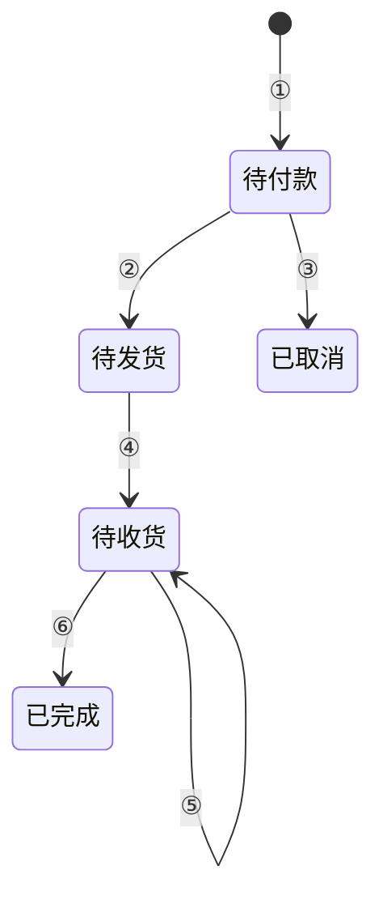
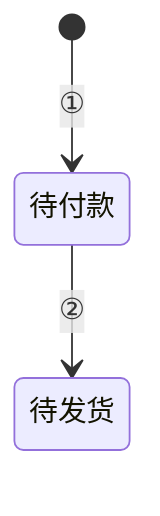
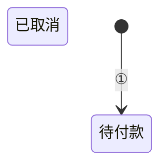
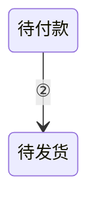

# 状态机（State Machine）

## 1 适用场景

业务对象在事件触发下的状态变化表达

侧重处理步骤与分支时，使用[流程图](flowchart.md)
侧重多个参与方之间的交互时，使用[时序图](sequence-diagram.md)

## 2 表达原则

以下三个内容均必需，按表中顺序展开

| 内容 | 表达规则 |
| --- | --- |
| 状态总览 | [§2.1](#21-状态总览) |
| 状态转移图 | [§2.2](#22-状态转移图) |
| 转移条件 | [§2.3](#23-转移条件) |

### 2.1 状态总览

表格列出编号、状态、业务含义，状态编号使用普通数字

### 2.2 状态转移图

使用 Mermaid `stateDiagram-v2`，语法遵循[官方状态图文档](https://mermaid.ai/open-source/syntax/stateDiagram.html)
图中必须有开始节点
除开始节点外，图中节点与 [§2.1](#21-状态总览) 的状态一一对应
各业务状态均可从开始节点经转换到达
每条转换使用唯一的带圈编号，包括初始化转换，编号不表示执行顺序

### 2.3 转移条件

表格列出编号、转移方向、触发条件，与图中转换逐条对应
触发条件写明事件及成立条件，同一状态下同一事件的不同去向不得含混

## 3 示例：订单状态

### 3.1 状态总览

| 编号 | 状态 | 业务含义 |
| --- | --- | --- |
| 1 | 待付款 | 订单已创建，尚未确认付款成功 |
| 2 | 待发货 | 已确认付款成功，商家尚未完成发货 |
| 3 | 待收货 | 商家已完成发货，买家尚未确认全部商品收齐 |
| 4 | 已完成 | 买家已确认全部商品收齐，订单记录保留 |
| 5 | 已取消 | 未付款订单已取消，不再收款或发货，订单记录保留 |

### 3.2 状态转移图

### 3.3 转移条件

| 编号 | 转移方向 | 触发条件 |
| --- | --- | --- |
| ① | 开始 → 待付款 | 订单创建成功 |
| ② | 待付款 → 待发货 | 收到有效付款成功结果，订单号与实付金额均匹配 |
| ③ | 待付款 → 已取消 | 买家请求取消，且确认尚未付款并已关闭付款入口 |
| ④ | 待发货 → 待收货 | 商家确认订单内全部商品已发货 |
| ⑤ | 待收货 → 待收货 | 买家确认部分商品收货，按商品及数量去重累计后仍未全部收齐 |
| ⑥ | 待收货 → 已完成 | 买家确认收货，按商品及数量去重累计后全部收齐 |

## 4 检查条件

### 4.1 组成或顺序不符

- [ ] 有且只有状态总览表、状态转移图、转移条件表，按此顺序展开

**反例**

只给出状态转移图与转移条件表

缺少状态总览表，无法查阅各状态的业务含义

### 4.2 表格字段或状态编号不符

- [ ] 状态总览表包含编号、状态、业务含义，状态编号使用普通数字
- [ ] 转移条件表包含编号、转移方向、触发条件

**反例**

| 编号 | 状态 |
| --- | --- |
| ① | 待付款 |

状态总览表缺少业务含义列，状态编号误用了转换编号的带圈形式

### 4.3 状态缺少业务定义

- [ ] 状态总览列全状态，业务含义说明对象的实际处境，不重复名称

**反例**

| 编号 | 状态 | 业务含义 |
| --- | --- | --- |
| 1 | 已完成 | 已经完成 |

没有说明完成的业务判据

### 4.4 图格式不符

- [ ] 状态转移图使用 Mermaid `stateDiagram-v2`，语法正确且能够正常渲染

**反例**

用 `flowchart` 画状态转移，即使能够渲染，也不是规定的状态图形式

### 4.5 图表状态不一致

- [ ] 除开始节点外，图中节点与状态总览逐一对应，每个状态对应一个节点，无增加、无遗漏

**反例**

状态总览列出「待付款」「待发货」「待收货」「已完成」「已取消」，图中却只有：

遗漏了三个业务状态

### 4.6 缺少开始节点或状态不可达

- [ ] 图中有开始节点，各业务状态均可从开始节点经转换到达

**反例**

「已取消」没有进入路径

### 4.7 转换编号与条件表失配

- [ ] 每条转换有唯一带圈编号，包括初始化转换，图与条件表的编号及方向逐一对应
- [ ] 编号仅用于图表对应，不表示执行顺序

**反例**

| 编号 | 转移方向 | 触发条件 |
| --- | --- | --- |
| ② | 待付款 → 已取消 | 买家请求取消，且确认尚未付款并已关闭付款入口 |

同一编号在图与表中指向不同状态

### 4.8 触发条件不能确定去向

- [ ] 条件明确到能够判定是否转移，同一事件的不同去向互不冲突

**反例**

| 编号 | 转移方向 | 触发条件 |
| --- | --- | --- |
| ⑤ | 待收货 → 待收货 | 买家确认收货 |
| ⑥ | 待收货 → 已完成 | 买家确认收货 |

没有区分商品是否全部收齐，同一事件同时满足两条转换

### 4.9 文字复述了图或表已表达的内容

- [ ] 图表之外的文字没有逐条复述状态、转换或触发条件

**反例**

> 订单创建后进入待付款，付款成功后进入待发货，商家发货后进入待收货，买家确认全部收齐后完成，未付款时可以取消

这段话把转移图和条件表挨个念了一遍，没有增加图表之外的信息
