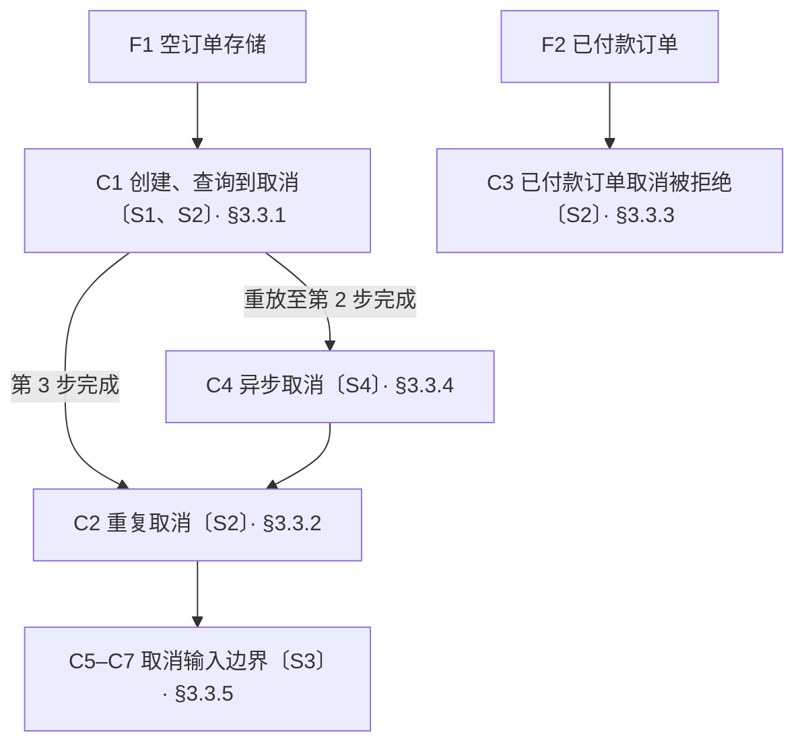

# 测试用例（Test Case）

## 1 适用场景

从确定的初始条件出发，写清操作步骤与预期结果，使测试能够直接实现
测试依据、范围、驱动入口与允许观察的内容由引用它的文档设计规定

## 2 表达原则

| 内容 | 必需条件 | 表达规则 |
| --- | --- | --- |
| 夹具 | 始终必需 | [§2.1](#21-夹具fixture) |
| 测试场景 | 始终必需 | [§2.2](#22-测试场景) |
| 测试用例 | 始终必需 | [§2.3](#23-测试用例) |

### 2.1 夹具（Fixture）

夹具（Fixture）定义测试开始前所需的初始条件及其建立与清理方式
初始条件包括数据、状态、环境配置，以及真实依赖或带预设响应的测试替身（Test Double）
夹具使用 F 加序号作为唯一标识，供测试用例引用

测试替身需要返回不同响应时，写明各次调用的匹配条件与对应响应
需要真实依赖才能核验的事务、锁、协议或恢复行为，保留真实依赖验证
其他测试优先使用能够保持验证意义的轻量替身
优先复用建立成本高的测试环境，并明确复用方式
各测试链的数据、替身与实例状态独立建立和清理

### 2.2 测试场景

测试场景列出需要验证的情况、测试点及其设计依据
场景使用 S 加序号作为唯一标识
每个场景一行，列出场景标识、场景名称、测试点与设计依据
设计依据逐项链接被验证的规则或设计位置

### 2.3 测试用例

每条独立用例应有可区分的测试点或预期判定
不重复枚举没有独立验证意义的分支组合

从夹具出发，优先沿最长可执行链条组织相关测试点
互斥分支从共同的前置状态分别展开
无法串联或需要不同初始条件的测试点，分别组织测试链
每条测试链开头引用起始夹具，用例按链内执行顺序展开
测试链存在分支或汇合时，用[流程图](flowchart.md)补充用例之间的执行关系
图中的用例节点标明用例标识与覆盖的场景标识，箭头表示执行顺序
需要重放前置步骤时，注明目标用例与步骤，从起始夹具执行到该位置，前置引用不得成环

测试用例使用 C 加序号作为唯一标识，名称说明它验证的行为
用例开头引用覆盖的测试场景，写明对应测试点
只有一个操作时使用无序列表，多个连续操作使用编号列表
每项一个动作，预期结果缩进写在对应动作下
预期结果包含返回结果、状态变化、副作用与不应发生的事
名称、状态与错误标识沿用测试依据中的定义
输入与预期结果使用确定的数据
边界、阈值与次数给出明确判定值

操作步骤相同、仅输入或预期结果不同的用例，使用参数化表
表格每行列出用例标识、输入与预期结果，共用操作步骤在表前定义
各行从相同的前置状态分别执行
异步结果写明等待条件、最长等待时间与超时后的失败判据
涉及故障或时间边界时，写明故障注入、时间控制与结果观察方式
优先通过已有依赖边界或测试运行器注入故障
无稳定注入方式时，修订测试方案，不为单条用例新增生产接口或机制
长时间边界优先通过确定的时间夹具或可控时钟触发，避免无必要的真实等待
核验真实依赖的时间行为时，使用该依赖实际采用的时间来源
性能用例依据已确认的容量、延迟或资源约束设计
写明负载、测量环境、指标与通过标准，不设置缺少设计依据的性能阈值
涉及评测时，写明评测集、每条执行次数、结果判定方法与通过标准
用例产生夹具清理范围之外的资源时，补充清理时机与方式

## 3 订单测试示例

### 3.1 夹具

| 标识 | 初始条件 | 建立方式 |
| --- | --- | --- |
| F1 | 隔离订单存储为空，商品 S1 可用库存 10<br>库存服务测试替身的预占与释放均返回成功，调用记录为空 | 清空订单与预占记录，设置 S1 库存为 10，装载成功响应脚本并清空调用记录 |
| F2 | 隔离存储中订单 A3K9F2 已付款，商品 S1 数量 2，有对应预占记录<br>库存服务测试替身的释放返回成功，调用记录为空 | 清空存储，写入上述订单及预占记录，装载成功响应脚本并清空调用记录 |

库存请求匹配商品 S1 与数量 2，记录操作类型、商品与数量
切换为暂停释放脚本后，释放请求保持未完成，直到测试明确放行，再返回成功
每条测试链结束后清空隔离存储与调用记录，恢复成功响应脚本

### 3.2 测试场景

本例创建与查询的测试依据如下，取消结果沿用[取消订单契约](interface.md#3-模块方法示例：取消订单（typescript）)

```typescript
interface Order {
  id: string;
  productId: string;
  quantity: number;
  status: "pending_payment" | "paid" | "cancelled";
}

/** 创建一笔待付款订单，成功时预占指定商品与数量的库存 */
declare function createOrder(
  id: string, productId: string, quantity: number
): Promise<Order>;

/** 查询完整订单，不产生写入；不存在时返回 null */
declare function queryOrder(id: string): Promise<Order | null>;
```

取消成功时释放该订单的预占库存，取消结果在库存释放完成后返回
重复取消与拒绝取消不新增释放请求

| 场景标识 | 场景名称 | 测试点 | 设计依据 |
| --- | --- | --- | --- |
| S1 | 创建与查询订单 | 创建后的待付款状态、商品与数量，库存预占，查询无写入 | [创建与查询声明](#32-测试场景) |
| S2 | 取消订单 | 取消结果与状态，释放库存，重复取消不重复释放，已付款订单不允许取消 | [取消订单契约](interface.md#3-模块方法示例：取消订单（typescript）)与本节库存副作用约定 |
| S3 | 取消输入边界 | 空白标识的 TypeError，不存在订单的 not_found，均无状态变化与库存释放 | [取消订单契约](interface.md#3-模块方法示例：取消订单（typescript）) |
| S4 | 异步取消 | 释放请求未完成时取消结果未完成，放行后获得确定结果 | [取消结果与库存释放约定](#32-测试场景)、[取消结果的 Promise 契约](interface.md#3-模块方法示例：取消订单（typescript）) |

### 3.3 测试用例

每条链开始前建立对应夹具，链内保留前序操作形成的状态



#### 3.3.1 C1 创建、查询到取消

测试场景：S1 的全部测试点、S2 的取消成功与库存释放

1. 调用 createOrder("A3K9F2", "S1", 2)，最多等待 5 秒
   - 期望：Promise 完成，返回 id=A3K9F2、productId=S1、quantity=2、status=pending_payment
   - 期望：预占请求恰好 1 次，商品 S1、数量 2，没有释放请求
2. 调用 queryOrder("A3K9F2")，最多等待 5 秒
   - 期望：返回第 1 步的订单数据，没有新增预占、释放或订单写入
3. 调用 cancelOrder("A3K9F2")，最多等待 5 秒
   - 期望：outcome=cancelled，order.id=A3K9F2、order.status=cancelled
   - 期望：释放请求恰好 1 次，商品 S1、数量 2，预占请求数仍为 1

任一步等待超过 5 秒即判定该步失败

#### 3.3.2 C2 重复取消

测试场景：S2 的重复取消与不重复释放
记录执行前的预占与释放请求数

- 再次调用 cancelOrder("A3K9F2")，最多等待 5 秒
   - 期望：outcome=already_cancelled，order.id=A3K9F2、order.status=cancelled
   - 期望：预占与释放请求数均不增加

等待超过 5 秒即判定失败

#### 3.3.3 C3 已付款订单取消被拒绝

测试场景：S2 的已付款订单取消限制

- 调用 cancelOrder("A3K9F2")，最多等待 5 秒
   - 期望：outcome=not_allowed，order.id=A3K9F2、order.status=paid
   - 期望：原预占记录保留，没有释放请求

等待超过 5 秒即判定失败

#### 3.3.4 C4 异步取消

测试场景：S4 的释放等待与异步结果
前置：从 F1 重放 C1 至第 2 步完成，不执行第 3 步

1. 将库存测试替身切换为暂停释放脚本
   - 期望：没有新增库存请求
2. 发起 cancelOrder("A3K9F2")，保留返回的 Promise，等待替身收到释放请求，最长 5 秒
   - 期望：收到 1 次商品 S1、数量 2 的释放请求，返回的 Promise 仍未完成
3. 放行已暂停的释放请求，最多等待 5 秒
   - 期望：原 Promise 完成，outcome=cancelled，order.status=cancelled
   - 期望：释放请求总数为 1，没有重新发起取消操作

等待替身收到请求或等待结果完成超过 5 秒，均判定失败
本用例完成后恢复成功响应脚本，保留订单与调用记录供后续用例使用

#### 3.3.5 取消输入边界

测试场景：S3 的全部测试点
各行从链内 A3K9F2 已取消、missing-order 不存在的相同状态分别执行
共用操作：记录当前订单数据与库存调用记录，调用 cancelOrder(输入)，最多等待 5 秒

| 用例标识 | 用例名称 | 输入 | 预期结果 |
| --- | --- | --- | --- |
| C5 | 拒绝空标识 | 空字符串 | Promise 以 TypeError 拒绝 |
| C6 | 拒绝纯空白标识 | 三个空格 | Promise 以 TypeError 拒绝 |
| C7 | 取消不存在的订单 | missing-order | outcome=not_found |

每行均断言订单数据与库存调用记录不变，等待超过 5 秒判定失败

## 4 意图识别评测示例

### 4.1 夹具

F1：隔离会话历史为空，模型版本与调用配置固定
建立方式：清空会话，冻结本次模型版本与配置，并在结果记录中保存其实际值
清理方式：清除本次会话历史

### 4.2 测试场景

本例 classify(text) 返回 intent 与 orderId，intent 为 query、cancel 或 unknown
只有输入明确要求查询或取消指定订单时，返回对应意图与订单标识
其他输入返回 intent=unknown、orderId=null
接口只识别意图，不执行订单操作

| 场景标识 | 场景名称 | 测试点 | 设计依据 |
| --- | --- | --- | --- |
| S1 | 订单意图识别 | 查询与取消意图、订单标识提取，无明确订单操作时返回 unknown | [意图识别约定](#42-测试场景) |

### 4.3 测试用例

起始夹具：F1
测试场景：S1 的全部测试点

共用操作：

1. 每条用例执行 3 次，每次调用前清空会话，再调用 classify，最多等待 10 秒
   - 期望：返回对象中的 intent 与 orderId 均等于表中对应值，不产生订单操作
2. 将用例标识、执行序号、模型配置、输出与判定结果写入本次隔离目录的 results.jsonl
   - 期望：共 9 条结果记录，每次执行均有对应记录

| 用例标识 | 用例名称 | 输入 | 期望 intent | 期望 orderId |
| --- | --- | --- | --- | --- |
| C1 | 识别查询意图 | 查一下订单 A3K9F2 | query | A3K9F2 |
| C2 | 识别取消意图 | 取消订单 A3K9F2 | cancel | A3K9F2 |
| C3 | 识别非订单意图 | 今天过得怎么样 | unknown | null |

通过标准：9 次执行全部通过，通过率为 100%
字段缺失、值不符、调用异常或超过 10 秒均计为该次失败
单次失败后继续执行剩余测试，异常或超时记录失败原因
结果记录供本次判定使用，判定完成后删除本次隔离目录

## 5 检查条件

- [ ] 内容按夹具、测试场景、测试用例的顺序展开
- [ ] 夹具、场景与用例分别使用 F、S、C 加序号，各标识唯一
- [ ] 夹具写明数据、状态、环境配置与依赖，初始条件的建立与清理方式明确
- [ ] 测试替身需要返回不同响应时，各次调用的匹配条件与对应响应明确
- [ ] 依赖选择保持验证意义，需要真实依赖才能核验的行为保留真实依赖验证
- [ ] 建立成本高的测试环境明确复用方式，各测试链的数据、替身与实例状态独立建立和清理
- [ ] 每个场景一行，列明名称、测试点与设计依据，依据逐项链接被验证的规则或设计位置
- [ ] 测试链引用起始夹具，优先沿最长可执行链组织相关测试点，互斥分支与不可串联的测试点分别组织
- [ ] 存在分支或汇合时补充流程图，节点标明用例与场景标识，箭头表示执行顺序
- [ ] 重放前置步骤时，引用明确到用例与步骤，能够从起始夹具到达指定位置，引用不成环
- [ ] 用例名称说明验证的行为，开头引用场景与对应测试点，全部测试点都有用例覆盖
- [ ] 独立用例有可区分的测试点或预期判定，没有重复枚举无独立验证意义的分支组合
- [ ] 单个操作使用无序列表，连续操作使用编号列表，每项一个动作，预期结果缩进写在对应动作下
- [ ] 预期结果明确返回结果、状态变化、副作用与不应发生的事，名称、状态与错误标识沿用测试依据
- [ ] 输入与预期结果使用确定的数据，边界、阈值与次数有明确判定值
- [ ] 步骤相同、仅输入或预期结果不同的用例使用参数化表，每行列明用例标识、输入与预期结果
- [ ] 参数化用例的共用步骤写在表前，各行从相同前置状态分别执行
- [ ] 涉及异步结果时，等待条件、最长等待时间与超时失败判据明确
- [ ] 涉及故障或时间边界时，故障注入、时间控制与结果观察方式明确
- [ ] 故障有稳定注入方式，没有为单条用例新增生产接口或机制
- [ ] 长时间边界有确定的触发方式，时间控制保持验证意义，没有无必要的真实等待
- [ ] 性能用例有已确认的设计依据，负载、测量环境、指标与通过标准明确
- [ ] 涉及评测时，评测集、每条执行次数、结果判定方法与通过标准明确
- [ ] 用例产生夹具清理范围之外的资源时，清理时机与方式明确
