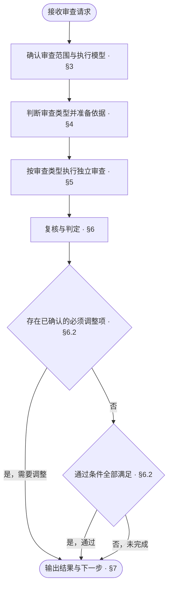
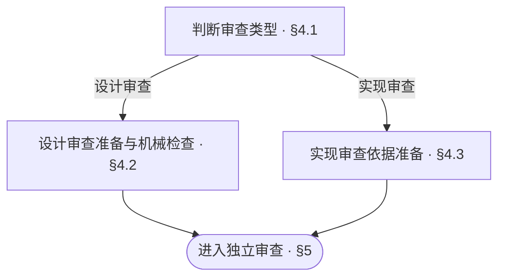

<!-- AUTO-GENERATED from SKILL.md.tmpl — do not edit directly -->
<!-- Regenerate: bash scripts/build-skills.sh --host claude -->

# aca-review

审查当前范围的设计文档或代码结构，判定通过、需要调整或未完成
不修改设计文档、项目源码与测试代码，不运行受审代码与测试
发布前的仓库整体审计由 `/aca-repo-audit` 执行

## 1 原则

### 1.1 审查原则

1. **依据驱动**
   以已确认的需求与适用规则审查设计
   以已确认的设计审查代码的模块化与整体结构
2. **独立判断**
   按审查维度独立形成结论
3. **证据判定**
   以代码结构与文档事实判定问题及审查结论
4. **范围约束**
   审查结论仅覆盖本次范围

### 1.2 行文公理

行文公理用于设计文档的行文审查与审查报告的表达

> 以尽可能低的理解成本，把内容写清楚：无冗余、无遗漏、无歧义

**行文结构**

- 先交代整体，再展开细节，参见[金字塔原理](~/.claude/skills/aca/SSOT.md#2-文档结构)
- 表达判断时，先给结论，再给依据
- 不增加信息的标题层级应当合并
- 有时序或优先级的条目用编号列表，包含子项时每步以加粗短语开头表达目的，具体操作与条件分支缩进在该步下
- 表格只用于多行同构、每行有两个以上属性、行之间没有先后关系的内容
- 列表项直接写完整的句子
- 一个条目有分支时，将分支缩进列在该条目下
- 每个分支一行，写成「条件：做什么」
- 执行前必须知道的条件写在动作之前
- 条件控制多个步骤时，把步骤列在该条件下

**表达与排版**

- 设计正文只描述当前有效设计
- 修订设计正文时，删除错误或失效的描述
- 设计正文不解释旧版本差异、改动过程或改动原因
- 以业务语言描述问题、流程和决定，技术语言只作辅助说明
- 同一条规则只在一处定义，其他位置直接引用
- 规则与引用应能直接定位，读者能明确找到需要修改的位置
- 删除不增加信息、也不帮助理解的内容
- 一行一句，每句只表达一个事实
- 操作步骤直接写动作
- 能用具体做法完整表达的约束，直接写做法
- 无法用具体做法完整表达的禁止事项仍须保留
- 有先后关系的动作分项写
- 执行者、操作对象与指代必须明确
- 上下文已经明确的执行者、操作对象与指代不重复说明
- 行末不落句号
- 同一主题的各行之间不空行，切换主题时空一行
- 表格单元格写片段，不写句子，不落句号
- 单元格里的多个事实不用分号串起来，分行写
- 用户用什么语言，就用什么语言回复
- 中文遵循[中文文案排版指北](~/.claude/skills/aca/SSOT.md#1-行文规范)
- 章节编号遵循 [ISO 2145](~/.claude/skills/aca/SSOT.md#1-行文规范)
- `§` 只用于正文里的交叉引用，不进标题
- 正文引用具体章节时，使用直接指向目标章节锚点的 Markdown 链接
  同文档引用使用本地章节锚点，如 `[§1.2](#12-章节标题)`
  跨文档引用使用目标文件的相对路径与章节锚点，如 `[目标文档 §1.2](other.md#12-章节标题)`
  链接文字可使用章节名称或 `§` 加章节编号
  章节标题或顺序变化时，同步更新受影响的引用并核验目标
  代码块中的算法或命令需要引用章节时，将链接写在代码块前后的正文中
- 引用整篇文档时，链接指向目标文件

参考：[ASD-STE100](~/.claude/skills/aca/SSOT.md#1-行文规范)

## 2 执行流程



## 3 审查准备

### 3.1 对象、范围与前提

1. **确认审查对象与范围**
   - 开发者已指定审查对象与范围：优先按其指定执行
   - 开发者未指定：沿用调用方已明确的审查对象与范围
   - 对象或范围仍未明确：结合当前工作区改动与近期相关提交确定，读取近期相关提交的说明与 diff
   - 仍无法确定审查对象或范围：请开发者明确
2. **记录比较基线**
   - 记录审查对象、范围与比较基线
   - 注明本次受审提交及纳入审查的未提交改动
3. **检查工程类型**
   - 运行 `bash ~/.claude/skills/aca/bin/aca-repo-type-check` 检查工程类型
   - 工程类型缺失或无效：将类型规则核对列为未完成，并建议运行 `/aca-init`
   - 工程类型尚未支持：将类型规则核对列为未完成，并注明缺少对应规则
4. **定位并读取通用审查依据**
   - 输入未包含设计文档位置时，从根 README 的文档入口定位；无法定位时请开发者提供位置，位置明确前将依赖这些内容的检查列为未完成
   - 读取本次已确认的问题、目标与改动范围
   - 工程类型有效且已支持时，读取对应的 Repo Type 规则
   - 读取 `CONTEXT.md`，核对本次审查涉及的业务概念与定义
   - 读取本次范围的设计文档，并沿引用补齐理解与核验所需的文档

### 3.2 Agent 与模型选择

1. **优先复用已确认模型**
   - 开发者已指定 Agent 环境或模型：按指定执行
   - 已有确认过的审查模型，且可用条件未变化：默认直接复用上次确认的 Agent 环境与模型，跳过环境扫描与确认
2. **首次审查扫描并确认模型**
   - 首次执行审查且未指定模型时，扫描当前及本机已有的其他 AI Agent 环境与可调用模型
   - 优先推荐不同于主 agent 的可调用旗舰模型；没有其他适合且可调用的候选时，提出使用本模型的方案
   - 展示候选的 Agent 环境、模型、可用状态与推荐依据，请开发者确认后再执行审查，后续审查默认复用该确认结果
3. **处理执行回落**
   - 将确认或复用的执行组合用于[任务编排与执行](#53-任务编排与执行)
   - 所选组合无法调用时，使用已确认的备选；无已确认备选时，报告变化并请开发者确认新的组合
   - 在[审查报告](#71-审查报告)中注明实际执行的 Agent 环境、模型、复用情况及回落原因

## 4 读取依据与执行检查



### 4.1 判断审查类型

1. **确定本次审查类型**
   - 开发者已指定审查类型：优先按其指定执行
   - 开发者未指定：沿用调用方已明确的审查类型
   - 审查类型未明确：根据受审对象与实际改动判断（设计文档执行设计审查，代码执行实现审查，同时涉及两者时分别执行两类审查）
   - 仍无法确定审查类型：请开发者明确

选择两类审查时，两条分支均执行

### 4.2 设计审查

设计审查默认用于跨模块范围的设计变更（涉及多个模块、项目级架构、模块划分或跨模块接口与协作契约），或开发者显式指定的设计审查

1. **提取适用检查条件**
   - 读取本次范围对应的文档组、Doc Design 与实际采用的 Pattern
   - 提取其中适用的检查条件，作为设计审查的核验依据
2. **复用或执行机械检查**
   - 本会话已有相同范围的机械检查结果，且相关文件、检查规则与工具均未变化时，直接复用并在报告中注明原结果及复用依据
   - 不满足复用条件时，将以下命令中的占位路径替换为本次受审文档的实际路径并执行
     - 行文检查覆盖本次受审的全部文档，包括纳入审查范围的项目级记录
     - 文档图检查选择包含本次受审文档、且具有 README 入口的文档树
     - Context 的机械检查用于核对结构与格式

   ```bash
   bash ~/.claude/skills/aca/bin/aca-doc-graph-check <文档目录>
   bash ~/.claude/skills/aca/bin/aca-context-check CONTEXT.md
   bash ~/.claude/skills/aca/bin/aca-prose-check <本次受审的全部文档路径>
   ```

3. **处理机械检查结果**

| 检查情况 | 处理 |
| --- | --- |
| 通过或满足复用条件 | 记录结果与验证或复用依据 |
| 返回失败 | 核对诊断，将已确认的问题列为必须调整 |
| 无法运行或诊断无法核实 | 对应检查或问题核验列为未完成，注明原因 |

### 4.3 实现审查

1. **读取结构设计与组织约定**
   - 读取本次范围对应的架构设计、模块边界、接口定义、内部组成与仓库代码组织约定
2. **读取受审代码的整体结构**
   - 按已确定的比较基线读取本次改动涉及的目录与文件分布、模块依赖、函数与类定义及跨模块组装接线
3. **明确审查边界**
   - 实现审查默认用于跨模块范围或改变了模块整体代码结构的变更（仅模块内部且未改变整体代码结构的改动不用执行实现审查，直接进入 `/aca-test`）
   - 实现审查只检查整体结构（模块结构、整体代码分布、函数构造），不检查具体的代码细节与实现逻辑
   - 实现审查不直接运行代码、测试或构建，运行验证在审查通过后由 `/aca-test` 执行

## 5 审查编排与执行

### 5.1 设计审查维度

设计审查作为一个整体审查任务，围绕以下四项核对受审设计文档

1. **需求与范围承接**
   核对设计是否完整承接本次已确认的问题、目标与范围
2. **职责边界与协作机制**
   核对职责与边界划分、模块依赖与接口约定是否符合业务分工并足以指导模块协作
   核对协作与处理机制、数据与状态变化、错误处理与边界行为是否足以指导具体实现
   涉及用户交互时，核对交互流程、各交互状态及成功与失败路径是否提供明确的反馈与操作指引
   核对设计是否存在会导致业务行为不同的歧义，以及实施前是否仍需补充设计决定
3. **验证设计完备性**
   核对测试设计是否明确夹具、场景、执行方式与预期结果
   核对测试结果能否判定对应验收条件是否满足
4. **关联一致性与表达规范**
   核对文档入口与引用能否准确定位本次设计及其依赖
   核对相关文档之间是否存在设计遗漏、约定冲突、重复定义或术语不一致
   核对适用文档组、Doc Design 与 Pattern 的检查条件是否满足

### 5.2 实现审查维度

实现审查作为一个整体审查任务，以已确认的设计文档为依据，只检查代码的模块化与整体结构，不检查具体的代码细节与实现逻辑

1. **模块结构**
   核对模块与子模块划分、职责归属、接口边界、依赖关系及跨模块组装接线是否符合设计
2. **整体代码分布**
   核对目录与文件组织是否符合设计，各文件职责是否单一、归属是否清晰，是否存在职责混杂或跨层耦合
3. **函数构造**
   核对函数与类的职责切分、签名设计、粒度及抽象层次是否清晰合理

### 5.3 任务编排与执行

1. **按审查类型派发独立审查任务**
   - 仅执行设计审查或仅执行实现审查时，创建 1 个独立子 agent 任务完成该维度的全部核对项
   - 同时执行设计审查与实现审查时，为设计审查与实现审查分别创建 1 个独立子 agent 任务
   - 各审查任务按[Agent 与模型选择](#32-agent-与模型选择)安排执行，独立形成结论
2. **提供任务上下文**
   - 负责的审查类型、对应核对项与适用检查条件
   - 审查对象、范围与比较基线，以及受审提交和纳入审查的未提交改动
   - 受审内容的位置及对应设计依据
   - 设计审查所需的第四章机械检查结果与证据
   - 实现审查所需的目录与文件结构、改动文件、模块依赖与仓库代码组织约定
3. **执行问题导向审查**
   - 子 agent 逐项核验所负责维度的核对项与适用检查条件
   - 发现问题时，按[审查报告](#71-审查报告)中的问题格式记录文件位置、问题、影响与调整建议
   - 存在无法完成的检查项时，记录未完成项及原因
   - 通过项与不适用项不逐条输出留痕明细，将发现的问题清单、未完成项与审查结论返回主 agent

## 6 复核与判定

### 6.1 复核与归并

1. **复核问题证据**
   - 主 agent 逐条核对子 agent 返回的问题涉及的文件与证据，确认成立后纳入报告
   - 已证伪的问题排除，证据不足的问题列为未完成核验
   - 主 agent 可补充自行发现的问题，经同样的证据核验后纳入报告
   - 合并重复问题，保留发生位置、证据与影响
2. **核对审查覆盖**
   - 确认所选审查维度及其核对项均已完成核验
   - 子 agent 未覆盖分配的范围或遗漏核对项时，补查对应内容并复核结果
   - 仍无法完成的审查维度或检查，列为未完成并注明原因

### 6.2 判定结论

| 结论 | 条件 |
| --- | --- |
| 通过 | 所选审查任务全部完成、适用检查条件全部核验通过、适用机械检查通过、无必须调整项 |
| 需要调整 | 存在已确认的必须调整项 |
| 未完成 | 未满足通过条件，且无已确认的必须调整项 |

同时存在必须调整项与未完成检查时，结论为需要调整，并列出未完成项
可选优化不影响通过
受审内容发生变化后，重新审查受影响范围，并更新对应结论

## 7 输出结果与下一步

### 7.1 审查报告

在当前对话中按以下模板输出审查结果，不写入项目文件

```markdown
# 🔎 Review：<通过 / 需要调整 / 未完成>

| 项目 | 结果 |
| --- | --- |
| 对象 | <设计文档 / 代码结构 / 两者> |
| 范围 | <受审模块、文件或改动范围> |
| 基线 | <比较基线、受审提交及未提交改动> |
| 执行模型 | <实际执行的 Agent 环境、模型、复用情况及回落原因> |
| 结论依据 | <满足通过条件的情况，或阻止通过的问题与未完成检查> |
| 必须调整 | <问题数量与主要影响 / 无> |
| 工具检查 | <设计审查机械检查的通过、复用、失败及未完成情况 / 实现审查不适用> |
| 未完成 | <本次范围内未完成的审查任务、检查及原因 / 无> |
| 下一步 | <一个立即可执行的动作> |

## 必须调整

- <文档章节链接 / 代码文件链接与行号>
  - 问题：<实际内容、违反的设计约定或检查条件及具体偏差>
  - 影响：<对设计理解、实施或代码结构维护的影响，以及适用的发生条件>
  - 调整：<需要修正或确认的内容，以及修正后应满足的约定或检查条件>

## 可选优化

- <不影响审查通过的改善建议、对应位置与预期收益>
```

### 7.2 后续动作

按审查结论与本轮进度选择下一步

| 结论 | 情况 | 下一步 |
| --- | --- | --- |
| 未完成 | 输入或核验条件缺失 | 报告恢复条件，补齐后通过 `/aca-review` 继续本次审查 |
| 需要调整 | 设计方案仍需论证或决定 | `/aca-specify` 补充或修订方案 |
| 需要调整 | 方案已明确，仅需修订设计文档 | `/aca-design` 修订文档 |
| 需要调整 | 代码结构问题 | `/aca-implement` 调整代码结构 |
| 通过 | 设计审查通过，本轮需要实施代码 | `/aca-implement` |
| 通过 | 设计审查通过，本轮仅改设计文档 | 按已确认的版本推进安排衔接 `/aca-release` |
| 通过 | 实现审查通过 | `/aca-test` 执行当前范围的测试验证 |

设计或代码结构修正后，通过 `/aca-review` 复审受影响范围
